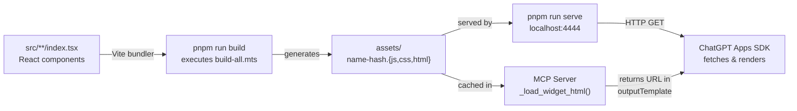
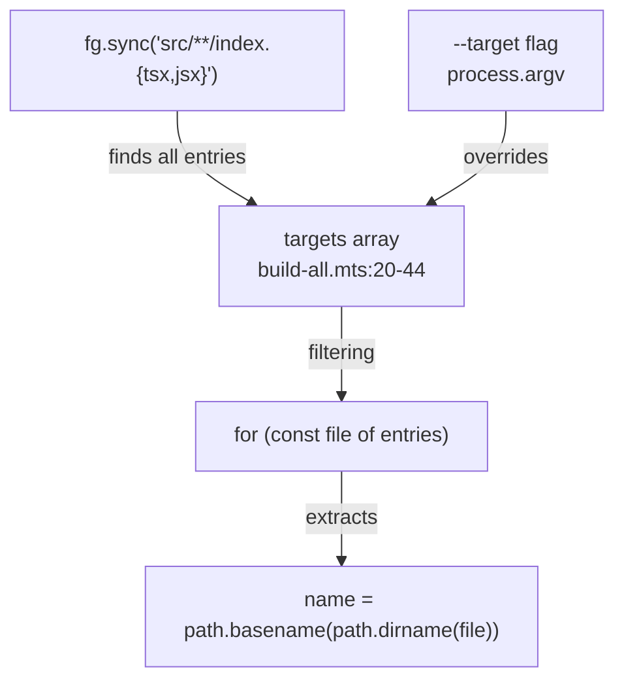
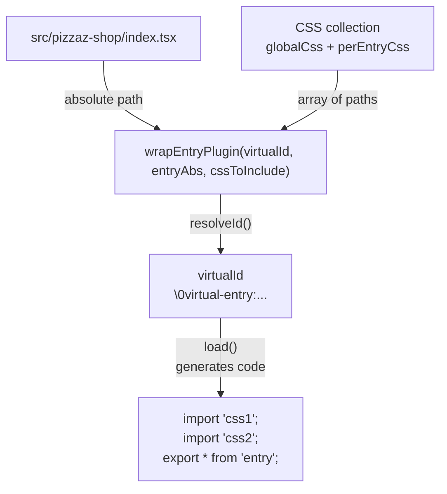
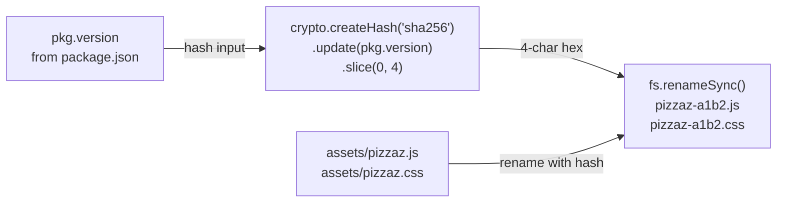
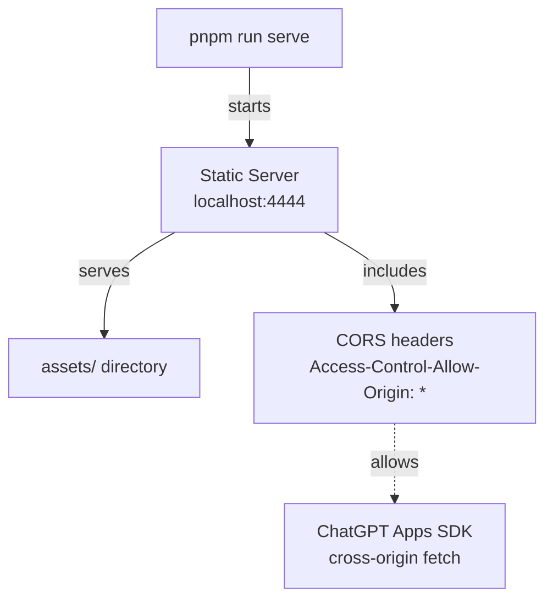

<!-- source: DeepWiki mcp.deepwiki.com · repo openai/openai-apps-sdk-examples · page 2.2 Building and Serving Assets · fetched 2026-10-26 -->

# Building and Serving Assets

<details>
<summary>Relevant source files</summary>

The following files were used as context for generating this wiki page:

- [build-all.mts](build-all.mts)
- [vite.config.mts](vite.config.mts)
- [vite.host.config.mts](vite.host.config.mts)

</details>


This document explains the build process for widget components and the static asset server that makes them available to MCP servers and ChatGPT. It covers the `pnpm run build` command, the output structure in the `assets/` directory, and the `pnpm run serve` command that hosts these files.

For information about developing widgets with hot reload, see [Development Workflow](#4.5). For details about how MCP servers load and reference these assets, see [Python Server Architecture Patterns](#5.1.6) and [MCP App Basics Node Server](#5.2.3).

---

## Overview

The build and serve workflow consists of two independent processes:

1.  **Build Process**: Transforms React/TypeScript source code in `src/` into production-ready HTML, JavaScript, and CSS bundles in `assets/`.
2.  **Static Server**: Hosts these bundles on `http://localhost:4444` with CORS enabled so MCP servers can reference them in widget metadata.

These processes are decoupled—MCP servers do not bundle or serve widget assets directly. Instead, they return URLs pointing to the static server in their `_meta.openai/outputTemplate` responses, and the Apps SDK fetches assets independently.

**Process Flow Overview**


**Sources:** [build-all.mts:1-14](), [build-all.mts:218-239]()

---

## Build Process

### The build-all.mts Script

The build process is orchestrated by `build-all.mts`, a TypeScript module that uses Vite to compile each widget into a standalone bundle. The script performs these operations:

1.  Discovers entry points in `src/`.
2.  Creates virtual modules to inject CSS imports.
3.  Bundles each widget with Vite.
4.  Generates version-based hashes.
5.  Renames output files with hashes.
6.  Creates HTML files with correct asset references and `window.__APP_URL_CONFIG__` injection.

**Sources:** [build-all.mts:1-239]()

### Entry Point Discovery

The script scans for widget entry points using the `fast-glob` library and filters them based on a hardcoded list or CLI arguments.

**Discovery Logic**


The `targets` array at [build-all.mts:20-44]() specifies which widgets to build by default. Users can target a specific widget using `pnpm run build --target <name>` [build-all.mts:45-50]().

**Sources:** [build-all.mts:13-50]()

### Virtual Entry Plugin Pattern

The `wrapEntryPlugin` function creates virtual modules that inject CSS imports before the actual component code. This ensures CSS is included in the correct cascade order.

**Virtual Module Construction**


The plugin implements two hooks:
-   **`resolveId(id)`** at [build-all.mts:61-63](): Returns the virtual ID when Vite encounters it.
-   **`load(id)`** at [build-all.mts:64-82](): Generates module code with CSS imports followed by re-exports from the actual entry file.

**Sources:** [build-all.mts:54-84]()

### CSS Collection Strategy

For each entry point, the build script collects CSS files using two sources:
1.  **Global CSS**: `src/index.css` (Tailwind, etc.) [build-all.mts:18]().
2.  **Per-Entry CSS**: Any CSS files within the widget's directory, excluding `.module.css` [build-all.mts:16-17]().

This pattern at [build-all.mts:97-112]() ensures Tailwind and global styles load first, followed by component-specific styles for predictable cascade behavior.

**Sources:** [build-all.mts:16-18](), [build-all.mts:97-112]()

### Vite Configuration

Each widget is built with a custom `InlineConfig` [build-all.mts:115-157]():

| Configuration | Value | Purpose |
| :--- | :--- | :--- |
| `esbuild.target` | `es2022` | Modern JavaScript syntax [build-all.mts:133]() |
| `build.minify` | `esbuild` | Fast minification [build-all.mts:140]() |
| `build.cssCodeSplit` | `false` | Single CSS bundle per widget [build-all.mts:141]() |
| `rollupOptions.inlineDynamicImports` | `true` | No code splitting; standalone bundles [build-all.mts:147]() |
| `rollupOptions.output.format` | `es` | ES modules format [build-all.mts:145]() |
| `rollupOptions.output.entryFileNames` | `${name}.js` | Predictable output names [build-all.mts:146]() |

**Sources:** [build-all.mts:115-157]()

### Hash-Based Versioning

After building, the script generates a version hash from `package.json` and renames output files.

**Hashing Implementation**


The hashing logic at [build-all.mts:172-188]():
-   Uses the `version` field from `package.json` as input.
-   Generates a SHA-256 hash truncated to 4 hex characters.
-   Renames both `.js` and `.css` files with the hash suffix.

**Sources:** [build-all.mts:8](), [build-all.mts:172-188]()

### HTML Generation and URL Config

The script generates two HTML files for each widget (e.g., `pizzaz-a1b2.html` and `pizzaz.html`) [build-all.mts:220-221](). These files inject a configuration object into the global scope:

```javascript
window.__APP_URL_CONFIG__ = {
  apiBaseUrl: "...",
  assetsBaseUrl: "..."
};
```

The values for `apiBaseUrl` and `assetsBaseUrl` are derived from environment variables `VITE_API_BASE_URL` and `VITE_BASE_URL`, with defaults of `http://localhost:8000` and `http://localhost:4444` respectively [build-all.mts:192-216]().

**Sources:** [build-all.mts:192-239]()

---

## Output Structure

After running `pnpm run build`, the `assets/` directory contains standalone bundles:

| File Type | Naming Pattern | Purpose |
| :--- | :--- | :--- |
| JavaScript | `{name}-{hash}.js` | Minified widget application code. |
| CSS | `{name}-{hash}.css` | Bundled styles (Global + Local). |
| HTML (versioned) | `{name}-{hash}.html` | Entrypoint with hashed script/link tags. |
| HTML (stable) | `{name}.html` | Identical to versioned HTML for stable dev URLs. |

**Sources:** [build-all.mts:14-15](), [build-all.mts:183-185](), [build-all.mts:220-221]()

---

## Serving Assets

### The Static Server

The `pnpm run serve` command (typically mapped to a simple static server like `http-server` or `sirv-cli` in `package.json`) hosts the `assets/` directory.

**Server-Client Interaction**


### Vite Dev Server (Development Mode)

During development, `vite.config.mts` provides a specialized `multiEntryDevEndpoints` plugin [vite.config.mts:24](). This plugin:
-   **Virtualizes Entries**: Maps requests for `/{name}.js` or `/{name}.css` to virtual modules that include HMR (Hot Module Replacement) logic [vite.config.mts:126-198]().
-   **Dynamic HTML**: Renders a dev-friendly HTML shell on the fly for any requested widget [vite.config.mts:71-79]().
-   **Index Page**: Generates a directory listing of all available widgets at the root `/` [vite.config.mts:41-69]().

**Sources:** [vite.config.mts:24-199](), [vite.config.mts:210-214]()

---

## Production Deployment

### BASE_URL Configuration

For production, the `BASE_URL` (or `VITE_BASE_URL`) must be set before building to ensure the generated HTML points to the correct remote location.

```bash
VITE_BASE_URL=https://cdn.example.com pnpm run build
```

The build script will then use this URL in the `<script src="...">` and `<link href="...">` tags [build-all.mts:228-229]().

**Sources:** [build-all.mts:193-200](), [build-all.mts:228-229]()

### API_BASE_URL Configuration

Similarly, `VITE_API_BASE_URL` configures where the widget will attempt to communicate with the MCP server for tool calls or state updates [build-all.mts:202-212]().

**Sources:** [build-all.mts:202-216](), [build-all.mts:226]()

---

