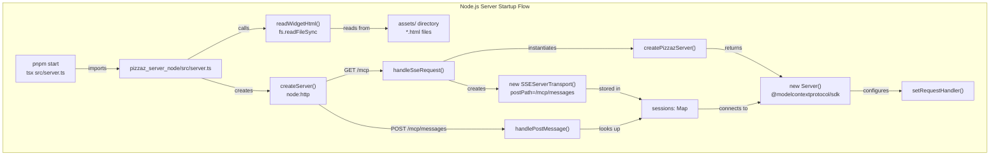

<!-- source: DeepWiki mcp.deepwiki.com · repo openai/openai-apps-sdk-examples · page 2.3 Running MCP Servers · fetched 2026-10-26 -->

# Running MCP Servers

<details>
<summary>Relevant source files</summary>

The following files were used as context for generating this wiki page:

- [LICENSE](LICENSE)
- [README.md](README.md)
- [kitchen_sink_server_node/README.md](kitchen_sink_server_node/README.md)
- [kitchen_sink_server_node/package-lock.json](kitchen_sink_server_node/package-lock.json)
- [kitchen_sink_server_node/package.json](kitchen_sink_server_node/package.json)
- [kitchen_sink_server_node/tsconfig.json](kitchen_sink_server_node/tsconfig.json)
- [kitchen_sink_server_python/README.md](kitchen_sink_server_python/README.md)
- [kitchen_sink_server_python/requirements.txt](kitchen_sink_server_python/requirements.txt)
- [pizzaz_server_node/README.md](pizzaz_server_node/README.md)
- [pizzaz_server_node/package.json](pizzaz_server_node/package.json)
- [pizzaz_server_node/tsconfig.json](pizzaz_server_node/tsconfig.json)
- [pizzaz_server_python/README.md](pizzaz_server_python/README.md)

</details>


This page provides instructions for starting the MCP servers included in this repository. After installing dependencies (see **2.1 Prerequisites and Installation**) and building widget assets (see **2.2 Building and Serving Assets**), you can launch any of the example servers to expose tools via the Model Context Protocol. For connecting these servers to ChatGPT, see **2.4 ChatGPT Integration**.

## Available MCP Servers

The repository includes several MCP server implementations demonstrating different architectural patterns:

| Server Name | Language | Primary Feature | Entry Point |
|-------------|----------|-----------------|-------------|
| Pizzaz Python | Python | Five widget variants (map, carousel, list, albums, shop) | `pizzaz_server_python/main.py` |
| Pizzaz Node | Node.js | Node.js equivalent of Pizzaz Python | `pizzaz_server_node/src/server.ts` |
| Shopping Cart Python | Python | `widgetSessionId` state persistence | `shopping_cart_python/main.py` |
| Solar System Python | Python | 3D visualization widget | `solar-system_server_python/main.py` |
| Authenticated Python | Python | OAuth integration with Auth0 | `authenticated_server_python/main.py` |
| Kitchen Sink Python | Python | Full `window.openai` API demo | `kitchen_sink_server_python/main.py` |
| Kitchen Sink Node | Node.js | Node.js kitchen sink implementation | `kitchen_sink_server_node/src/server.ts` |

All servers listen on port 8000 by default and expose MCP endpoints that ChatGPT can connect to via Connectors.

**Sources:** [README.md:110-176]()

## Python Server Execution

### Virtual Environment Setup

Python servers require dependency installation in a virtual environment. The same virtual environment can be reused across all Python servers:

```bash
# Create virtual environment (one-time)
python -m venv .venv

# Activate virtual environment
source .venv/bin/activate  # On Unix/macOS
# or
.venv\Scripts\activate     # On Windows
```

**Sources:** [README.md:128-129](), [pizzaz_server_python/README.md:13-14](), [kitchen_sink_server_python/README.md:18-19]()

### Installing Server Dependencies

Each Python server directory contains a `requirements.txt` file. Install dependencies for the server you intend to run:

```bash
# Example: Pizzaz Python server
pip install -r pizzaz_server_python/requirements.txt

# Example: Kitchen Sink Python server
pip install -r kitchen_sink_server_python/requirements.txt
```

Note that the official SDK package is `mcp`, which should be installed with the `[fastapi]` extra to provide the `mcp.server.fastmcp` module.

**Sources:** [README.md:130](), [pizzaz_server_python/README.md:15-23](), [kitchen_sink_server_python/requirements.txt:1-4]()

### Starting Python Servers with uvicorn

All Python servers use `uvicorn` as the ASGI server. The command pattern is:

```bash
uvicorn <module_path>:app --port 8000
```

#### Server Commands

*   **Pizzaz Python Server**: `uvicorn pizzaz_server_python.main:app --port 8000` [README.md:131]()
*   **Authenticated Python Server**: `uvicorn authenticated_python_server.main:app --port 8000` [README.md:140-141]()
*   **Solar System Python Server**: `uvicorn solar-system_server_python.main:app --port 8000` [README.md:149]()
*   **Kitchen Sink Python Server**: `uvicorn kitchen_sink_server_python.main:app --port 8000` [README.md:164]()
*   **Shopping Cart Python Server**: `uvicorn shopping_cart_python.main:app --port 8000` [README.md:175]()

**Sources:** [README.md:131-175](), [kitchen_sink_server_python/README.md:21]()

### Python Server Architecture

The following diagram maps the startup sequence to code entities within the Python implementations.

```mermaid
graph TB
    subgraph "Python Server Startup Flow"
        CLI["uvicorn CLI<br/>pizzaz_server_python.main:app"]
        MainModule["pizzaz_server_python/main.py"]
        FastMCPInit["FastMCP()<br/>name='pizzaz-python'<br/>stateless_http=True"]
        TransportSec["_transport_security_settings()<br/>MCP_ALLOWED_HOSTS<br/>MCP_ALLOWED_ORIGINS"]
        AppCreation["mcp.streamable_http_app()"]
        CORSMiddleware["CORSMiddleware<br/>allow_origins=['*']"]
        RequestHandlers["Request Handlers"]
        ListTools["_list_tools()"]
        CallTool["_call_tool_request()"]
        ReadResource["_handle_read_resource()"]
        WidgetLoader["_load_widget_html()<br/>@lru_cache"]
        AssetsDir["assets/ directory<br/>*.html files"]
    end
    
    CLI -->|"imports module"| MainModule
    MainModule -->|"instantiates"| FastMCPInit
    MainModule -->|"calls"| TransportSec
    TransportSec -->|"configures"| FastMCPInit
    FastMCPInit -->|"generates"| AppCreation
    AppCreation -->|"wraps"| CORSMiddleware
    CORSMiddleware -->|"exposes"| RequestHandlers
    RequestHandlers -->|"registers"| ListTools
    RequestHandlers -->|"registers"| CallTool
    RequestHandlers -->|"registers"| ReadResource
    CallTool -->|"uses"| WidgetLoader
    ReadResource -->|"uses"| WidgetLoader
    WidgetLoader -->|"reads from"| AssetsDir
```



**Architecture Details:**

1.  **FastMCP Initialization**: The server uses `FastMCP` with `stateless_http=True` to support SSE-compatible streaming HTTP [kitchen_sink_server_python/README.md:24]().
2.  **Widget HTML Caching**: Python servers use `functools.lru_cache` for `_load_widget_html`. If assets are rebuilt, the server must be restarted to clear this cache [README.md:106]().
3.  **FastAPI Integration**: The server exposes an SSE stream at `GET /mcp` and accepts follow-up messages at `POST /mcp/messages` [pizzaz_server_python/README.md:31-34]().

**Sources:** [README.md:106](), [pizzaz_server_python/README.md:31-36](), [kitchen_sink_server_python/README.md:24]()

## Node.js Server Execution

### Starting Node.js Servers with pnpm

Node.js servers are implemented using the official TypeScript SDK and can be started using `pnpm` scripts.

#### Pizzaz Node Server
```bash
cd pizzaz_server_node
pnpm start
```
This runs `tsx src/server.ts` [pizzaz_server_node/package.json:8-9]().

#### Kitchen Sink Node Server
```bash
pnpm --filter kitchen-sink-mcp-node start
```
This targets the specific workspace package [kitchen_sink_server_node/package.json:8]().

**Sources:** [pizzaz_server_node/package.json:8](), [kitchen_sink_server_node/package.json:8](), [README.md:121-123](), [README.md:154-156]()

### Node.js Server Architecture

The following diagram maps the Node.js implementation logic from the entry point to the protocol transport.



**Architecture Details:**

1.  **Transport Protocol**: The server uses `SSEServerTransport` for compatibility with ChatGPT connectors [pizzaz_server_node/README.md:24]().
2.  **SDK Usage**: Uses `@modelcontextprotocol/sdk` version `^0.5.0` [kitchen_sink_server_node/package.json:11]().
3.  **Response Metadata**: Tools respond with `_meta.openai/outputTemplate` metadata to bind results to widget shells [pizzaz_server_node/README.md:30]().
4.  **Asset Loading**: The server loads bundled assets (e.g., `assets/kitchen-sink-lite*.html`) created by the root build step [kitchen_sink_server_node/README.md:15]().

**Sources:** [pizzaz_server_node/README.md:24-30](), [kitchen_sink_server_node/package.json:11](), [kitchen_sink_server_node/README.md:15]()

## Port Configuration and Endpoints

All servers in this repository use consistent port and path conventions by default:

| Component | Port | Primary Endpoint |
|-----------|------|------------------|
| Python MCP Servers | 8000 | `http://localhost:8000/mcp` |
| Node.js MCP Servers | 8000 | `http://localhost:8000/mcp` (SSE stream) |
| Node.js Message POST | 8000 | `http://localhost:8000/mcp/messages?sessionId=...` |
| Static Asset Server | 4444 | `http://localhost:4444` |

You can override the port for Node.js servers using the `PORT` environment variable:
`PORT=9000 pnpm start` [kitchen_sink_server_node/README.md:26]().

**Sources:** [README.md:104](), [pizzaz_server_python/README.md:31](), [kitchen_sink_server_node/README.md:26]()

## Troubleshooting

### Widget HTML Not Found
If the server fails to find HTML files, ensure you have run `pnpm run build` from the root directory. Node.js servers look for versioned assets in the `assets/` folder [kitchen_sink_server_node/README.md:13-15]().

### Local Network Access (Chrome)
If using Chrome 142+, you must disable the `#local-network-access-check` flag at `chrome://flags/` and restart the browser to allow the widget UI to communicate with local servers [README.md:8-16]().

### Stale Python Assets
The Python Pizzaz server uses `lru_cache`. If you rebuild assets, you **must restart** the MCP server process for it to pick up the new markup [README.md:106]().

**Sources:** [README.md:8-16](), [README.md:106](), [kitchen_sink_server_node/README.md:13-15]()

---

