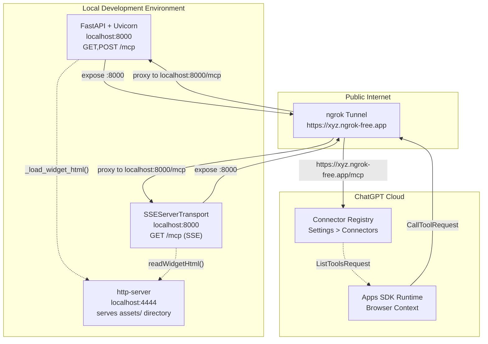
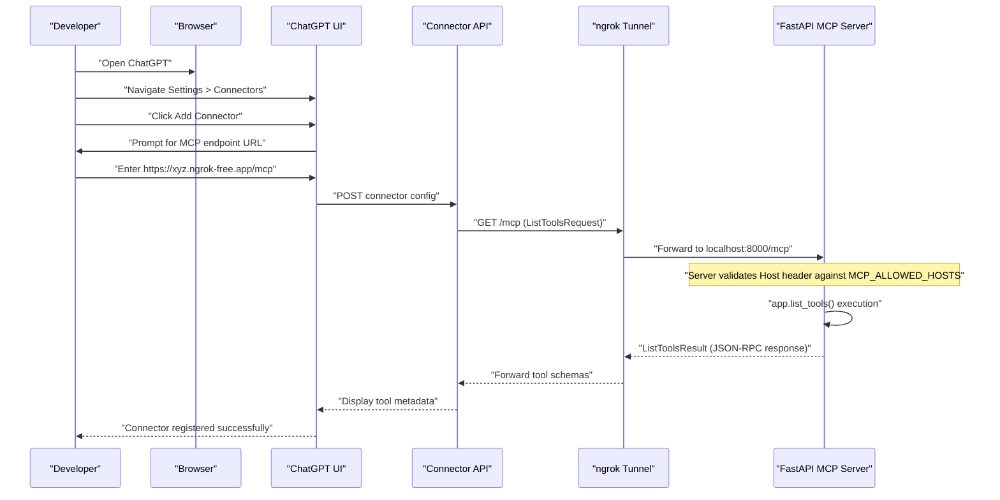
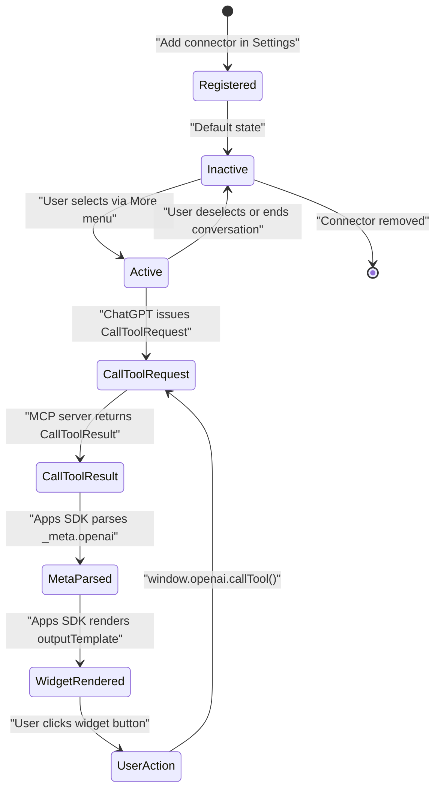
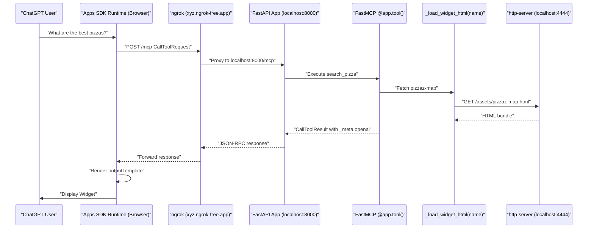

<!-- source: DeepWiki mcp.deepwiki.com · repo openai/openai-apps-sdk-examples · page 2.4 ChatGPT Integration · fetched 2026-10-26 -->

# ChatGPT Integration

<details>
<summary>Relevant source files</summary>

The following files were used as context for generating this wiki page:

- [README.md](README.md)
- [ngrok-v3-stable-linux-amd64.tgz](ngrok-v3-stable-linux-amd64.tgz)

</details>


## Purpose and Scope

This page explains how to connect locally running MCP servers to ChatGPT for testing and development. It covers exposing local servers via ngrok tunnels, configuring ChatGPT Connectors, troubleshooting browser compatibility issues, and using widgets in conversations.

For information about setting up the local development environment and running MCP servers, see [2.1 Prerequisites and Installation]() and [2.3 Running MCP Servers](). For details on MCP protocol implementation, see [3.2 Model Context Protocol (MCP)]().

---

## Integration Architecture

The local-to-cloud integration relies on three core components running simultaneously: the static asset server (port `4444`), the MCP server (port `8000`), and an ngrok tunnel exposing the MCP server to ChatGPT's cloud infrastructure.

### Network Topology



**Sources:** [README.md:18-30](), [README.md:186-209](), [pizzaz_server_python/main.py:1-50](), [pizzaz_server_node/src/server.ts:1-40]()

### Port and Endpoint Mapping

| Service | Local Port | Public Endpoint | Purpose | Code Entry Point |
|---------|-----------|-----------------|---------|------------------|
| Static Asset Server | `4444` | Not exposed | Serves `assets/*.html`, `*.js`, `*.css` | `package.json` script `serve` [README.md:101-104]() |
| MCP Server (Python) | `8000` | `https://*.ngrok-free.app/mcp` | FastAPI + Uvicorn HTTP/SSE | `pizzaz_server_python.main:app` [README.md:131-131]() |
| MCP Server (Node) | `8000` | `https://*.ngrok-free.app/mcp` | TypeScript `SSEServerTransport` | `pizzaz_server_node/src/server.ts` [README.md:121-123]() |
| Vite Dev Server | `5173` | Not exposed | Hot reload (optional) | `pnpm run dev` [README.md:93-94]() |

The static asset server must run on port `4444` as MCP servers reference this URL when invoking `_load_widget_html()` (Python) or `readWidgetHtml()` (Node.js) to load widget HTML files from the local `assets/` directory [README.md:96-104]().

**Sources:** [README.md:96-106](), [pizzaz_server_python/main.py:126-141](), [pizzaz_server_node/src/server.ts:41-60]()

---

## Prerequisites

Before integrating with ChatGPT, ensure the following are configured:

1. **ChatGPT Developer Mode** – Enabled via the OpenAI developer portal.
2. **ngrok Account** – Free tier sufficient for testing [ngrok.com](https://ngrok.com).
3. **Chrome 142+ Flag** – Disable `local-network-access-check` if using Chrome version 142 or later [README.md:8-15]().
4. **Running Services** – Both static asset server and MCP server must be active.

### Chrome Flag Configuration

Chrome version 142 introduced local network access restrictions that block widget rendering. The `local-network-access` flag must be disabled:

**Steps:**
1. Navigate to `chrome://flags/`
2. Search for `#local-network-access-check`
3. Set to **Disabled**
4. Restart browser [README.md:12-16]().

**Sources:** [README.md:8-16]()

---

## Setup Procedure

### Step 1: Start Local Services

Ensure both required services are running in separate terminal sessions:

**Terminal 1 – Static Asset Server:**
```bash
pnpm run serve
```
[README.md:101-101]()

**Terminal 2 – MCP Server (Python example):**
```bash
uvicorn pizzaz_server_python.main:app --port 8000
```
[README.md:131-131]()

Alternatively, use the Node.js MCP server:
```bash
cd pizzaz_server_node
pnpm start
```
[README.md:121-123]()

**Sources:** [README.md:74-118]()

### Step 2: Expose MCP Server with ngrok

With the MCP server running on port `8000`, create a public tunnel:

```bash
ngrok http 8000
```

ngrok will output a forwarding URL in the format:
`Forwarding https://<random-id>.ngrok-free.app -> http://localhost:8000`

The MCP endpoint becomes: `https://<random-id>.ngrok-free.app/mcp` [README.md:195-199]().

### Step 2.1: Configure DNS Rebinding Protection

Python MCP servers enforce DNS rebinding protection by default. When using ngrok, you must allowlist the tunnel hostname before starting the server:

```bash
export MCP_ALLOWED_HOSTS="<random-id>.ngrok-free.app"
export MCP_ALLOWED_ORIGINS="https://<random-id>.ngrok-free.app"
```
[README.md:201-207]()

Replace `<random-id>` with the actual subdomain from your ngrok forwarding URL.

**Sources:** [README.md:201-207](), [shopping_cart_python/main.py:1-20]()

### Step 3: Register Connector in ChatGPT



**Navigation Path:**
1. Open ChatGPT interface.
2. Click profile icon → **Settings**.
3. Navigate to **Connectors** section.
4. Click **"Add Connector"**.
5. Paste ngrok URL: `https://<random-id>.ngrok-free.app/mcp` [README.md:195-199]().

**Sources:** [README.md:186-209]()

---

## Connector Lifecycle and Usage

### Connector Activation

Connectors must be explicitly selected via the conversation context menu [README.md:209-215]().



**Sources:** [README.md:209-215]()

### Example Tool Invocation

For the Pizzaz connector, trigger tools with natural language queries like "What are the best pizzas in town?".

**ChatGPT Behavior:**
1. Recognizes intent matches tool schema (e.g., `search_pizza`).
2. Issues `CallToolRequest` to `https://*.ngrok-free.app/mcp`.
3. MCP server executes handler and invokes `_load_widget_html("pizzaz-map")` [pizzaz_server_python/main.py:126-141]().
4. Server returns `CallToolResult` with `_meta.openai/outputTemplate`.
5. Apps SDK renders widget inline.

**Sources:** [README.md:18-30](), [README.md:209-215](), [pizzaz_server_python/main.py:126-141]()

---

## Request Flow Diagram

This diagram maps the complete request lifecycle including specific code entities:



**Sources:** [README.md:18-30](), [README.md:186-215](), [pizzaz_server_python/main.py:126-141](), [pizzaz_server_node/src/server.ts:41-60]()

---

## Troubleshooting

### Connection Issues

| Problem | Symptom | Solution |
|---------|---------|----------|
| ngrok tunnel down | "Cannot connect to server" | Restart `ngrok http 8000`, update connector URL [README.md:195-199]() |
| MCP server not running | "Server unavailable" | Verify `uvicorn` or `pnpm start` is active [README.md:108-117]() |
| Static server not running | Blank UI / Asset 404 | Start `pnpm run serve` on port `4444` [README.md:101-104]() |
| DNS rebinding protection | 403 Forbidden | Set `MCP_ALLOWED_HOSTS` with ngrok hostname [README.md:201-207]() |

**Sources:** [README.md:186-207](), [README.md:96-106]()

### Widget Rendering Issues

| Problem | Symptom | Solution |
|---------|---------|----------|
| Chrome 142+ restrictions | Blank widget, CORS errors | Disable `#local-network-access-check` flag [README.md:8-16]() |
| Cached HTML not updating | Old content after rebuild | Restart Python MCP server (uses `@lru_cache`) [README.md:106-106]() |

**Sources:** [README.md:8-16](), [README.md:106-106](), [pizzaz_server_python/main.py:126-128]()

---

## Production Deployment Considerations

1. **Replace ngrok:** Deploy MCP server to cloud infrastructure.
2. **Update BASE_URL:** Set `BASE_URL` environment variable to CDN or static hosting URL [README.md:222-232]().
3. **CORS configuration:** Ensure proper CORS headers for cross-origin widget loading.
4. **OAuth configuration:** Update `AUTHORIZATION_SERVER_URL` for authenticated servers [authenticated_server_python/README.md:42-48]().

**Sources:** [README.md:222-232](), [authenticated_server_python/README.md:42-51]()

---

