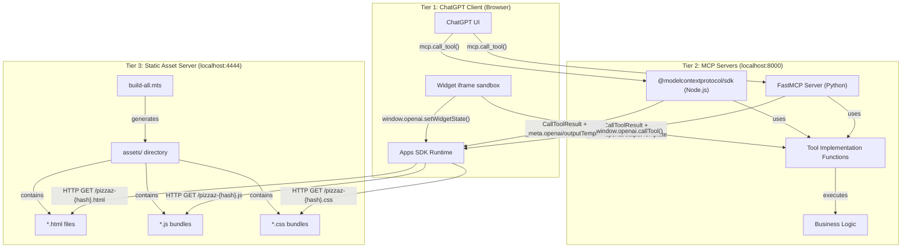
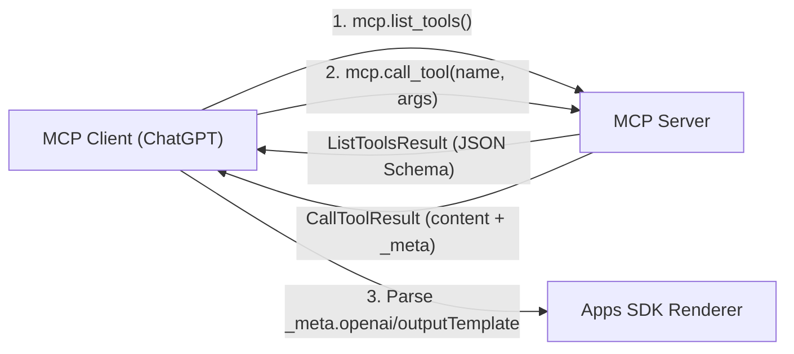
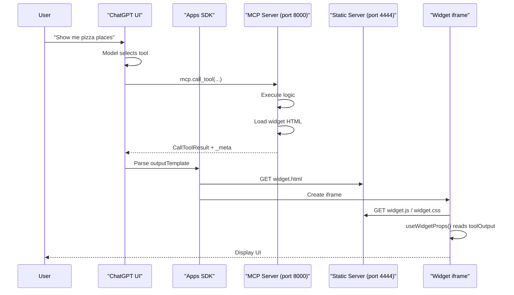
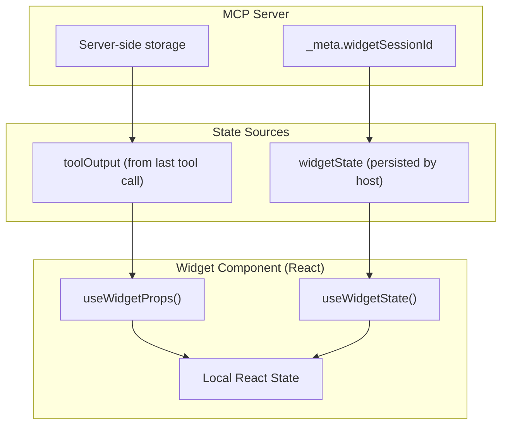

<!-- source: DeepWiki mcp.deepwiki.com · repo openai/openai-apps-sdk-examples · page 3 Architecture and Concepts · fetched 2026-10-26 -->

# Architecture and Concepts

Relevant source files

The following files were used as context for generating this wiki page:

- [README.md](README.md)
- [src/types.ts](src/types.ts)
- [src/use-widget-props.ts](src/use-widget-props.ts)

This document explains the core architectural patterns and concepts used throughout the OpenAI Apps SDK Examples repository. It provides a conceptual overview of how MCP servers, widget components, and the ChatGPT client interact to deliver rich, interactive user experiences.

For hands-on setup and installation instructions, see [Getting Started](#2). For detailed implementation guides on building widgets and MCP servers, see [Widget Development](#4) and [MCP Server Development](#5).

## Purpose and Scope

This page covers:

- The three-tier architecture separating MCP servers, static assets, and the ChatGPT client.
- The Model Context Protocol (MCP) and its role as the integration layer.
- How widget rendering flows from tool calls to UI display.
- State management patterns using `widgetSessionId` and `widgetState`.
- Authentication flows using OAuth and `WWW-Authenticate` challenges.

Each concept is introduced at a high level here, with references to more detailed documentation in sub-sections [System Architecture Overview](#3.1) through [Authentication and OAuth](#3.5).

## Three-Tier Architecture

The system operates across three distinct tiers, each running in separate processes with clear separation of concerns:

**Sources:** [README.md:18-43](), [README.md:96-106]()

### Tier 1: ChatGPT Client

The ChatGPT web interface hosts the Apps SDK runtime, which manages tool selection, widget rendering in sandboxed iframes, and state persistence. The SDK injects a `window.openai` global object into the widget sandbox, providing APIs defined in `src/types.ts`.

- **Visuals & Layout**: `theme`, `displayMode`, and `safeArea` [src/types.ts:7-16]().
- **State**: `toolInput`, `toolOutput`, and `widgetState` [src/types.ts:18-22]().
- **APIs**: `callTool`, `setWidgetState`, and `sendFollowUpMessage` [src/types.ts:23-38]().

For details, see [System Architecture Overview](#3.1).

### Tier 2: MCP Servers

MCP servers expose tools via the Model Context Protocol specification. This repository includes implementations in both Python and Node.js. Each server implements three core MCP capabilities: listing tools, calling tools, and returning structured content with widget metadata.

**Python Servers (FastMCP):**
- `pizzaz_server_python`: Five pizza-themed widget variants.
- `shopping_cart_python`: Shopping cart with session management.
- `solar-system_server_python`: 3D solar system visualization.
- `authenticated_server_python`: OAuth-protected tools.

**Node.js Servers (MCP SDK):**
- `pizzaz_server_node`: Node.js equivalent of pizzaz server.
- `kitchen_sink_server_node`: Full API demonstration in Node.js.

For details, see [Model Context Protocol (MCP)](#3.2).

### Tier 3: Static Asset Server

The static asset server runs independently on port 4444, serving pre-built widget bundles generated by `build-all.mts` [README.md:96-106](). The build system produces versioned bundles with content hashes, enabling aggressive browser caching [README.md:81-89]().

For details, see [Widget Rendering Flow](#3.3).

## Model Context Protocol (MCP)

MCP serves as the integration layer between ChatGPT and external tools. The protocol defines a standardized wire format for three core capabilities:

### Core Capability Flow

#### 1. List Tools (`mcp.list_tools()`)
Servers advertise their capabilities using JSON Schema. This includes the tool name, description, and `inputSchema` [README.md:24-24]().

#### 2. Call Tools (`mcp.call_tool()`)
When the model selects a tool, it issues a request with arguments matching the user intent. The server executes the action and returns structured content [README.md:25-25]().

#### 3. Return Widgets (`_meta.openai/outputTemplate`)
Alongside structured content, servers return embedded resources in response metadata. The Apps SDK uses the `_meta.openai/outputTemplate` field to render the interface inline [README.md:26-26]().

For details, see [Model Context Protocol (MCP)](#3.2).

## Widget Rendering Flow

The flow from user message to rendered widget involves multiple steps across all three tiers. The MCP server returns HTML in the `_meta` field, which contains references to the static asset server. The Apps SDK then fetches these resources independently.

For details, see [Widget Rendering Flow](#3.3).

## State Management Architecture

Widgets maintain state across conversational turns using a three-source synchronization pattern involving `toolOutput`, `widgetState`, and `widgetSessionId`.

- **`toolOutput`**: Read-only data from the last tool call, accessed via `useWidgetProps` [src/use-widget-props.ts:3-14]().
- **`widgetState`**: Persistent state managed by the host, updated via `setWidgetState` [src/types.ts:22-23]().
- **`widgetSessionId`**: A server-provided ID in `_meta` that allows the host to key and persist `widgetState` across turns [README.md:36-36]().

For details, see [State Management and widgetSessionId](#3.4).

## Authentication Flows

The system supports the MCP authorization specification, allowing tools to require OAuth 2.0 authentication.

- **`WWW-Authenticate`**: Servers can return this challenge to trigger the ChatGPT authentication UI.
- **OAuth Flow**: ChatGPT handles the OAuth flow with the authorization server and retries the tool call with a Bearer token.
- **Security Schemes**: Tools can be configured with "Required" or "Mixed" security patterns [README.md:42-42]().

For details, see [Authentication and OAuth](#3.5).

**Sources:** [README.md:18-43](), [src/types.ts:1-109](), [src/use-widget-props.ts:1-14]()

---

