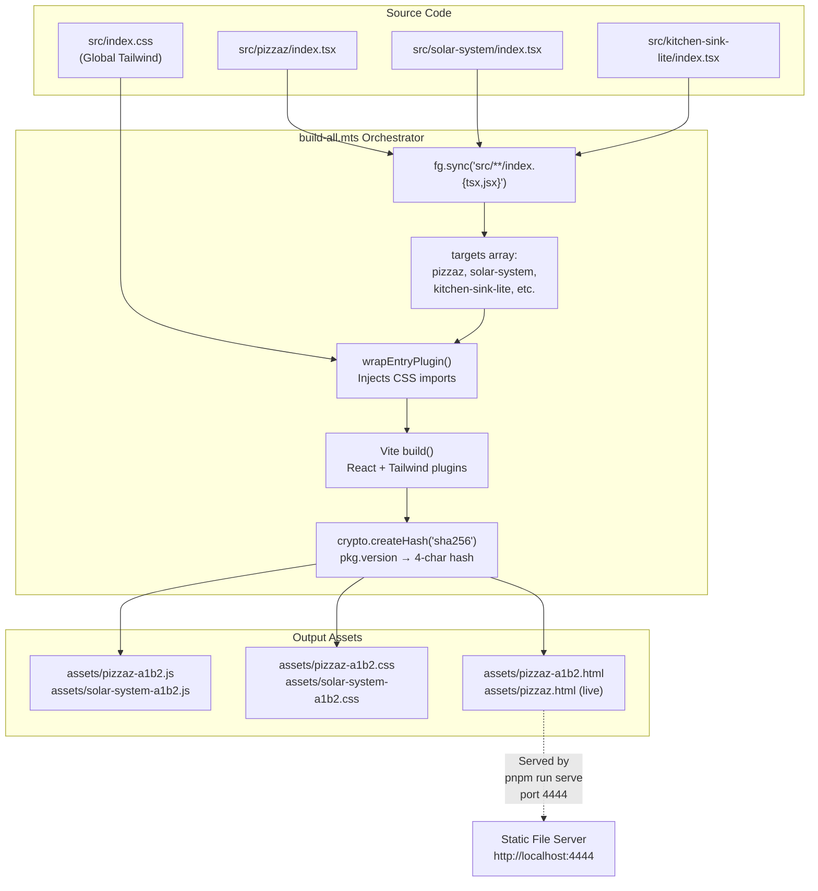
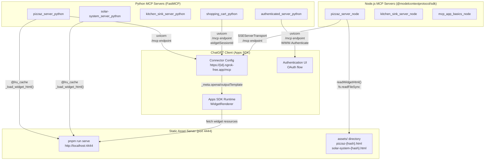
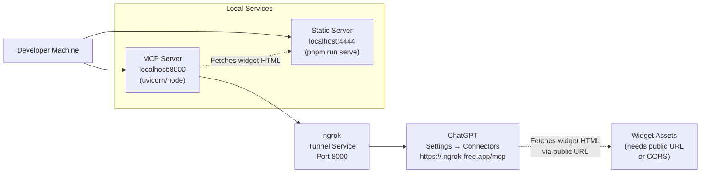
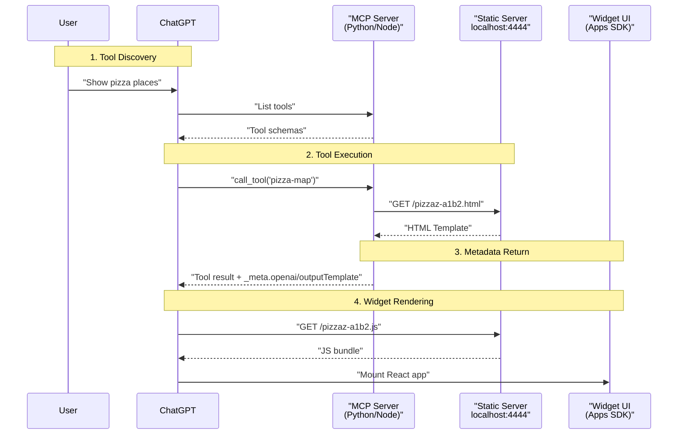
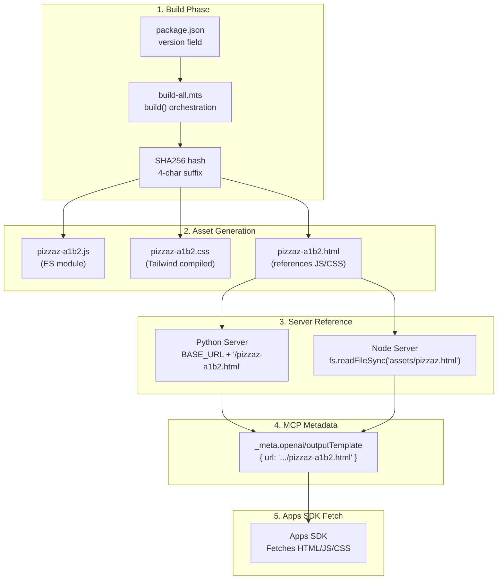

<!-- source: DeepWiki mcp.deepwiki.com · repo openai/openai-apps-sdk-examples · page 3.1 System Architecture Overview · fetched 2026-10-26 -->

# System Architecture Overview

<details>
<summary>Relevant source files</summary>

The following files were used as context for generating this wiki page:

- [README.md](README.md)
- [build-all.mts](build-all.mts)

</details>


## Purpose and Scope

This document describes the overall system architecture of the Apps SDK Examples Gallery repository, explaining how the three primary tiers—Development, Server, and Runtime—interact to deliver widget-backed MCP tools to ChatGPT. It covers the build pipeline that compiles React widgets into static assets, the MCP server implementations that expose these widgets as tools, and the runtime integration with ChatGPT's Apps SDK.

For detailed information about the Model Context Protocol itself, see [Model Context Protocol (MCP)](#3.2). For the end-to-end widget rendering flow, see [Widget Rendering Flow](#3.3). For implementation details of specific servers and widgets, see [Widget Development](#4) and [MCP Server Development](#5).

---

## Three-Tier Architecture

The repository implements a layered architecture that separates concerns across three distinct tiers:

| Tier | Primary Components | Key Responsibility | Output Artifacts |
|------|-------------------|-------------------|------------------|
| **Development** | `src/`, `build-all.mts`, Vite | Compile React widgets into standalone bundles | `assets/*.html`, `assets/*.js`, `assets/*.css` |
| **Server** | Python/Node.js MCP servers | Expose widget-backed tools via MCP protocol | Tool schemas, widget metadata, tool execution results |
| **Runtime** | ChatGPT, Apps SDK | Render widgets and orchestrate tool invocations | Live UI components in chat interface |

The Development tier produces static assets that the Server tier references, and the Runtime tier fetches and renders. This separation enables developers to build widgets once and serve them from multiple server implementations written in different languages.

**Sources:** [README.md:32-42](), [README.md:18-30]()

---

## Development Tier: Build System

### Build Orchestration

The `build-all.mts` script orchestrates the Vite build process to compile React widgets into self-contained HTML bundles:

**Build Pipeline Diagram**



**Key Build Process Steps:**

1. **Entry Discovery** ([build-all.mts:13-13]()): Uses `fast-glob` to find all `src/**/index.{tsx,jsx}` files.
2. **CSS Collection** ([build-all.mts:97-111]()): Gathers global CSS (`src/index.css`) and per-entry CSS files.
3. **Virtual Entry Wrapper** ([build-all.mts:54-84]()): Creates a virtual module that imports both the entry file and required CSS.
4. **Vite Compilation** ([build-all.mts:115-160]()): Runs Vite with React and Tailwind plugins, outputting ES modules.
5. **Hash Generation** ([build-all.mts:172-176]()): Creates 4-character SHA256 hash from `package.json` version.
6. **Asset Renaming** ([build-all.mts:179-188]()): Appends hash to all `.js` and `.css` files for cache-busting.
7. **HTML Generation** ([build-all.mts:218-239]()): Creates HTML files with script/link tags pointing to hashed assets.

**Widget Compilation Targets:**

The `targets` array in `build-all.mts` defines which widgets are compiled:

```typescript
// build-all.mts:20-44
const targets: string[] = [
  "todo",
  "solar-system",
  "cards-against-ai",
  "pizzaz",
  "pizzaz-carousel",
  "pizzaz-list",
  "pizzaz-albums",
  "pizzaz-shop",
  "mixed-auth-search",
  "mixed-auth-past-orders",
  "kitchen-sink-lite",
  "shopping-cart",
  "show-tool-result",
  "send-message",
  "update-model-context",
  "call-server-tool",
  "host-theming",
  "open-link",
  "request-display-mode",
  "streaming-tool-input",
  "get-host-capabilities",
  "get-host-context",
  "get-host-version",
];
```

Each target corresponds to a subdirectory in `src/` containing an `index.tsx` or `index.jsx` entry point file.

**Sources:** [build-all.mts:20-44](), [README.md:80-88]()

### Build Configuration

The build system uses environment variables and package configuration:

| Configuration | Source | Purpose |
|---------------|--------|---------|
| `BASE_URL` | `build-all.mts:192-199` | URL prefix for generated HTML asset references (defaults to `http://localhost:4444`) |
| `API_BASE_URL` | `build-all.mts:202-211` | Backend API URL prefix injected into `window.__APP_URL_CONFIG__` |
| `pkg.version` | `build-all.mts:174-174` | Source for SHA256 hash to version assets |
| `outDir` | `build-all.mts:14-14` | Output directory (`assets/`) |

The generated HTML structure ([build-all.mts:222-235]()):

```html
<!doctype html>
<html>
<head>
  <script>
    window.__APP_URL_CONFIG__ = {"apiBaseUrl":"...","assetsBaseUrl":"..."};
  </script>
  <script type="module" src="http://localhost:4444/pizzaz-a1b2.js"></script>
  <link rel="stylesheet" href="http://localhost:4444/pizzaz-a1b2.css">
</head>
<body>
  <div id="pizzaz-root"></div>
</body>
</html>
```

**Sources:** [build-all.mts:192-239](), [README.md:184-189]()

---

## Server Tier: MCP Server Implementations

### Server Implementation Matrix

The repository provides multiple MCP server implementations demonstrating two technology stacks:

**MCP Server Architecture Diagram**



### Server Implementation Details

| Server | Implementation File | Key Features | Widget Capabilities |
|--------|-------------------|--------------|-------------------|
| **pizzaz_server_python** | `main.py` | 5 widget variants (map, carousel, list, albums, shop) | Mapbox GL JS, Embla carousel, e-commerce flows |
| **pizzaz_server_node** | `src/server.ts` | Node.js equivalent of Python server | SSE transport, session management |
| **solar_system_server_python** | `main.py` | 3D planet visualization | Planet name normalization, `PLANET_ALIASES` |
| **authenticated_server_python** | `main.py` | OAuth integration with Auth0 | Mixed/Required authentication patterns |
| **shopping_cart_python** | `main.py` | Stateful shopping cart | `widgetSessionId` persistence |
| **kitchen_sink_server_python** | `main.py` | Full `window.openai` API demo | `callTool`, `setWidgetState`, `requestDisplayMode` |
| **mcp_app_basics_node** | `src/index.ts` | Educational Node.js server | `registerAppTool`, `registerAppResource` patterns |

**Sources:** [README.md:108-164](), [README.md:36-42]()

### Widget HTML Serving Patterns

**Python Pattern:** HTTP fetch with `@lru_cache` decorator
Python servers typically use `functools.lru_cache` to cache widget HTML fetched from the static asset server. This ensures the server doesn't re-fetch the template on every tool call but requires a restart if assets are rebuilt.

**Node.js Pattern:** File system read at startup
Node.js servers often read widget HTML files directly from the `assets/` directory using `fs.readFileSync`.

**Sources:** [README.md:98-107]()

---

## Runtime Tier: ChatGPT Integration

### Deployment and Connectivity

**Local Development Setup Diagram**



**Key Integration Points:**

1. **MCP Server Tunnel** ([README.md:154-164]()): Uses ngrok to expose local MCP server on port 8000 to ChatGPT.
2. **Static Asset Serving** ([README.md:96-104]()): Local CORS-enabled server on port 4444 (`pnpm run serve`).
3. **ChatGPT Configuration** ([README.md:152-169]()): Enable developer mode and add connector via the ngrok URL.

**Sources:** [README.md:150-173]()

### Tool Invocation and Widget Rendering

**Tool Execution and Widget Rendering Flow**



**MCP Protocol Capabilities Implemented:**
All servers implement these core capabilities ([README.md:22-26]()):
1. **List tools**: Advertise supported tools and JSON Schema contracts.
2. **Call tools**: Execute actions based on model intent.
3. **Return widgets**: Include `_meta.ui.resourceUri` or `outputTemplate` in metadata to render rich UI.

**Sources:** [README.md:18-30](), [README.md:43-52]()

---

## Key Data Flows

### Build-to-Runtime Asset Flow

**Asset Dependency Chain**



**Sources:** [build-all.mts:172-239](), [README.md:179-189]()

---

## Directory Structure and Component Mapping

### Repository Layout

```
openai-apps-sdk-examples/
├── src/                                # Widget source code
│   ├── pizzaz/                         # Pizzaz map widget
│   ├── shopping-cart/                  # Stateful cart widget
│   └── ...                             # Other widget sources
├── assets/                             # Generated bundles (Output)
│   ├── pizzaz-a1b2.html                # Hashed HTML
│   ├── pizzaz-a1b2.js                  # Hashed JS
│   └── pizzaz.html                     # Live (unhashed) HTML
├── pizzaz_server_python/               # Python MCP Server
├── pizzaz_server_node/                 # Node.js MCP Server
├── build-all.mts                       # Build orchestrator
├── package.json                        # Root configuration
└── README.md                           # Documentation
```

### Component Responsibilities Table

| Component | Files | Responsibility | Tier |
|-----------|-------|----------------|------|
| **Widget Source** | `src/*/index.tsx` | Render widget UI via React | Development |
| **Build Orchestrator** | `build-all.mts` | Compile widgets into static bundles | Development |
| **Static Assets** | `assets/` | Versioned bundles for the browser | Output |
| **MCP Servers** | `*_server_*/` | Expose tools and return widget metadata | Server |
| **Apps SDK** | ChatGPT Client | Orchestrate tool calls and render widgets | Runtime |

**Sources:** [README.md:32-42]()

---

