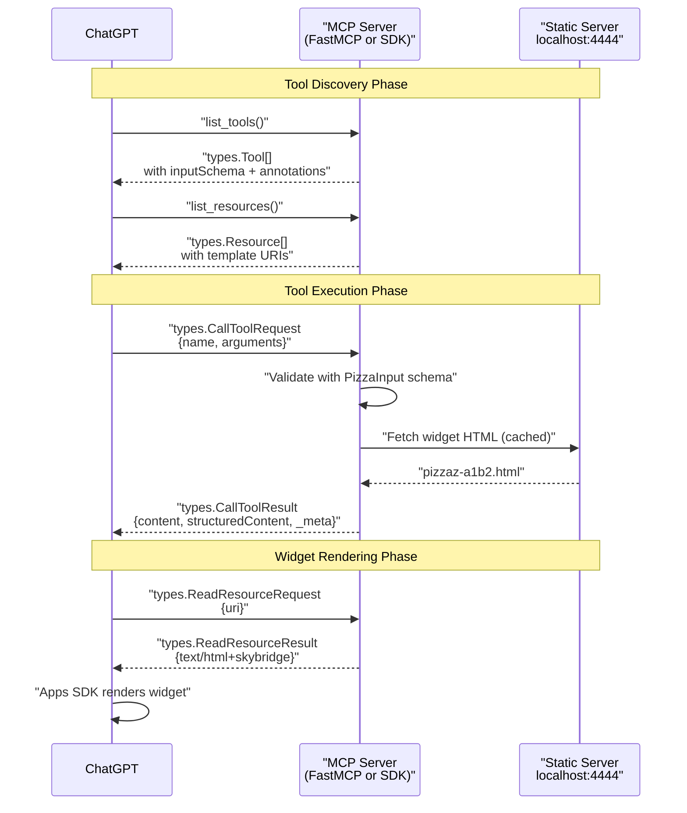
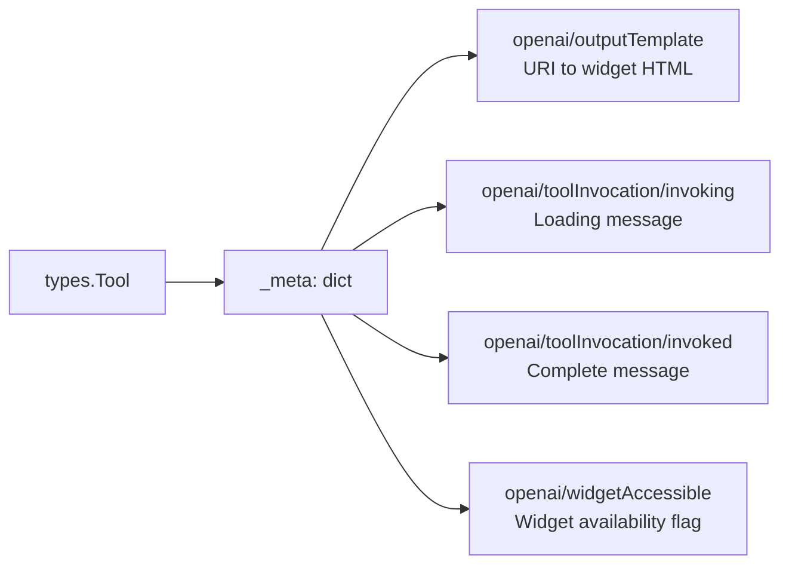
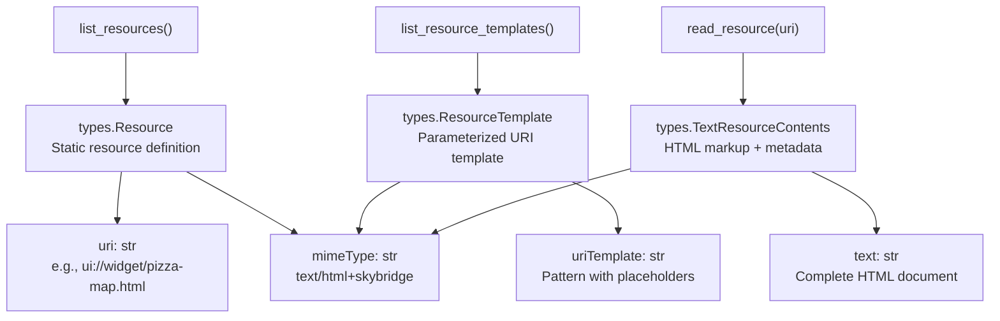
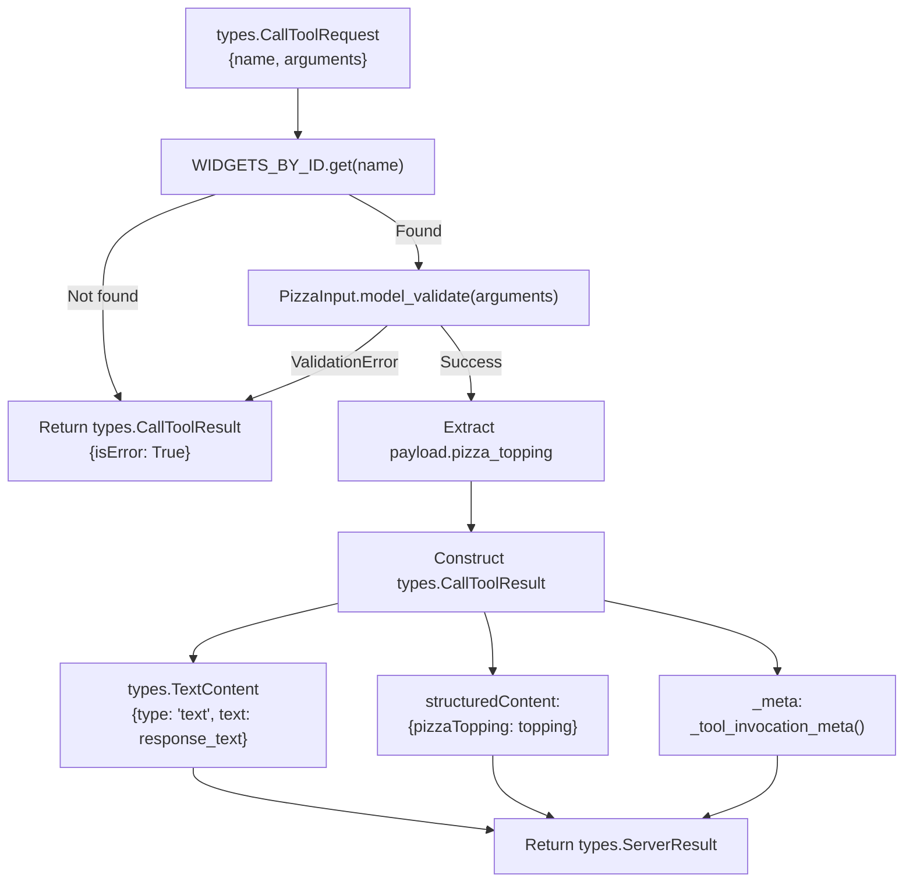

<!-- source: DeepWiki mcp.deepwiki.com · repo openai/openai-apps-sdk-examples · page 3.2 Model Context Protocol (MCP) · fetched 2026-10-26 -->

# Model Context Protocol (MCP)

<details>
<summary>Relevant source files</summary>

The following files were used as context for generating this wiki page:

- [README.md](README.md)
- [mcp_app_basics_node/README.md](mcp_app_basics_node/README.md)
- [mcp_app_basics_node/package.json](mcp_app_basics_node/package.json)
- [mcp_app_basics_node/src/server.ts](mcp_app_basics_node/src/server.ts)
- [mcp_app_basics_node/tsconfig.json](mcp_app_basics_node/tsconfig.json)
- [pizzaz_server_python/main.py](pizzaz_server_python/main.py)
- [src/call-server-tool/App.tsx](src/call-server-tool/App.tsx)
- [src/call-server-tool/index.css](src/call-server-tool/index.css)

</details>


## Purpose and Scope

This page documents the Model Context Protocol (MCP) as used in this repository to expose widgets as tools to ChatGPT. It covers the protocol's core concepts—tools, resources, and metadata—and shows how MCP servers advertise capabilities, handle requests, and return widget-backed responses. For details on how ChatGPT renders these widgets, see [Widget Rendering Flow](3.3). For implementation guides, see [Python MCP Servers with FastMCP](5.1) and [Node.js MCP Servers with SDK](5.2).

**Sources:** [README.md:18-31]()

---

## MCP Protocol Overview

The Model Context Protocol is an open specification that connects large language model clients (like ChatGPT) to external tools, data, and user interfaces. In this repository, MCP serves as the wire protocol between ChatGPT and the example servers, enabling:

1. **Tool discovery**: Servers advertise available tools with JSON Schema contracts.
2. **Tool execution**: ChatGPT sends `call_tool` requests; servers return structured results.
3. **Widget rendering**: Servers embed HTML resources in response metadata that the Apps SDK renders.

MCP is transport-agnostic. The servers in this repository support both Server-Sent Events (SSE) and streaming HTTP transports [README.md:28-28](). All MCP messages follow a standardized JSON-RPC format with typed request/response objects.

The protocol keeps the server, model, and UI in sync without custom wire formats. ChatGPT reasons about MCP tools the same way it reasons about built-in capabilities, using JSON Schema annotations to control approval prompts and execution behavior.

**Sources:** [README.md:18-28]()

---

## Core Protocol Components

### MCP Message Types

The MCP protocol defines several message types implemented by servers in this repository:

| Message Type | Purpose | Implementation Files |
|--------------|---------|---------------------|
| `List Tools` | Advertise available tools with schemas | [pizzaz_server_python/main.py:185-202]() |
| `Call Tool` | Execute a tool and return results | [pizzaz_server_python/main.py:236-281]() |
| `List Resources` | Advertise available HTML resources | [pizzaz_server_python/main.py:205-217]() |
| `List Resource Templates` | Advertise parameterized resource URIs | [pizzaz_server_python/main.py:220-232]() |
| `Read Resource` | Fetch HTML content for a resource URI | [pizzaz_server_python/main.py:236-255]() |

**Sources:** [pizzaz_server_python/main.py:185-281]()

### Protocol Data Flow



**Title:** MCP Protocol Request-Response Cycle
**Sources:** [pizzaz_server_python/main.py:185-281](), [README.md:22-26]()

---

## Tool Definitions

### Tool Structure

MCP tools are defined using the `types.Tool` class with the following structure:

```
types.Tool:
  - name: str (tool identifier, e.g., "pizza-map")
  - title: str (human-readable title)
  - description: str (what the tool does)
  - inputSchema: dict (JSON Schema for arguments)
  - annotations: dict (execution hints)
  - _meta: dict (OpenAI-specific metadata)
```

### Input Schema

Each tool declares its input contract using JSON Schema. The Pizzaz server defines a common schema for all pizza tools:

[pizzaz_server_python/main.py:152-162]()

```python
TOOL_INPUT_SCHEMA: Dict[str, Any] = {
    "type": "object",
    "properties": {
        "pizzaTopping": {
            "type": "string",
            "description": "Topping to mention when rendering the widget.",
        }
    },
    "required": ["pizzaTopping"],
    "additionalProperties": False,
}
```

The server validates incoming arguments against this schema using Pydantic models defined at [pizzaz_server_python/main.py:115-124](). In Node.js implementations, `zod` is typically used for schema validation [mcp_app_basics_node/src/server.ts:119-124]().

### Tool Annotations

Annotations control how ChatGPT presents tools to users:

| Annotation | Type | Purpose |
|------------|------|---------|
| `readOnlyHint` | boolean | Tool does not modify state (disables approval prompt) |
| `destructiveHint` | boolean | Tool performs destructive operations (requires approval) |
| `openWorldHint` | boolean | Tool accesses external resources (requires approval) |

The Pizzaz server sets all tools as read-only to disable approval prompts:

[pizzaz_server_python/main.py:195-199]()

```python
annotations={
    "destructiveHint": False,
    "openWorldHint": False,
    "readOnlyHint": True,
}
```

**Sources:** [pizzaz_server_python/main.py:152-199](), [mcp_app_basics_node/src/server.ts:125-129]()

### Tool Metadata

The `_meta` field on tool definitions contains OpenAI-specific extensions:



**Title:** Tool Metadata Structure

The `_tool_meta()` function at [pizzaz_server_python/main.py:169-175]() constructs this metadata:

```python
def _tool_meta(widget: PizzazWidget) -> Dict[str, Any]:
    return {
        "openai/outputTemplate": widget.template_uri,
        "openai/toolInvocation/invoking": widget.invoking,
        "openai/toolInvocation/invoked": widget.invoked,
        "openai/widgetAccessible": True,
    }
```

**Sources:** [pizzaz_server_python/main.py:169-202]()

---

## Resource System

### Resource Types

MCP resources represent HTML templates that the Apps SDK fetches and renders. The protocol defines three resource-related primitives:



**Title:** MCP Resource Type Hierarchy

### Resource Definitions

Resources are advertised in response to `list_resources()` calls. The Pizzaz server registers resources corresponding to its tools:

[pizzaz_server_python/main.py:205-217]()

Each resource includes:
- `uri`: A custom URI scheme (`ui://widget/<name>.html`)
- `mimeType`: Always `"text/html+skybridge"` for widgets [pizzaz_server_python/main.py:104-104]()
- `_meta`: Metadata structure including output templates.

### Resource Templates

Resource templates at [pizzaz_server_python/main.py:220-232]() mirror the resource list but use `uriTemplate` instead of `uri`. This allows parameterized resource fetching.

### Reading Resources

When ChatGPT requests a resource via `types.ReadResourceRequest`, the server returns `types.TextResourceContents` with the widget HTML:

[pizzaz_server_python/main.py:236-255]()

The handler function:
1. Looks up the widget by URI in the `WIDGETS_BY_URI` dictionary [pizzaz_server_python/main.py:241-241]().
2. Returns `types.TextResourceContents` with the cached HTML [pizzaz_server_python/main.py:250-250]().
3. Includes the same `_meta` dict used in tool definitions.

**Sources:** [pizzaz_server_python/main.py:104-255]()

---

## Widget HTML Loading

### HTML Caching Strategy

MCP servers load widget HTML from the `assets/` directory. Python implementations often use an LRU cache to avoid repeated file I/O:

[pizzaz_server_python/main.py:39-52]()

The `_load_widget_html()` function:
1. Checks for an exact match: `assets/{component_name}.html`.
2. Falls back to versioned files: `assets/{component_name}-*.html` (sorted alphabetically, uses last) [pizzaz_server_python/main.py:45-47]().
3. Raises `FileNotFoundError` if no match exists.
4. Uses `@lru_cache(maxsize=None)` for indefinite caching [pizzaz_server_python/main.py:39-39]().

Node.js implementations use synchronous file system reads during initialization to populate variables like `showToolResultHtml` [mcp_app_basics_node/src/server.ts:60-91]().

### Widget Metadata Structure

The `PizzazWidget` dataclass at [pizzaz_server_python/main.py:25-33]() encapsulates all metadata needed to expose a widget:

```python
@dataclass(frozen=True)
class PizzazWidget:
    identifier: str      # Tool name, e.g., "pizza-map"
    title: str           # Human-readable title
    template_uri: str    # Resource URI, e.g., "ui://widget/pizza-map.html"
    invoking: str        # Loading message
    invoked: str         # Completion message
    html: str            # Cached HTML content
    response_text: str   # Structured response text
```

**Sources:** [pizzaz_server_python/main.py:25-99](), [mcp_app_basics_node/src/server.ts:60-101]()

---

## Tool Execution Flow

### Call Tool Request Handling

The `_call_tool_request()` handler at [pizzaz_server_python/main.py:258-303]() processes tool invocations:



**Title:** Call Tool Request Handler Flow

### Result Structure

A successful tool call returns a result containing both text for the model and structured data for the widget:

[pizzaz_server_python/main.py:295-303]()

```python
return types.CallToolResult(
    content=[
        types.TextContent(
            type="text",
            text=widget.response_text,
        )
    ],
    structuredContent={"pizzaTopping": topping},
    _meta=_tool_invocation_meta(widget),
)
```

The `structuredContent` field is specifically used by the Apps SDK to hydrate the widget via the `ontoolresult` callback [src/call-server-tool/App.tsx:38-41]().

**Sources:** [pizzaz_server_python/main.py:258-303](), [src/call-server-tool/App.tsx:34-43]()

---

## Request Handler Registration

### Custom Request Handlers

While libraries like FastMCP or the Node SDK provide high-level abstractions, servers often override default request handlers for custom logic:

[pizzaz_server_python/main.py:306-307]()

```python
mcp._mcp_server.request_handlers[types.CallToolRequest] = _call_tool_request
mcp._mcp_server.request_handlers[types.ReadResourceRequest] = _handle_read_resource
```

### Node.js Implementation Pattern

In Node.js, `registerAppTool` and `registerAppResource` are used to bind tools and resources to the server instance:

[mcp_app_basics_node/src/server.ts:109-132]()

```typescript
registerAppTool(
  server,
  "show_tool_result",
  {
    title: "Show Tool Result",
    inputSchema: { name: z.string().optional() },
    _meta: { ui: { resourceUri: SHOW_TOOL_RESULT_URI } },
  },
  async ({ name }) => { /* handler logic */ }
);
```

**Sources:** [pizzaz_server_python/main.py:306-307](), [mcp_app_basics_node/src/server.ts:102-132]()

---

## Security and Transport

### Transport Security

Servers implement protection against DNS rebinding and restrict origins based on environment variables:

[pizzaz_server_python/main.py:133-142]()

```python
def _transport_security_settings() -> TransportSecuritySettings:
    allowed_hosts = _split_env_list(os.getenv("MCP_ALLOWED_HOSTS"))
    allowed_origins = _split_env_list(os.getenv("MCP_ALLOWED_ORIGINS"))
    return TransportSecuritySettings(
        enable_dns_rebinding_protection=True,
        allowed_hosts=allowed_hosts,
        allowed_origins=allowed_origins,
    )
```

### CORS Configuration

For local development, servers typically enable CORS to allow the Apps SDK and MCP inspectors to communicate with the server:

[pizzaz_server_python/main.py:312-323]()

```python
app.add_middleware(
    CORSMiddleware,
    allow_origins=["*"],
    allow_credentials=True,
    allow_methods=["*"],
    allow_headers=["*"],
)
```

**Sources:** [pizzaz_server_python/main.py:133-149](), [pizzaz_server_python/main.py:312-323]()

---

