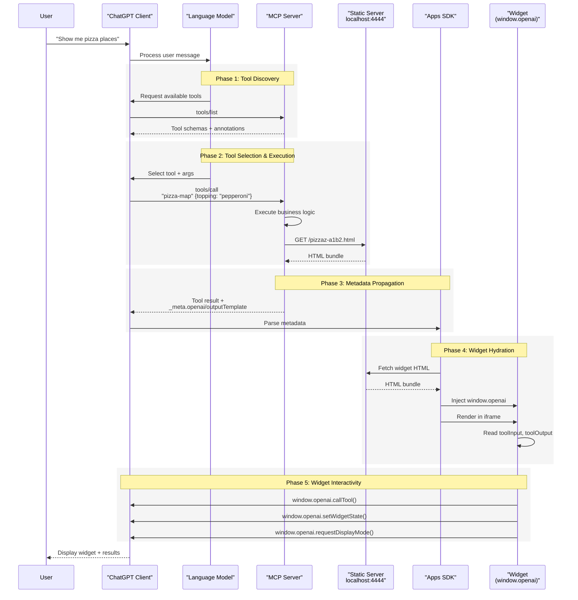
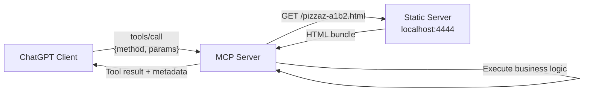
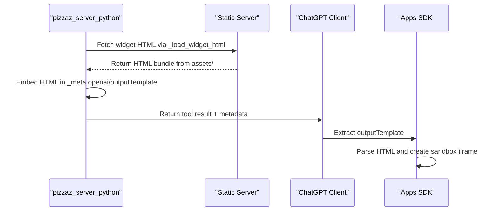
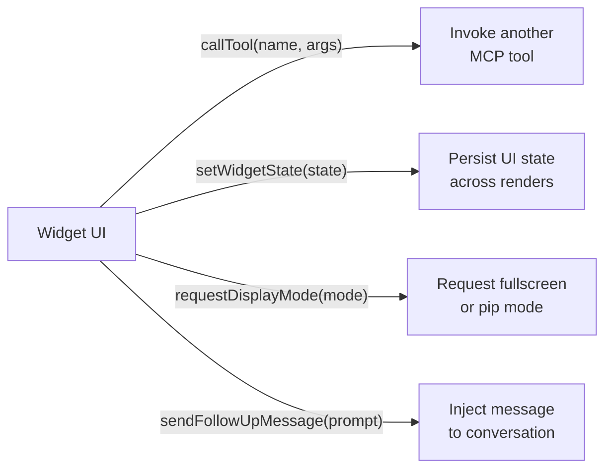
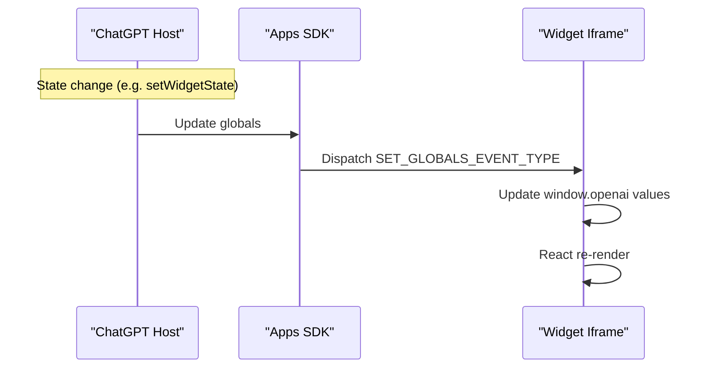

<!-- source: DeepWiki mcp.deepwiki.com · repo openai/openai-apps-sdk-examples · page 3.3 Widget Rendering Flow · fetched 2026-10-26 -->

# Widget Rendering Flow

<details>
<summary>Relevant source files</summary>

The following files were used as context for generating this wiki page:

- [README.md](README.md)
- [pizzaz_server_python/main.py](pizzaz_server_python/main.py)
- [src/types.ts](src/types.ts)
- [src/use-widget-props.ts](src/use-widget-props.ts)

</details>


## Purpose and Scope

This document describes the end-to-end flow of widget rendering in the Apps SDK Examples Gallery, from tool invocation through widget display in the ChatGPT interface. It covers how MCP servers propagate widget metadata, how the Apps SDK hydrates widgets with state, and how widgets interact with the host environment during their lifecycle.

For information about the overall system architecture, see [System Architecture Overview](#3.1). For details on the MCP protocol itself, see [Model Context Protocol (MCP)](#3.2). For widget development patterns and the `window.openai` API surface, see [Widget Architecture](#4.1) and [window.openai API Reference](#4.2).

---

## Rendering Flow Overview

Widget rendering is a multi-phase process that begins when a user interacts with ChatGPT and ends with a live, interactive UI component displayed in the chat interface. The flow involves five primary actors:

| Actor | Role | Implementation |
|-------|------|----------------|
| ChatGPT Client | Orchestrates conversation and tool invocations | Proprietary OpenAI client |
| Language Model | Selects tools and generates arguments | GPT model |
| MCP Server | Executes business logic and returns widget metadata | Python (FastMCP) or Node.js (MCP SDK) |
| Static Server | Serves bundled widget HTML | `pnpm run serve` on port 4444 |
| Apps SDK | Parses metadata, fetches HTML, and hydrates widgets | `@openai/apps-sdk-ui` |

The following diagram illustrates the complete rendering flow:



**Sources:** [README.md:18-30](), [src/types.ts:1-103]()

---

## Phase 1: Tool Discovery

Before any widget can render, the language model must discover which tools are available. This happens through the MCP `tools/list` endpoint.

### Tool Schema Structure

MCP servers return tool definitions that include:

| Field | Type | Purpose |
|-------|------|---------|
| `name` | string | Unique tool identifier (e.g., `"pizza-map"`) |
| `description` | string | Natural language description for model selection |
| `inputSchema` | JSON Schema | Defines required/optional parameters |
| `_meta` | object | Contains `openai/outputTemplate` for widget association |
| `annotations` | object | OpenAI-specific hints (`readOnlyHint`, `destructiveHint`) |

### Example Tool Definition (Python)

In `pizzaz_server_python/main.py`, tools are registered with metadata using `_tool_meta` and `_list_tools`:

```python
def _tool_meta(widget: PizzazWidget) -> Dict[str, Any]:
    return {
        "openai/outputTemplate": widget.template_uri,
        "openai/toolInvocation/invoking": widget.invoking,
        "openai/toolInvocation/invoked": widget.invoked,
        "openai/widgetAccessible": True,
    }

@mcp._mcp_server.list_tools()
async def _list_tools() -> List[types.Tool]:
    return [
        types.Tool(
            name=widget.identifier,
            # ...
            _meta=_tool_meta(widget),
            annotations={"readOnlyHint": True},
        )
        for widget in widgets
    ]
```

**Sources:** [pizzaz_server_python/main.py:169-202](), [README.md:18-30]()

---

## Phase 2: Tool Execution

When the language model selects a tool, ChatGPT issues a `tools/call` request.

### Call Request Structure



### Widget HTML Loading Patterns

#### Python Implementation (with LRU Cache)

Python servers use `functools.lru_cache` and `Path.read_text` to retrieve the bundled assets generated by the build process.

```python
@lru_cache(maxsize=None)
def _load_widget_html(component_name: str) -> str:
    html_path = ASSETS_DIR / f"{component_name}.html"
    if html_path.exists():
        return html_path.read_text(encoding="utf8")
    # ... fallback logic
```

**Sources:** [pizzaz_server_python/main.py:39-52](), [README.md:105-107]()

---

## Phase 3: Metadata Propagation

The critical bridge between tool execution and widget rendering is the `_meta.openai/outputTemplate` metadata field in the MCP tool response.

### Metadata Flow Through System



The `outputTemplate` contains the complete HTML shell. For example, in the Pizzaz server, the `PizzazWidget` dataclass holds the HTML content loaded from the `assets/` directory.

**Sources:** [pizzaz_server_python/main.py:25-34](), [pizzaz_server_python/main.py:55-101](), [README.md:20-30]()

---

## Phase 4: Widget Hydration

Once the Apps SDK receives the `outputTemplate`, it initiates hydration by injecting the `window.openai` global object into the iframe.

### Apps SDK Hydration and Globals

The Apps SDK populates the `window.openai` global (defined as `OpenAiGlobals` in `src/types.ts`) with state from the conversation context.

| State Field | Source | Type | Example |
|-------------|--------|------|---------|
| `theme` | Host | `Theme` | `"dark"` [src/types.ts:8]() |
| `displayMode` | Host | `DisplayMode` | `"inline"` [src/types.ts:15]() |
| `toolInput` | Tool Call | `ToolInput` | `{ "pizzaTopping": "pepperoni" }` [src/types.ts:19]() |
| `toolOutput` | Tool Result | `ToolOutput` | Result of tool execution [src/types.ts:20]() |
| `widgetState` | Host | `WidgetState` | Persisted UI state [src/types.ts:22]() |

### React Hook Integration

Widgets use hooks like `useWidgetProps` to access the hydrated `toolOutput` data.

```typescript
export function useWidgetProps<T extends Record<string, unknown>>(
  defaultState?: T | (() => T)
): T {
  const props = useOpenAiGlobal("toolOutput") as T;
  // ... fallback logic
  return props ?? fallback;
}
```

**Sources:** [src/types.ts:1-25](), [src/use-widget-props.ts:3-14]()

---

## Phase 5: Widget Interactivity

After hydration, widgets interact bidirectionally with the ChatGPT host through the `API` interface of `window.openai`.

### Interactive Capabilities



### State Updates and Re-rendering

The Apps SDK manages widget lifecycle and state updates through the `SET_GLOBALS_EVENT_TYPE` ("openai:set_globals") custom event.



The `SetGlobalsEvent` carries the updated partial globals to the widget, allowing it to stay in sync with the host's view of the state.

**Sources:** [src/types.ts:29-38](), [src/types.ts:91-96](), [src/types.ts:101-109]()

---

## Lifecycle and Performance

### Optimization with Caching
MCP servers like the Python Pizzaz server optimize the rendering flow by caching the widget HTML. This ensures that the heavy lifting of reading files from `assets/` is done only once or when the cache is cleared.

```python
@lru_cache(maxsize=None)
def _load_widget_html(component_name: str) -> str:
    # ... logic to read from Path(__file__) / "assets"
```

### Static Asset Deployment
The `pnpm run build` command (orchestrated by `build-all.mts`) produces versioned `.html`, `.js`, and `.css` files. These assets are then served by a local server (usually port 4444) with CORS enabled, allowing the MCP server to fetch them and embed them into the `outputTemplate`.

**Sources:** [pizzaz_server_python/main.py:36-52](), [README.md:85-104]()

---

