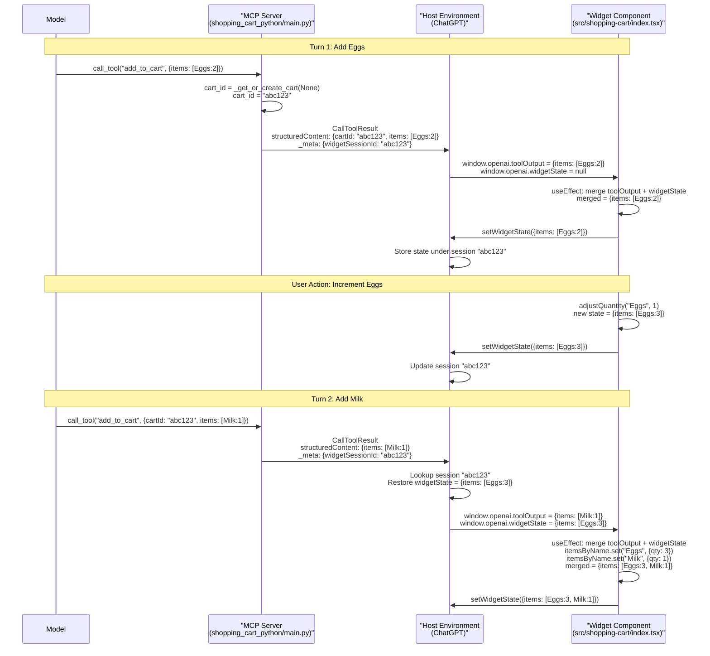
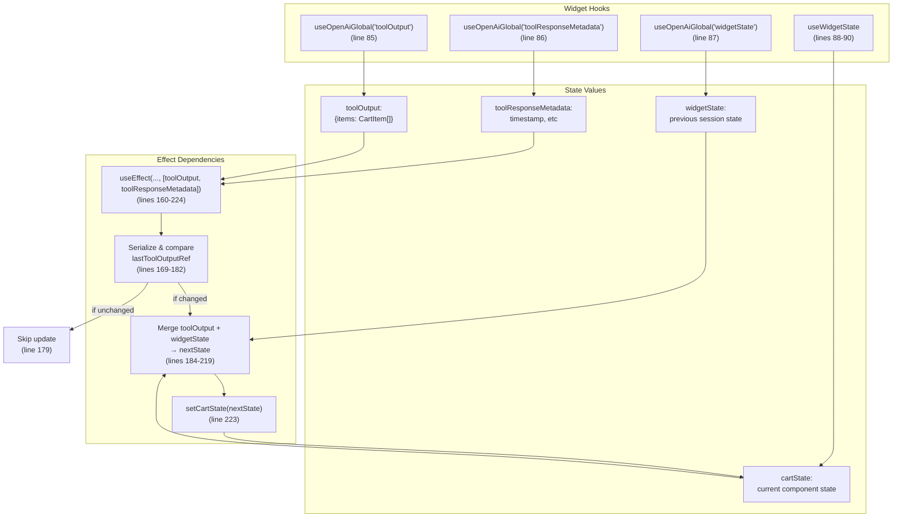
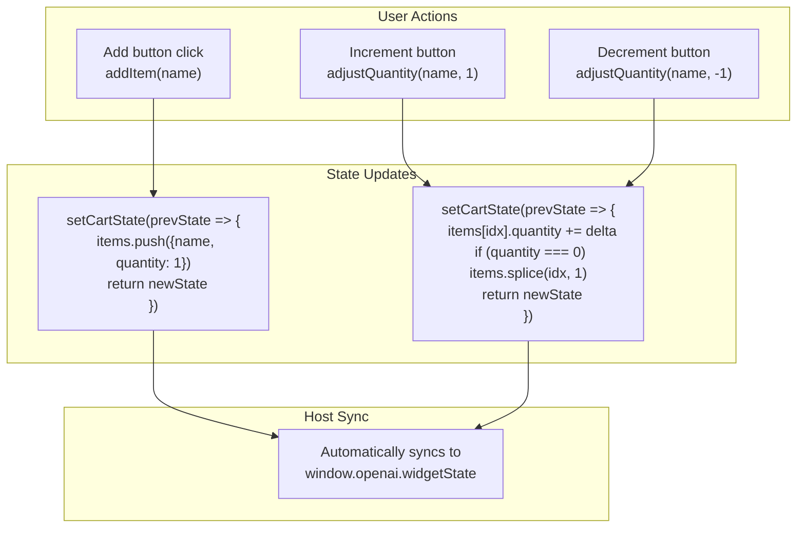
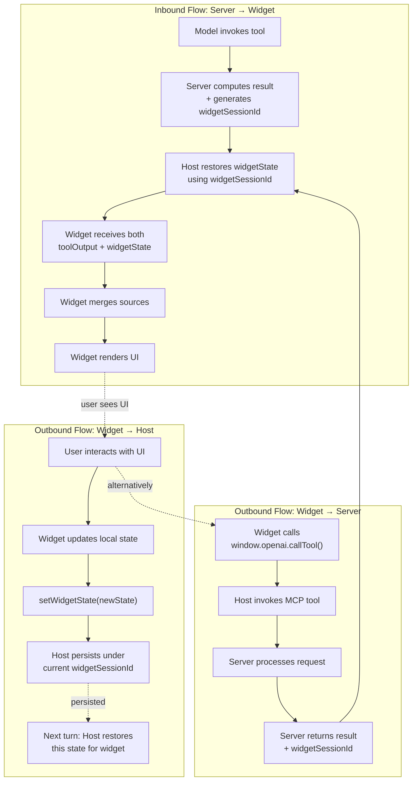

<!-- source: DeepWiki mcp.deepwiki.com · repo openai/openai-apps-sdk-examples · page 3.4 State Management and widgetSessionId · fetched 2026-10-26 -->

# State Management and widgetSessionId

<details>
<summary>Relevant source files</summary>

The following files were used as context for generating this wiki page:

- [shopping_cart_python/README.md](shopping_cart_python/README.md)
- [shopping_cart_python/requirements.txt](shopping_cart_python/requirements.txt)
- [src/shopping-cart/icons.tsx](src/shopping-cart/icons.tsx)
- [src/shopping-cart/index.tsx](src/shopping-cart/index.tsx)
- [src/types.ts](src/types.ts)
- [src/use-display-mode.ts](src/use-display-mode.ts)
- [src/use-max-height.ts](src/use-max-height.ts)
- [src/use-openai-global.ts](src/use-openai-global.ts)
- [src/use-widget-props.ts](src/use-widget-props.ts)
- [src/use-widget-state.ts](src/use-widget-state.ts)

</details>


## Purpose and Scope

This document explains how state management works in the Apps SDK, focusing on the relationship between `widgetState`, `widgetSessionId`, and `toolOutput`. It covers the architectural patterns for maintaining state consistency across conversational turns and the synchronization mechanisms between MCP servers and widget components.

For implementation-specific patterns and hooks (`useWidgetState`, `useWidgetProps`), see [State Management Patterns](#4.3). For the overall widget rendering lifecycle, see [Widget Rendering Flow](#3.3).

## State Sources in Apps SDK

Widgets in the Apps SDK have access to three primary state sources, each serving a distinct purpose:

| State Source | Lifecycle | Access Pattern | Typical Use |
|-------------|-----------|---------------|-------------|
| `toolOutput` | Per tool invocation | Read-only via `window.openai.toolOutput` | Server-computed data from most recent tool call |
| `widgetState` | Persistent across turns | Read/write via `window.openai.widgetState` | User modifications, UI state, derived data |
| `widgetSessionId` | Session identifier | Metadata in tool response `_meta.openai/widgetSessionId` | Keys `widgetState` to specific session/resource |

### toolOutput

The `toolOutput` contains the `structuredContent` returned by the MCP server in the most recent tool call. This data is immutable from the widget's perspective and represents the "source of truth" for server-computed information.

**Example structure:**
```typescript
{
  "cartId": "abc123",
  "items": [
    { "name": "Eggs", "quantity": 2 }
  ]
}
```

### widgetState

The `widgetState` is a persistent storage mechanism managed by the host environment (ChatGPT). Widgets can read and write to this state, and changes persist across tool invocations when properly keyed by `widgetSessionId`.

Widgets access this state through `useWidgetState` hook [src/use-widget-state.ts:5-46]() or directly via `window.openai.widgetState` [src/types.ts:22]().

### widgetSessionId

The `widgetSessionId` is a session identifier returned in the tool response metadata that the host uses to associate `widgetState` with a specific resource or session. When a server includes `_meta.openai/widgetSessionId` in a tool response, the host environment:

1. Uses this identifier to retrieve any previously stored `widgetState` for that session.
2. Makes that state available to the widget via `window.openai.widgetState`.
3. Persists any widget state updates under this session identifier for future turns.

**Sources:** [shopping_cart_python/README.md:35-37](), [src/types.ts:18-23]()

## The widgetSessionId Pattern

The following diagram illustrates how state is maintained and merged across multiple conversational turns.

**State Evolution across Turns**

```mermaid
graph TB
    subgraph Turn1["Turn 1: Initial Tool Call"]
        T1Call["Model calls add_to_cart<br/>arguments: {items: [{name: 'Eggs', qty: 2}]}"]
        T1Server["Server: _get_or_create_cart()<br/>cart_id = uuid4().hex<br/>returns structuredContent + widgetSessionId"]
        T1Meta["Tool Response _meta:<br/>{openai/widgetSessionId: 'abc123'}"]
        T1Widget["Widget receives:<br/>toolOutput.items = [Eggs:2]<br/>widgetState = null"]
        T1Update["Widget writes to widgetState:<br/>{cartId: 'abc123', items: [Eggs:2]}"]
    end
    
    subgraph Turn2["Turn 2: User Modifies UI"]
        T2UI["User clicks + button<br/>adjustQuantity('Eggs', 1)"]
        T2State["Widget updates widgetState:<br/>{cartId: 'abc123', items: [Eggs:3]}"]
        T2NoServer["No server call<br/>State persisted in host"]
    end
    
    subgraph Turn3["Turn 3: Subsequent Tool Call"]
        T3Call["Model calls add_to_cart<br/>arguments: {cartId: 'abc123', items: [{name: 'Milk', qty: 1}]}"]
        T3Server["Server returns same widgetSessionId:<br/>{openai/widgetSessionId: 'abc123'}"]
        T3Restore["Host restores widgetState<br/>from session 'abc123':<br/>{cartId: 'abc123', items: [Eggs:3]}"]
        T3Widget["Widget receives:<br/>toolOutput.items = [Milk:1]<br/>widgetState = {items: [Eggs:3]}"]
        T3Merge["Widget merges:<br/>toolOutput + widgetState<br/>→ {items: [Eggs:3, Milk:1]}"]
    end
    
    T1Call --> T1Server
    T1Server --> T1Meta
    T1Meta --> T1Widget
    T1Widget --> T1Update
    
    T1Update -.persisted.-> T2UI
    T2UI --> T2State
    T2State --> T2NoServer
    
    T2NoServer -.persisted.-> T3Call
    T3Call --> T3Server
    T3Server --> T3Restore
    T3Restore --> T3Widget
    T3Widget --> T3Merge

    style T1Meta fill:#f9f9f9
    style T3Restore fill:#f9f9f9
    style T3Merge fill:#f9f9f9
```


This pattern enables state continuity across three scenarios:

1. **Server-initiated changes**: Tool calls add new data via `toolOutput`.
2. **User-initiated changes**: UI interactions modify `widgetState` without server involvement.
3. **Merged state**: Widget combines both sources to maintain a consistent view.

**Sources:** [shopping_cart_python/README.md:33-37](), [src/shopping-cart/index.tsx:158-224]()

## State Synchronization Flow

The shopping cart implementation demonstrates the canonical synchronization pattern between the MCP server and the React widget.

**Synchronization Sequence**


### Key Synchronization Points

1. **Server Response**: The server sets `_meta["openai/widgetSessionId"]` to the cart identifier, ensuring subsequent calls for the same cart restore the correct state.
2. **Widget Effect**: The `useEffect` hook in `App` [src/shopping-cart/index.tsx:160-224]() triggers when `toolOutput` changes, merging incoming items with existing `widgetState`.
3. **State Merge Logic**: Uses a `Map` [src/shopping-cart/index.tsx:201-219]() to combine items by name, preferring existing quantities from `widgetState` while adding new items from `toolOutput`.
4. **Deduplication**: The widget serializes `toolOutput` and `toolResponseMetadata` [src/shopping-cart/index.tsx:169-182]() to detect actual changes, preventing unnecessary merge operations when `widgetState` updates trigger global events.

**Sources:** [src/shopping-cart/index.tsx:84-224](), [shopping_cart_python/README.md:33-37]()

## Widget-Side Implementation

### State Initialization and Hooks

The widget uses several hooks to access global state and manage local synchronization.

**Widget State Hook Architecture**


### Merge Algorithm

The widget implements a map-based merge strategy to combine server data with local modifications:

**Algorithm steps** [src/shopping-cart/index.tsx:184-223]():

1. **Extract incoming data**: Parse `toolOutput.items` and `toolOutput.cartId`.
2. **Determine base state**: Use `widgetState ?? cartState ?? createDefaultCartState()` as the foundation.
3. **Build item map**: Create a `Map<string, CartItem>` from base state items, keyed by item name.
4. **Merge incoming items**: For each item in `toolOutput.items`, merge into the map (new items override with the spread operator).
5. **Construct next state**: Convert map values to an array, and preserve or set `cartId`.
6. **Update component state**: Call `setCartState(nextState)`, which automatically syncs to `window.openai.widgetState` via the `useWidgetState` hook [src/use-widget-state.ts:36]().

### User Interaction Handlers

UI interactions such as adding or removing items trigger local state updates that are immediately persisted to the host.

**User Action Flow**


**Sources:** [src/shopping-cart/index.tsx:99-156](), [src/use-widget-state.ts:30-43]()

## Bidirectional Data Flow

The relationship between the Server, Host, and Widget creates a bidirectional loop for state.

**System Data Flow**


**Sources:** [shopping_cart_python/README.md:33-45](), [src/types.ts:29-38]()

## Production Considerations

The shopping cart example demonstrates the mechanics of `widgetSessionId`, but production implementations should adopt more robust persistence strategies.

### Server-Side Persistence

**Recommended pattern** [shopping_cart_python/README.md:39-45]():

1. Store data in a persistent datastore (database, Redis, etc.) keyed by session/cart ID.
2. On each tool call:
   - Load state from the datastore using the provided ID.
   - Apply incoming changes and persist.
   - Return state in `structuredContent` and include `_meta.openai/widgetSessionId`.
3. Widget interactions:
   - Invoke MCP tools via `window.openai.callTool()` [src/types.ts:30]() to mutate state server-side.
   - The server responds with updated state, and the widget receives it via `toolOutput`.

### Benefits of Server-Side Persistence

| Aspect | Client-Side State (`widgetState`) | Server-Side Persistence |
|--------|------------------|------------------------|
| **Durability** | Lost on session end | Survives across devices/sessions |
| **Multi-device** | No synchronization | Consistent across all clients |
| **Authority** | Widget is source of truth | Server is source of truth |
| **Conflict Resolution** | Manual merge logic in widget | Centralized transaction control |

**Sources:** [shopping_cart_python/README.md:39-47]()

---

