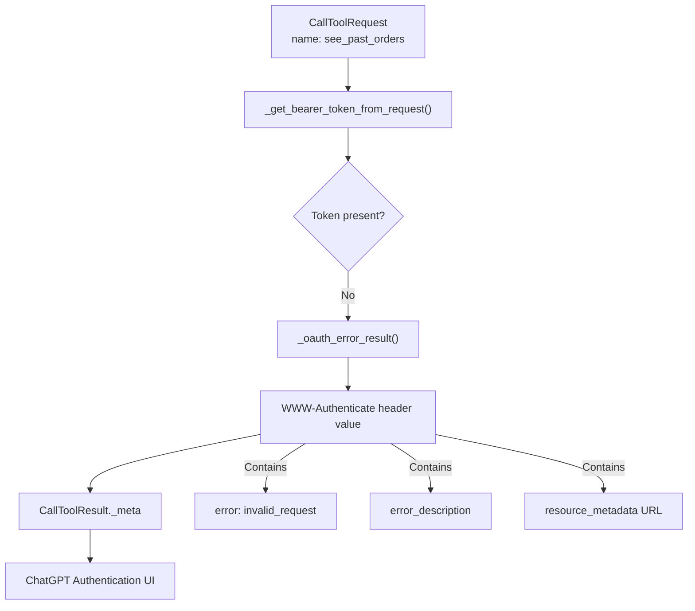
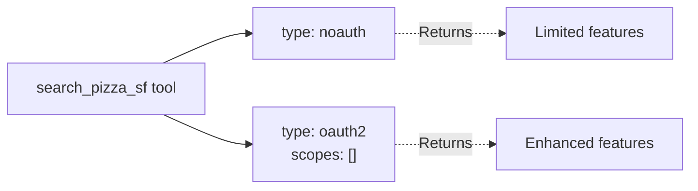
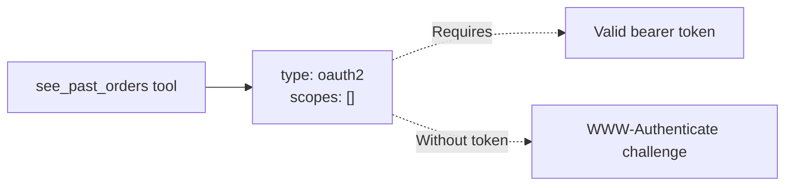
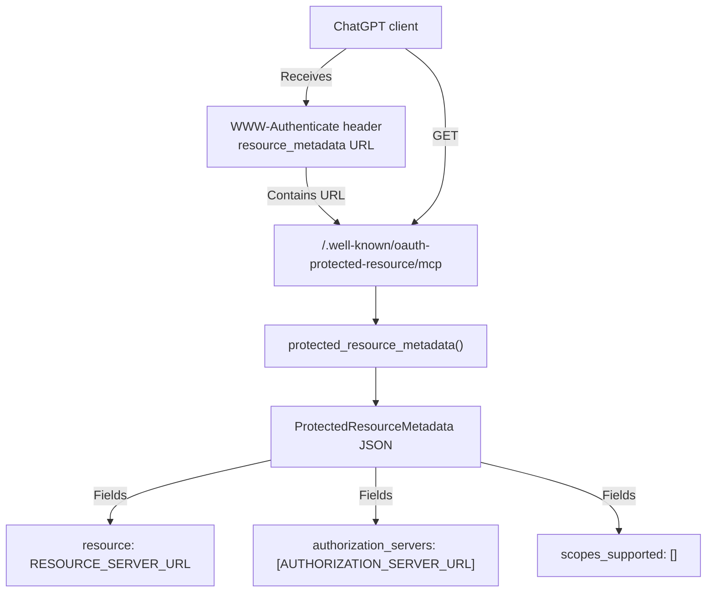
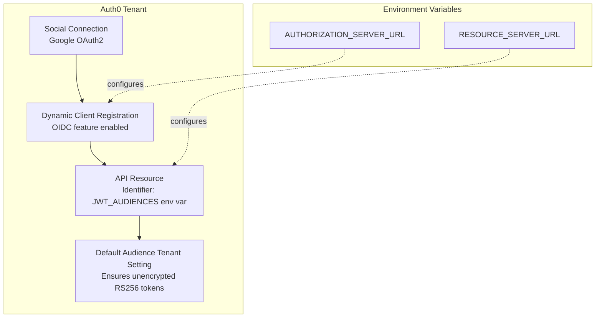
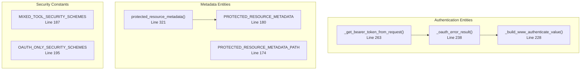

<!-- source: DeepWiki mcp.deepwiki.com · repo openai/openai-apps-sdk-examples · page 3.5 Authentication and OAuth · fetched 2026-10-26 -->

# Authentication and OAuth

<details>
<summary>Relevant source files</summary>

The following files were used as context for generating this wiki page:

- [authenticated_server_python/.env.example](authenticated_server_python/.env.example)
- [authenticated_server_python/README.md](authenticated_server_python/README.md)
- [authenticated_server_python/main.py](authenticated_server_python/main.py)
- [authenticated_server_python/requirements.txt](authenticated_server_python/requirements.txt)

</details>


This page explains the MCP authorization specification implementation and OAuth flow used in authenticated MCP servers. It covers how tools trigger ChatGPT's authentication UI, how OAuth discovery works through RFC 9728 metadata, and how tokens are validated.

## MCP Authorization Specification

The MCP protocol defines a standardized way for servers to require OAuth authentication through `WWW-Authenticate` challenges and security schemes metadata. When a protected tool is invoked without a valid bearer token, the server returns an error result containing authentication metadata that triggers ChatGPT's authentication UI.

### WWW-Authenticate Challenge Structure

When authentication is required, the server constructs a `CallToolResult` with `isError=True` and includes a `mcp/www_authenticate` metadata field:



**Sources:** [authenticated_server_python/main.py:228-260](), [authenticated_server_python/main.py:499-503](), [authenticated_server_python/README.md:1-16]()

The `_build_www_authenticate_value` function constructs the header value:

| Field | Purpose | Example Value |
|-------|---------|---------------|
| `error` | OAuth 2.0 error code | `"invalid_request"` |
| `error_description` | Human-readable message | `"No access token was provided"` |
| `resource_metadata` | URL to RFC 9728 metadata | `"https://example.ngrok-free.app/.well-known/oauth-protected-resource/mcp"` |

The complete header value follows this format: `Bearer error="{error}", error_description="{description}", resource_metadata="{url}"`

**Sources:** [authenticated_server_python/main.py:228-236]()

### Security Schemes

Tools declare their authentication requirements through `securitySchemes` arrays in the tool metadata. Two patterns are supported in the example:

**Mixed Authentication (MIXED_TOOL_SECURITY_SCHEMES)**



Supports both authenticated and unauthenticated requests. The tool works without a token but may provide degraded functionality or prompt for login.

**Sources:** [authenticated_server_python/main.py:187-193](), [authenticated_server_python/README.md:12-12]()

**OAuth-Only Authentication (OAUTH_ONLY_SECURITY_SCHEMES)**



Requires a valid OAuth token for all requests. Unauthenticated requests receive a `WWW-Authenticate` challenge.

**Sources:** [authenticated_server_python/main.py:195-200](), [authenticated_server_python/README.md:13-13]()

## OAuth Discovery (RFC 9728)

The server exposes a protected resource metadata endpoint following [RFC 9728](https://datatracker.ietf.org/doc/html/rfc9728) that advertises the authorization server location and supported scopes.

### Protected Resource Metadata Endpoint



The endpoint path is dynamically constructed from the `RESOURCE_SERVER_URL` environment variable to match the resource being protected:

**Sources:** [authenticated_server_python/main.py:170-178](), [authenticated_server_python/main.py:321-326]()

**Metadata Structure:**

```python
PROTECTED_RESOURCE_METADATA = ProtectedResourceMetadata(
    resource=RESOURCE_SERVER_URL,
    authorization_servers=[AUTHORIZATION_SERVER_URL],
    scopes_supported=RESOURCE_SCOPES,
)
```

| Field | Type | Description |
|-------|------|-------------|
| `resource` | `str` | The protected resource URL (this MCP server's `/mcp` endpoint) |
| `authorization_servers` | `List[str]` | Array containing the Auth0 authorization server URL |
| `scopes_supported` | `List[str]` | OAuth scopes required for access |

**Sources:** [authenticated_server_python/main.py:180-184](), [authenticated_server_python/.env.example:1-2]()

## Complete OAuth Flow

The authentication flow involves coordination between ChatGPT, the MCP server, and the Auth0 authorization server:

```mermaid
sequenceDiagram
    participant User
    participant ChatGPT
    participant MCP["MCP Server<br/>authenticated_server_python"]
    participant Metadata["/.well-known/oauth-protected-resource/mcp"]
    participant Auth0["Auth0 Authorization Server"]
    
    User->>ChatGPT: Invoke "see_past_orders" tool
    ChatGPT->>MCP: CallToolRequest (no token)
    MCP->>MCP: _get_bearer_token_from_request()
    MCP->>MCP: _oauth_error_result()
    MCP->>ChatGPT: CallToolResult (isError, WWW-Authenticate)
    
    ChatGPT->>Metadata: GET (fetch metadata)
    Metadata->>ChatGPT: ProtectedResourceMetadata JSON
    
    ChatGPT->>Auth0: Dynamic Client Registration
    Auth0->>ChatGPT: Client credentials
    
    ChatGPT->>User: Trigger authentication UI
    User->>Auth0: Social login (Google OAuth2)
    Auth0->>ChatGPT: RS256 JWT access token
    
    ChatGPT->>MCP: CallToolRequest (Authorization: Bearer {token})
    MCP->>MCP: _get_bearer_token_from_request()
    MCP->>MCP: _call_tool_request()
    MCP->>ChatGPT: CallToolResult (orders data)
```

**Sources:** [authenticated_server_python/README.md:1-16](), [authenticated_server_python/main.py:477-526]()

### Token Extraction

The `_get_bearer_token_from_request` function extracts the bearer token from multiple possible header locations (ASGI scope, Starlette request headers, or raw dictionary) for compatibility:

**Sources:** [authenticated_server_python/main.py:263-318]()

### Token Validation

The example server checks for token presence but does not validate JWT signatures or claims. In a production environment, you should validate the JWT using the authorization server's public keys.

```python
if not _get_bearer_token_from_request():
    return _oauth_error_result(
        "Authentication required: no access token provided.",
        description="No access token was provided",
    )
```

**Sources:** [authenticated_server_python/main.py:499-503](), [authenticated_server_python/README.md:53-55]()

## Auth0 Configuration

The authenticated server requires specific Auth0 tenant configuration to enable Dynamic Client Registration and issue unencrypted JWT tokens.

### Required Auth0 Setup



**Configuration Steps:**

| Step | Action | Purpose |
|------|--------|---------|
| 1 | Create API Resource | Define protected resource with identifier matching the server's audience |
| 2 | Set Default Audience | Configure tenant-level default to issue RS256 JWTs (not JWE) |
| 3 | Enable DCR | Allow ChatGPT to register as OAuth client without manual configuration |
| 4 | Add Social Connection | Provide a social login mechanism for users |

**Sources:** [authenticated_server_python/README.md:19-39]()

## Transport Security

The MCP servers implement DNS rebinding protection and CORS policies to secure the transport layer.

### DNS Rebinding Protection

The server uses `TransportSecuritySettings` to manage host and origin validation. If `MCP_ALLOWED_HOSTS` or `MCP_ALLOWED_ORIGINS` are set in the environment, protection is enabled.

```python
def _transport_security_settings() -> TransportSecuritySettings:
    allowed_hosts = _split_env_list(os.getenv("MCP_ALLOWED_HOSTS"))
    allowed_origins = _split_env_list(os.getenv("MCP_ALLOWED_ORIGINS"))
    if not allowed_hosts and not allowed_origins:
        return TransportSecuritySettings(enable_dns_rebinding_protection=False)
    return TransportSecuritySettings(
        enable_dns_rebinding_protection=True,
        allowed_hosts=allowed_hosts,
        allowed_origins=allowed_origins,
    )
```

**Sources:** [authenticated_server_python/main.py:209-218](), [authenticated_server_python/main.py:221-225]()

### Code Entity Mapping



**Sources:** [authenticated_server_python/main.py:170-326]()

---

