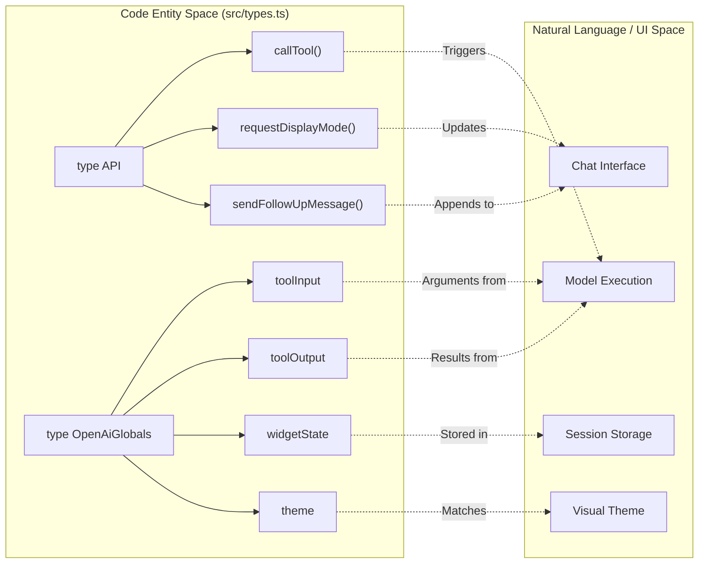
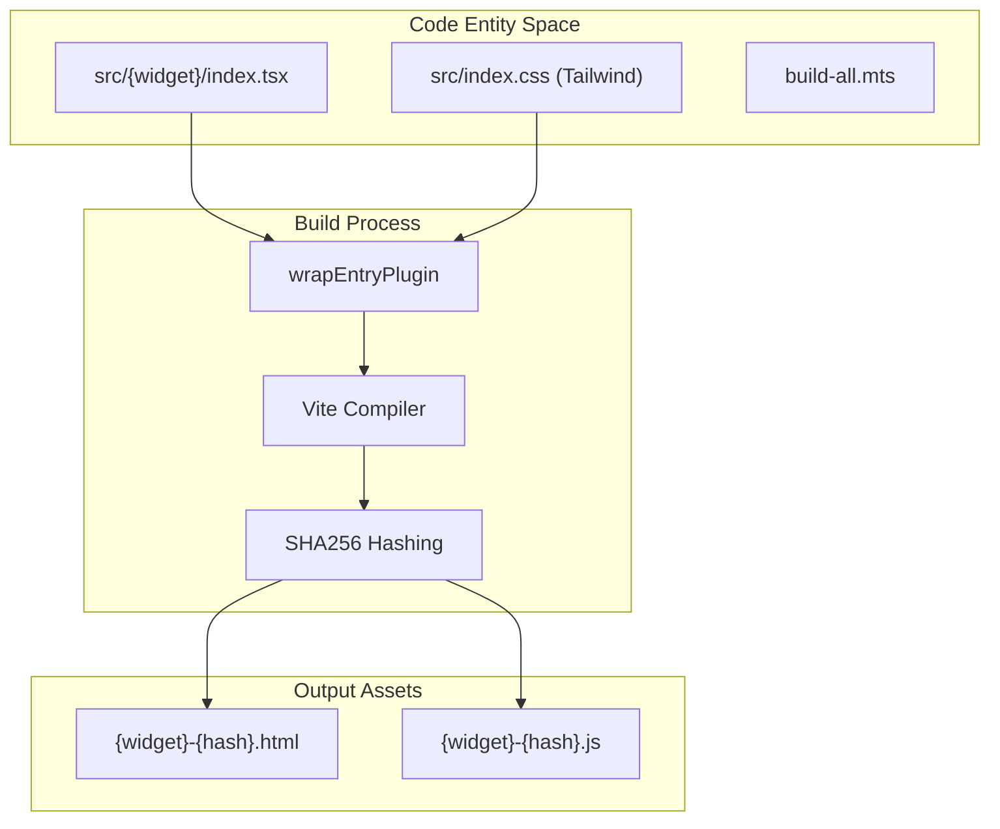

<!-- source: DeepWiki mcp.deepwiki.com · repo openai/openai-apps-sdk-examples · page 4 Widget Development · fetched 2026-10-26 -->

# Widget Development

Relevant source files

The following files were used as context for generating this wiki page:

- [src/types.ts](src/types.ts)
- [src/use-display-mode.ts](src/use-display-mode.ts)
- [src/use-max-height.ts](src/use-max-height.ts)
- [src/use-openai-global.ts](src/use-openai-global.ts)
- [src/use-widget-props.ts](src/use-widget-props.ts)
- [src/use-widget-state.ts](src/use-widget-state.ts)

This document provides a comprehensive overview of developing UI widgets for the Apps SDK. Widgets are self-contained React components bundled as standalone HTML files that render rich, interactive interfaces within ChatGPT conversations. They communicate with the host environment through the `window.openai` API and receive data via `toolInput`, `toolOutput`, and `widgetState` globals.

For detailed information on the `window.openai` API surface, see [window.openai API Reference](#4.2). For patterns on state synchronization, see [State Management Patterns](#4.3).

## Overview

Widgets in this repository serve three primary functions:

1.  **Display tool outputs** - Render structured data returned by MCP tool executions in visually rich formats (maps, carousels, 3D visualizations).
2.  **Enable user interactions** - Allow users to interact with data through UI controls that trigger additional tool calls via `window.openai.callTool`.
3.  **Maintain session state** - Persist widget-specific state across display mode changes or conversational turns using `window.openai.setWidgetState`.

Each widget is authored as a React component in `src/`, compiled by Vite into a single HTML file with embedded assets, and served from a static file server. MCP servers reference these HTML files in their tool responses via `_meta.openai/outputTemplate` metadata.

**Sources:** [src/types.ts:1-25](), [src/types.ts:29-38]()

## Widget Architecture

The widget architecture relies on a "Bridge" pattern where the ChatGPT host injects a global `openai` object into the widget's iframe sandbox. This bridge allows the React application to communicate with the model and the chat UI.

### Component Structure
Widgets are typically structured with a root `App.tsx` that utilizes specialized React hooks to access the host context. These hooks provide a reactive interface to the `window.openai` globals.

| Hook | Purpose | Source |
|------|---------|--------|
| `useOpenAiGlobal` | Low-level hook to subscribe to any key in `window.openai` | [src/use-openai-global.ts:31-33]() |
| `useWidgetProps` | Accesses `toolOutput`, allowing for fallback default values | [src/use-widget-props.ts:3-5]() |
| `useWidgetState` | Manages persistent state synced with the host via `setWidgetState` | [src/use-widget-state.ts:5-13]() |
| `useDisplayMode` | Subscribes to the current `DisplayMode` (pip, inline, fullscreen) | [src/use-display-mode.ts:4-4]() |

For details on component patterns and integration, see [Widget Architecture](#4.1).

**Sources:** [src/use-openai-global.ts:31-96](), [src/use-widget-state.ts:5-46](), [src/use-widget-props.ts:3-14]()

## Core Widget API: window.openai

The `window.openai` object is the primary interface between the widget and the Apps SDK. It contains both stateful properties (globals) and functional methods.

### System Mapping: Code Entities to Host Context
The following diagram maps the TypeScript definitions in the SDK to the functional areas of the ChatGPT interface.

**Sources:** [src/types.ts:1-25](), [src/types.ts:29-38]()

## State Management Patterns

State in widgets is managed across three layers:
1.  **Tool Input/Output**: Static data passed from the MCP server tool execution [src/types.ts:19-21]().
2.  **Widget State**: Client-side state persisted by the host (e.g., UI toggle positions, map coordinates) via `setWidgetState` [src/types.ts:23]().
3.  **Local Component State**: Standard React `useState` for transient UI interactions that don't require persistence.

The `useWidgetState` hook bridges local React state with the host's persistence layer, ensuring that when a widget is re-mounted (e.g., switching from `inline` to `fullscreen`), its state is restored [src/use-widget-state.ts:16-24]().

For details, see [State Management Patterns](#4.3).

**Sources:** [src/use-widget-state.ts:30-43](), [src/types.ts:70-78]()

## Build and Development

The build system uses a custom TypeScript orchestrator (`build-all.mts`) and Vite to bundle widgets.

### Build Workflow
The build process transforms individual widget directories into hashed HTML assets.

For details on the build process and environment variables like `BASE_URL`, see [Build System](#4.4). For information on the development server and hot reloading, see [Development Workflow](#4.5).

**Sources:** [src/types.ts:101-109](), [src/use-openai-global.ts:34-56]()

## Styling and UI

Widgets use Tailwind CSS for styling. The SDK provides a shared `index.css` that ensures widgets maintain a consistent look and feel with the ChatGPT interface. Widgets also receive `theme` (light/dark) and `safeArea` insets from the host to ensure they render correctly across different devices and system settings.

For details, see [Styling and CSS](#4.6).

**Sources:** [src/types.ts:8](), [src/types.ts:47-58]()

## Example Widgets

The repository includes a variety of examples ranging from simple display components to complex interactive applications:

*   **Pizzaz Widgets**: Demonstrates maps, carousels, and list views.
*   **Solar System**: 3D visualization using Three.js.
*   **Kitchen Sink**: A comprehensive reference for every `window.openai` API.
*   **Cards Against AI**: The most advanced example, featuring real-time state streaming and complex tool interactions.

For an overview of all examples, see [Example Widgets](#4.7). For a deep dive into the most complex implementation, see [Cards Against AI Widget](#4.8).

**Sources:** [src/types.ts:1-109]()

---

