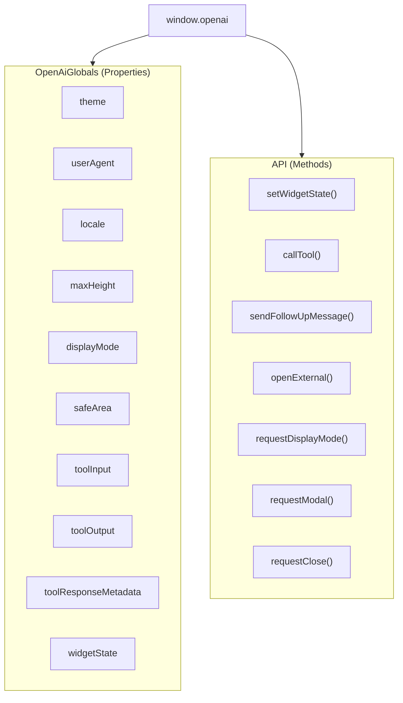
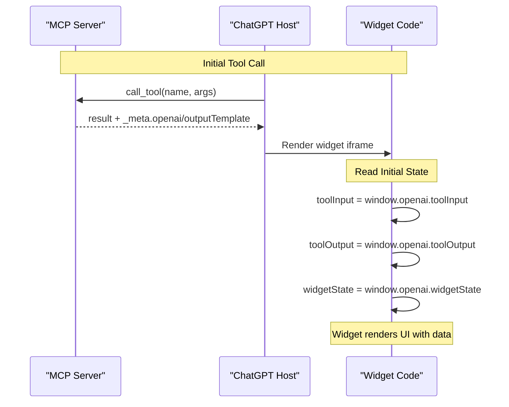

<!-- source: DeepWiki mcp.deepwiki.com · repo openai/openai-apps-sdk-examples · page 4.2 window.openai API Reference · fetched 2026-10-26 -->

# window.openai API Reference

<details>
<summary>Relevant source files</summary>

The following files were used as context for generating this wiki page:

- [.gitignore](.gitignore)
- [package.json](package.json)
- [pnpm-lock.yaml](pnpm-lock.yaml)
- [pnpm-workspace.yaml](pnpm-workspace.yaml)
- [src/kitchen-sink-lite/index.tsx](src/kitchen-sink-lite/index.tsx)
- [src/kitchen-sink-lite/kitchen-sink-lite.tsx](src/kitchen-sink-lite/kitchen-sink-lite.tsx)
- [src/types.ts](src/types.ts)
- [src/use-display-mode.ts](src/use-display-mode.ts)
- [src/use-max-height.ts](src/use-max-height.ts)
- [src/use-openai-global.ts](src/use-openai-global.ts)
- [src/use-widget-props.ts](src/use-widget-props.ts)
- [src/use-widget-state.ts](src/use-widget-state.ts)

</details>


This document provides a complete reference for the `window.openai` API available to widgets rendered in the ChatGPT Apps SDK. This API serves as the bidirectional communication bridge between widgets and the ChatGPT host environment, enabling widgets to read context, update state, call MCP tools, and control their display behavior.

For architectural context on how widgets integrate with the Apps SDK, see [Widget Architecture](#4.1). For practical examples of using these APIs, see [Kitchen Sink Widget](#4.7.4).

---

## API Structure Overview

The `window.openai` object combines two type definitions: `OpenAiGlobals` (read-only context properties) and `API` (callable methods). This unified interface is injected by the Apps SDK at widget render time [src/types.ts:98-104]().

**Diagram: window.openai API Structure**



**Sources:** [src/types.ts:1-104]()

---

## Global Properties

Global properties provide read-only context about the current widget's environment, display state, and data. These values are hydrated by the Apps SDK when the widget is rendered and may update during the widget's lifecycle.

### Visual and Locale Properties

| Property | Type | Description |
|----------|------|-------------|
| `theme` | `"light" \| "dark"` | Current theme of the ChatGPT interface [src/types.ts:8]() |
| `locale` | `string` | User's locale string (e.g., "en-US") [src/types.ts:11]() |
| `userAgent` | `UserAgent` | Device type and capability information [src/types.ts:10]() |

#### UserAgent Structure

```typescript
userAgent: {
  device: { 
    type: "mobile" | "tablet" | "desktop" | "unknown" 
  };
  capabilities: {
    hover: boolean;  // Whether device supports hover interactions
    touch: boolean;  // Whether device supports touch interactions
  };
}
```

**Sources:** [src/types.ts:8-11](), [src/types.ts:60-68]()

### Layout Properties

| Property | Type | Description |
|----------|------|-------------|
| `displayMode` | `DisplayMode` | Current display mode: `"pip"`, `"inline"`, or `"fullscreen"` [src/types.ts:15]() |
| `maxHeight` | `number` | Maximum height in pixels available to the widget [src/types.ts:14]() |
| `safeArea` | `SafeArea` | Safe area insets for avoiding system UI overlays [src/types.ts:16]() |

#### SafeArea Structure

```typescript
safeArea: {
  insets: {
    top: number;     // Pixels to inset from top edge
    bottom: number;  // Pixels to inset from bottom edge
    left: number;    // Pixels to inset from left edge
    right: number;   // Pixels to inset from right edge
  };
}
```

The `safeArea` property is particularly important for fullscreen widgets on mobile devices where system UI (notches, home indicators) may overlap widget content [src/types.ts:49-58]().

**Sources:** [src/types.ts:14-16](), [src/types.ts:49-58](), [src/types.ts:71]()

### Tool State Properties

These properties contain the data flow between the MCP tool execution and the widget UI.

| Property | Type | Description |
|----------|------|-------------|
| `toolInput` | `ToolInput` | Arguments passed to the MCP tool that generated this widget [src/types.ts:19]() |
| `toolOutput` | `ToolOutput \| null` | Structured result returned by the MCP tool [src/types.ts:20]() |
| `toolResponseMetadata` | `ToolResponseMetadata \| null` | Additional metadata from the MCP tool response [src/types.ts:21]() |
| `widgetState` | `WidgetState \| null` | Persistent state stored by the widget across interactions [src/types.ts:22]() |

**Diagram: Tool State Data Flow**



**Sources:** [src/types.ts:18-25](), [src/kitchen-sink-lite/kitchen-sink-lite.tsx:98-104]()

---

## API Methods

API methods enable widgets to interact with the ChatGPT host, trigger actions, and update their own state or display behavior.

### setWidgetState

Persists widget state that survives across widget re-renders and tool calls [src/types.ts:23]().

```typescript
setWidgetState: (state: WidgetState) => Promise<void>
```

**Parameters:**
- `state`: Object containing the widget state to persist

**Returns:** Promise that resolves when state is successfully persisted

**Usage:**
```typescript
await window.openai.setWidgetState({
  note: "User took a note",
  savedAt: new Date().toISOString()
});
```

The persisted state becomes available in `window.openai.widgetState` on subsequent renders [src/use-widget-state.ts:14-24]().

**Sources:** [src/types.ts:23](), [src/use-widget-state.ts:30-43]()

### callTool

Invokes another MCP tool from within the widget, enabling widgets to refresh data or trigger actions without user interaction [src/types.ts:30]().

```typescript
callTool: (name: string, args: Record<string, unknown>) => Promise<CallToolResponse>
```

**Parameters:**
- `name`: The name of the MCP tool to call
- `args`: Arguments object matching the tool's input schema

**Returns:** Promise resolving to `{ result: string }` [src/types.ts:80-82]()

**Usage:**
```typescript
const response = await window.openai.callTool("kitchen-sink-refresh", {
  message: "Refresh requested from widget"
});

// The result is typically a JSON string
const data = JSON.parse(response.result);
```

**Sources:** [src/types.ts:30](), [src/types.ts:85-88](), [src/kitchen-sink-lite/kitchen-sink-lite.tsx:184-210]()

### sendFollowUpMessage

Sends a follow-up message to the conversation on behalf of the user, allowing widgets to suggest next actions or provide clarifying information [src/types.ts:31]().

```typescript
sendFollowUpMessage: (args: { prompt: string, scrollToBottom?: boolean }) => Promise<void>
```

**Parameters:**
- `args.prompt`: The message text to send to the conversation
- `args.scrollToBottom`: Optional boolean to control UI behavior

**Returns:** Promise that resolves when the message is sent

**Sources:** [src/types.ts:31]()

### openExternal

Opens an external URL in the user's default browser [src/types.ts:32]().

```typescript
openExternal(payload: { href: string }): void;
```

**Parameters:**
- `payload.href`: The URL to open

**Returns:** void (synchronous)

**Sources:** [src/types.ts:32]()

### requestDisplayMode

Requests a change to the widget's display mode. The host may grant or reject the request based on device capabilities and user context [src/types.ts:35]().

```typescript
requestDisplayMode: (args: { mode: DisplayMode }) => Promise<{ mode: DisplayMode }>
```

**Parameters:**
- `args.mode`: Requested display mode (`"pip"`, `"inline"`, or `"fullscreen"`)

**Returns:** Promise resolving to `{ mode: DisplayMode }` containing the granted mode [src/types.ts:72-78]()

**Behavior:**
- The granted mode may differ from the requested mode.
- On mobile devices, `"pip"` is automatically coerced to `"fullscreen"` [src/types.ts:75-76]().
- The current display mode is always available via `window.openai.displayMode`.

**Sources:** [src/types.ts:35](), [src/types.ts:71-78]()

### requestModal

Requests the host to display a modal dialog. This API is used for secondary views or detailed information that should appear over the main widget [src/types.ts:36]().

```typescript
requestModal: (args: { title?: string; params?: UnknownObject }) => Promise<unknown>
```

**Parameters:**
- `args.title`: Optional modal title
- `args.params`: Optional parameters passed to the modal content

**Returns:** Promise resolving when the modal is closed.

**Sources:** [src/types.ts:36]()

### requestClose

Requests the widget to close [src/types.ts:37]().

```typescript
requestClose: () => Promise<void>
```

**Returns:** Promise that resolves when the widget is closed.

**Sources:** [src/types.ts:37]()

---

## Type Definitions

### Theme

```typescript
export type Theme = "light" | "dark";
```
**Sources:** [src/types.ts:47]()

### DisplayMode

```typescript
export type DisplayMode = "pip" | "inline" | "fullscreen";
```
**Sources:** [src/types.ts:71]()

### DeviceType

```typescript
export type DeviceType = "mobile" | "tablet" | "desktop" | "unknown";
```
**Sources:** [src/types.ts:60]()

### Generic Type Parameters

The `OpenAiGlobals` type is generic and can be specialized for type-safe tool contracts:

```typescript
export type OpenAiGlobals<
  ToolInput = UnknownObject,
  ToolOutput = UnknownObject,
  ToolResponseMetadata = UnknownObject,
  WidgetState = UnknownObject
>
```
**Sources:** [src/types.ts:1-6]()

---

## Global State Updates

The `window.openai` global properties can be updated dynamically by the host. Widgets can listen for these updates using the `openai:set_globals` custom event [src/types.ts:91-96]().

```typescript
export const SET_GLOBALS_EVENT_TYPE = "openai:set_globals";

export class SetGlobalsEvent extends CustomEvent<{
  globals: Partial<OpenAiGlobals>;
}> {
  readonly type = SET_GLOBALS_EVENT_TYPE;
}
```

**Sources:** [src/types.ts:91-96]()

---

## React Hooks Integration

The SDK examples provide reactive hooks for interacting with the `window.openai` API.

### useOpenAiGlobal

Provides reactive access to individual `window.openai` properties, using `useSyncExternalStore` to listen for `SET_GLOBALS_EVENT_TYPE` [src/use-openai-global.ts:31-96]().

```typescript
const theme = useOpenAiGlobal("theme");
const toolOutput = useOpenAiGlobal("toolOutput");
```

**Sources:** [src/use-openai-global.ts:1-96]()

### useWidgetState

A React hook that synchronizes local component state with the persistent `window.openai.setWidgetState` [src/use-widget-state.ts:5-46]().

```typescript
const [state, setState] = useWidgetState({ note: "" });

// Calling setState will internally call window.openai.setWidgetState
setState({ note: "Updated note" });
```

**Sources:** [src/use-widget-state.ts:30-43]()

### useWidgetProps

A helper hook to retrieve `toolOutput` with an optional fallback [src/use-widget-props.ts:3-14]().

```typescript
const props = useWidgetProps({ fallbackKey: "value" });
```

**Sources:** [src/use-widget-props.ts:1-15]()

---

## Complete Type Declaration

The global `window.openai` object is declared in TypeScript as:

```typescript
declare global {
  interface Window {
    openai: API & OpenAiGlobals;
  }

  interface WindowEventMap {
    [SET_GLOBALS_EVENT_TYPE]: SetGlobalsEvent;
  }
}
```

**Sources:** [src/types.ts:101-109]()

---

