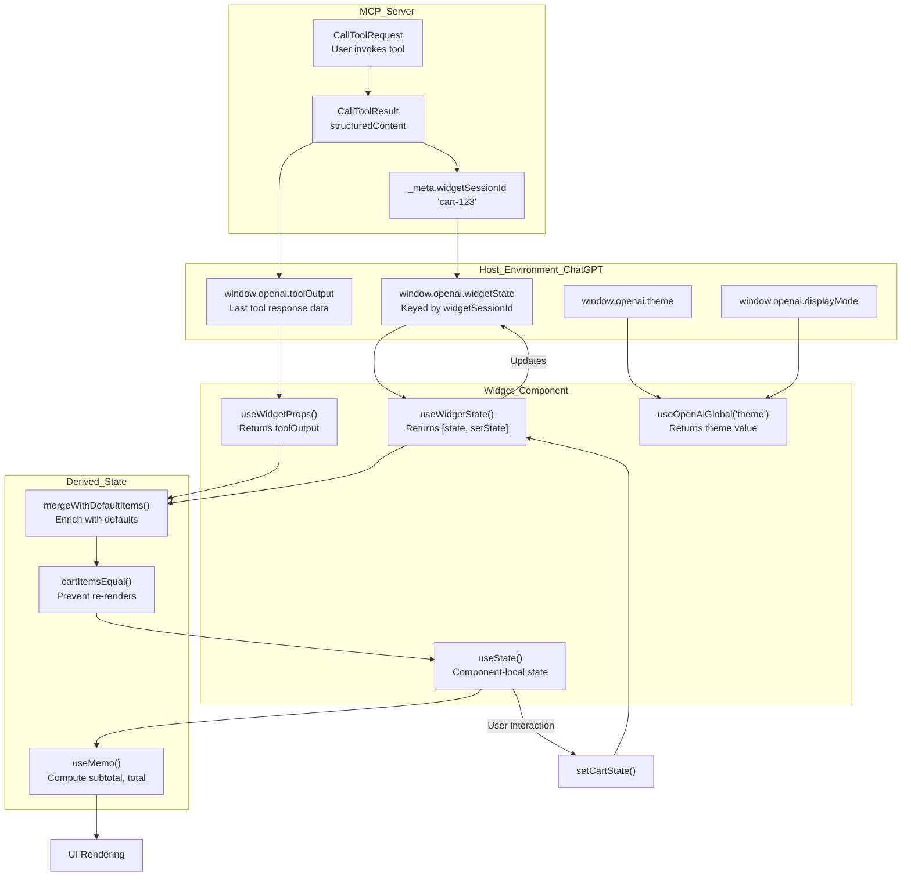
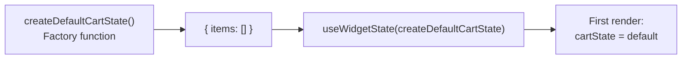
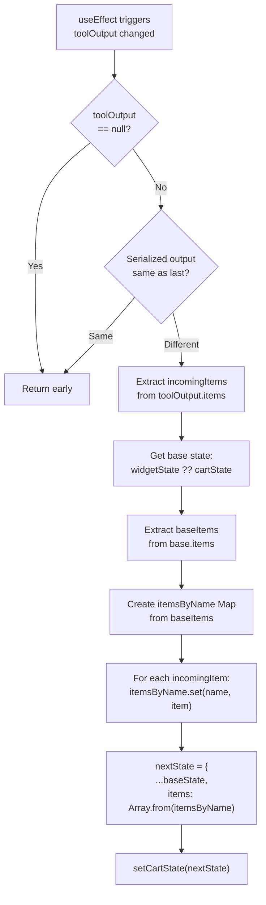
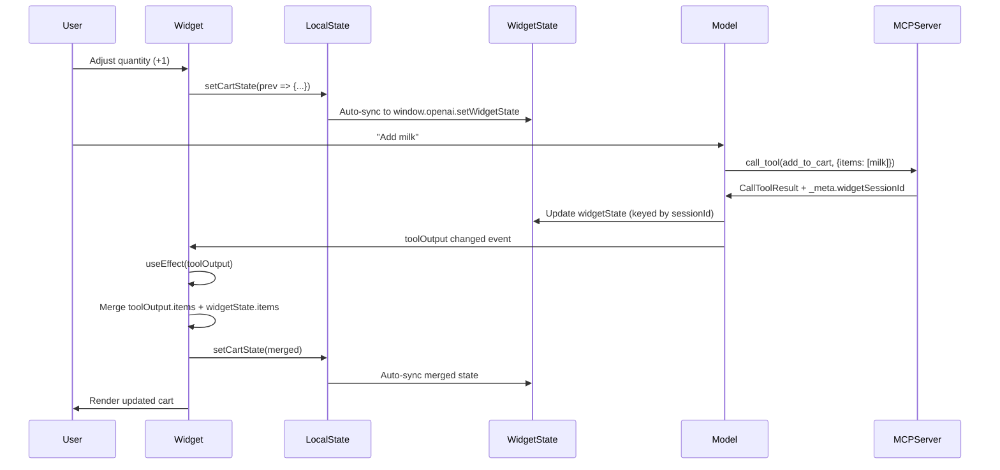

<!-- source: DeepWiki mcp.deepwiki.com · repo openai/openai-apps-sdk-examples · page 4.3 State Management Patterns · fetched 2026-10-26 -->

# State Management Patterns

<details>
<summary>Relevant source files</summary>

The following files were used as context for generating this wiki page:

- [shopping_cart_python/README.md](shopping_cart_python/README.md)
- [shopping_cart_python/requirements.txt](shopping_cart_python/requirements.txt)
- [src/shopping-cart/icons.tsx](src/shopping-cart/icons.tsx)
- [src/shopping-cart/index.tsx](src/shopping-cart/index.tsx)
- [src/types.ts](src/types.ts)
- [src/use-display-mode.ts](src/use-display-mode.ts)
- [src/use-max-height.ts](src/use-max-height.ts)
- [src/use-openai-global.ts](src/use-openai-global.ts)
- [src/use-widget-props.ts](src/use-widget-props.ts)
- [src/use-widget-state.ts](src/use-widget-state.ts)

</details>


This page documents patterns for managing state in Apps SDK widgets, including the use of `useWidgetState`, `useWidgetProps`, and `useOpenAiGlobal` hooks, state merging strategies, and synchronization mechanisms. It explains how widgets maintain state across conversational turns and user interactions.

For information about the `window.openai` API that underlies these patterns, see [window.openai API Reference](#4.2). For architectural context on state management in the overall system, see [State Management and widgetSessionId](#3.4).

## State Sources in Widgets

Widgets work with three distinct state sources that must be coordinated:

| State Source | Access Method | Persistence | Use Case |
|-------------|---------------|-------------|----------|
| `toolOutput` | `useWidgetProps()` | Single turn | Read-only data from most recent tool invocation |
| `widgetState` | `useWidgetState()` | Cross-turn (with `widgetSessionId`) | Persistent UI state that survives conversation turns |
| Local React State | `useState()` | Component lifecycle only | Ephemeral UI state (hover, focus, filters) |

**Three-Source State Flow**



**Sources:**
- [src/shopping-cart/index.tsx:84-90]()
- [shopping_cart_python/README.md:33-37]()
- [src/types.ts:18-23]()

## Core Hooks

### useWidgetProps

Returns read-only data from the most recent tool invocation. This includes the structured content returned by the tool. It serves as a wrapper around `useOpenAiGlobal("toolOutput")`.

```typescript
const props = useWidgetProps<MyProps>(() => ({}));
```

**Implementation details:**
- Accesses `window.openai.toolOutput` via `useOpenAiGlobal` [src/use-widget-props.ts:6-6]().
- Accepts an optional `defaultState` factory or object [src/use-widget-props.ts:3-5]().

**Sources:**
- [src/use-widget-props.ts:3-14]()
- [src/shopping-cart/index.tsx:85-86]()

### useWidgetState

Provides read/write access to persistent state that survives across conversation turns when paired with `widgetSessionId`.

```typescript
const [cartState, setCartState] = useWidgetState<CartWidgetState>(
  createDefaultCartState
);
```

**Key behaviors:**
- State updates automatically synchronize to `window.openai.setWidgetState` [src/use-widget-state.ts:35-37]().
- When `_meta.widgetSessionId` is set in tool responses, the host restores previous state for that session, which is then read from `window.openai.widgetState` [src/use-widget-state.ts:14-14]().
- Uses `useEffect` to keep the local React state in sync with changes to the global `widgetState` from the host [src/use-widget-state.ts:26-28]().

**Sources:**
- [src/use-widget-state.ts:5-46]()
- [src/shopping-cart/index.tsx:88-90]()

### useOpenAiGlobal

Reads global values from the host environment. It uses `useSyncExternalStore` to subscribe to updates and handles polling if the values are not immediately available on `window.openai`.

```typescript
const toolOutput = useOpenAiGlobal("toolOutput");
const widgetState = useOpenAiGlobal("widgetState");
const displayMode = useOpenAiGlobal("displayMode");
```

**Implementation details:**
- Subscribes to `SET_GLOBALS_EVENT_TYPE` ("openai:set_globals") [src/use-openai-global.ts:35-60]().
- Implements a polling fallback (up to 40 checks every 250ms) to ensure initialization [src/use-openai-global.ts:62-84]().

**Sources:**
- [src/use-openai-global.ts:10-96]()
- [src/types.ts:91-96]()

## State Initialization and Defaults

**Factory Pattern for Default State**



Use factory functions rather than inline objects to prevent unnecessary re-initializations:

**Good:**
```typescript
const createDefaultCartState = (): CartWidgetState => ({
  items: [],
});

const [cartState, setCartState] = useWidgetState(createDefaultCartState);
```

**Sources:**
- [src/shopping-cart/index.tsx:19-21]()
- [src/use-widget-state.ts:21-23]()

## State Merging Patterns

### Merging Tool Output with Widget State

The shopping cart widget demonstrates the canonical pattern for merging incoming data with existing state. This is critical because a user might modify a cart in the UI (updating `widgetState`), and then the model might add an item via a tool (updating `toolOutput`).

**Shopping Cart Merge Flow**



**Implementation details:**

1. **Deduplication check** prevents redundant updates. Changes to `cartState` trigger global update events, so the widget must verify if the tool response actually changed [src/shopping-cart/index.tsx:169-182]().
2. **Source prioritization** treats `widgetState` (restored from the host session) as the primary source, falling back to local `cartState` [src/shopping-cart/index.tsx:194-194]().
3. **Map-based merging** ensures items are updated or added correctly based on unique keys (like `name`) [src/shopping-cart/index.tsx:201-212]().

**Sources:**
- [src/shopping-cart/index.tsx:160-224]()
- [shopping_cart_python/README.md:33-37]()

## Synchronization Patterns

### Unidirectional Updates from Local to Global

User interactions update local state via the setter from `useWidgetState`, which automatically pushes the update to the host environment.

```typescript
function adjustQuantity(name: string, delta: number) {
  setCartState((prevState) => {
    const baseState: CartWidgetState = prevState ?? {};
    const items = Array.isArray(baseState.items)
      ? baseState.items.map((item) => ({ ...item }))
      : [];

    const idx = items.findIndex((item) => item.name === name);
    if (idx === -1) return baseState;

    const current = items[idx];
    const nextQuantity = Math.max(0, (current.quantity ?? 0) + delta);
    
    if (nextQuantity === 0) {
      items.splice(idx, 1);
    } else {
      items[idx] = { ...current, quantity: nextQuantity };
    }

    return { ...baseState, items };
  });
}
```

**Sources:**
- [src/shopping-cart/index.tsx:125-156]()
- [src/use-widget-state.ts:30-43]()

### Bidirectional Synchronization with Tool Responses

**Complete State Lifecycle**



**Key insight:** The widget merges both sources of truth:
- `toolOutput` contains items from the tool response (e.g., items added by voice).
- `widgetState` contains items from previous UI interactions (e.g., quantity adjustments).

**Sources:**
- [src/shopping-cart/index.tsx:160-224]()
- [shopping_cart_python/README.md:33-37]()

## Session Persistence with widgetSessionId

### How widgetSessionId Enables Cross-Turn State

When a tool response includes `_meta["widgetSessionId"]`, the host environment keys the `widgetState` to that specific session ID. This allows the state to persist across multiple turns of a conversation even if other widgets or tools are used in between.

```mermaid
graph LR
    Turn1Start["Turn 1: User says<br/>'Add eggs'"]
    Turn1Tool["Tool call returns:<br/>items: [eggs]<br/>_meta.widgetSessionId: 'cart-123'"]
    Turn1State["Host stores widgetState<br/>keyed by 'cart-123'"]
    
    UserUI["User clicks +1 on eggs<br/>(between turns)"]
    UIUpdate["Widget updates widgetState<br/>eggs.quantity = 2"]
    
    Turn2Start["Turn 2: User says<br/>'Add milk'"]
    Turn2Restore["Host restores widgetState<br/>for 'cart-123'"]
    Turn2Tool["Tool returns:<br/>items: [milk]<br/>_meta.widgetSessionId: 'cart-123'"]
    Turn2Merge["Widget merges:<br/>[eggs(qty=2), milk(qty=1)]"]
    
    Turn1Start --> Turn1Tool
    Turn1Tool --> Turn1State
    Turn1State --> UserUI
    UserUI --> UIUpdate
    UIUpdate --> Turn2Start
    Turn2Start --> Turn2Restore
    Turn2Restore --> Turn2Tool
    Turn2Tool --> Turn2Merge
```



**Recommended Production Pattern:**
While `window.openai.widgetState` is useful for demo purposes, production apps should keep the authoritative state in a backend datastore. The `widgetSessionId` should still be used to lock the host and widget to the same session/resource ID [shopping_cart_python/README.md:39-47]().

**Sources:**
- [shopping_cart_python/README.md:3-4]()
- [shopping_cart_python/README.md:33-37]()
- [shopping_cart_python/README.md:39-47]()

## State Management Anti-Patterns

### Don't: Direct Mutation
Always use the functional updater pattern with `setCartState` to ensure React detects the change and synchronizes with the host.

### Don't: Inline Object Defaults
```typescript
// WRONG: Creates new object every render, potentially causing sync loops
const [state, setState] = useWidgetState({ items: [] });

// CORRECT: Use factory function
const createDefault = () => ({ items: [] });
const [state, setState] = useWidgetState(createDefault);
```

### Don't: Ignore toolOutput Serialization
Failing to check if the serialized `toolOutput` has actually changed can lead to infinite update loops because `setCartState` triggers a global state change event that the widget itself listens to [src/shopping-cart/index.tsx:167-182]().

**Sources:**
- [src/shopping-cart/index.tsx:104-122]()
- [src/shopping-cart/index.tsx:167-182]()
- [src/use-widget-state.ts:21-23]()

---

