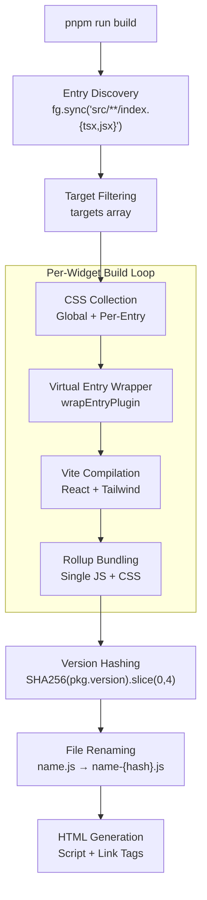
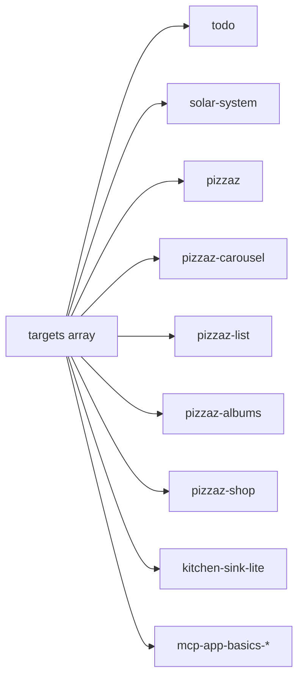
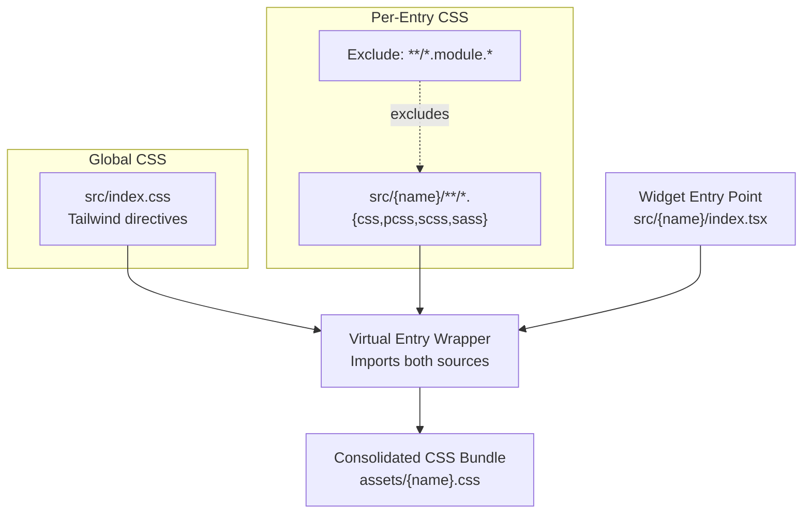
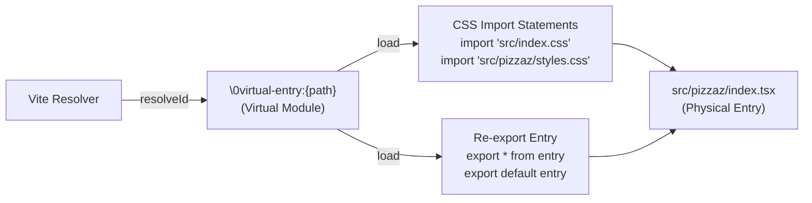
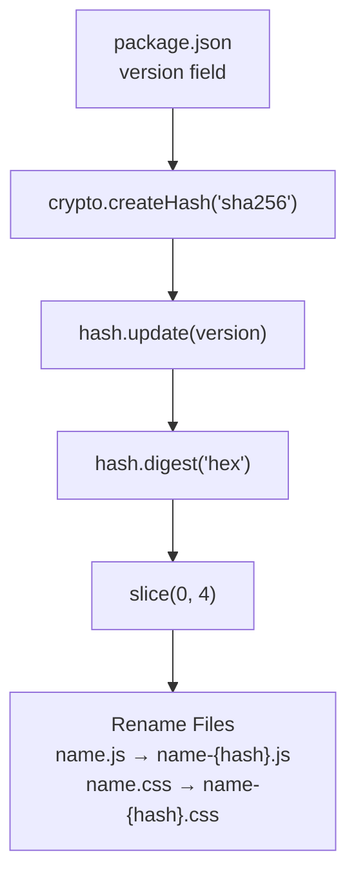

<!-- source: DeepWiki mcp.deepwiki.com · repo openai/openai-apps-sdk-examples · page 4.4 Build System · fetched 2026-10-26 -->

# Build System

Relevant source files

The following files were used as context for generating this wiki page:

- [build-all.mts](build-all.mts)
- [pizzaz_server_python/requirements.txt](pizzaz_server_python/requirements.txt)
- [solar-system_server_python/requirements.txt](solar-system_server_python/requirements.txt)
- [src/pizzaz-albums/albums.json](src/pizzaz-albums/albums.json)
- [tsconfig.app.json](tsconfig.app.json)
- [tsconfig.node.json](tsconfig.node.json)
- [vite.config.mts](vite.config.mts)
- [vite.host.config.mts](vite.host.config.mts)

## Purpose and Scope

The build system compiles React widgets from TypeScript source code into standalone, self-contained HTML bundles that MCP servers can serve to ChatGPT. Each widget is packaged with all necessary JavaScript and CSS inlined or referenced, enabling independent deployment and versioning.

This document covers the Vite-based build orchestrator [build-all.mts](), output file structure, versioning strategy, and CSS aggregation. 

---

## Build Pipeline Overview

The build system transforms individual widget entry points into production-ready bundles through a multi-stage pipeline orchestrated by [build-all.mts]().

### Build Pipeline Flow

**Sources:** [build-all.mts:1-192]()

---

## Entry Point Discovery

The build script discovers widget entry points using `fast-glob` to scan for `index.tsx` or `index.jsx` files under `src/`.

| Configuration | Value |
|--------------|-------|
| Entry pattern | `src/**/index.{tsx,jsx}` | [build-all.mts:13-13]() |
| Discovery method | `fg.sync()` | [build-all.mts:13-13]() |
| Output Directory | `assets` | [build-all.mts:14-14]() |

### Target Whitelist

The `targets` array [build-all.mts:20-44]() defines the specific directories under `src/` that will be processed. Users can also specify a single target via the CLI using the `--target` flag [build-all.mts:45-50]().

**Sources:** [build-all.mts:20-50]()

---

## CSS Aggregation Strategy

The build system collects CSS from two sources for each widget to ensure that global styles (like Tailwind) and widget-specific styles are bundled correctly.

### CSS Collection Hierarchy

| CSS Source | Pattern / Path | Purpose |
|-----------|---------|---------|
| Global | `src/index.css` | Tailwind base/components/utilities [build-all.mts:18-18]() |
| Per-entry | `**/*.{css,pcss,scss,sass}` | Widget-specific styles [build-all.mts:16-16]() |
| Exclusions | `**/*.module.*` | Excludes CSS modules [build-all.mts:17-17]() |

**Sources:** [build-all.mts:16-18](), [build-all.mts:97-112]()

---

## Virtual Entry Wrapper

To avoid manual imports of global CSS in every widget, the build system uses a virtual module plugin `wrapEntryPlugin` [build-all.mts:54-84]().

### Virtual Module Pattern

The plugin dynamically generates code that imports the required CSS files and then exports the original widget component [build-all.mts:69-81]().

**Sources:** [build-all.mts:54-84]()

---

## Vite Build Configuration

The `createConfig` function [build-all.mts:115-157]() generates a Vite `InlineConfig` for each widget.

### Build Configuration Key Settings

| Option | Value | Purpose |
|--------|-------|---------|
| `target` | `es2022` | Modern JavaScript features [build-all.mts:136-136]() |
| `cssCodeSplit` | `false` | Single CSS bundle per widget [build-all.mts:141-141]() |
| `inlineDynamicImports` | `true` | Prevent code splitting into multiple chunks [build-all.mts:147-147]() |
| `format` | `es` | Output as ES module [build-all.mts:145-145]() |
| `minify` | `esbuild` | Fast minification using esbuild [build-all.mts:140-140]() |

The configuration includes a custom `remove-manual-chunks` plugin [build-all.mts:120-128]() to ensure all code is bundled into a single file by deleting the `manualChunks` option from Rollup.

**Sources:** [build-all.mts:115-157]()

---

## Versioning and Hashing

After the Vite build completes, the system applies a version-based hash to the output files [build-all.mts:172-187]().

### Hash Generation Algorithm

The hash is derived from the `version` field in `package.json` [build-all.mts:8](), [build-all.mts:172-176](). This ensures that all assets are updated simultaneously when the package version changes.

**Sources:** [build-all.mts:172-187]()

---

## HTML Generation

The final step is generating HTML files that serve as the entry points for the widgets [build-all.mts:218-239]().

### Config Injection

The build system injects a global configuration object `window.__APP_URL_CONFIG__` into the HTML [build-all.mts:225-227](). This object contains:
- `apiBaseUrl`: The URL of the MCP server [build-all.mts:213-213]().
- `assetsBaseUrl`: The URL where static assets (JS/CSS) are hosted [build-all.mts:214-214]().

### HTML Template Structure

The template [build-all.mts:222-235]() generates:
1. A `<script>` block with `__APP_URL_CONFIG__`.
2. A `<script type="module">` pointing to the hashed JS file.
3. A `<link rel="stylesheet">` pointing to the hashed CSS file.
4. A `
` with an ID matching `{name}-root` to mount the React application.

**Sources:** [build-all.mts:192-239]()

---

## Development vs. Production Configuration

The repository includes different Vite configurations for development and production:

| File | Purpose |
|------|---------|
| `build-all.mts` | Production build orchestrator for all widgets. |
| `vite.config.mts` | Development server configuration with multi-entry support and HMR [vite.config.mts:203-231](). |
| `vite.host.config.mts` | Configuration for building the "host" test environment [vite.host.config.mts:5-18](). |

### Development Endpoints

The `multiEntryDevEndpoints` plugin in `vite.config.mts` [vite.config.mts:24-199]() provides:
- A directory index at `/` listing all available widgets [vite.config.mts:94-99]().
- Dynamic HTML generation for each widget at `/{name}.html` [vite.config.mts:100-119]().
- Virtual module resolution for development assets with HMR support [vite.config.mts:171-194]().

**Sources:** [vite.config.mts:24-231](), [vite.host.config.mts:5-18]()

---

## TypeScript Project Structure

The build system utilizes multiple `tsconfig` files to manage different environment requirements:

| File | Target | Scope |
|------|--------|-------|
| `tsconfig.json` | Project | References `tsconfig.app.json` and `tsconfig.node.json`. |
| `tsconfig.app.json` | Browser | Widget source code in `src/` [tsconfig.app.json:26-26](). |
| `tsconfig.node.json` | Node.js | Build scripts like `build-all.mts` and Vite configs [tsconfig.node.json:20-24](). |

**Sources:** [tsconfig.app.json:1-27](), [tsconfig.node.json:1-25]()

---

