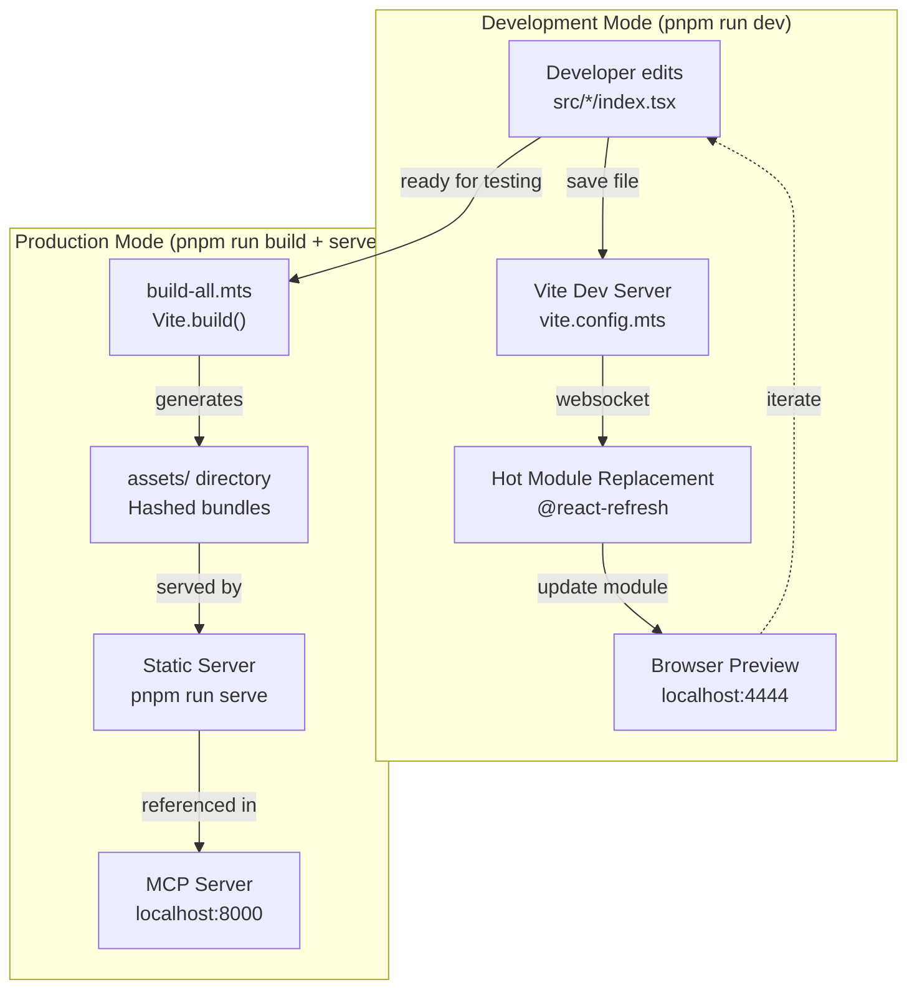
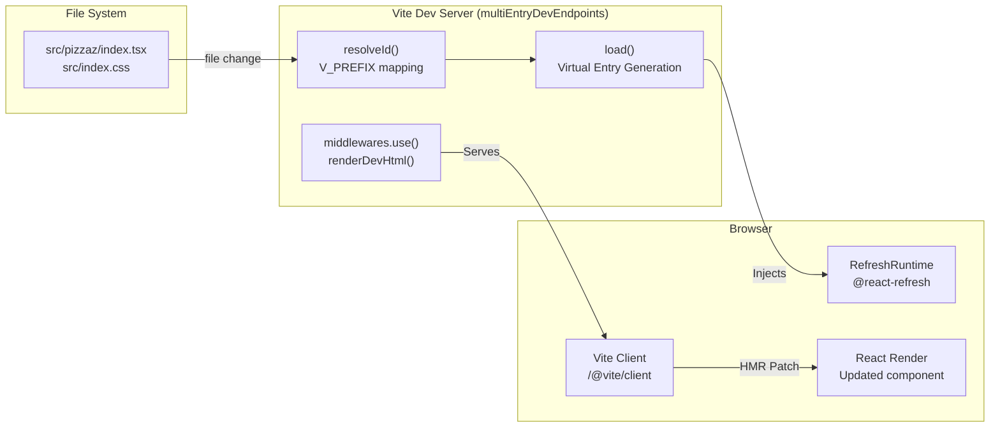

<!-- source: DeepWiki mcp.deepwiki.com · repo openai/openai-apps-sdk-examples · page 4.5 Development Workflow · fetched 2026-10-26 -->

# Development Workflow

<details>
<summary>Relevant source files</summary>

The following files were used as context for generating this wiki page:

- [.github/workflows/pre-commit.yml](.github/workflows/pre-commit.yml)
- [.pre-commit-config.yaml](.pre-commit-config.yaml)
- [build-all.mts](build-all.mts)
- [vite.config.mts](vite.config.mts)

</details>


This document describes the day-to-day workflow for developing and debugging widgets and MCP servers. It covers hot reload development, iteration patterns, and testing integration with ChatGPT.

## Purpose and Scope

This page explains:
- **Hot reload development** with Vite dev server for rapid widget iteration.
- **MCP server development loop** for testing tool responses.
- **Integration testing** with ChatGPT using ngrok.
- **Debugging techniques** for widget rendering and state management.

Related pages:
- For build system internals and `build-all.mts` details, see [Build System](#4.4).
- For widget architecture patterns, see [Widget Architecture](#4.1).
- For MCP server implementation details, see [MCP Server Development](#5).

## Development Modes

The repository supports two distinct development modes:

| Mode | Command | Port | Purpose | Hot Reload | Build Required |
|------|---------|------|---------|-----------|----------------|
| **Development** | `pnpm run dev` | 4444 | Widget iteration with HMR | Yes | No |
| **Production** | `pnpm run build` + `pnpm run serve` | 4444 | MCP server integration testing | No | Yes |

Sources: [vite.config.mts:210-212](), [build-all.mts:192-200]()

### Development Mode Architecture



Sources: [vite.config.mts:203-214](), [build-all.mts:135-156]()

## Hot Reload Development Workflow

### Starting the Development Server

The Vite dev server provides instant feedback without requiring builds. It is configured via `vite.config.mts` to handle multiple entry points dynamically.

```bash
pnpm run dev
```

This command starts Vite on `http://localhost:4444` with hot module replacement (HMR) enabled for all widget entrypoints found in `src/**/index.{tsx,jsx}`.

Sources: [vite.config.mts:8-13](), [vite.config.mts:210-212]()

### Development Server Behavior

The dev server uses a custom plugin, `multiEntryDevEndpoints`, to serve virtual HTML and JS files for each widget without them existing on disk.



**Key characteristics:**
- **Virtual Entrypoints**: The server generates virtual modules prefixed with `\0multi-entry:` to wrap your components with HMR logic [vite.config.mts:37-38]().
- **React Fast Refresh**: It injects the React Refresh preamble into every virtual entry to maintain component state across edits [vite.config.mts:179-188]().
- **Dynamic CSS**: Global and per-entry CSS files are collected and injected via virtual style modules [vite.config.mts:162-169]().

Sources: [vite.config.mts:24-35](), [vite.config.mts:81-125](), [vite.config.mts:140-198]()

## Widget Development Cycle

### Step-by-Step Process

#### Phase 1: Widget Development (HMR)

1. Start the dev server: `pnpm run dev`.
2. Navigate to the widget endpoint (e.g., `http://localhost:4444/pizzaz.html`).
3. Edit `src/pizzaz/index.tsx`.
4. Changes reflect immediately. The `multiEntryDevEndpoints` plugin serves the updated JS via a virtual module [vite.config.mts:171-194]().

#### Phase 2: Build and Serve (Integration)

Once the UI is ready, you must generate static assets for the MCP server to reference.

```bash
pnpm run build
pnpm run serve
```

The `build-all.mts` script:
1. Iterates through defined `targets` [build-all.mts:20-44]().
2. Bundles each using `vite.build()` with `cssCodeSplit: false` to ensure one CSS file per widget [build-all.mts:135-141]().
3. Hashes the output filenames based on the version in `package.json` to manage caching [build-all.mts:172-188]().
4. Generates a static HTML file (e.g., `assets/pizzaz.html`) that includes the `__APP_URL_CONFIG__` global for the SDK [build-all.mts:218-239]().

#### Phase 3: MCP Server Integration

**Python servers** (e.g., Pizzaz Python Server) often use `@lru_cache` to serve widget HTML. After running `pnpm run build`, you **must restart the Python server** to clear the cache and pick up the new hashed asset paths.

**Node.js servers** (e.g., Pizzaz Node Server) often use `SSEServerTransport`. Ensure the server is pointed to the `assets/` directory generated by the build.

Sources: [build-all.mts:1-14](), [build-all.mts:218-235]()

## Debugging Widgets

### Inspecting State and Props

Widgets use `@openai/apps-sdk-react` hooks to interact with the host. During development, you can inspect these values in the console.

| Hook | Purpose | Source |
|------|---------|--------|
| `useWidgetProps()` | Access `toolOutput` and `initialWidgetState` | Apps SDK |
| `useWidgetState()` | Manage state persisted across turns via `widgetSessionId` | Apps SDK |

### Tool Response Validation

To debug the connection between the server and the widget, verify the MCP `CallToolResult` structure. It must include the `_meta` field with the `outputTemplate` pointing to the built HTML file.

```json
{
  "result": {
    "structuredContent": { ... },
    "_meta": {
      "openai/outputTemplate": "http://localhost:4444/pizzaz.html",
      "widgetSessionId": "session-123"
    }
  }
}
```

Sources: [build-all.mts:212-216]()

## Best Practices

### Iteration Speed
- **Use `pnpm run dev` for UI**: Don't run the full build/restart cycle for CSS or layout tweaks.
- **Targeted Builds**: Use the `--target` flag with the build script to only rebuild the widget you are working on: `pnpm run build --target pizzaz` [build-all.mts:45-50]().

### Pre-commit Checks
The repository uses `ruff` and standard hooks to ensure code quality before commits are pushed.
- **Linting**: `ruff-check` [ .pre-commit-config.yaml:5]().
- **Formatting**: `ruff-format` [ .pre-commit-config.yaml:6]().
- **Validation**: JSON and YAML schema checks [ .pre-commit-config.yaml:10-11]().

Sources: [ .pre-commit-config.yaml:1-15](), [ .github/workflows/pre-commit.yml:1-15]()

---

