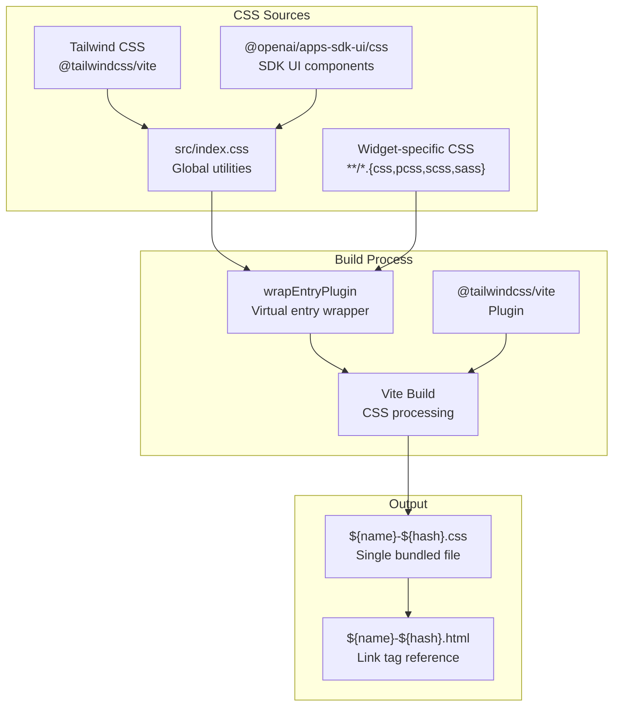
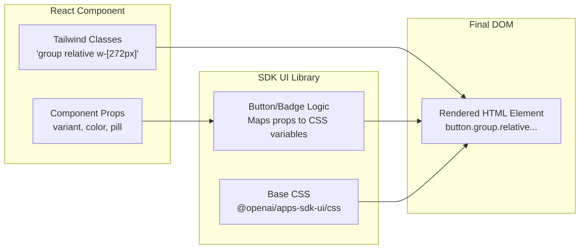

<!-- source: DeepWiki mcp.deepwiki.com · repo openai/openai-apps-sdk-examples · page 4.6 Styling and CSS · fetched 2026-10-26 -->

# Styling and CSS

<details>
<summary>Relevant source files</summary>

The following files were used as context for generating this wiki page:

- [src/index.css](src/index.css)
- [src/kitchen-sink-lite/kitchen-sink-lite.css](src/kitchen-sink-lite/kitchen-sink-lite.css)
- [src/pizzaz-albums/AlbumCard.jsx](src/pizzaz-albums/AlbumCard.jsx)
- [tailwind.config.ts](tailwind.config.ts)

</details>


This page documents the CSS architecture, compilation strategy, and styling patterns used for widget development. It covers how Tailwind CSS is integrated via Vite, how global styles from `@openai/apps-sdk-ui` are imported, how per-widget CSS is collected and bundled, and the custom utility classes provided for common UI patterns.

For information about the overall build system orchestration, see [Build System](4.4). For details on widget development workflow, see [Development Workflow](4.5).

## CSS Architecture Overview

The styling system follows a layered architecture where global styles cascade into per-entry styles, all compiled into a single CSS bundle per widget. This ensures consistent theming while allowing widget-specific customization.



**Sources:** [src/index.css:1-108](), [tailwind.config.ts:1-10]()

## Tailwind CSS Integration

Tailwind CSS is integrated through the `@tailwindcss/vite` plugin (or legacy configuration via `tailwind.config.ts`), which processes utility classes during the build.

**Tailwind Import Syntax:**
The global CSS file uses the modern Tailwind v4 `@import` directive:
```css
@import "tailwindcss";
```
[src/index.css:1]()

This single import replaces the traditional `@tailwind` directives and automatically includes base, components, and utilities layers.

**Source Directives:**
Tailwind uses `@source` directives to discover where utility classes are used:
- `@source "../node_modules/@openai/apps-sdk-ui"`: [src/index.css:3]()
- `@source "."`: [src/index.css:4]()

These directives tell Tailwind where to scan for class usage when tree-shaking unused utilities during the build process. The first directive scans the SDK UI component library, while the second scans the local `src/` directory.

**Content Configuration:**
The `tailwind.config.ts` file specifies the content paths to be scanned for class names:
```typescript
content: [
  "./src/**/*.{html,js,ts,jsx,tsx}",
  "./host/**/*.{html,js,ts,jsx,tsx}",
],
```
[tailwind.config.ts:3-6]()

**Sources:** [src/index.css:1, 3-4](), [tailwind.config.ts:1-10]()

## Global Styles and SDK UI

The global stylesheet `src/index.css` serves as the foundation for all widgets. It imports both Tailwind utilities and the Apps SDK UI component styles, ensuring consistent appearance across all widgets and compatibility with the ChatGPT host environment.

| Import | Purpose | File Reference |
|--------|---------|----------------|
| `tailwindcss` | Core Tailwind CSS framework | [src/index.css:1]() |
| `@openai/apps-sdk-ui/css` | SDK UI component styles, theme variables | [src/index.css:2]() |

**Apps SDK UI Components:**
Widgets leverage pre-styled components from the SDK. For example, the `AlbumCard` component uses `Button`, `Image`, and `Badge`:
```javascript
import { Button } from "@openai/apps-sdk-ui/components/Button";
import { Image } from "@openai/apps-sdk-ui/components/Image";
import { Badge } from "@openai/apps-sdk-ui/components/Badge";
```
[src/pizzaz-albums/AlbumCard.jsx:2-4]()

These components are styled using Tailwind classes combined with the SDK's internal CSS:
- `Badge` with `variant="soft"` and `color="secondary"`: [src/pizzaz-albums/AlbumCard.jsx:24-26]()
- `Button` with `variant="ghost"` and custom Tailwind overrides: [src/pizzaz-albums/AlbumCard.jsx:8-13]()

**Sources:** [src/index.css:1-2](), [src/pizzaz-albums/AlbumCard.jsx:1-15]()

## Custom Utilities and Animations

The global stylesheet defines custom utility classes and animations in the `@layer utilities` block, providing functionality that extends Tailwind's built-in set.

### Scrollbar Styling

Custom scrollbar utilities provide consistent, theme-aware scrollbar appearance across light and dark modes. These utilities target overflow classes like `overflow-auto` and `overflow-scroll`.

**Default State:**
```css
.overflow-auto,
.overflow-scroll,
.overflow-x-auto,
.overflow-y-auto,
.overflow-x-scroll,
.overflow-y-scroll {
  scrollbar-color: rgb(0, 0, 0, 0.1) transparent;

  @media (prefers-color-scheme: dark) {
    scrollbar-color: rgb(255, 255, 255, 0.1) transparent;
  }
}
```
[src/index.css:84-95]()

**Hover State:**
```css
.overflow-auto:hover,
.overflow-scroll:hover,
.overflow-x-auto:hover,
.overflow-y-auto:hover {
  scrollbar-color: rgb(0, 0, 0, 0.2) transparent;

  @media (prefers-color-scheme: dark) {
    scrollbar-color: rgb(255, 255, 255, 0.2) transparent;
  }
}
```
[src/index.css:98-107]()

### Animations

The SDK includes complex animations for specific app states, such as the winner sequence in "Cards Against AI".

| Animation Name | Effect | CSS Definition |
|----------------|--------|----------------|
| `cards-ai-winner-glow` | Pulsing box-shadow with gold/amber colors | [src/index.css:6-21]() |
| `cards-ai-winner-entrance` | Scaling and opacity transition for entrance | [src/index.css:23-36]() |
| `cards-ai-winner-border-glow` | Outer shadow pulse for high emphasis | [src/index.css:38-50]() |

These are applied via composite classes like `.cards-ai-winner-panel`: [src/index.css:52-56]()

**Sources:** [src/index.css:6-56, 84-108]()

## Theme Support

The SDK supports both light and dark modes via the `prefers-color-scheme` media query. Global background and text colors are defined at the body level.

```css
body {
  background-color: rgb(248, 250, 252);
  color: rgb(15, 23, 42);
}

@media (prefers-color-scheme: dark) {
  body {
    background-color: rgb(2, 6, 23);
    color: rgb(241, 245, 249);
  }
}
```
[src/index.css:63-73]()

**Sources:** [src/index.css:63-73]()

## Widget-Specific Styling

While Tailwind is the primary tool, widgets can define their own CSS for niche requirements, such as code block formatting or Picture-in-Picture (PiP) specific sizing.

- **Kitchen Sink Lite:** Defines specific font sizes for code blocks: [src/kitchen-sink-lite/kitchen-sink-lite.css:1-5]()
- **Cards Against AI:** Defines a PiP-specific font size utility: [src/index.css:59-61]()

### Styling Data Flow

The following diagram illustrates how styling properties flow from component props to the final DOM via Tailwind and SDK UI.



**Sources:** [src/pizzaz-albums/AlbumCard.jsx:8-13](), [src/index.css:1-4]()

---

