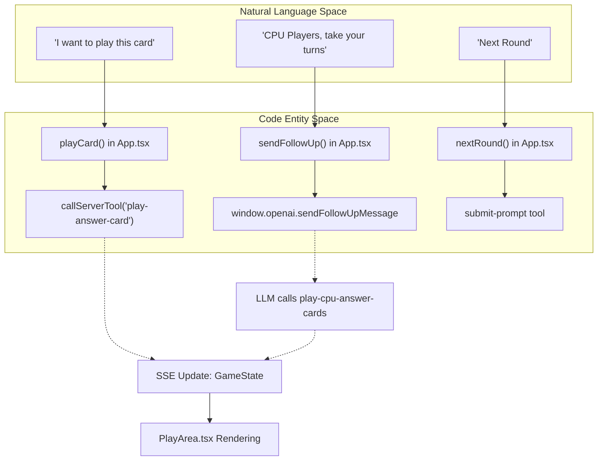
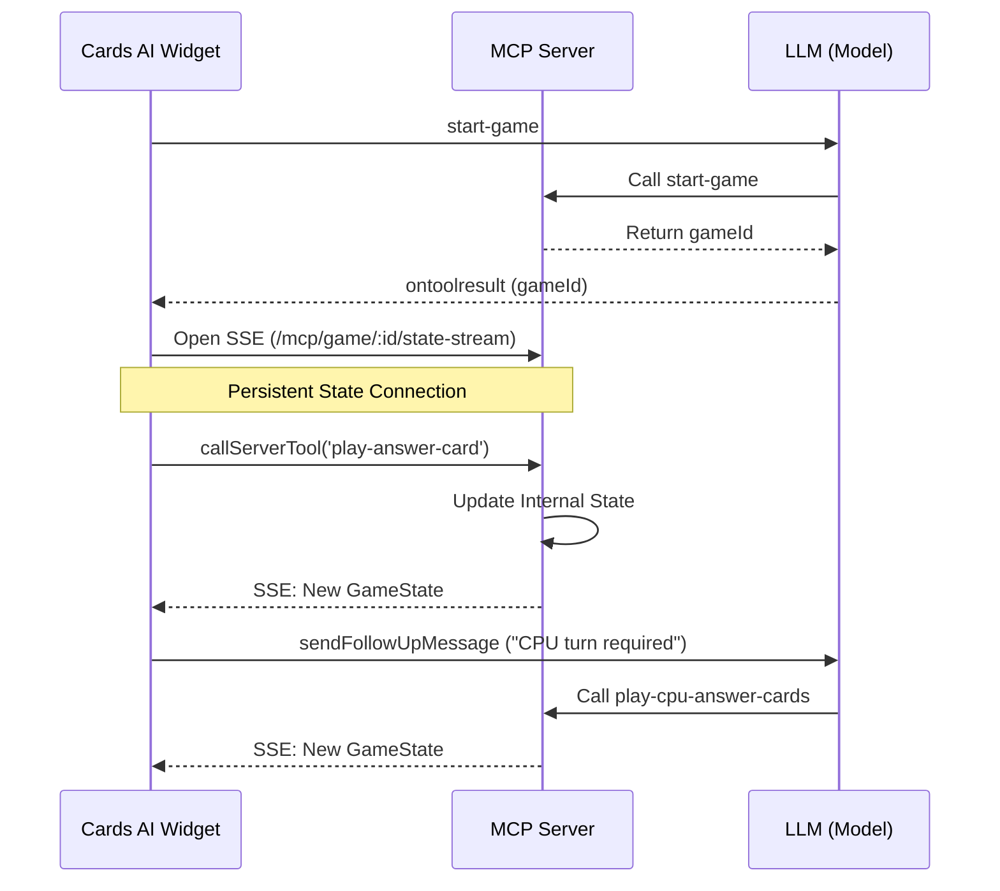

<!-- source: DeepWiki mcp.deepwiki.com · repo openai/openai-apps-sdk-examples · page 4.8 Cards Against AI Widget · fetched 2026-10-26 -->

# Cards Against AI Widget

Relevant source files

The following files were used as context for generating this wiki page:

- [cards_against_ai_server_node/cards-against-ai-mcp-node@0.1.0](cards_against_ai_server_node/cards-against-ai-mcp-node@0.1.0)
- [cards_against_ai_server_node/tsx](cards_against_ai_server_node/tsx)
- [src/cards-against-ai/App.tsx](src/cards-against-ai/App.tsx)
- [src/cards-against-ai/Cards.tsx](src/cards-against-ai/Cards.tsx)
- [src/cards-against-ai/DESIGN.md](src/cards-against-ai/DESIGN.md)
- [src/cards-against-ai/PlayArea.tsx](src/cards-against-ai/PlayArea.tsx)
- [src/cards-against-ai/Scoreboard.tsx](src/cards-against-ai/Scoreboard.tsx)
- [src/cards-against-ai/SplashScreen.tsx](src/cards-against-ai/SplashScreen.tsx)
- [src/cards-against-ai/index.tsx](src/cards-against-ai/index.tsx)
- [src/cards-against-ai/types.ts](src/cards-against-ai/types.ts)
- [src/cards-against-ai/vite-env.d.ts](src/cards-against-ai/vite-env.d.ts)

The Cards Against AI widget is the most sophisticated example in the OpenAI Apps SDK gallery. It demonstrates a complex game loop requiring high-frequency state updates, model-mediated NPC actions, and a hybrid communication strategy that combines direct tool calls with Server-Sent Events (SSE) [src/cards-against-ai/DESIGN.md:1-15]().

## Overview and Purpose

The widget provides a full-featured "party game" experience where a human player competes against CPU personas. It is designed to showcase:
*   **SSE State Streaming**: Real-time game state synchronization from server to widget [src/cards-against-ai/App.tsx:35-36]().
*   **Direct Tool Calls**: Using `app.callServerTool` to bypass the model for instant user interactions [src/cards-against-ai/App.tsx:166-169]().
*   **Model-Mediated Actions**: Using `sendFollowUpMessage` to prompt the LLM to perform CPU turns [src/cards-against-ai/App.tsx:178-181]().
*   **Complex Animations**: A 3D card-playing interface built with React and Tailwind CSS [src/cards-against-ai/Cards.tsx:59-87]().

## Architecture and Data Flow

The widget employs a hybrid approach to data management. While standard widgets rely on the model to pass state back and forth, Cards Against AI uses an external SSE channel for high-fidelity state updates, ensuring the UI remains responsive even when the LLM is not actively generating a response [src/cards-against-ai/DESIGN.md:9-15]().

### Communication Channels

| Channel | Mechanism | Purpose |
| :--- | :--- | :--- |
| **SSE Stream** | `EventSource` | Pushes full `GameState` to the widget on every change [src/cards-against-ai/App.tsx:92-95](). |
| **Direct Tools** | `app.callServerTool` | Executes human actions (playing/judging) without LLM latency [src/cards-against-ai/App.tsx:187-197](). |
| **Follow-up** | `window.openai.sendFollowUpMessage` | Prompts the model to handle CPU turns or banter [src/cards-against-ai/App.tsx:17-21](). |
| **Bootstrapping** | `app.ontoolresult` | Captures the initial `gameId` to establish the SSE connection [src/cards-against-ai/App.tsx:59-65](). |

### Natural Language to Code Mapping

This diagram maps the conceptual game loop to the specific code entities responsible for each phase.

**Game Loop Entity Mapping**

Sources: [src/cards-against-ai/App.tsx:13-30](), [src/cards-against-ai/App.tsx:187-206](), [src/cards-against-ai/DESIGN.md:21-35]()

## Implementation Details

### State Synchronization (SSE)

The widget maintains a `gameId` which it uses to open an `EventSource` connection to the server [src/cards-against-ai/App.tsx:75-93](). The server streams a `GameState` object whenever the internal game engine advances.

**State Flow Architecture**

Sources: [src/cards-against-ai/App.tsx:75-131](), [src/cards-against-ai/DESIGN.md:9-15](), [src/cards-against-ai/DESIGN.md:21-35]()

### Key Components

#### `useCardsAgainstAIGame` Hook
This custom hook in `App.tsx` manages the lifecycle of the game. It handles:
*   **SSE Connection**: Managing the `EventSource` and reconnection logic [src/cards-against-ai/App.tsx:82-120]().
*   **Watchdog Timer**: If the model fails to respond to a `notifyModel` hint within 15 seconds, the widget sends a "nudge" message to keep the game moving [src/cards-against-ai/App.tsx:134-148]().
*   **Action Dispatching**: Wrappers for playing cards and judging that coordinate tool calls and model notifications [src/cards-against-ai/App.tsx:159-183]().

#### `PlayArea` Component
The `PlayArea` is responsible for the visual layout. It uses a `ResizeObserver` to calculate card positions dynamically based on the widget's current dimensions [src/cards-against-ai/PlayArea.tsx:61-74]().
*   **Card Positioning**: Calculates X/Y coordinates and rotations for cards in hand, played cards, and the prompt card [src/cards-against-ai/PlayArea.tsx:79-216]().
*   **Interaction Logic**: Determines if a card is "interactive" (clickable) based on the `localPlayerIsJudge` state and the current `GameStatus` [src/cards-against-ai/PlayArea.tsx:184-185]().

#### `Card` Component
A low-level presentation component that handles 3D CSS transforms for card flips and movement animations [src/cards-against-ai/Cards.tsx:59-87](). It uses `requestAnimationFrame` to trigger transitions after the initial mount [src/cards-against-ai/Cards.tsx:48-57]().

## Game Logic Patterns

### The `notifyModel` Pattern
Because some actions are performed by the human (via the widget) and others by the model (CPU turns), the server includes a `NextActionHint` in its responses. If `nextAction.notifyModel` is `true`, the widget automatically triggers a `sendFollowUpMessage` to tell the model it is its turn to act [src/cards-against-ai/types.ts:68-73](), [src/cards-against-ai/App.tsx:174-182]().

### Picture-in-Picture (PiP) Support
The widget is designed to be responsive. When the user scrolls away from the widget in the chat, the Apps SDK may move the widget into a PiP overlay. The `PlayArea` component's use of `ResizeObserver` ensures the game board re-layouts correctly in the smaller PiP dimensions [src/cards-against-ai/PlayArea.tsx:61-74]().

### Data Structures
The `GameState` interface is the single source of truth for the UI [src/cards-against-ai/types.ts:87-99](). It tracks:
*   `players`: List of human and CPU players, their scores, and hands [src/cards-against-ai/types.ts:28-34]().
*   `status`: The current phase of the game (e.g., `waiting-for-answers`, `judging`, `display-judgement`) [src/cards-against-ai/types.ts:42-49]().
*   `playedAnswerCards`: The cards currently on the table [src/cards-against-ai/types.ts:90]().

Sources: [src/cards-against-ai/App.tsx:1-206](), [src/cards-against-ai/PlayArea.tsx:1-216](), [src/cards-against-ai/Cards.tsx:1-187](), [src/cards-against-ai/types.ts:1-100](), [src/cards-against-ai/DESIGN.md:1-60]()

---

