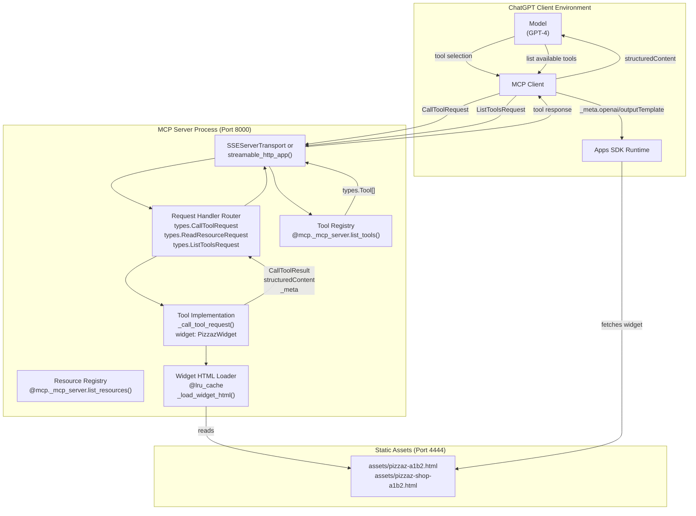
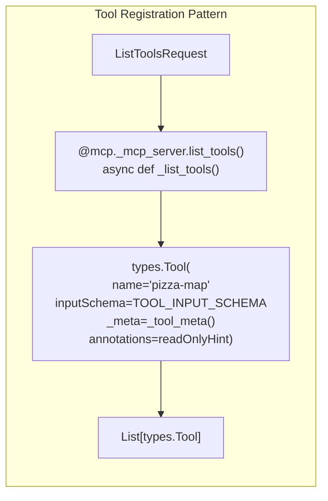
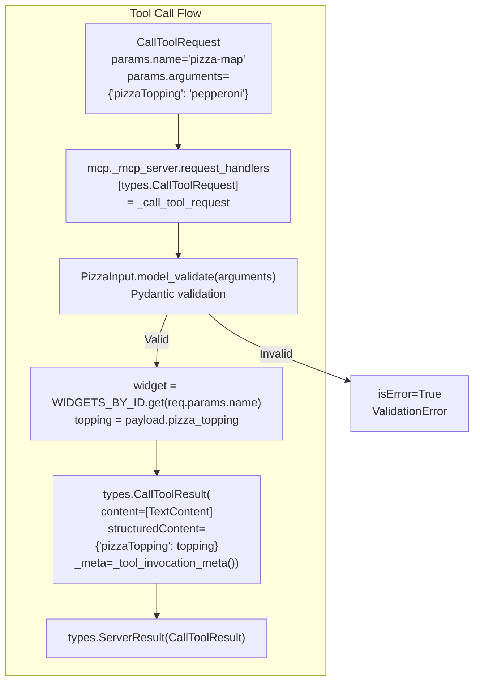
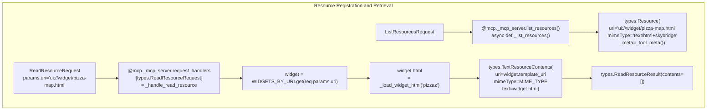
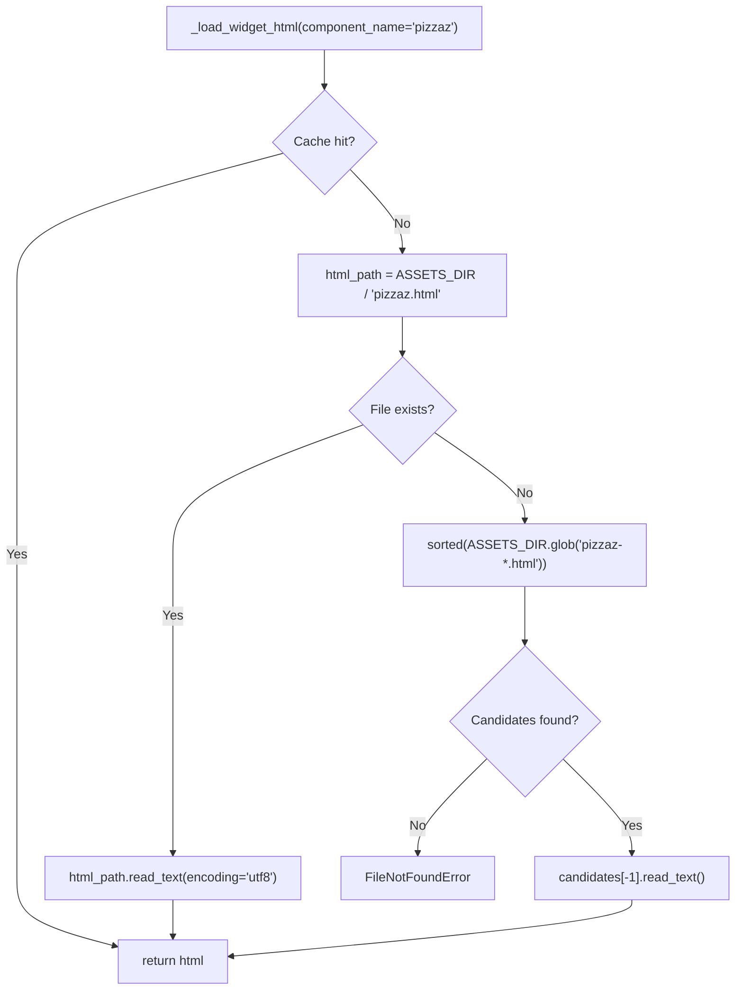
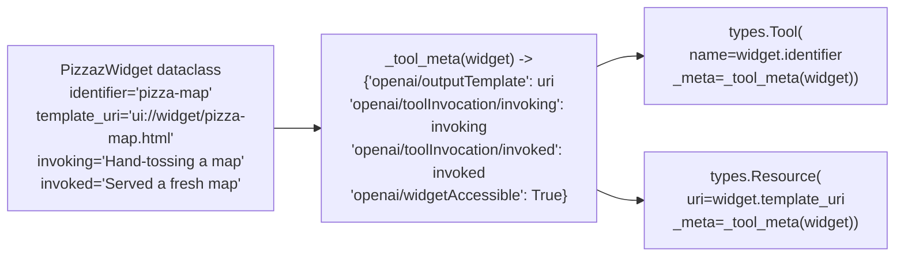

<!-- source: DeepWiki mcp.deepwiki.com · repo openai/openai-apps-sdk-examples · page 5 MCP Server Development · fetched 2026-10-26 -->

# MCP Server Development

Relevant source files

The following files were used as context for generating this wiki page:

- [README.md](README.md)

This document covers the implementation of Model Context Protocol (MCP) servers that expose tools and widgets to ChatGPT. It explains the core MCP capabilities, server architecture patterns, and how to register tools and resources in both Python and Node.js environments.

For detailed widget rendering concepts, see [Widget Rendering Flow](#3.3). For state persistence patterns, see [State Management and widgetSessionId](#3.4). For OAuth integration, see [Authentication and OAuth](#3.5).

## MCP Server Role and Architecture

MCP servers act as the backend layer between ChatGPT and your application logic. Each server exposes tools that the model can call during a conversation, returns structured data that the model can parse, and provides widget metadata that the Apps SDK uses to render rich UI components.

### System Interaction Diagram

**Sources:** [README.md:18-30](), [pizzaz_server_python/main.py:1-23]()

## Core MCP Capabilities

Every MCP server in this repository implements three essential capabilities defined by the Model Context Protocol specification:

### 1. List Tools

The server advertises available tools through the `list_tools` handler. Each tool includes:
- `name`: Unique tool identifier (e.g., `"pizza-map"`, `"add_to_cart"`)
- `title`: Human-readable display name
- `description`: Natural language explanation for the model
- `inputSchema`: JSON Schema defining required and optional parameters
- `_meta`: OpenAI-specific metadata including `openai/outputTemplate` URI
- `annotations`: Hints like `readOnlyHint`, `destructiveHint`, `openWorldHint`

**Sources:** [pizzaz_server_python/main.py:185-202]()

### 2. Call Tools

When the model selects a tool, the client sends a `CallToolRequest` with validated arguments. The server executes business logic and returns a `CallToolResult` containing:
- `content`: Array of `TextContent` objects with response text
- `structuredContent`: Structured data (JSON object) that the widget receives as `widgetProps.toolOutput`
- `isError`: Boolean indicating execution failure
- `_meta`: Metadata including `openai/toolInvocation/invoking` and `openai/toolInvocation/invoked` status messages

**Sources:** [pizzaz_server_python/main.py:257-302]()

### 3. Return Widgets via Resources

The server exposes widget HTML through MCP resources. Resources are registered with:
- `uri`: Resource identifier (e.g., `"ui://widget/pizza-map.html"`)
- `mimeType`: Always `"text/html+skybridge"` for widgets
- `description`: Resource description
- `_meta`: Same metadata as tool definition

When a tool's `_meta.openai/outputTemplate` references a resource URI, the Apps SDK fetches it via `ReadResourceRequest`, and the server returns the HTML content through `ReadResourceResult`.

**Sources:** [pizzaz_server_python/main.py:205-217](), [pizzaz_server_python/main.py:235-254]()

## Server Implementation Patterns

### Python Servers with FastMCP

Python servers use the `FastMCP` helper library, which provides a simplified API over the lower-level `mcp.server` module. Key characteristics:

| Component | Implementation | Purpose |
|-----------|---------------|---------|
| Server instance | `FastMCP(name="pizzaz-python", stateless_http=True)` | Creates MCP server with HTTP/SSE support |
| Tool registration | `@mcp._mcp_server.list_tools()` decorator | Registers tool list handler |
| Request routing | `mcp._mcp_server.request_handlers[types.CallToolRequest]` | Maps request types to handlers |
| Transport | `mcp.streamable_http_app()` | Exposes Starlette ASGI app for uvicorn |
| Validation | `pydantic.BaseModel` subclasses | Validates tool input schemas |
| Widget loading | `@lru_cache` decorated functions | Caches HTML reads from disk |
| Transport security | `TransportSecuritySettings(enable_dns_rebinding_protection)` | Validates allowed hosts/origins |

For details, see [Python MCP Servers with FastMCP](#5.1).

**Sources:** [pizzaz_server_python/main.py:145-149](), [pizzaz_server_python/main.py:305-309]()

### Node.js Servers with MCP SDK

Node.js servers use the official `@modelcontextprotocol/sdk` package. Key characteristics:

| Component | Implementation | Purpose |
|-----------|---------------|---------|
| Server instance | `new Server(...)` | Creates MCP server instance |
| Tool registration | `server.setRequestHandler(ListToolsRequestSchema, ...)` | Registers tool list handler |
| Request routing | `server.setRequestHandler(CallToolRequestSchema, ...)` | Type-safe request handlers |
| Transport | `new SSEServerTransport(...)` | Server-Sent Events transport layer |
| Validation | `zod` schemas | Validates tool input parameters |
| Session management | `Map<string, SessionData>` | Stores per-session state |
| Widget loading | `readFileSync` with fallback pattern | Reads versioned HTML files |

For details, see [Node.js MCP Servers with SDK](#5.2).

**Sources:** [README.md:37-38]()

## Widget HTML Loading Strategy

Both Python and Node.js servers implement similar widget loading patterns to support versioned asset bundles generated by the build system.

### Python Pattern: `@lru_cache` with Fallback

The `@lru_cache` decorator ensures HTML is read only once per server process. After `pnpm run build` regenerates assets, the server must be restarted to invalidate the cache.

**Sources:** [pizzaz_server_python/main.py:39-52](), [README.md:106-107]()

## Tool and Resource Metadata

All tools and resources include `_meta` dictionaries with OpenAI-specific annotations:

### Core Metadata Fields

| Field | Type | Purpose | Example |
|-------|------|---------|---------|
| `openai/outputTemplate` | string | Resource URI for widget HTML | `"ui://widget/pizza-map.html"` |
| `openai/toolInvocation/invoking` | string | Status text while tool executes | `"Hand-tossing a map"` |
| `openai/toolInvocation/invoked` | string | Status text after completion | `"Served a fresh map"` |
| `openai/widgetAccessible` | boolean | Indicates widget support | `true` |
| `widgetSessionId` | string | Session key for persistent state | `"cart-session-123"` |

**Sources:** [pizzaz_server_python/main.py:169-182]()

### Metadata Generation Pattern

**Sources:** [pizzaz_server_python/main.py:25-33](), [pizzaz_server_python/main.py:169-182]()

## Example Server Inventory

The repository includes several demo MCP servers highlighting different capabilities:

- **[Python MCP Servers with FastMCP](#5.1)**: Reference implementations for Pizzaz, Shopping Cart, Solar System, and Authenticated flows.
- **[Node.js MCP Servers with SDK](#5.2)**: Reference implementations for Pizzaz, Kitchen Sink, and educational basics.
- **[Cards Against AI Server](#5.3)**: Advanced Node.js server demonstrating stateful SSE streaming and complex game logic.
- **[MCP Tool Design Best Practices](#5.4)**: Guidelines for JSON Schema and annotations.
- **[Authentication and Security](#5.5)**: Implementation details for OAuth and transport security.

**Sources:** [README.md:32-43](), [README.md:110-117]()

---

