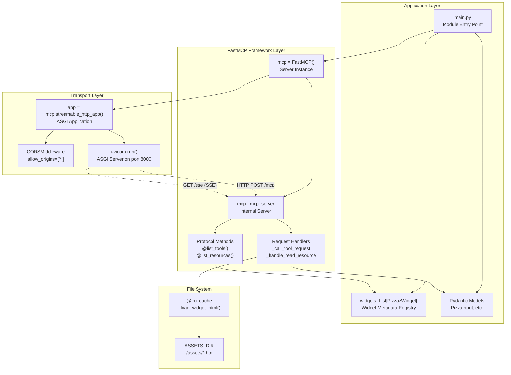

<!-- source: DeepWiki mcp.deepwiki.com · repo openai/openai-apps-sdk-examples · page 5.1 Python MCP Servers with FastMCP · fetched 2026-10-26 -->

# Python MCP Servers with FastMCP

<details>
<summary>Relevant source files</summary>

The following files were used as context for generating this wiki page:

- [authenticated_server_python/.env.example](authenticated_server_python/.env.example)
- [authenticated_server_python/main.py](authenticated_server_python/main.py)
- [pizzaz_server_python/main.py](pizzaz_server_python/main.py)

</details>


This page provides an introduction to implementing MCP servers in Python using the FastMCP framework. It covers the core architecture patterns, key components, and server lifecycle common to all Python MCP server implementations in this repository.

For detailed implementation walkthroughs of specific servers, see:
- [Pizzaz Python Server](#5.1.1)
- [Shopping Cart Python Server](#5.1.2)
- [Solar System Python Server](#5.1.3)
- [Authenticated Python Server](#5.1.4)
- [Kitchen Sink Python Server](#5.1.5)
- [Python Server Architecture Patterns](#5.1.6)

For Node.js MCP server implementations, see [Node.js MCP Servers with SDK](#5.2).

---

## FastMCP Framework Overview

FastMCP is a Python framework that provides a high-level API for implementing MCP servers on top of FastAPI. It abstracts the MCP protocol details and provides decorators for registering tools, resources, and prompts. The framework handles transport-level concerns (SSE, HTTP POST) and protocol serialization, allowing developers to focus on business logic.

### Key Characteristics

| Characteristic | Implementation |
|---------------|----------------|
| **Base Framework** | FastAPI (ASGI web framework) |
| **Server Runtime** | uvicorn (ASGI server) |
| **Input Validation** | Pydantic models with JSON Schema generation |
| **Transport** | HTTP + Server-Sent Events (SSE) via `stateless_http=True` |
| **Protocol Handling** | Automatic via `mcp.server.fastmcp.FastMCP` |
| **Widget Caching** | `functools.lru_cache` for HTML content |

All Python MCP servers in this repository use FastMCP with the `stateless_http=True` configuration, which enables the HTTP/SSE transport pattern required for ChatGPT integration [pizzaz_server_python/main.py:145-149](). The servers run on port 8000 by default and expose an `/mcp` endpoint [pizzaz_server_python/main.py:307-308]().

**Sources:** [pizzaz_server_python/main.py:1-8](), [pizzaz_server_python/main.py:145-149](), [pizzaz_server_python/main.py:307-308]()

---

## Python MCP Server Architecture

### System Component Mapping



The architecture consists of four layers:

1. **Application Layer**: Defines widget metadata (`PizzazWidget` dataclass), input schemas (Pydantic models), and the widget registry (`widgets` list) [pizzaz_server_python/main.py:25-101]().

2. **FastMCP Framework Layer**: The `FastMCP` instance provides decorators for registering protocol handlers and automatically generates the MCP server (`mcp._mcp_server`) [pizzaz_server_python/main.py:145-149]().

3. **Transport Layer**: FastMCP generates an ASGI application via `streamable_http_app()`, which is wrapped with CORS middleware and served by uvicorn [pizzaz_server_python/main.py:288-308]().

4. **File System**: Widget HTML is cached using `@lru_cache` and loaded from the `assets/` directory [pizzaz_server_python/main.py:36-52]().

**Sources:** [pizzaz_server_python/main.py:25-101](), [pizzaz_server_python/main.py:145-149](), [pizzaz_server_python/main.py:288-308](), [pizzaz_server_python/main.py:36-52]()

---

## Core Components

### FastMCP Instance

```python
mcp = FastMCP(
    name="pizzaz-python",
    stateless_http=True,
    transport_security=_transport_security_settings(),
)
```

The `FastMCP` instance is the central component that:
- Generates the underlying MCP server (`mcp._mcp_server`)
- Provides decorators for protocol method registration
- Exposes `streamable_http_app()` to generate the ASGI application
- Handles protocol serialization and deserialization [pizzaz_server_python/main.py:145-149]()

**Configuration Options:**
- `name`: Server identifier returned in MCP handshake.
- `stateless_http=True`: Enables HTTP/SSE transport (required for ChatGPT).
- `transport_security`: Configures DNS rebinding protection and CORS origins [pizzaz_server_python/main.py:133-142]().

**Sources:** [pizzaz_server_python/main.py:133-149]()

### Widget Metadata Dataclass

```python
@dataclass(frozen=True)
class PizzazWidget:
    identifier: str          # Tool name (e.g., "pizza-map")
    title: str              # Human-readable title
    template_uri: str       # Resource URI (e.g., "ui://widget/pizza-map.html")
    invoking: str          # Loading state text
    invoked: str           # Complete state text
    html: str              # Cached HTML content
    response_text: str     # Tool response text
```

This immutable dataclass encapsulates all metadata for a widget-backed tool, including protocol identifiers, UI states for tool invocation, and cached HTML content [pizzaz_server_python/main.py:25-33]().

**Sources:** [pizzaz_server_python/main.py:25-33]()

### Widget HTML Loading

```python
@lru_cache(maxsize=None)
def _load_widget_html(component_name: str) -> str:
    html_path = ASSETS_DIR / f"{component_name}.html"
    if html_path.exists():
        return html_path.read_text(encoding="utf8")
    
    fallback_candidates = sorted(ASSETS_DIR.glob(f"{component_name}-*.html"))
    if fallback_candidates:
        return fallback_candidates[-1].read_text(encoding="utf8")
    ...
```

The `_load_widget_html()` function:
1. Attempts to load the "live" version (`{component_name}.html`) [pizzaz_server_python/main.py:41-43]().
2. Falls back to the latest versioned file (`{component_name}-*.html`) [pizzaz_server_python/main.py:45-47]().
3. Uses `@lru_cache(maxsize=None)` to cache HTML content indefinitely [pizzaz_server_python/main.py:39-39]().

**Sources:** [pizzaz_server_python/main.py:39-47]()

### Pydantic Input Models

```python
class PizzaInput(BaseModel):
    pizza_topping: str = Field(
        ...,
        alias="pizzaTopping",
        description="Topping to mention when rendering the widget.",
    )
    
    model_config = ConfigDict(populate_by_name=True, extra="forbid")
```

Pydantic models provide field validation, alias mapping (e.g., `pizzaTopping` to `pizza_topping`), and automatic JSON Schema generation for MCP tool input contracts [pizzaz_server_python/main.py:115-124]().

**Sources:** [pizzaz_server_python/main.py:115-124]()

---

## MCP Protocol Implementation

### Protocol Flow: Natural Language to Code Entity

```mermaid
sequenceDiagram
    participant ChatGPT
    participant uvicorn["uvicorn<br/>ASGI Server"]
    participant FastMCP["mcp._mcp_server<br/>MCP Server"]
    participant Handlers["Request Handlers<br/>_call_tool_request<br/>_handle_read_resource"]
    participant Cache["@lru_cache<br/>_load_widget_html"]
    participant Assets["assets/<br/>*.html files"]
    
    rect rgb(245, 245, 245)
        Note over ChatGPT,FastMCP: Protocol Handshake
        ChatGPT->>uvicorn: POST /mcp (initialize)
        uvicorn->>FastMCP: Forward request
        FastMCP-->>uvicorn: Server capabilities
        uvicorn-->>ChatGPT: {name, version, capabilities}
    end
    
    rect rgb(245, 245, 245)
        Note over ChatGPT,Handlers: Tool Discovery
        ChatGPT->>uvicorn: POST /mcp (tools/list)
        uvicorn->>FastMCP: types.ListToolsRequest
        FastMCP->>FastMCP: Call _list_tools()
        FastMCP-->>uvicorn: List[types.Tool]
        uvicorn-->>ChatGPT: Tool schemas + metadata
    end
    
    rect rgb(245, 245, 245)
        Note over ChatGPT,Cache: Tool Execution
        ChatGPT->>uvicorn: POST /mcp (tools/call)
        uvicorn->>FastMCP: types.CallToolRequest
        FastMCP->>Handlers: _call_tool_request(req)
        Handlers->>Handlers: PizzaInput.model_validate()
        Handlers->>Cache: _load_widget_html() (cached)
        Cache->>Assets: Read HTML (on cache miss)
        Assets-->>Cache: HTML content
        Handlers-->>FastMCP: types.CallToolResult
        FastMCP-->>uvicorn: structuredContent + _meta
        uvicorn-->>ChatGPT: Tool result + widget URI
    end
```

### Protocol Method Registration

FastMCP provides two patterns for registering protocol handlers:

**Pattern 1: Decorators (List Operations)**
Used for operations that return lists of available entities, such as `_list_tools` [pizzaz_server_python/main.py:185-202]() and `_list_resources` [pizzaz_server_python/main.py:205-217]().

**Pattern 2: Direct Handler Registration (Request/Response)**
Used for operations that process individual requests, such as `_call_tool_request` [pizzaz_server_python/main.py:236-281]() and `_handle_read_resource` [pizzaz_server_python/main.py:219-234](). These are registered via `mcp._mcp_server.request_handlers` [pizzaz_server_python/main.py:284-285]().

**Sources:** [pizzaz_server_python/main.py:185-285]()

---

## Metadata Generation Patterns

### Tool Metadata Structure

The `_meta` field controls widget rendering and tool invocation UI [pizzaz_server_python/main.py:169-176]():

| Field | Purpose |
|-------|---------|
| `openai/outputTemplate` | Resource URI for widget HTML (e.g., `ui://widget/pizza-map.html`). |
| `openai/toolInvocation/invoking` | Loading state text (e.g., "Hand-tossing a map"). |
| `openai/toolInvocation/invoked` | Complete state text (e.g., "Served a fresh map"). |
| `openai/widgetAccessible` | Indicates widget is accessible from tool. |

**Sources:** [pizzaz_server_python/main.py:169-176]()

### Tool Annotations

Annotations control approval prompts in ChatGPT [pizzaz_server_python/main.py:195-199]():
- **`readOnlyHint: True`**: Indicates read-only operation, may skip approval.
- **`destructiveHint: False`**: No data modification, reduced approval friction.
- **`openWorldHint: False`**: No external API calls, safer execution.

**Sources:** [pizzaz_server_python/main.py:195-199]()

---

## Authentication and Security

Python servers implement security through `TransportSecuritySettings` and standard OAuth patterns:

1. **DNS Rebinding Protection**: Enabled via `enable_dns_rebinding_protection=True` when `MCP_ALLOWED_HOSTS` is provided [pizzaz_server_python/main.py:133-142]().
2. **OAuth Integration**: Authenticated servers (see [Authenticated Python Server](#5.1.4)) use `ProtectedResourceMetadata` to define resource servers and scopes [authenticated_server_python/main.py:180-184]().
3. **WWW-Authenticate Challenges**: Servers return 401 Unauthorized with `WWW-Authenticate` headers to trigger the ChatGPT OAuth flow [authenticated_server_python/main.py:228-245]().

**Sources:** [pizzaz_server_python/main.py:133-142](), [authenticated_server_python/main.py:180-184](), [authenticated_server_python/main.py:228-245]()

---

## Server Lifecycle

### Server Startup Flow

1. **Module Import**: Python loads the module and imports dependencies.
2. **Widget Loading**: `_load_widget_html()` is called for each widget, caching HTML [pizzaz_server_python/main.py:55-101]().
3. **Registry Initialization**: `WIDGETS_BY_ID` and `WIDGETS_BY_URI` dictionaries are populated [pizzaz_server_python/main.py:107-112]().
4. **FastMCP Creation**: The `FastMCP` instance is initialized with `stateless_http=True` [pizzaz_server_python/main.py:145-149]().
5. **Handler Registration**: Protocol methods are registered via decorators and direct assignment [pizzaz_server_python/main.py:185-285]().
6. **App Generation**: `streamable_http_app()` generates the ASGI application [pizzaz_server_python/main.py:288-288]().
7. **Middleware Setup**: CORS middleware is added to the app [pizzaz_server_python/main.py:291-299]().
8. **Server Start**: uvicorn starts the server on `0.0.0.0:8000` [pizzaz_server_python/main.py:307-308]().

**Sources:** [pizzaz_server_python/main.py:55-308]()

---

