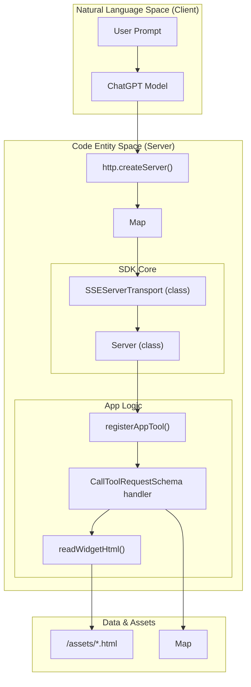
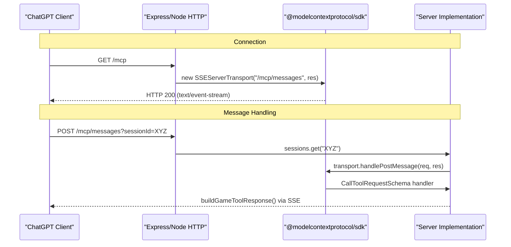

<!-- source: DeepWiki mcp.deepwiki.com · repo openai/openai-apps-sdk-examples · page 5.2 Node.js MCP Servers with SDK · fetched 2026-10-26 -->

# Node.js MCP Servers with SDK

Relevant source files

The following files were used as context for generating this wiki page:

- [cards_against_ai_server_node/README.md](cards_against_ai_server_node/README.md)
- [cards_against_ai_server_node/package.json](cards_against_ai_server_node/package.json)
- [pizzaz_server_node/src/server.ts](pizzaz_server_node/src/server.ts)
- [src/cards-against-ai/api-base-url.ts](src/cards-against-ai/api-base-url.ts)

This page introduces implementing MCP servers in Node.js using the official `@modelcontextprotocol/sdk` package. The repository includes multiple Node.js server implementations that demonstrate how to expose widgets as MCP tools with Server-Sent Events (SSE) transport and advanced state management.

For detailed implementation walkthroughs, see:
- **[Pizzaz Node Server](#5.2.1)** — Node.js reference implementation with SSE transport, session management, and widget serving.
- **[Kitchen Sink Node Server](#5.2.2)** — Node.js server demonstrating full API surface with `kitchen-sink-show` and `kitchen-sink-refresh` tools.
- **[MCP App Basics Node Server](#5.2.3)** — Educational Node.js server with eleven tools covering all MCP Apps SDK APIs, using `registerAppTool` and `registerAppResource` patterns.
- **[Node.js Server Architecture Patterns](#5.2.4)** — Common patterns: session Maps, `SSEServerTransport`, widget HTML fallback logic, Zod schemas, and `registerAppTool` vs manual `McpServer`.

For Python implementations using FastMCP, see page **5.1**.

**Sources:** [pizzaz_server_node/src/server.ts:1-27](), [cards_against_ai_server_node/README.md:35-45]()

## SDK Overview

The `@modelcontextprotocol/sdk` package provides the official TypeScript/JavaScript implementation of the Model Context Protocol. It handles protocol details, message serialization, and transport management. For advanced Apps SDK features like real-time state streaming, the `@modelcontextprotocol/ext-apps` extension is used.

### Key Features

| Feature | Description |
|---------|-------------|
| **Protocol Implementation** | Complete MCP specification compliance with request/response schemas. |
| **Type Safety** | TypeScript definitions for all protocol messages and types. |
| **Transport Abstraction** | Built-in `SSEServerTransport` for Server-Sent Events communication. |
| **Request Handlers** | Schema-based handler registration with automatic validation. |
| **Session Management** | Per-connection isolation with cleanup lifecycle hooks. |
| **Zod Integration** | Support for Zod schemas in `registerAppTool` for automatic JSON Schema conversion. |

**Sources:** [pizzaz_server_node/src/server.ts:10-26](), [cards_against_ai_server_node/package.json:14-20](), [cards_against_ai_server_node/README.md:44-45]()

## Core SDK Components

The SDK provides primary classes for building MCP servers:

### Server Class
The `Server` class represents an MCP server instance. In simple implementations, a single server is created. In advanced scenarios like Cards Against AI, a fresh `McpServer` is created per request to maintain a stateless transport while storing game state in an external Map.

**Sources:** [pizzaz_server_node/src/server.ts:10](), [pizzaz_server_node/src/server.ts:195-207](), [cards_against_ai_server_node/README.md:42-42]()

### SSEServerTransport Class
Implements Server-Sent Events transport. It manages the SSE stream and handles incoming POST messages. In the `cards_against_ai_server_node`, a custom SSE endpoint is also used to push game state to widgets independently of the MCP protocol.

**Sources:** [pizzaz_server_node/src/server.ts:11](), [pizzaz_server_node/src/server.ts:294-296](), [cards_against_ai_server_node/README.md:43-43]()

## Architecture Overview

**Node.js MCP Server Architecture (Natural Language to Code Space)**

**Sources:** [pizzaz_server_node/src/server.ts:43-75](), [pizzaz_server_node/src/server.ts:281-286](), [pizzaz_server_node/src/server.ts:353-400](), [cards_against_ai_server_node/README.md:42-43]()

## SSE Transport Layer

Node.js MCP servers use Server-Sent Events (SSE) for bidirectional communication. While the SDK handles the standard MCP-over-SSE flow, advanced servers may implement additional SSE endpoints for real-time widget synchronization.

### SSE Connection Flow

**SSE Message Exchange (Code Identifiers)**

**Sources:** [pizzaz_server_node/src/server.ts:291-348](), [cards_against_ai_server_node/README.md:37-38](), [cards_against_ai_server_node/README.md:42-43]()

## Widget Integration Patterns

Node.js servers utilize specific patterns to bind widgets to model responses:

1.  **Widget Session Binding**: Using `openai/widgetSessionId` to tie tool responses to a persistent widget iframe across multiple turns.
2.  **Resource Registration**: Serving widget HTML as an MCP resource (e.g., `ui://widget/*.html`) so ChatGPT can render it.
3.  **Tool Annotations**: Providing hints like `readOnlyHint` or `destructiveHint` to control ChatGPT's UI behavior (e.g., approval prompts).
4.  **Three-Channel Responses**: Using `buildGameToolResponse` to return `_meta.ui.resourceUri` (UI binding), `content` (model text), and `structuredContent` (widget data).

**Sources:** [pizzaz_server_node/src/server.ts:172-176](), [cards_against_ai_server_node/README.md:37-41]()

## Project Structure and Setup

Node.js MCP servers in this repository are typically structured as standalone packages within the monorepo, sharing a common `assets/` directory for widget bundles.

| File/Directory | Role |
|----------------|------|
| `src/server.ts` | Main entry point; defines MCP server and HTTP endpoints. |
| `package.json` | Defines dependencies like `@modelcontextprotocol/sdk` and `zod`. |
| `../assets/` | Shared directory containing pre-built widget HTML. |
| `.env.local` | Configuration for `BASE_URL` (used for ngrok/tunnels). |

**Sources:** [cards_against_ai_server_node/package.json:1-27](), [cards_against_ai_server_node/README.md:1-23](), [pizzaz_server_node/src/server.ts:39-41]()

For more details on specific implementations, refer to the child pages listed in the overview.

---

