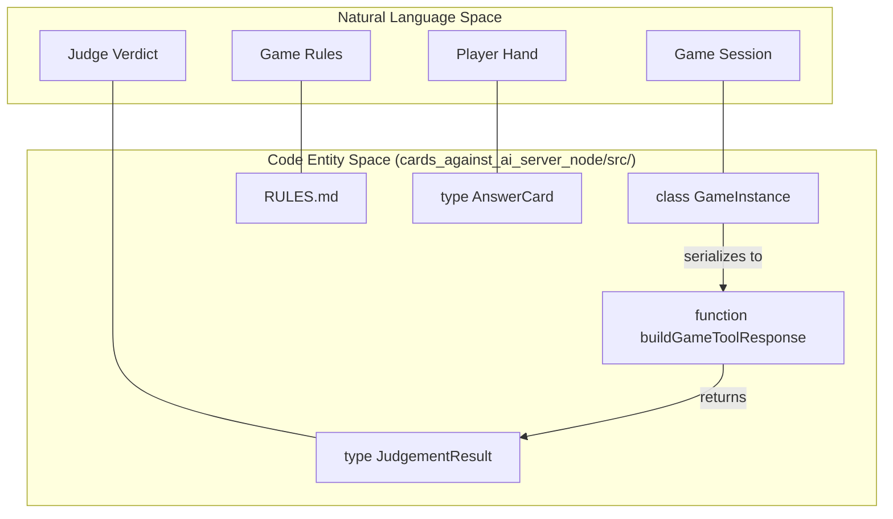
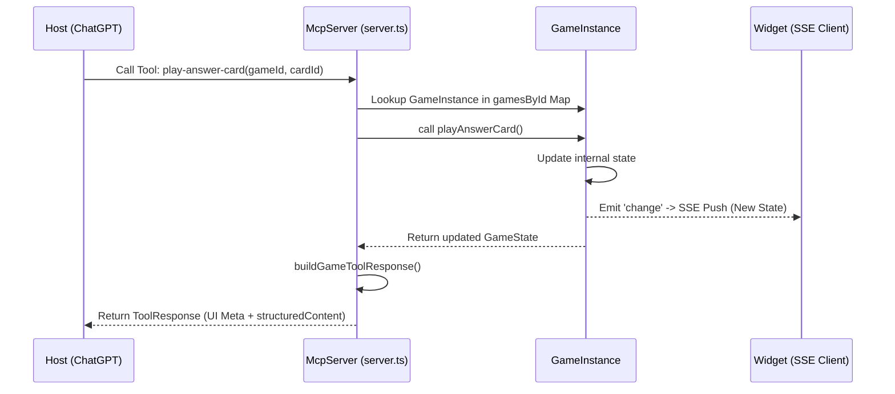

<!-- source: DeepWiki mcp.deepwiki.com · repo openai/openai-apps-sdk-examples · page 5.3 Cards Against AI Server · fetched 2026-10-26 -->

# Cards Against AI Server

Relevant source files

The following files were used as context for generating this wiki page:

- [cards_against_ai_server_node/ANSWER_DECK_GUIDANCE.md](cards_against_ai_server_node/ANSWER_DECK_GUIDANCE.md)
- [cards_against_ai_server_node/README.md](cards_against_ai_server_node/README.md)
- [cards_against_ai_server_node/RULES.md](cards_against_ai_server_node/RULES.md)
- [cards_against_ai_server_node/package.json](cards_against_ai_server_node/package.json)
- [cards_against_ai_server_node/src/GameInstance.ts](cards_against_ai_server_node/src/GameInstance.ts)
- [cards_against_ai_server_node/src/server.ts](cards_against_ai_server_node/src/server.ts)
- [cards_against_ai_server_node/src/shared-types.ts](cards_against_ai_server_node/src/shared-types.ts)
- [src/cards-against-ai/README.md](src/cards-against-ai/README.md)
- [src/cards-against-ai/api-base-url.ts](src/cards-against-ai/api-base-url.ts)

The **Cards Against AI** Node.js server is the most sophisticated example in the repository. It demonstrates a complex, multi-turn game loop using a stateless MCP transport coupled with an external state `Map`. It highlights advanced features such as Server-Sent Events (SSE) for real-time UI synchronization, Zod-based schema validation, and the use of `rules://` resources to guide Model behavior.

## Technical Overview

The server is built using the `@modelcontextprotocol/sdk` and the `@modelcontextprotocol/ext-apps` wrapper. Unlike simpler examples, this server manages a dynamic game state that persists across multiple tool calls and conversational turns, even though the MCP transport itself remains stateless.

### Key Architectural Patterns

| Pattern | Implementation |
|:---|:---|
| **Stateless Transport** | A fresh `McpServer` instance is created per request, with state looked up via `gameId` [cards_against_ai_server_node/src/server.ts:318-320](). |
| **External State Map** | `gamesById` (a `Map<string, GameRecord>`) stores `GameInstance` objects in memory [cards_against_ai_server_node/src/server.ts:77-77](). |
| **Real-time Streaming** | A dedicated `/api/game-state/:gameId/stream` endpoint uses SSE to push updates to the widget [cards_against_ai_server_node/src/server.ts:335-337](). |
| **Model Guidance** | `rules://` resources provide the Model with game logic and deck generation instructions [cards_against_ai_server_node/src/server.ts:43-44](). |
| **Self-Contained Assets** | The server inlines JS and CSS into the widget HTML to avoid CSP and cross-origin loading issues in the ChatGPT sandbox [cards_against_ai_server_node/src/server.ts:133-153](). |

**Sources:** [cards_against_ai_server_node/src/server.ts:31-77](), [cards_against_ai_server_node/src/server.ts:133-153](), [cards_against_ai_server_node/src/server.ts:318-337](), [cards_against_ai_server_node/README.md:35-45]()

---

## Data Flow and State Synchronization

The system uses a "Dual-Channel" update pattern. When a tool is called, it returns the current state to the Model (via `structuredContent`). Simultaneously, the `GameInstance` emits an event that triggers an SSE push to the widget, ensuring the UI stays in sync even if the Model hasn't finished processing the response.

### System Entity Mapping

This diagram maps the natural language game concepts to the specific classes and functions in the codebase.

"Game Logic to Code Mapping"

**Sources:** [cards_against_ai_server_node/src/GameInstance.ts:88-105](), [cards_against_ai_server_node/src/server.ts:46-50](), [cards_against_ai_server_node/src/shared-types.ts:3-13](), [cards_against_ai_server_node/src/server.ts:287-287]()

---

## Key Server Functions

### Game State Management
The `GameInstance` class (defined in `GameInstance.ts`) acts as a finite state machine. It handles actions like `playAnswerCard` and `judgeAnswers`, updating its internal `GameState` and emitting events [cards_against_ai_server_node/src/GameInstance.ts:88-260]().

### `buildGameToolResponse`
This utility function is critical for MCP Apps. It constructs a standardized response that includes:
1.  **`_meta.ui`**: Binds the response to the specific widget [cards_against_ai_server_node/src/server.ts:175-179]().
2.  **`content`**: Textual descriptions for the Model to read/narrate [cards_against_ai_server_node/src/server.ts:291-291]().
3.  **`structuredContent`**: JSON data for the widget, including `gameState` and `nextAction` [cards_against_ai_server_node/src/server.ts:292-298]().

### Resource Registration
The server registers two types of resources using `registerAppResource`:
*   **UI Resources**: `ui://widget/cards-against-ai.html` provides the inlined HTML for the widget [cards_against_ai_server_node/src/server.ts:42-42]().
*   **Rule Resources**: `rules://cards-against-ai` provides the Markdown ruleset [cards_against_ai_server_node/src/server.ts:43-43]().

**Sources:** [cards_against_ai_server_node/src/server.ts:175-179](), [cards_against_ai_server_node/src/server.ts:287-308](), [cards_against_ai_server_node/src/GameInstance.ts:143-260]()

---

## Tool Execution Flow

The following diagram illustrates how a tool call (e.g., `play-answer-card`) flows through the server to update both the Model and the Widget.

"Tool Call Sequence"

**Sources:** [cards_against_ai_server_node/src/server.ts:77-77](), [cards_against_ai_server_node/src/server.ts:287-308](), [cards_against_ai_server_node/src/server.ts:318-340](), [cards_against_ai_server_node/src/GameInstance.ts:143-182]()

---

## Schema and Validation

The server uses **Zod** for input validation. `registerAppTool` automatically converts these Zod schemas into JSON Schema for the MCP tool definitions.

*   **`cpuPersonaParser`**: Defines the complex personality traits for AI players [cards_against_ai_server_node/src/server.ts:184-197]().
*   **`startGameShape`**: Validates the initial game setup, requiring exactly 4 players and intro dialog [cards_against_ai_server_node/src/server.ts:219-223]().
*   **`playAnswerCardShape`**: Ensures tool calls include the necessary IDs [cards_against_ai_server_node/src/server.ts:225-229]().

**Sources:** [cards_against_ai_server_node/src/server.ts:181-223](), [cards_against_ai_server_node/README.md:44-44]()

---

## Rules and Guidance

The server provides two primary Markdown files as resources to guide the Model's creative output:

1.  **`RULES.md`**: Explains the game flow, card types, and specifically how to use the `nextAction` hints provided in tool responses [cards_against_ai_server_node/RULES.md:1-60]().
2.  **`ANSWER_DECK_GUIDANCE.md`**: Instructs the Model on how to generate "punchy, irreverent" answer cards when refilling player hands [cards_against_ai_server_node/ANSWER_DECK_GUIDANCE.md:1-20]().

**Sources:** [cards_against_ai_server_node/src/server.ts:46-55](), [cards_against_ai_server_node/RULES.md:1-223]()

---

