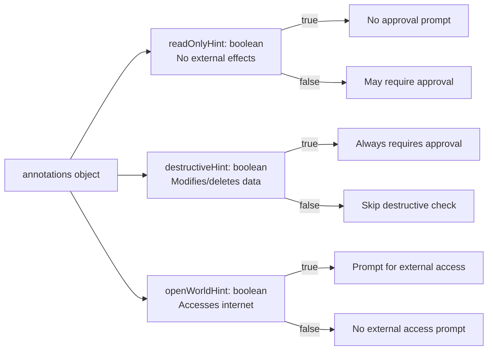
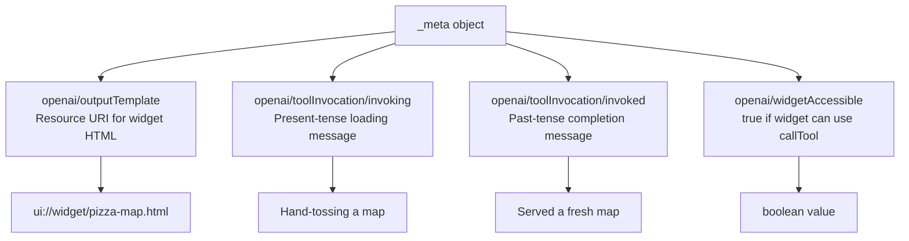
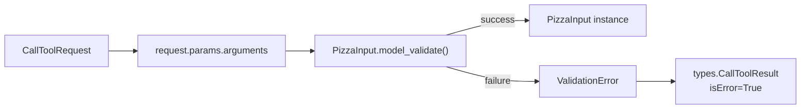
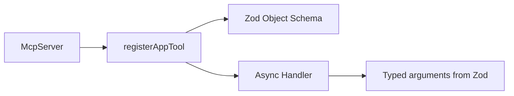
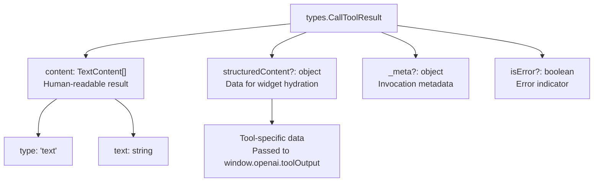

<!-- source: DeepWiki mcp.deepwiki.com · repo openai/openai-apps-sdk-examples · page 5.4 MCP Tool Design Best Practices · fetched 2026-10-26 -->

# MCP Tool Design Best Practices

<details>
<summary>Relevant source files</summary>

The following files were used as context for generating this wiki page:

- [cards_against_ai_server_node/README.md](cards_against_ai_server_node/README.md)
- [cards_against_ai_server_node/package.json](cards_against_ai_server_node/package.json)
- [mcp_app_basics_node/README.md](mcp_app_basics_node/README.md)
- [mcp_app_basics_node/package.json](mcp_app_basics_node/package.json)
- [mcp_app_basics_node/src/server.ts](mcp_app_basics_node/src/server.ts)
- [mcp_app_basics_node/tsconfig.json](mcp_app_basics_node/tsconfig.json)
- [pizzaz_server_python/main.py](pizzaz_server_python/main.py)
- [src/call-server-tool/App.tsx](src/call-server-tool/App.tsx)
- [src/call-server-tool/index.css](src/call-server-tool/index.css)
- [src/cards-against-ai/api-base-url.ts](src/cards-against-ai/api-base-url.ts)

</details>


## Purpose and Scope

This document provides guidelines for designing MCP tools that integrate seamlessly with ChatGPT and the Apps SDK. It covers input schema design, annotation patterns, metadata fields, validation strategies, and error handling conventions used throughout the example servers in this repository.

For implementation details of Python servers using FastMCP, see [5.1 Python MCP Servers with FastMCP](). For Node.js implementations, see [5.2 Node.js MCP Servers with SDK]().

---

## Tool Definition Anatomy

An MCP tool consists of several required and optional components that control how ChatGPT presents and executes the tool. The following diagram shows the complete structure:

### Tool Structure Hierarchy

```mermaid
graph TB
    Tool["types.Tool / Tool"]
    
    Tool --> Name["name: string<br/>(identifier for call_tool)"]
    Tool --> Title["title?: string<br/>(display name)"]
    Tool --> Description["description: string<br/>(LLM instructions)"]
    Tool --> InputSchema["inputSchema: JSONSchema<br/>(argument validation)"]
    Tool --> Annotations["annotations?: object<br/>(approval hints)"]
    Tool --> Meta["_meta?: object<br/>(widget metadata)"]
    
    InputSchema --> Type["type: 'object'"]
    InputSchema --> Properties["properties: {...}"]
    InputSchema --> Required["required: string[]"]
    InputSchema --> Additional["additionalProperties: false"]
    
    Annotations --> ReadOnly["readOnlyHint: boolean"]
    Annotations --> Destructive["destructiveHint: boolean"]
    Annotations --> OpenWorld["openWorldHint: boolean"]
    
    Meta --> OutputTemplate["openai/outputTemplate: URI"]
    Meta --> Invoking["openai/toolInvocation/invoking"]
    Meta --> Invoked["openai/toolInvocation/invoked"]
    Meta --> WidgetAccessible["openai/widgetAccessible: boolean"]
```



**Sources:** [pizzaz_server_python/main.py:185-202](), [mcp_app_basics_node/src/server.ts:109-131]()

---

## Input Schema Design

### JSON Schema Requirements

Tool input schemas must follow the [JSON Schema Draft 2020-12](https://json-schema.org/draft/2020-12/json-schema-core.html) specification. The Apps SDK requires well-formed schemas for argument parsing and validation.

| Schema Field | Required | Purpose | Example |
|-------------|----------|---------|---------|
| `type` | Yes | Must be `"object"` | `"object"` |
| `properties` | Yes | Defines available parameters | `{"pizzaTopping": {...}}` |
| `required` | No | Lists mandatory fields | `["pizzaTopping"]` |
| `additionalProperties` | Recommended | Should be `false` to prevent unknown args | `false` |

### Schema Example from Pizzaz Server

The Pizzaz tools use a simple schema with a single required string parameter:

```json
{
  "type": "object",
  "properties": {
    "pizzaTopping": {
      "type": "string",
      "description": "Topping to mention when rendering the widget."
    }
  },
  "required": ["pizzaTopping"],
  "additionalProperties": false
}
```

**Sources:** [pizzaz_server_python/main.py:152-162]()

### Field Description Guidelines

Property descriptions should be concise and actionable:

- ✅ **Good:** `"Topping to mention when rendering the widget"` [pizzaz_server_python/main.py:157]()
- ✅ **Good:** `"Optional name to greet (defaults to 'World')"` [mcp_app_basics_node/src/server.ts:123]()
- ❌ **Avoid:** `"The topping that the user wants to see"`
- ❌ **Avoid:** Generic descriptions that don't guide argument generation

The LLM uses these descriptions to generate appropriate argument values from user intent.

---

## Tool Annotations for Approval Control

Annotations control when ChatGPT displays approval prompts before executing a tool. All three hints should be explicitly set to avoid default behavior.

### Annotation Properties



### Common Annotation Patterns

| Tool Type | readOnlyHint | destructiveHint | openWorldHint | Example |
|-----------|--------------|-----------------|---------------|---------|
| Widget display | `true` | `false` | `false` | Pizzaz map, carousel [pizzaz_server_python/main.py:196-198]() |
| Data query | `true` | `false` | `false` | show_tool_result [mcp_app_basics_node/src/server.ts:126-128]() |
| State update | `false` | `false` | `false` | Game actions |
| External API | `false` | May vary | `true` | HTTP requests |

---

## Metadata Fields for Widget Integration

The `_meta` object contains OpenAI-specific fields that control widget rendering and tool invocation display.

### Metadata Field Reference



### Metadata Field Details

| Field | Type | Required | Purpose |
|-------|------|----------|---------|
| `openai/outputTemplate` | string (URI) | Yes (for widgets) | Points to resource containing widget HTML |
| `openai/toolInvocation/invoking` | string | No | Present-tense message shown during execution |
| `openai/toolInvocation/invoked` | string | No | Past-tense message shown after completion |
| `openai/widgetAccessible` | boolean | No | If `true`, widget can call `window.openai.callTool()` |

### Metadata Construction Pattern (Python)

```python
def _tool_meta(widget: PizzazWidget) -> Dict[str, Any]:
    return {
        "openai/outputTemplate": widget.template_uri,
        "openai/toolInvocation/invoking": widget.invoking,
        "openai/toolInvocation/invoked": widget.invoked,
        "openai/widgetAccessible": True,
    }
```

**Sources:** [pizzaz_server_python/main.py:169-175]()

---

## Input Validation Strategies

### Python: Pydantic Models

Python servers use Pydantic models to validate and parse tool arguments with type safety:



**Example Pydantic Model:**

```python
class PizzaInput(BaseModel):
    """Schema for pizza tools."""
    
    pizza_topping: str = Field(
        ...,
        alias="pizzaTopping",
        description="Topping to mention when rendering the widget.",
    )
    
    model_config = ConfigDict(populate_by_name=True, extra="forbid")
```

**Sources:** [pizzaz_server_python/main.py:115-125]()

### Node.js: Zod Schemas

Node.js servers use Zod for runtime validation and type inference, particularly when using `registerAppTool`:



**Example Zod Parser:**

```typescript
registerAppTool(
  server,
  "show_tool_result",
  {
    inputSchema: {
      name: z.string().optional().describe("Optional name to greet"),
    },
    // ... meta
  },
  async ({ name }) => { /* name is typed as string | undefined */ }
);
```

**Sources:** [mcp_app_basics_node/src/server.ts:109-131]()

---

## Tool Response Structure

### Response Components



### Example Response Construction (Node.js)

```typescript
return {
  content: [
    {
      type: "text" as const,
      text: "The tool was called successfully.",
    },
  ],
  structuredContent: {
    greeting: `Hello, ${resolvedName}!`,
    timestamp: new Date().toISOString(),
  },
};
```

**Sources:** [mcp_app_basics_node/src/server.ts:135-152]()

---

## Resource URI Conventions

### URI Scheme Guidelines

Resource URIs must use the `ui://` scheme for widget templates:

| Component | Format | Example |
|-----------|--------|---------|
| Scheme | `ui://` | Required prefix |
| Full URI | `ui://widget/pizzaz.html` | [pizzaz_server_python/main.py:59]() |
| Full URI | `ui://show-tool-result/show-tool-result.html` | [mcp_app_basics_node/src/server.ts:42]() |

### Widget-to-File Mapping

Servers must map these URIs to actual files on disk. The pattern typically involves an `ASSETS_DIR` and a lookup function.

**Python Loading Pattern:**
```python
@lru_cache(maxsize=None)
def _load_widget_html(component_name: str) -> str:
    html_path = ASSETS_DIR / f"{component_name}.html"
    if html_path.exists():
        return html_path.read_text(encoding="utf8")
    
    # Fallback to hashed filename
    fallback_candidates = sorted(ASSETS_DIR.glob(f"{component_name}-*.html"))
    if fallback_candidates:
        return fallback_candidates[-1].read_text(encoding="utf8")
    ...
```

**Sources:** [pizzaz_server_python/main.py:36-52]()

---

## Summary Checklist

When designing an MCP tool, ensure:

- ✅ **Input schema** is valid (JSON Schema or Zod) with clear descriptions.
- ✅ **All three annotations** (`readOnlyHint`, `destructiveHint`, `openWorldHint`) are explicitly set. [pizzaz_server_python/main.py:195-199]()
- ✅ **Metadata fields** include `openai/outputTemplate` for widget-backed tools. [pizzaz_server_python/main.py:171]()
- ✅ **Tool names** use `snake_case` (Python) or descriptive identifiers (Node). [mcp_app_basics_node/src/server.ts:111]()
- ✅ **Validation** is performed before business logic execution. [pizzaz_server_python/main.py:115-125]()
- ✅ **Response includes** both `content` (for the model) and `structuredContent` (for the widget). [mcp_app_basics_node/src/server.ts:136-147]()

**Sources:** [pizzaz_server_python/main.py](), [mcp_app_basics_node/src/server.ts]()

---

