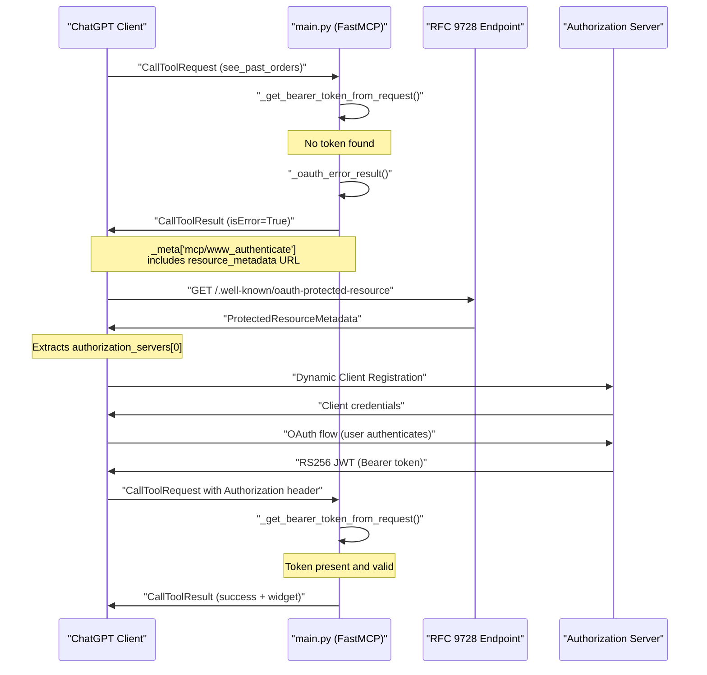
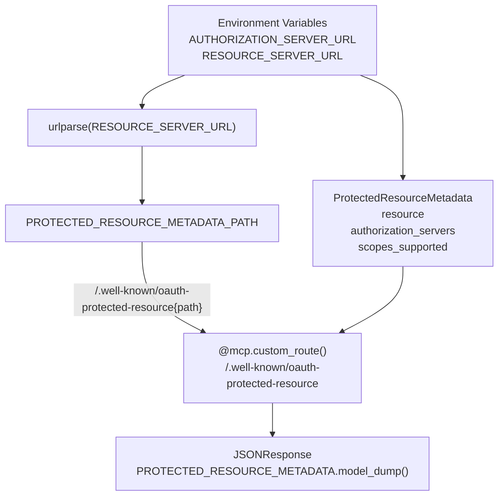
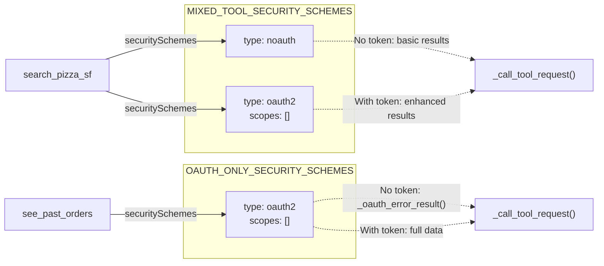
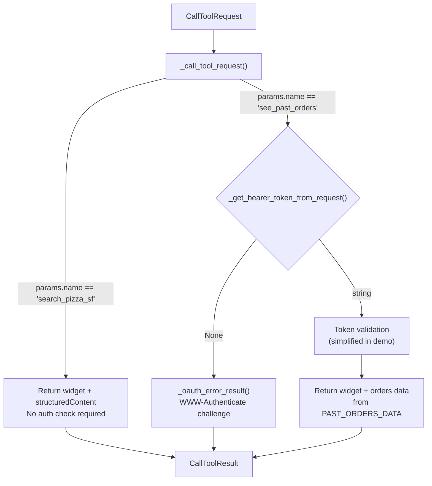
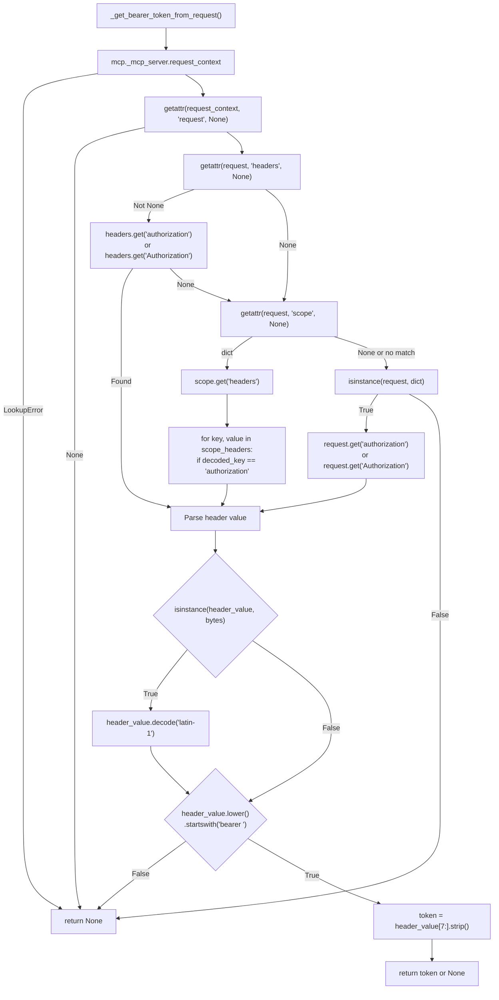
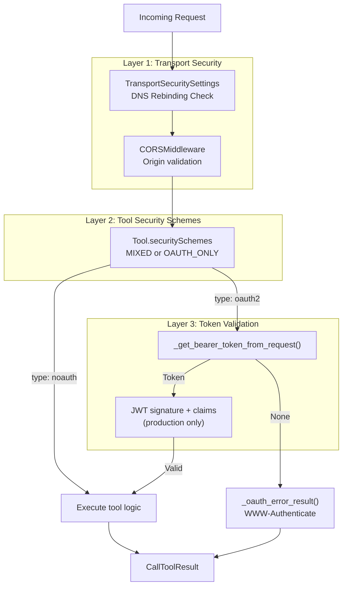

<!-- source: DeepWiki mcp.deepwiki.com · repo openai/openai-apps-sdk-examples · page 5.5 Authentication and Security · fetched 2026-10-26 -->

# Authentication and Security

<details>
<summary>Relevant source files</summary>

The following files were used as context for generating this wiki page:

- [authenticated_server_python/.env.example](authenticated_server_python/.env.example)
- [authenticated_server_python/README.md](authenticated_server_python/README.md)
- [authenticated_server_python/main.py](authenticated_server_python/main.py)
- [authenticated_server_python/requirements.txt](authenticated_server_python/requirements.txt)
- [src/mixed-auth-past-orders/index.jsx](src/mixed-auth-past-orders/index.jsx)
- [src/mixed-auth-search/SliceCard.jsx](src/mixed-auth-search/SliceCard.jsx)
- [src/mixed-auth-search/index.jsx](src/mixed-auth-search/index.jsx)

</details>


This document covers the implementation of authentication and security features in MCP servers, including OAuth 2.0 integration, token validation, transport security, and CORS configuration. It focuses on server-side security patterns used in the example implementations.

For widget-level state management and session persistence, see [State Management and widgetSessionId](#3.4). For OAuth flow from the client perspective, see [Authentication and OAuth](#3.5).

---

## OAuth 2.0 Integration via MCP Authorization Specification

The MCP protocol supports OAuth 2.0 authorization through standardized metadata and challenge-response patterns. The `authenticated_server_python` example demonstrates full implementation of the [MCP authorization specification](https://modelcontextprotocol.io/docs/tutorials/security/authorization).

### WWW-Authenticate Challenge Flow

When a protected tool is invoked without valid credentials, the server returns a `CallToolResult` with `isError=True` and a `_meta` field containing WWW-Authenticate challenge data. This triggers ChatGPT's authentication UI.

**Sequence Diagram: Authentication Trigger and Resolution**



**Sources:** [authenticated_server_python/main.py:228-260](), [authenticated_server_python/README.md:1-16]()

### WWW-Authenticate Header Construction

The `_build_www_authenticate_value` function constructs RFC 6750 compliant challenge headers with additional MCP-specific metadata.

[authenticated_server_python/main.py:228-235]():
```python
def _build_www_authenticate_value(error: str, description: str) -> str:
    safe_error = error.replace('"', r"\"")
    safe_description = description.replace('"', r"\"")
    parts = [
        f'error="{safe_error}"error_description="{safe_description}"',
    ]
    parts.append(f'resource_metadata="{PROTECTED_RESOURCE_METADATA_URL}"')
    return f"Bearer {', '.join(parts)}"
```

The `_oauth_error_result` function wraps this into a proper `CallToolResult`:

[authenticated_server_python/main.py:238-260]():
```python
def _oauth_error_result(
    user_message: str,
    *,
    error: str = "invalid_request",
    description: str | None = None,
) -> types.ServerResult:
    description_text = description or user_message
    return types.ServerResult(
        types.CallToolResult(
            content=[
                types.TextContent(
                    type="text",
                    text=user_message,
                )
            ],
            _meta={
                "mcp/www_authenticate": [
                    _build_www_authenticate_value(error, description_text)
                ]
            },
            isError=True,
        )
    )
```

**Sources:** [authenticated_server_python/main.py:228-260]()

### RFC 9728 Protected Resource Metadata

The server exposes an OAuth 2.0 Protected Resource Metadata endpoint per [RFC 9728](https://datatracker.ietf.org/doc/html/rfc9728). This endpoint advertises the authorization server URL and supported scopes.

**Diagram: Metadata Endpoint Configuration**



**Path Computation:**

[authenticated_server_python/main.py:170-179]():
```python
_parsed_resource_url = urlparse(str(RESOURCE_SERVER_URL))
_resource_path = (
    _parsed_resource_url.path if _parsed_resource_url.path not in ("", "/") else ""
)
PROTECTED_RESOURCE_METADATA_PATH = (
    f"/.well-known/oauth-protected-resource{_resource_path}"
)
PROTECTED_RESOURCE_METADATA_URL = f"{_parsed_resource_url.scheme}://{_parsed_resource_url.netloc}{PROTECTED_RESOURCE_METADATA_PATH}"
```

**Metadata Structure:**

[authenticated_server_python/main.py:180-184]():
```python
PROTECTED_RESOURCE_METADATA = ProtectedResourceMetadata(
    resource=RESOURCE_SERVER_URL,
    authorization_servers=[AUTHORIZATION_SERVER_URL],
    scopes_supported=RESOURCE_SCOPES,
)
```

**Endpoint Handler:**

[authenticated_server_python/main.py:321-326]():
```python
@mcp.custom_route(PROTECTED_RESOURCE_METADATA_PATH, methods=["GET", "OPTIONS"])
async def protected_resource_metadata(request: Request) -> Response:
    """Expose RFC 9728 metadata so clients can find the Auth0 authorization server."""
    if request.method == "OPTIONS":
        return Response(status_code=204)
    return JSONResponse(PROTECTED_RESOURCE_METADATA.model_dump(mode="json"))
```

**Sources:** [authenticated_server_python/main.py:170-184](), [authenticated_server_python/main.py:321-326]()

### Auth0 Configuration Requirements

The example uses Auth0 as the authorization server. Configuration steps are documented in [authenticated_server_python/README.md:19-40]().

| Requirement | Purpose | Configuration |
|------------|---------|---------------|
| **API Resource** | JWT audience validation | Identifier matches `JWT_AUDIENCES` env var |
| **Default Audience** | Unencrypted RS256 tokens | Tenant Settings → Default Audience |
| **Dynamic Client Registration** | Programmatic client registration | Dashboard → Settings → Advanced → OIDC DCR |
| **Social Connection** | User authentication mechanism | Authentication → Social → Promote to Domain Level |

**Sources:** [authenticated_server_python/README.md:19-40]()

---

## Security Schemes and Tool-Level Authorization

MCP supports per-tool security requirements through `securitySchemes` arrays. Tools can specify mixed authentication (works with or without tokens) or strict OAuth requirements.

### Security Scheme Types



**Definitions:**

[authenticated_server_python/main.py:187-200]():
```python
MIXED_TOOL_SECURITY_SCHEMES = [
    {"type": "noauth"},
    {
        "type": "oauth2",
        "scopes": RESOURCE_SCOPES,
    },
]

OAUTH_ONLY_SECURITY_SCHEMES = [
    {
        "type": "oauth2",
        "scopes": RESOURCE_SCOPES,
    }
]
```

**Tool Registration:**

[authenticated_server_python/main.py:365-399]():
- `search_pizza_sf` uses `MIXED_TOOL_SECURITY_SCHEMES` and `securitySchemes=list(MIXED_TOOL_SECURITY_SCHEMES)`
- `see_past_orders` uses `OAUTH_ONLY_SECURITY_SCHEMES` and `securitySchemes=list(OAUTH_ONLY_SECURITY_SCHEMES)`

**Sources:** [authenticated_server_python/main.py:187-200](), [authenticated_server_python/main.py:365-399]()

### Tool Handler Implementation



[authenticated_server_python/main.py:477-526]():
- Line 482-496: `search_pizza_sf` handler does not check for tokens
- Line 498-524: `see_past_orders` handler calls `_get_bearer_token_from_request()` and returns `_oauth_error_result()` if missing

**Sources:** [authenticated_server_python/main.py:477-526]()

---

## Token Extraction and Validation

The `_get_bearer_token_from_request` function extracts Bearer tokens from various header locations to maximize compatibility with different request contexts.

### Token Extraction Strategy

**Diagram: Token Extraction Logic in main.py**



**Implementation:**

[authenticated_server_python/main.py:263-318]():
```python
def _get_bearer_token_from_request() -> str | None:
    try:
        request_context = mcp._mcp_server.request_context
    except LookupError:
        return None

    request = getattr(request_context, "request", None)
    if request is None:
        return None

    header_value: Any = None
    headers = getattr(request, "headers", None)
    if headers is not None:
        try:
            header_value = headers.get("authorization")
            if header_value is None:
                header_value = headers.get("Authorization")
        except Exception:
            header_value = None

    if header_value is None:
        # Attempt to read from ASGI scope headers if available
        scope = getattr(request, "scope", None)
        scope_headers = scope.get("headers") if isinstance(scope, dict) else None
        if scope_headers:
            for key, value in scope_headers:
                decoded_key = (
                    key.decode("latin-1")
                    if isinstance(key, (bytes, bytearray))
                    else str(key)
                ).lower()
                if decoded_key == "authorization":
                    header_value = (
                        value.decode("latin-1")
                        if isinstance(value, (bytes, bytearray))
                        else str(value)
                    )
                    break

    if header_value is None and isinstance(request, dict):
        # Fall back to dictionary-like request contexts
        raw_value = request.get("authorization") or request.get("Authorization")
        header_value = raw_value

    if header_value is None:
        return None

    if isinstance(header_value, (bytes, bytearray)):
        header_value = header_value.decode("latin-1")

    header_value = header_value.strip()
    if not header_value.lower().startswith("bearer "):
        return None

    token = header_value[7:].strip()
    return token or None
```

The function handles standard header access, case-insensitivity, ASGI scope headers, and dictionary-based contexts.

**Sources:** [authenticated_server_python/main.py:263-318]()

---

## Transport Security

MCP servers implement multiple layers of transport security to prevent unauthorized access and cross-origin attacks.

### DNS Rebinding Protection

The `TransportSecuritySettings` class enables protection against DNS rebinding attacks when `MCP_ALLOWED_HOSTS` or `MCP_ALLOWED_ORIGINS` environment variables are set.

[authenticated_server_python/main.py:209-219]():
```python
def _transport_security_settings() -> TransportSecuritySettings:
    allowed_hosts = _split_env_list(os.getenv("MCP_ALLOWED_HOSTS"))
    allowed_origins = _split_env_list(os.getenv("MCP_ALLOWED_ORIGINS"))
    if not allowed_hosts and not allowed_origins:
        return TransportSecuritySettings(enable_dns_rebinding_protection=False)
    return TransportSecuritySettings(
        enable_dns_rebinding_protection=True,
        allowed_hosts=allowed_hosts,
        allowed_origins=allowed_origins,
    )
```

**FastMCP Initialization:**

[authenticated_server_python/main.py:221-225]():
```python
mcp = FastMCP(
    name="authenticated-server-python",
    stateless_http=True,
    transport_security=_transport_security_settings(),
)
```

**Sources:** [authenticated_server_python/main.py:209-225]()

### CORS Configuration

CORS middleware is added to allow widget asset requests from ChatGPT's origin.

[authenticated_server_python/main.py:536-546]():
```python
try:
    from starlette.middleware.cors import CORSMiddleware

    app.add_middleware(
        CORSMiddleware,
        allow_origins=["*"],
        allow_methods=["*"],
        allow_headers=["*"],
        allow_credentials=False,
    )
except Exception:
    pass
```

**Sources:** [authenticated_server_python/main.py:536-546]()

---

## Environment Variables Reference

### Security-Related Environment Variables

| Variable | Required | Example | Purpose |
|----------|----------|---------|---------|
| `AUTHORIZATION_SERVER_URL` | Yes (OAuth) | `https://dev-xyz.us.auth0.com` | Base URL for OAuth authorization server |
| `RESOURCE_SERVER_URL` | Yes (OAuth) | `https://abc123.ngrok-free.app/mcp` | Public URL to MCP server's `/mcp` endpoint |
| `MCP_ALLOWED_HOSTS` | Optional | `localhost,127.0.0.1,*.ngrok-free.app` | Allowlist for DNS rebinding protection |
| `MCP_ALLOWED_ORIGINS` | Optional | `https://chatgpt.com` | Allowlist for origin validation |

**Sources:** [authenticated_server_python/main.py:148-168](), [authenticated_server_python/.env.example]()

---

## Security Architecture Summary

**Diagram: Comprehensive Security Layers**



**Sources:** [authenticated_server_python/main.py:1-553]()

---

