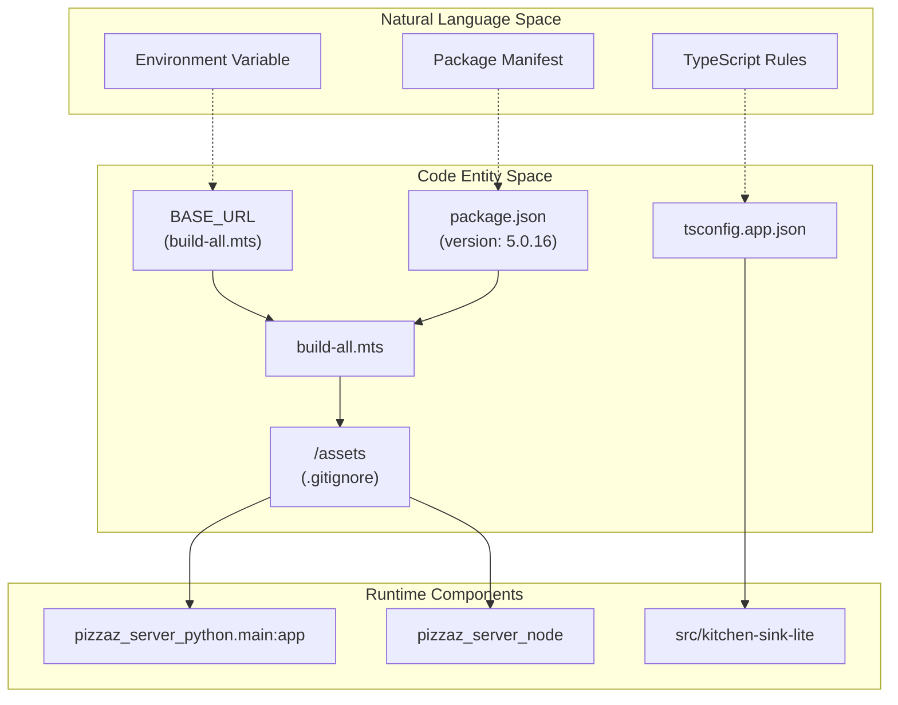
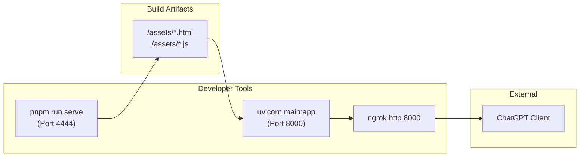

<!-- source: DeepWiki mcp.deepwiki.com · repo openai/openai-apps-sdk-examples · page 6 Configuration Reference · fetched 2026-10-26 -->

# Configuration Reference

Relevant source files

The following files were used as context for generating this wiki page:

- [.gitignore](.gitignore)
- [README.md](README.md)
- [package.json](package.json)
- [pnpm-lock.yaml](pnpm-lock.yaml)
- [pnpm-workspace.yaml](pnpm-workspace.yaml)
- [src/kitchen-sink-lite/kitchen-sink-lite.tsx](src/kitchen-sink-lite/kitchen-sink-lite.tsx)

This page provides reference documentation for configuration files, environment variables, and settings used throughout the repository. The system uses environment variables for runtime configuration, TypeScript for type safety, Vite for building and development, and various development tools for code quality.

---

## Configuration Files Overview

The repository uses the following configuration files to manage dependencies, build processes, and runtime environments:

| File | Category | Purpose | Detailed Docs |
|------|----------|---------|---------------|
| Environment Variables | Runtime | Server configuration, deployment URLs, security settings | [Environment Variables](#6.1) |
| `tsconfig.app.json` | TypeScript | Compiler settings for React/widget application code in `src/` | [TypeScript Configuration](#6.2) |
| `tsconfig.node.json` | TypeScript | Compiler settings for Node.js build scripts and tooling | [TypeScript Configuration](#6.2) |
| `build-all.mts` | Build | Production build orchestrator with asset hashing | [Build System](#4.4) |
| `package.json` | Package | Root package metadata, scripts, and dependencies | [Package Configuration](#6.3) |
| `pnpm-workspace.yaml` | Package | Workspace structure definition for Node.js packages | [Package Configuration](#6.3) |
| `.gitignore` | Version Control | Build artifact and cache exclusion patterns | [Development Tools](#6.4) |

**Sources:** [README.md:18-43](), [package.json:1-14](), [pnpm-workspace.yaml:1-5]()

---

## Environment Variables Overview

The system uses environment variables for runtime configuration across MCP servers and build processes. These variables control deployment URLs, security settings, and authentication configuration.

### Core Environment Variables

| Variable | Used By | Purpose | Default Value |
|----------|---------|---------|---------------|
| `BASE_URL` | `build-all.mts` | Asset CDN URL for production deployments | `http://localhost:4444` |
| `MCP_ALLOWED_HOSTS` | Python MCP servers | DNS rebinding protection - allowlisted hostnames | None (disabled) |
| `MCP_ALLOWED_ORIGINS` | Python MCP servers | DNS rebinding protection - allowlisted origins | None (disabled) |
| `AUTHORIZATION_SERVER_URL` | `authenticated_server_python` | OAuth authorization server discovery URL | None (required for auth) |
| `JWT_AUDIENCES` | `authenticated_server_python` | Expected JWT audience claim for token validation | None (required for auth) |

For a complete reference including OAuth configuration and transport security settings, see [Environment Variables](#6.1).

**Sources:** [README.md:103-104](), [package.json:44]()

---

## Configuration Architecture

The following diagram shows how configuration files and environment variables interact during development and build processes, bridging the gap between natural language concepts and code entities.

**Diagram: Configuration System Architecture**

**Sources:** [package.json:3-14](), [pnpm-workspace.yaml:1-5](), [README.md:96-106]()

---

## TypeScript Configuration Overview

The repository uses separate TypeScript configurations to handle different environments (browser-based widgets vs. Node.js tooling).

*   **`tsconfig.app.json`**: Targets the browser environment for React components in `src/`.
*   **`tsconfig.node.json`**: Targets the Node.js environment for build scripts like `build-all.mts`.

Both configurations enforce strict type checking and use `"moduleResolution": "bundler"` to align with Vite's behavior. For details, see [TypeScript Configuration](#6.2).

**Sources:** [package.json:10-12]()

---

## Package Configuration Overview

The root `package.json` defines the `ecosystem_ui` package, orchestrating the monorepo and individual examples.

### Core Scripts

| Script | Command | Purpose |
|--------|---------|---------|
| `build` | `tsx ./build-all.mts` | Production build with asset versioning |
| `serve` | `serve -s ./assets -p 4444 --cors` | Serves built assets with CORS enabled |
| `dev` | `vite --config vite.config.mts` | Local dev server for widgets |
| `tsc` | `tsc -b` | Project-wide type checking |

For details on workspace management and dependency structures, see [Package Configuration](#6.3).

**Sources:** [package.json:6-14](), [pnpm-workspace.yaml:1-5]()

---

## Development Tools Overview

Local development relies on a suite of tools to bridge the local environment with the ChatGPT client.

**Diagram: Local Development Tooling Flow**

*   **Vite**: Powers the development server and production bundling.
*   **pnpm**: Manages the monorepo workspace.
*   **uvicorn**: Serves the Python-based MCP implementations.
*   **ngrok**: Provides a secure tunnel for ChatGPT to access local MCP servers.

For details on tool setup and usage, see [Development Tools](#6.4).

**Sources:** [README.md:80-106](), [README.md:125-132](), [package.json:8-9]()

---

## Version Control and Artifacts

The `.gitignore` file ensures that build artifacts and environment-specific configurations are not committed to the repository.

### Key Exclusions
*   **`/assets`**: Generated by the build process; contains hashed bundles.
*   **`node_modules/` & `.pnpm-store/`**: Managed by the package manager.
*   **`.env*`**: Local environment variables (potential secrets).
*   **`__pycache__/` & `.venv/`**: Python execution and environment artifacts.

**Sources:** [.gitignore:1-42]()

---

