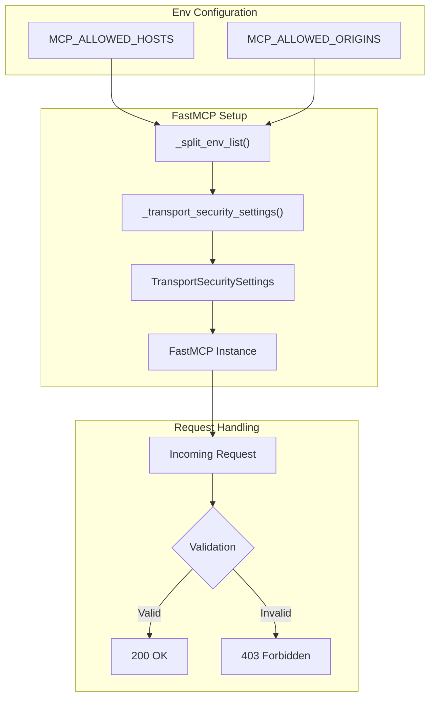
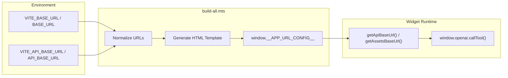

<!-- source: DeepWiki mcp.deepwiki.com · repo openai/openai-apps-sdk-examples · page 6.1 Environment Variables · fetched 2026-10-26 -->

# Environment Variables

<details>
<summary>Relevant source files</summary>

The following files were used as context for generating this wiki page:

- [authenticated_server_python/.env.example](authenticated_server_python/.env.example)
- [authenticated_server_python/main.py](authenticated_server_python/main.py)
- [build-all.mts](build-all.mts)
- [cards_against_ai_server_node/README.md](cards_against_ai_server_node/README.md)
- [cards_against_ai_server_node/package.json](cards_against_ai_server_node/package.json)
- [src/cards-against-ai/api-base-url.ts](src/cards-against-ai/api-base-url.ts)

</details>


This document provides a comprehensive reference for all environment variables used across the MCP servers and build system in the OpenAI Apps SDK Examples repository. These variables control transport security, asset serving, and OAuth authentication behavior.

---

## Transport Security Variables

### MCP_ALLOWED_HOSTS

**Purpose:** Defines a comma-separated list of hostnames permitted to access the MCP server when DNS rebinding protection is enabled.

**Required:** Only when using ngrok or other tunneling tools for local development.

**Default:** If unset (along with `MCP_ALLOWED_ORIGINS`), DNS rebinding protection is disabled.

**Format:** Comma-separated list of domain names without protocol or path.

**Example:**
```bash
export MCP_ALLOWED_HOSTS="abc123.ngrok-free.app,chatgpt.com"
```

**Implementation:**

The variable is parsed and applied in Python MCP servers via `TransportSecuritySettings`. In `authenticated_server_python/main.py`, the `_transport_security_settings` function reads this value:

[authenticated_server_python/main.py:203-218]()

```python
def _split_env_list(value: str | None) -> List[str]:
    if not value:
        return []
    return [item.strip() for item in value.split(",") if item.strip()]

def _transport_security_settings() -> TransportSecuritySettings:
    allowed_hosts = _split_env_list(os.getenv("MCP_ALLOWED_HOSTS"))
    allowed_origins = _split_env_list(os.getenv("MCP_ALLOWED_ORIGINS"))
    if not allowed_hosts and not allowed_origins:
        return TransportSecuritySettings(enable_dns_rebinding_protection=False)
    return TransportSecuritySettings(
        enable_dns_rebinding_protection=True,
        allowed_hosts=allowed_hosts,
        allowed_origins=allowed_origins,
    )
```

The security settings are then passed to the `FastMCP` instance:

[authenticated_server_python/main.py:221-225]()

**Sources:** [authenticated_server_python/main.py:203-225]()

---

### MCP_ALLOWED_ORIGINS

**Purpose:** Defines a comma-separated list of full origin URLs permitted to access the MCP server. More specific than `MCP_ALLOWED_HOSTS` as it includes the protocol and port.

**Required:** Only when using ngrok or other tunneling tools for local development.

**Default:** If unset (along with `MCP_ALLOWED_HOSTS`), DNS rebinding protection is disabled.

**Format:** Comma-separated list of full origin URLs including protocol.

**Implementation:**

Parsed using the same `_split_env_list` helper and applied to `TransportSecuritySettings` in Python servers [authenticated_server_python/main.py:211-218]().

**Relationship with MCP_ALLOWED_HOSTS:**

Both variables work together. If either is set, DNS rebinding protection is enabled. The server validates incoming requests against both allow lists:

| Variable Set | DNS Protection | Behavior |
|-------------|----------------|----------|
| Neither | Disabled | All hosts/origins accepted |
| `MCP_ALLOWED_HOSTS` only | Enabled | Validates Host header |
| `MCP_ALLOWED_ORIGINS` only | Enabled | Validates Origin header |
| Both | Enabled | Validates both headers |

**Sources:** [authenticated_server_python/main.py:209-218]()

---

## Asset Serving and API Base URLs

### BASE_URL / VITE_BASE_URL

**Purpose:** Specifies the base URL for serving static widget assets. The build system uses this to generate the HTML entry points for widgets.

**Default:** `http://localhost:4444` [build-all.mts:192]()

**Implementation:**
The build script `build-all.mts` prioritizes `VITE_BASE_URL` over `BASE_URL`. It normalizes the URL to ensure no trailing slashes and uses it to inject `<script>` and `<link>` tags into the generated HTML:

[build-all.mts:193-200]()
[build-all.mts:228-229]()

### API_BASE_URL / VITE_API_BASE_URL

**Purpose:** Specifies the base URL of the MCP server API that the widget should communicate with.

**Default:** `http://localhost:8000` [build-all.mts:202]()

**Implementation:**
The build script injects this into a global configuration object in the widget's HTML:

[build-all.mts:204-216]()
[build-all.mts:225-227]()

```javascript
window.__APP_URL_CONFIG__ = {
  apiBaseUrl: "...",
  assetsBaseUrl: "..."
};
```

Within the widget code (e.g., `src/cards-against-ai/api-base-url.ts`), the application retrieves these values via `getApiBaseUrl()` and `getAssetsBaseUrl()`, checking `window.__APP_URL_CONFIG__` first before falling back to environment variables [src/cards-against-ai/api-base-url.ts:31-53]().

**Sources:** [build-all.mts:192-216](), [src/cards-against-ai/api-base-url.ts:31-53]()

---

## OAuth and Authentication Variables

### AUTHORIZATION_SERVER_URL

**Purpose:** The base URL of the OAuth 2.0 authorization server (e.g., Auth0 tenant).

**Required:** Yes, for `authenticated_server_python`.

**Implementation:**
The server reads this variable to initialize `ProtectedResourceMetadata`, which is advertised to ChatGPT via the MCP protocol to signal that tools require authentication [authenticated_server_python/main.py:148-184]().

### RESOURCE_SERVER_URL

**Purpose:** The public URL of the MCP server itself, used as the `resource` identifier in the OAuth flow.

**Required:** Yes, for `authenticated_server_python`.

**Implementation:**
Used to construct the `ProtectedResourceMetadata` and the `.well-known/oauth-protected-resource` path [authenticated_server_python/main.py:170-184]().

**Sources:** [authenticated_server_python/main.py:148-184](), [authenticated_server_python/.env.example:1-3]()

---

## Environment Variable Flow Diagrams

### Transport Security Configuration Flow


**Sources:** [authenticated_server_python/main.py:203-225]()

### Build-Time Asset URL Injection


**Sources:** [build-all.mts:192-216](), [src/cards-against-ai/api-base-url.ts:31-53]()

---

## Environment Variable Reference Table

| Variable | Scope | Default | Description |
|----------|-------|---------|-------------|
| `MCP_ALLOWED_HOSTS` | Python Servers | `None` | Comma-separated list of allowed hostnames for DNS rebinding protection. |
| `MCP_ALLOWED_ORIGINS` | Python Servers | `None` | Comma-separated list of allowed origin URLs. |
| `BASE_URL` | Build System | `http://localhost:4444` | Base URL for static assets (`.js`, `.css`, `.html`). |
| `VITE_BASE_URL` | Build System | `BASE_URL` | Vite-specific override for `BASE_URL`. |
| `API_BASE_URL` | Build System | `http://localhost:8000` | Base URL for the MCP server API. |
| `VITE_API_BASE_URL` | Build System | `API_BASE_URL` | Vite-specific override for `API_BASE_URL`. |
| `AUTHORIZATION_SERVER_URL` | Auth Server | `None` | The OAuth2 authorization server URL (e.g. Auth0). |
| `RESOURCE_SERVER_URL` | Auth Server | `None` | The identifier for the MCP server resource in OAuth. |
| `PORT` | Servers | Varies | The port on which the MCP server or asset server listens. |

**Sources:** [build-all.mts:192-212](), [authenticated_server_python/main.py:148-156](), [authenticated_server_python/main.py:210-211]()

---

