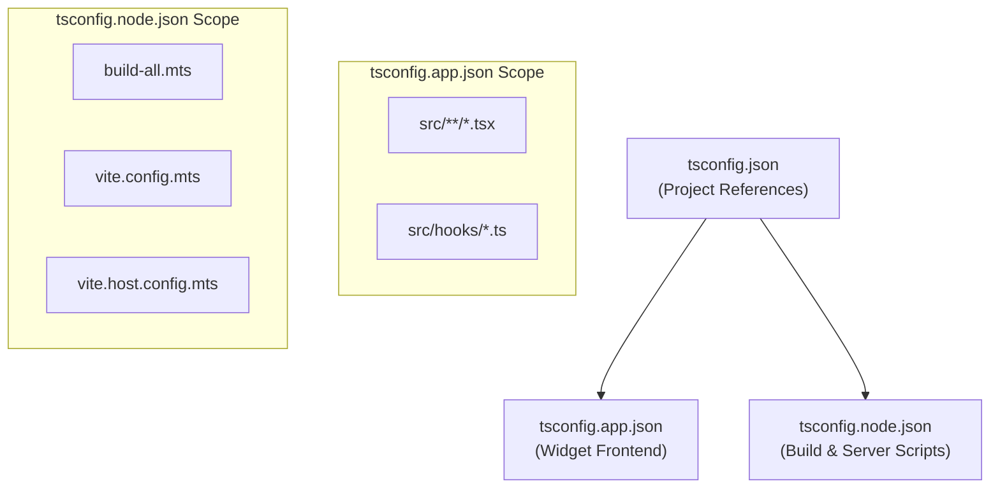
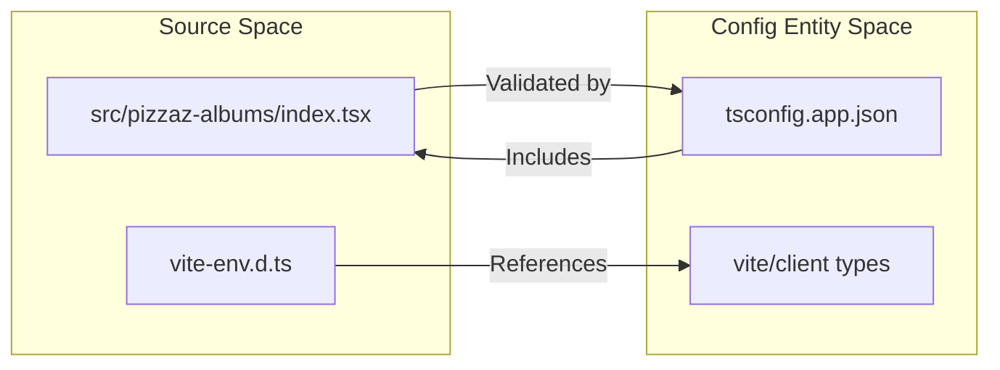
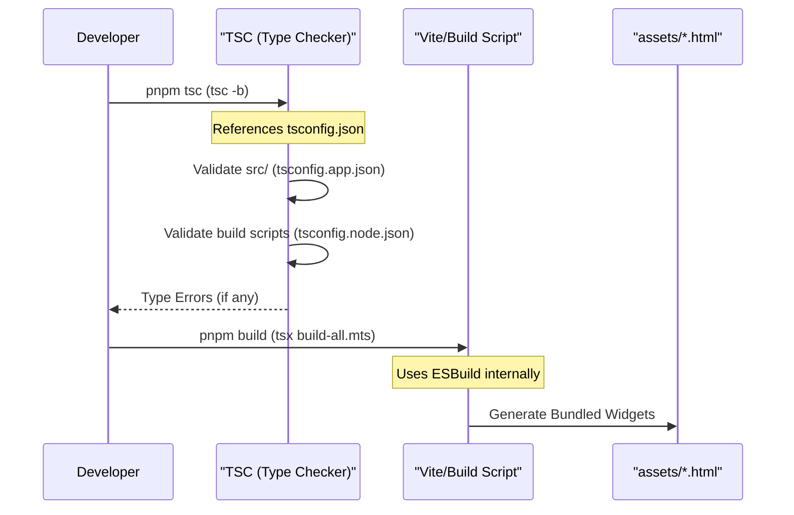

<!-- source: DeepWiki mcp.deepwiki.com · repo openai/openai-apps-sdk-examples · page 6.2 TypeScript Configuration · fetched 2026-10-26 -->

# TypeScript Configuration

Relevant source files

The following files were used as context for generating this wiki page:

- [pizzaz_server_python/requirements.txt](pizzaz_server_python/requirements.txt)
- [solar-system_server_python/requirements.txt](solar-system_server_python/requirements.txt)
- [src/pizzaz-albums/albums.json](src/pizzaz-albums/albums.json)
- [tsconfig.app.json](tsconfig.app.json)
- [tsconfig.json](tsconfig.json)
- [tsconfig.node.json](tsconfig.node.json)
- [vite-env.d.ts](vite-env.d.ts)

This page details the TypeScript configuration for the OpenAI Apps SDK examples repository. The project uses a multi-layered configuration strategy to handle React widget development, Node.js server compilation, and build automation scripts.

## Configuration Strategy

The repository utilizes **TypeScript Project References** to manage different compilation targets within a single monorepo structure [tsconfig.json:3-6](). This allows for strict isolation between browser-based widget code and Node.js-based server or build logic.

### Configuration Hierarchy

**Sources**: [tsconfig.json:1-8](), [tsconfig.app.json:26](), [tsconfig.node.json:20-24]()

---

## Widget Frontend Configuration (`tsconfig.app.json`)

The `tsconfig.app.json` file governs the compilation of React widgets. It is optimized for modern browser environments and React 19.

### Key Compiler Options

| Option | Setting | Purpose |
|--------|---------|---------|
| `target` | `ES2022` | Modern JS output compatible with current browsers [tsconfig.app.json:4]() |
| `lib` | `["ES2022", "DOM", "DOM.Iterable"]` | Includes browser APIs and modern ES features [tsconfig.app.json:6]() |
| `moduleResolution` | `bundler` | Optimized for Vite/Rollup bundling [tsconfig.app.json:9]() |
| `jsx` | `react-jsx` | Enables the modern React JSX transform [tsconfig.app.json:14]() |
| `types` | `["vite/client", "@react-three/fiber"]` | Global types for Vite env and 3D graphics [tsconfig.app.json:16]() |

### Code Entity Association: Widget Environment

**Sources**: [tsconfig.app.json:1-27](), [vite-env.d.ts:1]()

---

## Node.js and Build Configuration (`tsconfig.node.json`)

The `tsconfig.node.json` file is used for scripts that run in the Node.js environment, specifically the build pipeline and Vite configuration files.

### Included Files
This configuration specifically targets the build infrastructure [tsconfig.node.json:20-24]():
- `build-all.mts`: The main widget bundling script.
- `vite.config.mts`: Core Vite configuration.
- `vite.host.config.mts`: Configuration for the local host emulator.

### Strictness and Safety
The Node configuration enforces high code quality for the build system:
- `strict: true`: Enables all strict type-checking options [tsconfig.node.json:13]().
- `verbatimModuleSyntax: true`: Ensures imports are preserved exactly as written, critical for ESM compatibility [tsconfig.node.json:10]().
- `noEmit: true`: TypeScript is used only for type checking; `tsx` or `vite` handles the actual execution/bundling [tsconfig.node.json:12]().

**Sources**: [tsconfig.node.json:1-25]()

---

## Data Flow: Type Checking vs. Bundling

TypeScript in this repository acts as a validation layer rather than a transpilation layer. The actual transformation of code is handled by Vite and `tsx`.

**Sources**: [package.json:9-11](), [tsconfig.json:3-6](), [tsconfig.node.json:12](), [tsconfig.app.json:13]()

---

## Shared Compiler Defaults

Both configurations share a set of "modern strict" defaults to ensure consistency across the monorepo:

- **Module System**: Both use `ESNext` modules [tsconfig.app.json:7](), [tsconfig.node.json:6]().
- **Resolution**: Both use `bundler` resolution to support modern package exports [tsconfig.app.json:9](), [tsconfig.node.json:8]().
- **Extensions**: `allowImportingTsExtensions: true` is enabled in both, allowing `.ts` extensions in import paths when using no-emit tools [tsconfig.app.json:10](), [tsconfig.node.json:9]().
- **Unused Code**: Both enforce `noUnusedLocals` and `noUnusedParameters` to keep the codebase clean [tsconfig.app.json:20-21](), [tsconfig.node.json:14-15]().

**Sources**: [tsconfig.app.json:1-27](), [tsconfig.node.json:1-25]()

---

