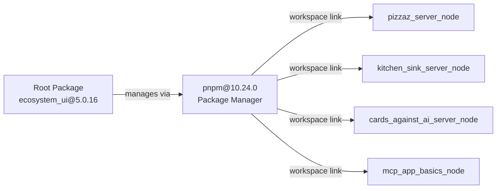
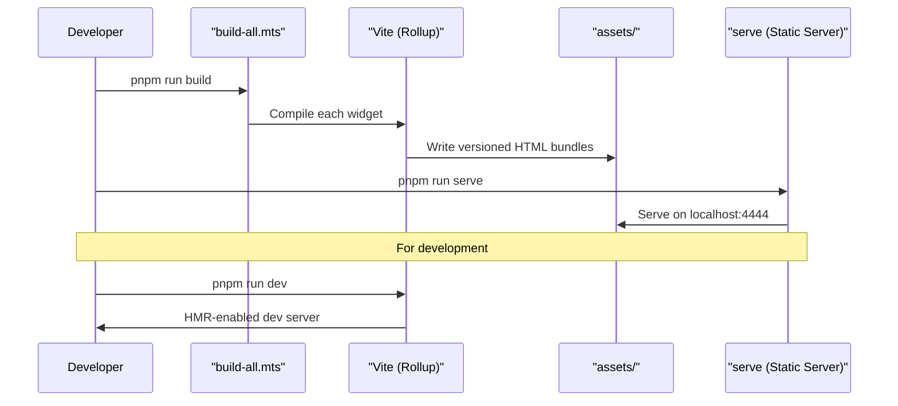
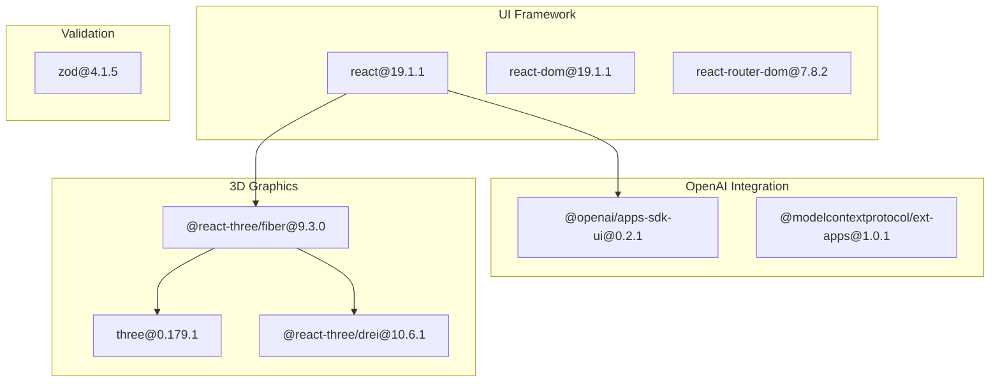
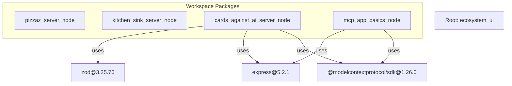

<!-- source: DeepWiki mcp.deepwiki.com · repo openai/openai-apps-sdk-examples · page 6.3 Package Configuration · fetched 2026-10-26 -->

# Package Configuration

Relevant source files

The following files were used as context for generating this wiki page:

- [.gitignore](.gitignore)
- [cards_against_ai_server_node/tsconfig.json](cards_against_ai_server_node/tsconfig.json)
- [package.json](package.json)
- [pnpm-lock.yaml](pnpm-lock.yaml)
- [pnpm-workspace.yaml](pnpm-workspace.yaml)
- [src/kitchen-sink-lite/kitchen-sink-lite.tsx](src/kitchen-sink-lite/kitchen-sink-lite.tsx)

This page documents the package configuration for the OpenAI Apps SDK Examples Gallery, including the root `package.json`, workspace setup using pnpm, and dependency management.

---

## Overview

The repository uses a **pnpm monorepo** structure with a root package containing widget source code and build tooling, plus four Node.js MCP server workspace packages. The root [package.json:1-65]() defines the unified build system, widget dependencies, and npm scripts, while [pnpm-workspace.yaml:1-5]() configures the workspace boundaries for Node.js server implementations.

**Sources:** [package.json:1-65](), [pnpm-workspace.yaml:1-5]()

---

## Package Metadata and Manager

The root package is named `ecosystem_ui` at version `5.0.16` [package.json:2-3](). The repository enforces **pnpm@10.24.0** as the package manager via the `packageManager` field [package.json:18](), ensuring consistent dependency resolution and workspace linking.

**Sources:** [package.json:2-3,18](), [pnpm-workspace.yaml:1-5]()

---

## NPM Scripts

The root package defines scripts for building, serving, and developing widgets:

| Script | Command | Purpose |
|--------|---------|---------|
| `build` | `tsx ./build-all.mts` | Executes the Vite build orchestrator to compile all widgets into `assets/` [package.json:7]() |
| `serve` | `serve -s ./assets -p 4444 --cors` | Starts a CORS-enabled static file server on port 4444 [package.json:8]() |
| `dev` | `vite --config vite.config.mts` | Launches Vite dev server for widget development [package.json:9]() |
| `tsc` | `tsc -b` | Builds all TypeScript projects [package.json:10]() |
| `tsc:app` | `tsc -p tsconfig.app.json` | Type-checks widget application code [package.json:11]() |
| `tsc:node` | `tsc -p tsconfig.node.json` | Type-checks Node.js build scripts [package.json:12]() |
| `dev:host` | `vite --config vite.host.config.mts` | Launches Vite dev server for host environment [package.json:13]() |

**Sources:** [package.json:6-14]()

---

## Dependencies

### Runtime Dependencies

The root package includes dependencies for UI frameworks, 3D graphics, and OpenAI integration:

Key dependencies:
- **React 19.1.1**: UI framework [package.json:55]().
- **@openai/apps-sdk-ui@0.2.1**: UI components like `Badge`, `Button`, and `CodeBlock` [package.json:36](), [src/kitchen-sink-lite/kitchen-sink-lite.tsx:14-16]().
- **@modelcontextprotocol/ext-apps@1.0.1**: MCP extensions for Apps SDK [package.json:35]().
- **Three.js Stack**: `three`, `@react-three/fiber`, and `@react-three/drei` for 3D visualizations [package.json:38-40,62]().
- **zod@4.1.5**: Schema validation [package.json:63]().

**Sources:** [package.json:34-64](), [src/kitchen-sink-lite/kitchen-sink-lite.tsx:14-19]()

### Development Dependencies

Key devDependencies for the build pipeline:
- **vite@7.1.1**: Build tool [package.json:32]().
- **tailwindcss@4.1.11**: Styling framework [package.json:29]().
- **tsx@4.20.4**: TypeScript executor for `build-all.mts` [package.json:30]().
- **typescript@5.9.2**: Compiler [package.json:31]().

**Sources:** [package.json:19-33]()

---

## Workspace Configuration

The repository uses **pnpm workspaces** to manage four Node.js MCP server packages [pnpm-workspace.yaml:1-5]().

### Workspace Package Structure

**Workspace Package Highlights:**
- **cards_against_ai_server_node**: Uses `express` for SSE transport and `@modelcontextprotocol/sdk@1.26.0` [pnpm-lock.yaml:141-158]().
- **mcp_app_basics_node**: Uses `@modelcontextprotocol/ext-apps` for specialized app tool registration [pnpm-lock.yaml:191-196]().
- **Shared Validation**: Workspace packages typically use `zod@3.25.76` for server-side validation [pnpm-lock.yaml:156-158, 203-205]().

**Sources:** [pnpm-workspace.yaml:1-5](), [pnpm-lock.yaml:139-219]()

---

## Lock File and Resolution

The `pnpm-lock.yaml` uses lockfile version `9.0` [pnpm-lock.yaml:1](). It configures `autoInstallPeers: true` [pnpm-lock.yaml:4]() and manages dependencies for five distinct importers (root + 4 workspace packages) [pnpm-lock.yaml:7-226]().

The `onlyBuiltDependencies` field in [pnpm-workspace.yaml:7-11]() restricts which packages are allowed to run install scripts, including `@modelcontextprotocol/ext-apps`, `@tailwindcss/oxide`, and `esbuild`.

**Sources:** [pnpm-lock.yaml:1-226](), [pnpm-workspace.yaml:7-11]()

---

## CSS and Asset Handling

The repository includes specific CSS handling via package links:
- `mapbox-gl.css`: Linked to `mapbox-gl/dist/mapbox-gl.css` [package.json:52]().
- `react-datepicker.css`: Linked to `react-datepicker/dist/react-datepicker.css` [package.json:57]().

Build outputs, dependency directories (`node_modules`), and Python artifacts (`__pycache__`, `.venv`) are excluded from version control via `.gitignore` [.gitignore:1-35]().

**Sources:** [package.json:52,57](), [.gitignore:1-35]()

---

