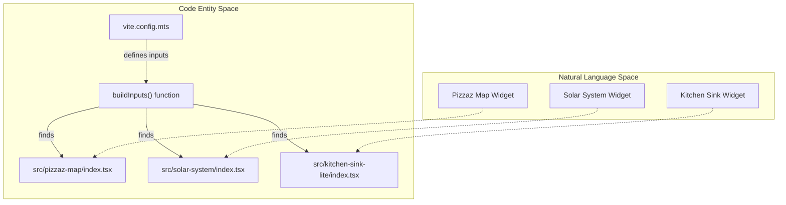
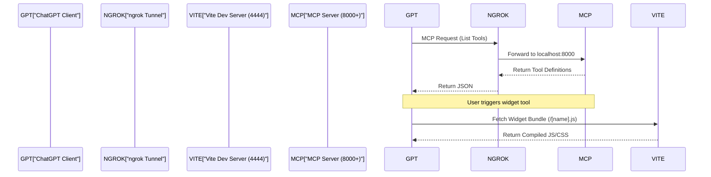

<!-- source: DeepWiki mcp.deepwiki.com · repo openai/openai-apps-sdk-examples · page 6.4 Development Tools · fetched 2026-10-26 -->

# Development Tools

Relevant source files

The following files were used as context for generating this wiki page:

- [.github/workflows/pre-commit.yml](.github/workflows/pre-commit.yml)
- [.pre-commit-config.yaml](.pre-commit-config.yaml)
- [ngrok-v3-stable-linux-amd64.tgz](ngrok-v3-stable-linux-amd64.tgz)
- [vite.config.mts](vite.config.mts)
- [vite.host.config.mts](vite.host.config.mts)

## Purpose and Scope

This document details the configuration and implementation of the development environment for the OpenAI Apps SDK Examples. It covers the local development lifecycle, including the **Vite** multi-entry build system, **pnpm** workspace management, **Python/Uvicorn** server orchestration, and **ngrok** tunneling for ChatGPT integration.

---

## Package and Workspace Management

The repository utilizes **pnpm workspaces** to manage a monorepo containing the widget build system and Node.js-based MCP servers.

### Workspace Configuration
The workspace is defined in [pnpm-workspace.yaml:1-3](), including the `pizzaz_server_node` package. Python servers remain outside the JavaScript workspace to maintain isolation of the Python dependency ecosystem.

### Package Manager Enforcement
The repository enforces **pnpm 10.13.1** via the `packageManager` field in [package.json:18](). This ensures consistent dependency resolution and binary integrity via SHA-512 validation across all development environments.

**Sources:** [pnpm-workspace.yaml:1-3](), [package.json:18]()

---

## Vite Development System

The development workflow is powered by **Vite**, configured to support a multi-entry architecture. This allows developers to work on dozens of independent widgets within a single dev server instance.

### Multi-Entry Architecture
The build system dynamically discovers widget entries using `fast-glob` to find `index.tsx` or `index.jsx` files within the `src/` directory [vite.config.mts:8-13]().

**Widget Discovery to Code Entity Mapping**

**Sources:** [vite.config.mts:8-13]()

### Custom Dev Server Middleware
The `multiEntryDevEndpoints` plugin [vite.config.mts:24-199]() implements custom middleware to handle virtual routes:
- **Index Page:** Renders a list of available examples at `/` or `/index.html` [vite.config.mts:41-69]().
- **Virtual HTML/JS:** Dynamically generates HTML wrappers for each widget (e.g., `/[widget-name].html`) and maps `.js` requests to virtual entry points [vite.config.mts:126-138]().
- **CSS Injection:** Automatically collects global CSS and per-entry CSS files, injecting them into the virtual style modules [vite.config.mts:151-169]().

### Dev Server Configuration
The dev server is configured to run on port **4444** with CORS enabled to allow the ChatGPT client or the local host simulator to fetch assets [vite.config.mts:210-214]().

**Sources:** [vite.config.mts:24-199](), [vite.config.mts:210-214]()

---

## Python Development with Uvicorn

Python-based MCP servers (e.g., `pizzaz_server_python`, `solar-system_server_python`) are typically served using **Uvicorn**, an ASGI server.

### Server Lifecycle
The servers use the `FastMCP` framework, which integrates with Uvicorn to provide:
1. **SSE Transport:** Handling the Model Context Protocol over Server-Sent Events.
2. **Static Asset Serving:** While Vite handles assets in development, the Python servers are configured to reference these assets via the `BASE_URL` environment variable.

---

## Tunneling with ngrok

For local development to be accessible by the ChatGPT web client, a secure tunnel is required. **ngrok** is the recommended tool for exposing the local server (typically port 4444 for assets and 8000+ for MCP servers) to the internet.

### Integration Flow
When a developer starts `ngrok`, it provides a public HTTPS URL that must be configured in the ChatGPT Developer Console as the **MCP Endpoint**.

**Local Development Data Flow**

---

## Pre-commit and Linting

To maintain code quality, the repository uses `pre-commit` to run automated checks before code is committed.

### Hooks Configuration
The hooks are defined in [.pre-commit-config.yaml:1-15]() and include:
- **Ruff:** For Python linting and formatting [ .pre-commit-config.yaml:5-6]().
- **Standard Hooks:** YAML/JSON validation, end-of-file fixing, and trailing whitespace removal [ .pre-commit-config.yaml:10-14]().

### CI Integration
These checks are mirrored in GitHub Actions [.github/workflows/pre-commit.yml:1-15](), ensuring that all PRs adhere to the project's formatting standards.

**Sources:** [.pre-commit-config.yaml:1-15](), [.github/workflows/pre-commit.yml:1-15]()

---

## Summary of Dev Scripts

Key commands defined in [package.json:6-13]():

| Command | Tool | Purpose |
|:---|:---|:---|
| `pnpm run dev` | Vite | Starts the widget development server on port 4444. |
| `pnpm run build` | tsx/Vite | Compiles all widgets into production-ready assets. |
| `pnpm run serve` | serve | Serves the `assets/` directory for local production testing. |
| `pnpm run tsc` | tsc | Executes project-wide type checking using TypeScript project references. |

**Sources:** [package.json:6-13]()

---

