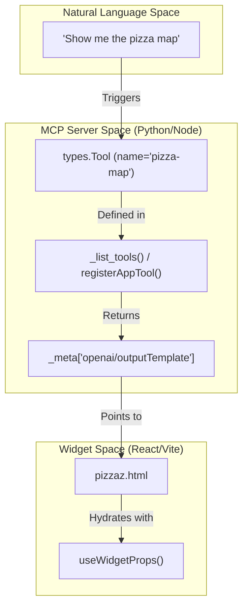
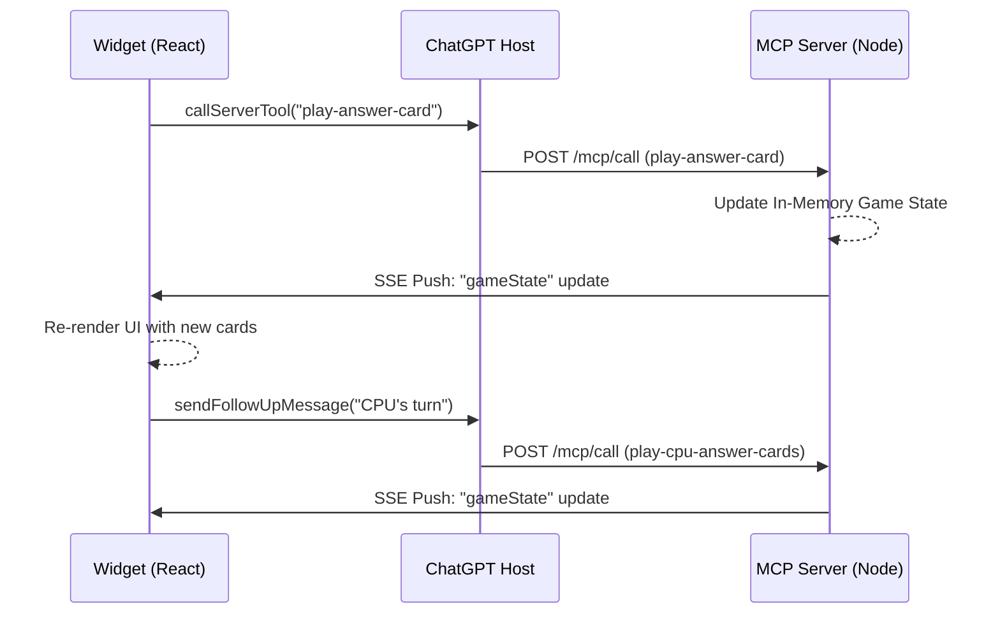

<!-- source: DeepWiki mcp.deepwiki.com · repo openai/openai-apps-sdk-examples · page 7 Glossary · fetched 2026-10-26 -->

# Glossary

Relevant source files

The following files were used as context for generating this wiki page:

- [README.md](README.md)
- [authenticated_server_python/.env.example](authenticated_server_python/.env.example)
- [authenticated_server_python/main.py](authenticated_server_python/main.py)
- [mcp_app_basics_node/README.md](mcp_app_basics_node/README.md)
- [mcp_app_basics_node/package.json](mcp_app_basics_node/package.json)
- [mcp_app_basics_node/src/server.ts](mcp_app_basics_node/src/server.ts)
- [mcp_app_basics_node/tsconfig.json](mcp_app_basics_node/tsconfig.json)
- [pizzaz_server_python/main.py](pizzaz_server_python/main.py)
- [src/call-server-tool/App.tsx](src/call-server-tool/App.tsx)
- [src/call-server-tool/index.css](src/call-server-tool/index.css)
- [src/cards-against-ai/DESIGN.md](src/cards-against-ai/DESIGN.md)
- [src/types.ts](src/types.ts)
- [src/use-widget-props.ts](src/use-widget-props.ts)

This glossary defines the technical terms, protocol extensions, and codebase-specific patterns used across the OpenAI Apps SDK examples. It serves as a reference for engineers onboarding to the monorepo to understand how the Model Context Protocol (MCP) and the Apps SDK interact.

## Core Protocol and SDK Terms

### Model Context Protocol (MCP)
An open specification for connecting LLMs to external data and tools [README.md:20-21](). In this repository, MCP is extended to support UI widgets by including metadata in tool responses that points to hosted HTML resources [README.md:22-26]().

### Apps SDK
The client-side library and runtime (typically within ChatGPT) that handles the rendering of widgets and provides the `window.openai` (or `@modelcontextprotocol/ext-apps`) API to those widgets [README.md:5-6](), [src/types.ts:98-103]().

### Widget
A rich UI component rendered inline within a conversation turn [README.md:20-22](). Widgets are standard web bundles (HTML/JS/CSS) that communicate with the host via a postMessage-based bridge [src/cards-against-ai/DESIGN.md:5-6]().

### Resource URI
A unique identifier (e.g., `ui://widget/pizza-map.html`) used by the server to tell the Apps SDK which widget bundle to fetch and render [pizzaz_server_python/main.py:59-60]().

---

## Data Flow Concepts

The following diagram maps the relationship between Natural Language intents and the specific code entities that handle them.

**Diagram: Intent to Code Entity Mapping**

Sources: [README.md:22-27](), [pizzaz_server_python/main.py:185-202](), [mcp_app_basics_node/src/server.ts:109-131](), [src/use-widget-props.ts:3-14]()

### structuredContent
A field in the MCP tool response containing a JSON object meant specifically for the widget to consume [mcp_app_basics_node/src/server.ts:147-153](). Unlike the standard `content` field (meant for the LLM), `structuredContent` is used to hydrate the UI [mcp_app_basics_node/src/server.ts:172-174]().

### widgetSessionId
A unique identifier returned in tool metadata (`_meta["openai/widgetSessionId"]`) that allows the server to associate subsequent tool calls with a specific widget instance [README.md:36-37](). This is critical for maintaining state (like a shopping cart) across multiple conversational turns [README.md:116-117]().

### widgetState
A client-side state object managed by the Apps SDK. Widgets can read this via `window.openai.widgetState` and update it using `window.openai.setWidgetState` [src/types.ts:22-23]().

---

## window.openai API Reference

The `window.openai` object is the primary interface between the widget and the ChatGPT host [src/types.ts:101-103]().

| Method / Property | Description | Source |
|:---|:---|:---|
| `callTool(name, args)` | Calls another MCP tool directly from the widget. | [src/types.ts:85-88]() |
| `setWidgetState(state)` | Persists a JSON-serializable state for the current widget. | [src/types.ts:23-23]() |
| `sendFollowUpMessage(args)` | Sends a message to the LLM as if the user typed it. | [src/types.ts:31-31]() |
| `requestDisplayMode(mode)` | Requests a change to `inline`, `pip`, or `fullscreen`. | [src/types.ts:72-78]() |
| `openExternal(payload)` | Opens a URL in a new browser tab. | [src/types.ts:32-32]() |
| `theme` | Returns the host theme (`light` or `dark`). | [src/types.ts:8-8]() |
| `toolOutput` | The `structuredContent` returned by the tool that spawned the widget. | [src/types.ts:20-20]() |

---

## Server Implementation Patterns

### FastMCP (Python)
A high-level wrapper around the MCP Python SDK used to quickly define tools and resources [pizzaz_server_python/main.py:20-21](). It supports decorators for listing tools and resources [pizzaz_server_python/main.py:185-205]().

### registerAppTool (Node.js)
A utility function from `@modelcontextprotocol/ext-apps/server` that simplifies registering tools that return widgets by automatically handling the `_meta` template requirements [mcp_app_basics_node/src/server.ts:109-111]().

### WWW-Authenticate Challenge
A pattern used in the `authenticated_server_python` example where the server returns a 401 response with a `WWW-Authenticate` header to trigger the Apps SDK OAuth flow [authenticated_server_python/main.py:228-234]().

---

## Complex Interaction Patterns

The following diagram illustrates the "Cards Against AI" game loop, which represents the most advanced use of the SDK, combining direct tool calls and SSE streaming.

**Diagram: Advanced State Synchronization (Cards Against AI)**

Sources: [src/cards-against-ai/DESIGN.md:9-15](), [src/cards-against-ai/DESIGN.md:21-35](), [src/cards-against-ai/DESIGN.md:39-46]()

### Model-Mediated Action
An action triggered by the widget using `sendFollowUpMessage`, which requires the LLM to process the request and decide which tool to call next [src/cards-against-ai/DESIGN.md:11-12]().

### Direct Tool Call (`callServerTool`)
An action triggered by the widget that bypasses the LLM's reasoning loop, executing the tool immediately on the server. This is used for low-latency interactions like playing a card [src/cards-against-ai/DESIGN.md:11-11]().

### Stateless Transport Security
Settings used in MCP servers to prevent DNS rebinding and enforce CORS, typically configured via `MCP_ALLOWED_HOSTS` and `MCP_ALLOWED_ORIGINS` environment variables [pizzaz_server_python/main.py:133-142](), [authenticated_server_python/main.py:209-218]().