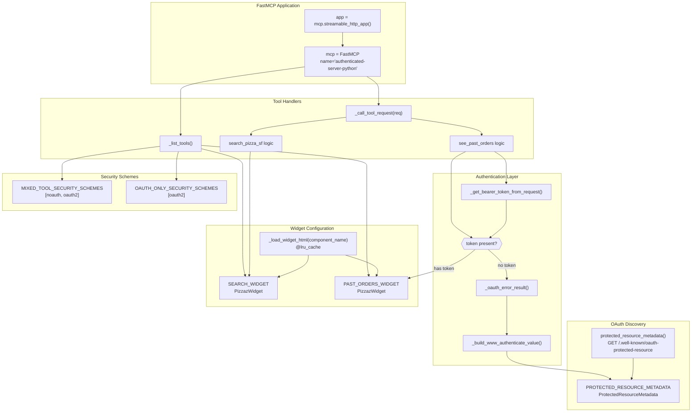
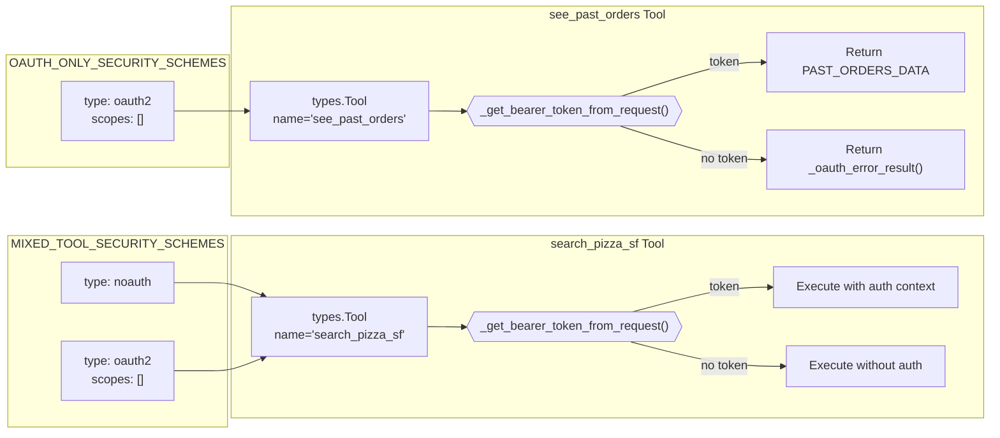

<!-- source: DeepWiki mcp.deepwiki.com · repo openai/openai-apps-sdk-examples · extra page Authenticated Python Server · fetched 2026-10-26 -->

# Authenticated Python Server

<details>
<summary>Relevant source files</summary>

The following files were used as context for generating this wiki page:

- [authenticated_server_python/.env.example](authenticated_server_python/.env.example)
- [authenticated_server_python/README.md](authenticated_server_python/README.md)
- [authenticated_server_python/main.py](authenticated_server_python/main.py)
- [authenticated_server_python/requirements.txt](authenticated_server_python/requirements.txt)

</details>


## Purpose and Scope

This document covers the `authenticated_server_python` implementation, which demonstrates OAuth integration with the Model Context Protocol. The server showcases two authentication patterns: mixed authentication (tools that work with or without tokens) and strict OAuth requirements. It implements the MCP authorization specification including `WWW-Authenticate` challenges and RFC 9728 protected resource metadata.

For general OAuth concepts in the Apps SDK, see [Authentication and OAuth](#3.5). For authentication implementation in Node.js servers, see [MCP App Basics Node Server](#5.2.3). For other Python server patterns, see [Python Server Architecture Patterns](#5.1.6).

**Sources:** [authenticated_server_python/README.md:1-16](), [authenticated_server_python/main.py:1-16]()

---

## Server Architecture Overview

The authenticated server is built using `FastMCP` with `stateless_http=True` [authenticated_server_python/main.py:221-225](). It exposes two tools with different authentication requirements, demonstrating how to implement graceful degradation and strict OAuth protection within the same MCP server.

### Component Relationship Diagram

The following diagram maps the Natural Language concepts of authentication and tool handling to the specific Code Entities in `main.py`.



**Sources:** [authenticated_server_python/main.py:22-31,180-201,221-225,263-319,321-326,365-399,477-527]()

---

## Authentication Patterns

The server demonstrates two distinct authentication patterns through tool-level `securitySchemes` configuration.

| Tool Name | Authentication Pattern | Security Schemes | Behavior |
|-----------|----------------------|------------------|----------|
| `search_pizza_sf` | Mixed authentication | `MIXED_TOOL_SECURITY_SCHEMES` | Works without token, returns `mixed-auth-search` widget |
| `see_past_orders` | OAuth required | `OAUTH_ONLY_SECURITY_SCHEMES` | Returns `WWW-Authenticate` challenge if token missing |

### Security Scheme Logic Flow



**Sources:** [authenticated_server_python/main.py:187-201,365-399,477-527]()

---

## OAuth Configuration

The server requires two environment variables to configure the OAuth flow [authenticated_server_python/main.py:148-164]():

| Variable | Purpose | Example |
|----------|---------|---------|
| `AUTHORIZATION_SERVER_URL` | Base URL of OAuth authorization server (Auth0 tenant) | `https://your-domain.example.com` |
| `RESOURCE_SERVER_URL` | Public URL to this MCP server's `/mcp` endpoint | `https://your-mcp-server.app/mcp` |

### RFC 9728 Metadata URL Construction

The server constructs the protected resource metadata endpoint URL according to RFC 9728 conventions [authenticated_server_python/main.py:170-179]():

```python
_parsed_resource_url = urlparse(str(RESOURCE_SERVER_URL))
_resource_path = (
    _parsed_resource_url.path if _parsed_resource_url.path not in ("", "/") else ""
)
PROTECTED_RESOURCE_METADATA_PATH = (
    f"/.well-known/oauth-protected-resource{_resource_path}"
)
PROTECTED_RESOURCE_METADATA_URL = f"{_parsed_resource_url.scheme}://{_parsed_resource_url.netloc}{PROTECTED_RESOURCE_METADATA_PATH}"
```

If `RESOURCE_SERVER_URL` is `https://example.com/mcp`, the metadata path becomes `/.well-known/oauth-protected-resource/mcp`.

**Sources:** [authenticated_server_python/main.py:148-179](), [authenticated_server_python/.env.example:1-3]()

---

## Token Extraction Implementation

The `_get_bearer_token_from_request` function implements a comprehensive strategy for extracting Bearer tokens from various request contexts, including standard headers, ASGI scope headers, and dictionary fallbacks [authenticated_server_python/main.py:263-319]().

### Token Extraction Strategy

1. **Standard Headers**: Checks `request.headers.get("authorization")` with case-insensitive fallback.
2. **ASGI Scope Headers**: Iterates through `request.scope["headers"]` for ASGI-compatible contexts.
3. **Byte Decoding**: Converts bytes to `latin-1` strings if necessary.
4. **Bearer Prefix**: Validates that the scheme is "Bearer" and extracts the token [authenticated_server_python/main.py:313-317]().

**Sources:** [authenticated_server_python/main.py:263-319]()

---

## WWW-Authenticate Challenge Generation

When a protected tool is called without authentication, the server returns a `CallToolResult` with `isError=True` and special metadata containing `WWW-Authenticate` header information.

### OAuth Error Result Construction

The `_oauth_error_result` function [authenticated_server_python/main.py:238-260]() creates the MCP error response:

```python
def _oauth_error_result(
    user_message: str,
    *,
    error: str = "invalid_request",
    description: str | None = None,
) -> types.ServerResult:
    # ...
    return types.ServerResult(
        types.CallToolResult(
            # ...
            _meta={
                "mcp/www_authenticate": [
                    _build_www_authenticate_value(error, description_text)
                ]
            },
            isError=True,
        )
    )
```

The `_build_www_authenticate_value` helper [authenticated_server_python/main.py:228-236]() constructs the actual header string, including the `resource_metadata` pointer to the discovery endpoint.

**Sources:** [authenticated_server_python/main.py:228-260]()

---

## Tool Implementation

### search_pizza_sf (Mixed Auth)
Accepts an optional `searchTerm` and returns the `SEARCH_WIDGET` (`mixed-auth-search`). It echoes the search term as `pizzaTopping` in the `structuredContent` [authenticated_server_python/main.py:482-496]().

### see_past_orders (OAuth Required)
Strictly checks for a token using `_get_bearer_token_from_request()` [authenticated_server_python/main.py:499](). If present, it returns a subset of `PAST_ORDERS_DATA` [authenticated_server_python/main.py:109-146]() based on the `limit` argument [authenticated_server_python/main.py:504-524]().

**Sources:** [authenticated_server_python/main.py:477-527]()

---

## RFC 9728 Metadata Endpoint

The server exposes a metadata endpoint at `/.well-known/oauth-protected-resource{resource_path}` [authenticated_server_python/main.py:321-326]() that advertises OAuth configuration to clients.

```python
@mcp.custom_route(PROTECTED_RESOURCE_METADATA_PATH, methods=["GET", "OPTIONS"])
async def protected_resource_metadata(request: Request) -> Response:
    # ...
    return JSONResponse(PROTECTED_RESOURCE_METADATA.model_dump(mode="json"))
```

The `PROTECTED_RESOURCE_METADATA` object [authenticated_server_python/main.py:180-184]() contains the `authorization_servers` list (pointing to the `AUTHORIZATION_SERVER_URL`) and `scopes_supported`.

**Sources:** [authenticated_server_python/main.py:180-184,321-326]()

---

## Transport Security Configuration

The server implements DNS rebinding protection and CORS configuration via `_transport_security_settings()` [authenticated_server_python/main.py:209-218]().

- **DNS Rebinding**: Enabled if `MCP_ALLOWED_HOSTS` or `MCP_ALLOWED_ORIGINS` are provided in the environment.
- **CORS Middleware**: permissive `CORSMiddleware` is added to the Starlette app to allow cross-origin requests from ChatGPT [authenticated_server_python/main.py:535-546]().

**Sources:** [authenticated_server_python/main.py:209-225,535-546]()

---

