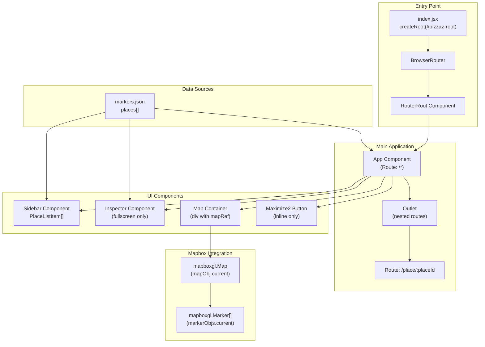
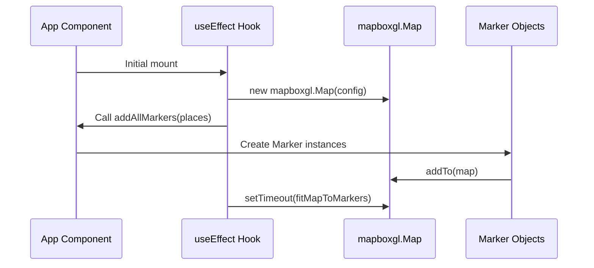
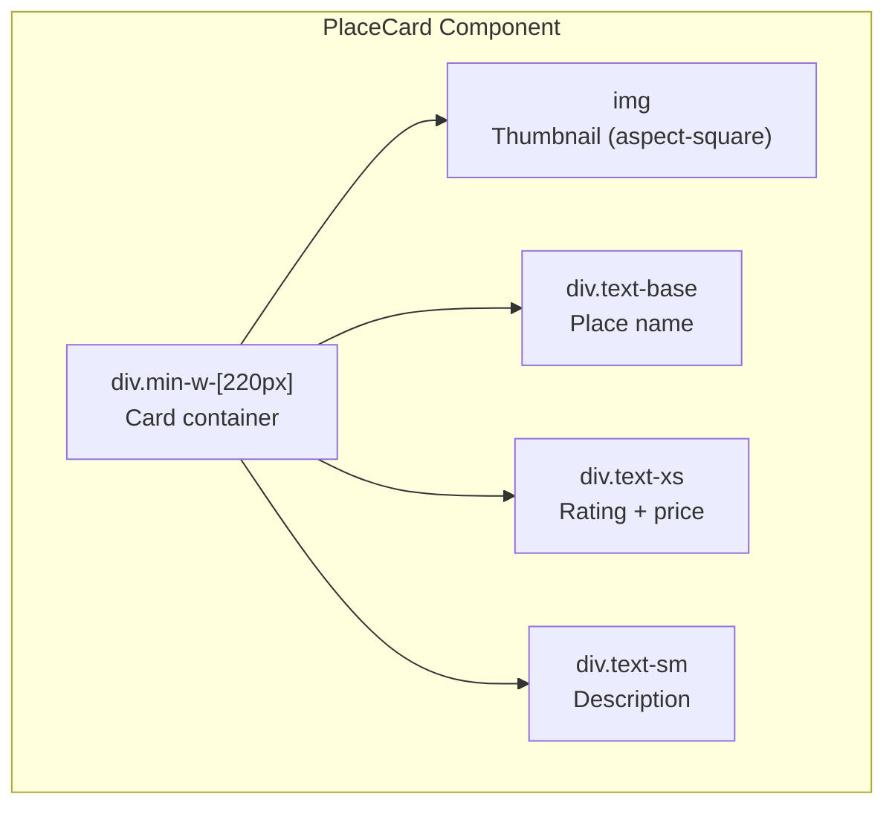
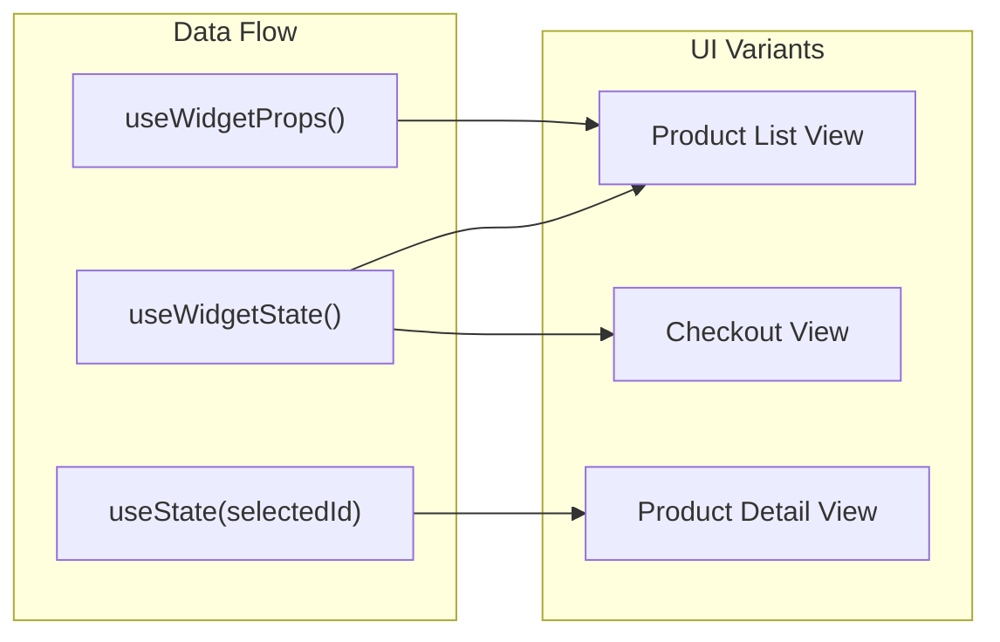
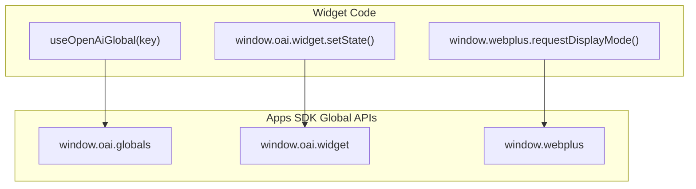

<!-- source: DeepWiki mcp.deepwiki.com · repo openai/openai-apps-sdk-examples · extra page Pizzaz Widgets · fetched 2026-10-26 -->

# Pizzaz Widgets

<details>
<summary>Relevant source files</summary>

The following files were used as context for generating this wiki page:

- [src/pizzaz-albums/FilmStrip.jsx](src/pizzaz-albums/FilmStrip.jsx)
- [src/pizzaz-albums/FullscreenViewer.jsx](src/pizzaz-albums/FullscreenViewer.jsx)
- [src/pizzaz-albums/index.jsx](src/pizzaz-albums/index.jsx)
- [src/pizzaz-carousel/PlaceCard.jsx](src/pizzaz-carousel/PlaceCard.jsx)
- [src/pizzaz-carousel/index.jsx](src/pizzaz-carousel/index.jsx)
- [src/pizzaz-list/index.jsx](src/pizzaz-list/index.jsx)
- [src/pizzaz-shop/index.tsx](src/pizzaz-shop/index.tsx)
- [src/pizzaz/Inspector.jsx](src/pizzaz/Inspector.jsx)
- [src/pizzaz/Sidebar.jsx](src/pizzaz/Sidebar.jsx)
- [src/pizzaz/index.jsx](src/pizzaz/index.jsx)

</details>


## Overview

The Pizzaz widget suite is a collection of five pizza-themed UI components that demonstrate different interaction patterns and visualization strategies for the OpenAI Apps SDK. Each widget showcases distinct use cases: interactive maps, image carousels, photo albums, list views, and e-commerce interfaces.

The suite demonstrates responsive design patterns, display mode adaptation (inline and fullscreen), state management with the `window.openai` API, and integration with MCP servers that provide pizza restaurant data.

### Widget Components

| Widget | Purpose | Key Technologies |
|--------|---------|------------------|
| **Map** | Interactive map with restaurant markers | Mapbox GL JS, React Router |
| **Carousel** | Horizontal scrolling place cards | Embla Carousel |
| **Albums** | Photo gallery with filmstrip navigation | React state, image loading |
| **List** | Vertical scrolling restaurant list | Standard list view |
| **Shop** | E-commerce interface for pizza ordering | Shopping cart patterns |

All widgets are built with React 19, TypeScript, and Tailwind CSS. They share common integration points with the Apps SDK including `useOpenAiGlobal`, `useMaxHeight`, and `window.oai.widget.setState()`.

**Sources**: [src/pizzaz/index.jsx:1-287](), [src/pizzaz-carousel/PlaceCard.jsx:1-39](), [src/pizzaz-albums/FullscreenViewer.jsx:1-43](), [src/pizzaz-shop/index.tsx:1-45]()

---

## Pizzaz Map Widget

### Purpose and Architecture

The Pizzaz Map Widget is an interactive map-based component that displays pizza restaurant locations using Mapbox GL JS. It demonstrates responsive design with two distinct display modes (inline and fullscreen), URL-based routing for place selection, and bidirectional communication with the OpenAI Apps SDK.

**Sources**: [src/pizzaz/index.jsx:1-287]()

### Component Architecture

The map widget is built as a React Router application with three primary UI regions: a sidebar showing a list of places, a Mapbox map with markers, and an optional inspector panel for detailed place views.



**Sources**: [src/pizzaz/index.jsx:38-287](), [src/pizzaz/Sidebar.jsx:48-165](), [src/pizzaz/Inspector.jsx:7-110]()

### Core Components and Routing

The `App` component serves as the main orchestrator, managing the Mapbox instance, marker state, and routing logic. It uses React Router's `useLocation` and `useNavigate` hooks to implement URL-based place selection [src/pizzaz/index.jsx:44-50]().

| Component | Source Location | Responsibility |
|-----------|----------------|----------------|
| `App` | [src/pizzaz/index.jsx:38-271]() | Main container, Mapbox management, routing |
| `RouterRoot` | [src/pizzaz/index.jsx:273-281]() | Route configuration wrapper |
| `Sidebar` | [src/pizzaz/Sidebar.jsx:48-165]() | Place list display, carousel for mobile |
| `Inspector` | [src/pizzaz/Inspector.jsx:7-110]() | Place detail panel (fullscreen only) |

**Sources**: [src/pizzaz/index.jsx:38-271]()

### Mapbox Integration

The map widget uses Mapbox GL JS for interactive map rendering. The integration includes map initialization, marker management, and coordinated navigation.

#### Map Lifecycle



The access token is set globally [src/pizzaz/index.jsx:22-23](). The `addAllMarkers()` function creates Mapbox marker instances for each place in the dataset, attaching click event listeners to navigate to place routes [src/pizzaz/index.jsx:97-116]().

---

## Pizzaz Carousel Widget

### Purpose and Architecture

The Pizzaz Carousel Widget implements a horizontal scrolling interface for browsing pizza restaurants using Embla Carousel [src/pizzaz-carousel/index.jsx:11-18]().

### PlaceCard Component

The `PlaceCard` component is the fundamental building block of the carousel, rendering individual restaurant cards with thumbnails, ratings, and descriptions [src/pizzaz-carousel/PlaceCard.jsx:6-40]().



**Sources**: [src/pizzaz-carousel/PlaceCard.jsx:1-40]()

---

## Pizzaz Albums Widget

### Purpose and Architecture

The Pizzaz Albums Widget implements a photo gallery interface with a filmstrip navigation sidebar and a large main viewer.

### FullscreenViewer Component

The `FullscreenViewer` component manages the overall layout and photo selection state [src/pizzaz-albums/FullscreenViewer.jsx:5-43](). It uses `useMaxHeight()` to adapt to the container size provided by the Apps SDK [src/pizzaz-albums/FullscreenViewer.jsx:6]().

### FilmStrip Component

The `FilmStrip` component implements the vertical thumbnail navigation sidebar [src/pizzaz-albums/FilmStrip.jsx:3-30](). It renders all photos in the album as clickable thumbnails with visual feedback for the selected photo [src/pizzaz-albums/FilmStrip.jsx:12-16]().

**Sources**: [src/pizzaz-albums/FullscreenViewer.jsx:1-43](), [src/pizzaz-albums/FilmStrip.jsx:1-30]()

---

## Pizzaz List Widget

The Pizzaz List Widget provides a traditional vertical scrolling list view of pizza restaurants, ranked as a "National Best Pizza List" [src/pizzaz-list/index.jsx:24]().

### List Implementation

The component slices the `markers.json` data to show the top 7 pizzerias [src/pizzaz-list/index.jsx:37](). Each list item includes:
- A rank number [src/pizzaz-list/index.jsx:57]().
- A 40x40px or 44x44px thumbnail [src/pizzaz-list/index.jsx:51-55]().
- Rating and city information [src/pizzaz-list/index.jsx:63-77]().
- A "PlusCircle" button to add the place [src/pizzaz-list/index.jsx:86-95]().

**Sources**: [src/pizzaz-list/index.jsx:8-113]()

---

## Pizzaz Shop Widget

The Pizzaz Shop Widget is a complex e-commerce interface for ordering food. It uses `useWidgetState` and `useWidgetProps` for robust state management [src/pizzaz-shop/index.tsx:18-19]().

### State and Data Flow

The widget manages a `PizzazCartWidgetState` containing `cartItems` and a `selectedCartItemId` [src/pizzaz-shop/index.tsx:43-47]().



### Checkout Logic

The widget calculates order totals including a service fee ($3), delivery fee ($2.99), and tax ($3.40) [src/pizzaz-shop/index.tsx:54-56](). It communicates with the host using a custom event `pizzaz-shop:continue-to-payment` [src/pizzaz-shop/index.tsx:57]().

**Sources**: [src/pizzaz-shop/index.tsx:1-45]()

---

## Common Patterns Across Pizzaz Widgets

### Shared Integration Patterns

All Pizzaz widgets share common integration touchpoints with the OpenAI Apps SDK via global hooks and the `window.oai` API.

#### Apps SDK API Surface



#### State Publication Pattern

Widgets publish their internal state to enable Apps SDK features like state persistence [src/pizzaz/index.jsx:165-177]().

```javascript
window.oai.widget.setState({
  center: viewState.center,
  zoom: viewState.zoom,
  markers: markerCoords,
});
```

**Sources**: [src/pizzaz/index.jsx:165-177](), [src/pizzaz-shop/index.tsx:17-19]()

---

