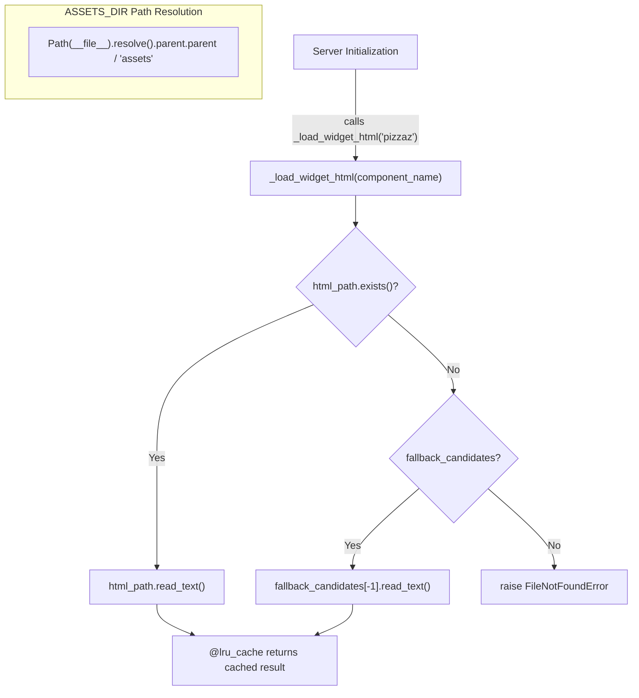
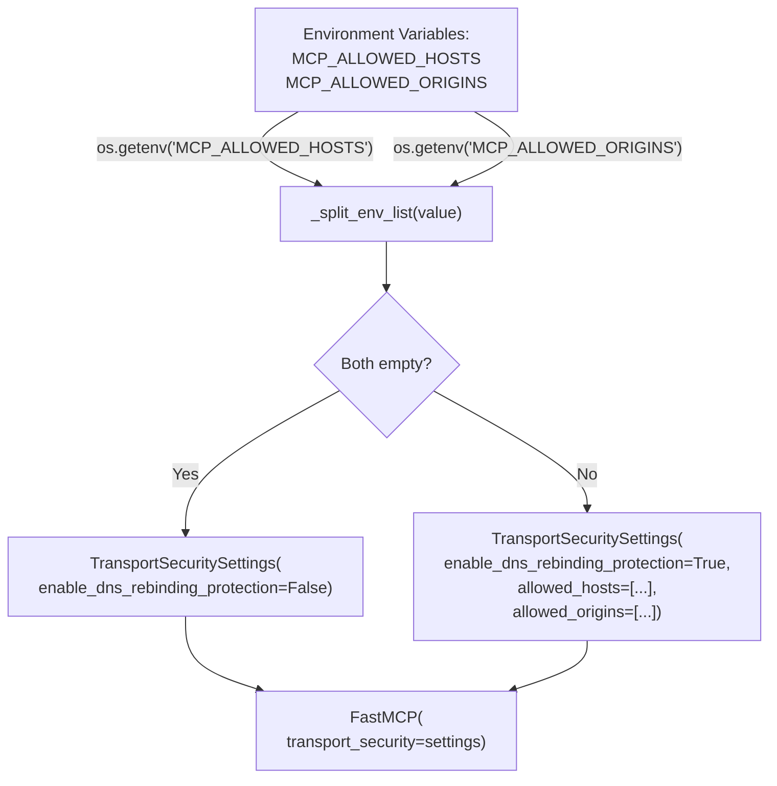
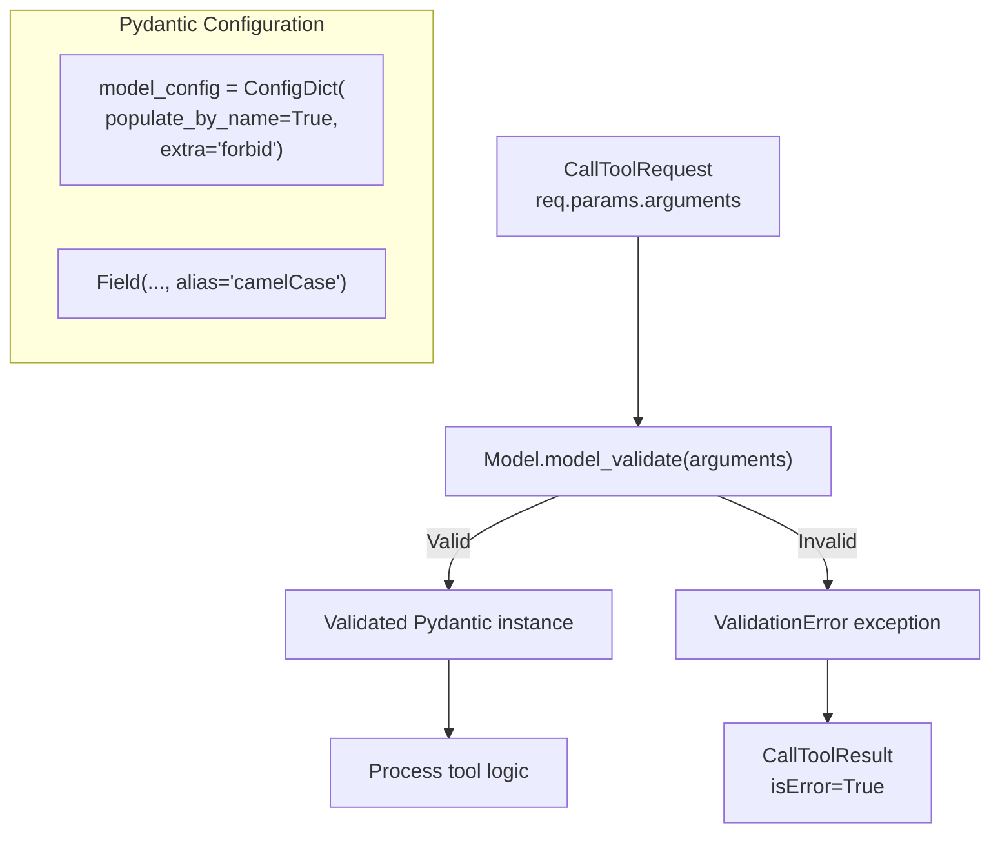
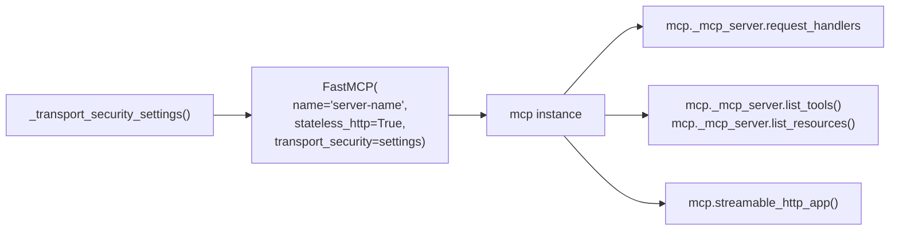
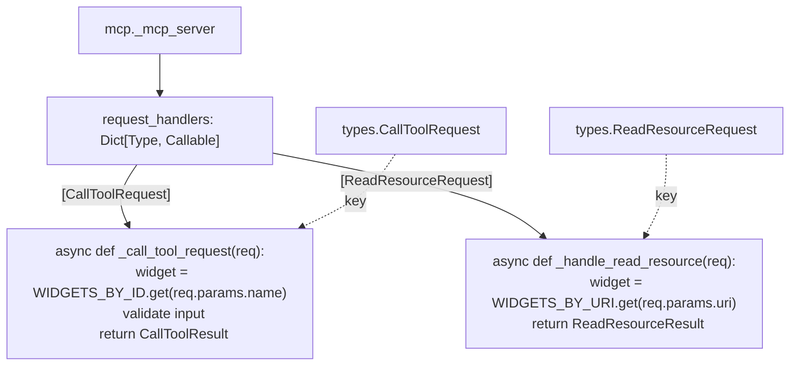

<!-- source: DeepWiki mcp.deepwiki.com · repo openai/openai-apps-sdk-examples · extra page Python Server Architecture Patterns · fetched 2026-10-26 -->

# Python Server Architecture Patterns

<details>
<summary>Relevant source files</summary>

The following files were used as context for generating this wiki page:

- [authenticated_server_python/.env.example](authenticated_server_python/.env.example)
- [authenticated_server_python/main.py](authenticated_server_python/main.py)
- [pizzaz_server_python/main.py](pizzaz_server_python/main.py)
- [shopping_cart_python/main.py](shopping_cart_python/main.py)

</details>


This page documents common architectural patterns and reusable code constructs found across Python MCP servers in this repository. All Python servers use the FastMCP library and share consistent patterns for widget loading, security configuration, validation, and request handling.

For server-specific implementation details, see:
- [Pizzaz Python Server](#5.1.1) - Reference implementation
- [Shopping Cart Python Server](#5.1.2) - Session management
- [Solar System Python Server](#5.1.3) - Input normalization
- [Authenticated Python Server](#5.1.4) - OAuth integration

For general MCP server concepts, see [Model Context Protocol (MCP)](#3.2).

---

## Widget HTML Loading Pattern

All Python servers implement a consistent pattern for loading widget HTML files from the `assets/` directory using the `@lru_cache` decorator for performance optimization.

### Pattern Structure

**Widget Loading Data Flow**


The pattern consists of three key components:

| Component | Purpose | Implementation Details |
|-----------|---------|----------------------|
| `ASSETS_DIR` | Resolve assets directory path | `Path(__file__).resolve().parent.parent / "assets"` |
| `@lru_cache(maxsize=None)` | Cache loaded HTML indefinitely | Decorator on `_load_widget_html` function |
| Fallback logic | Support versioned filenames | `sorted(ASSETS_DIR.glob(f"{component_name}-*.html"))` |

### Implementation Example

[pizzaz_server_python/main.py:36-52]() demonstrates the canonical implementation:

```python
ASSETS_DIR = Path(__file__).resolve().parent.parent / "assets"

@lru_cache(maxsize=None)
def _load_widget_html(component_name: str) -> str:
    html_path = ASSETS_DIR / f"{component_name}.html"
    if html_path.exists():
        return html_path.read_text(encoding="utf8")
    
    fallback_candidates = sorted(ASSETS_DIR.glob(f"{component_name}-*.html"))
    if fallback_candidates:
        return fallback_candidates[-1].read_text(encoding="utf8")
    
    raise FileNotFoundError(
        f'Widget HTML for "{component_name}" not found in {ASSETS_DIR}. '
        "Run `pnpm run build` to generate the assets before starting the server."
    )
```

The function first attempts to load `{component_name}.html`, then falls back to versioned files matching `{component_name}-*.html` (sorted lexicographically), selecting the last match which represents the latest version due to hash-based naming.

### Cache Implications

The `@lru_cache` decorator means:
- Widget HTML is loaded only once per server process.
- Changes to HTML files require server restart to take effect.
- Memory footprint is minimal (5-10 KB per widget).
- No I/O overhead after initial load.

**Sources:**
- [pizzaz_server_python/main.py:36-52]()
- [authenticated_server_python/main.py:36-52]()
- [shopping_cart_python/main.py:24-36]()

---

## Transport Security Configuration

Python servers implement DNS rebinding protection through the `TransportSecuritySettings` class, configurable via environment variables.

### Security Configuration Flow

**Security Settings Initialization**


### Implementation Pattern

All servers implement identical `_split_env_list` and `_transport_security_settings` functions:

[pizzaz_server_python/main.py:127-142]() shows the standard implementation:

```python
def _split_env_list(value: str | None) -> List[str]:
    if not value:
        return []
    return [item.strip() for item in value.split(",") if item.strip()]

def _transport_security_settings() -> TransportSecuritySettings:
    allowed_hosts = _split_env_list(os.getenv("MCP_ALLOWED_HOSTS"))
    allowed_origins = _split_env_list(os.getenv("MCP_ALLOWED_ORIGINS"))
    if not allowed_hosts and not allowed_origins:
        return TransportSecuritySettings(enable_dns_rebinding_protection=False)
    return TransportSecuritySettings(
        enable_dns_rebinding_protection=True,
        allowed_hosts=allowed_hosts,
        allowed_origins=allowed_origins,
    )
```

### Configuration Examples

| Scenario | `MCP_ALLOWED_HOSTS` | `MCP_ALLOWED_ORIGINS` | Result |
|----------|---------------------|----------------------|--------|
| Local development (default) | Not set | Not set | DNS rebinding protection **disabled** |
| Ngrok tunnel | `abc123.ngrok.io` | Not set | Protection enabled for specific host |
| Production deployment | `api.example.com` | `https://chatgpt.com` | Full protection with host and origin validation |
| Multiple hosts | `host1.com,host2.com` | Not set | Comma-separated list support |

### Security Behavior

When DNS rebinding protection is enabled:
- `FastMCP` validates `Host` header against `allowed_hosts`.
- `FastMCP` validates `Origin` header against `allowed_origins`.
- Requests from non-allowlisted sources receive HTTP 403 Forbidden.
- Empty allowlists disable protection entirely (development mode).

**Sources:**
- [pizzaz_server_python/main.py:127-149]()
- [authenticated_server_python/main.py:203-225]()
- [shopping_cart_python/main.py:42-58]()

---

## CORS Middleware Configuration

All Python servers apply identical CORS middleware configuration to enable cross-origin requests from ChatGPT's browser environment.

### CORS Middleware Pattern

[pizzaz_server_python/main.py:309-322]() demonstrates the standard pattern:

```python
app = mcp.streamable_http_app()

try:
    from starlette.middleware.cors import CORSMiddleware
    
    app.add_middleware(
        CORSMiddleware,
        allow_origins=["*"],
        allow_methods=["*"],
        allow_headers=["*"],
        allow_credentials=False,
    )
except Exception:
    pass
```

### Configuration Details

| Parameter | Value | Rationale |
|-----------|-------|-----------|
| `allow_origins` | `["*"]` | Permits requests from any origin (necessary for ChatGPT's domain) |
| `allow_methods` | `["*"]` | Allows all HTTP methods (GET, POST, OPTIONS) |
| `allow_headers` | `["*"]` | Permits any request headers including custom MCP headers |
| `allow_credentials` | `False` | No cookies/credentials needed for MCP protocol |

### Relationship to Transport Security

CORS and DNS rebinding protection serve different purposes:

**Middleware vs Protocol Security**


- **CORS**: Browser-enforced policy, handled by middleware at HTTP layer.
- **Transport Security**: MCP-enforced policy, validated before request processing.
- Both can coexist; CORS allows the browser to make the request, transport security validates it server-side.

**Sources:**
- [pizzaz_server_python/main.py:309-322]()
- [authenticated_server_python/main.py:533-546]()
- [shopping_cart_python/main.py:224-237]()

---

## Pydantic Model Validation Pattern

Python servers use Pydantic models for type-safe input validation with MCP-compatible JSON Schema generation.

### Validation Architecture

**Input Validation Flow**


### Model Definition Pattern

[pizzaz_server_python/main.py:115-124]() shows the standard structure:

```python
class PizzaInput(BaseModel):
    """Schema for pizza tools."""
    
    pizza_topping: str = Field(
        ...,
        alias="pizzaTopping",
        description="Topping to mention when rendering the widget.",
    )
    
    model_config = ConfigDict(populate_by_name=True, extra="forbid")
```

### Key Configuration Options

| Config Option | Value | Purpose |
|---------------|-------|---------|
| `populate_by_name=True` | Enabled | Accept both `pizza_topping` and `pizzaTopping` keys |
| `extra="forbid"` | Enforced | Reject unknown fields (strict validation) |
| `extra="allow"` | Permissive | Pass through extra fields (used in [shopping_cart_python/main.py:70]()) |
| `by_alias=True` | In `model_dump()` | Serialize using camelCase aliases |

### Validation in Request Handlers

[pizzaz_server_python/main.py:273-286]() shows the standard validation pattern using `PizzaInput`:

```python
arguments = req.params.arguments or {}
try:
    payload = PizzaInput.model_validate(arguments)
except ValidationError as exc:
    return types.ServerResult(
        types.CallToolResult(
            content=[
                types.TextContent(
                    type="text",
                    text=f"Input validation error: {exc.errors()}",
                )
            ],
            isError=True,
        )
    )

# Use validated payload
topping = payload.pizza_topping
```

**Sources:**
- [pizzaz_server_python/main.py:115-124,273-286]()
- [shopping_cart_python/main.py:60-89,184-196]()

---

## FastMCP Initialization Pattern

All Python servers initialize `FastMCP` with consistent parameters for stateless HTTP transport.

### Initialization Structure

**Server Component Lifecycle**


### Standard Initialization Pattern

[pizzaz_server_python/main.py:145-149]() demonstrates the typical initialization:

```python
mcp = FastMCP(
    name="pizzaz-python",
    stateless_http=True,
    transport_security=_transport_security_settings(),
)
```

### Server Names by Implementation

| Server | Name | File |
|--------|------|------|
| Pizzaz | `pizzaz-python` | [pizzaz_server_python/main.py:146]() |
| Shopping Cart | `ecommerce-python` | [shopping_cart_python/main.py:94]() |
| Authenticated | `authenticated-server-python` | [authenticated_server_python/main.py:222]() |

### Accessing Internal Components

FastMCP exposes the underlying MCP server through `mcp._mcp_server`:

```python
# Register custom request handlers
mcp._mcp_server.request_handlers[types.CallToolRequest] = _call_tool_request
mcp._mcp_server.request_handlers[types.ReadResourceRequest] = _handle_read_resource

# Register list handlers (decorator-based alternative)
@mcp._mcp_server.list_tools()
async def _list_tools() -> List[types.Tool]:
    return [...]
```

**Sources:**
- [pizzaz_server_python/main.py:145-149,309]()
- [authenticated_server_python/main.py:221-225,533]()
- [shopping_cart_python/main.py:93-97,224]()

---

## Metadata Construction Patterns

Python servers use consistent helper functions to construct `_meta` dictionaries for tools, resources, and tool responses.

### Metadata Helper Functions

[pizzaz_server_python/main.py:165-182]() implements standard helper functions:

```python
def _resource_description(widget: PizzazWidget) -> str:
    return f"{widget.title} widget markup"

def _tool_meta(widget: PizzazWidget) -> Dict[str, Any]:
    return {
        "openai/outputTemplate": widget.template_uri,
        "openai/toolInvocation/invoking": widget.invoking,
        "openai/toolInvocation/invoked": widget.invoked,
        "openai/widgetAccessible": True,
    }

def _tool_invocation_meta(widget: PizzazWidget) -> Dict[str, Any]:
    return {
        "openai/toolInvocation/invoking": widget.invoking,
        "openai/toolInvocation/invoked": widget.invoked,
    }
```

### Metadata Keys Reference

| Key | Usage | Value Type | Purpose |
|-----|-------|-----------|---------|
| `openai/outputTemplate` | Tool/Resource registration | `str` (URI) | References widget HTML resource |
| `openai/toolInvocation/invoking` | Tool registration, responses | `str` | Status message during execution |
| `openai/toolInvocation/invoked` | Tool registration, responses | `str` | Status message after completion |
| `openai/widgetAccessible` | Tool/Resource registration | `bool` | Marks tool as widget-enabled |
| `openai/widgetSessionId` | Tool responses | `str` | Session identifier for state persistence |

**Sources:**
- [pizzaz_server_python/main.py:25-34,55-112,165-182]()
- [authenticated_server_python/main.py:22-31,333-353]()

---

## Request Handler Registration Pattern

Python servers register custom request handlers for `CallToolRequest` and `ReadResourceRequest` through the `mcp._mcp_server.request_handlers` dictionary.

### Handler Registration Architecture

**MCP Protocol to Python Function Mapping**


### Standard Registration Pattern

[pizzaz_server_python/main.py:305-306]() shows the registration syntax:

```python
mcp._mcp_server.request_handlers[types.CallToolRequest] = _call_tool_request
mcp._mcp_server.request_handlers[types.ReadResourceRequest] = _handle_read_resource
```

### CallToolRequest Handler Pattern

[pizzaz_server_python/main.py:257-302]() implements the standard tool call handler:

```python
async def _call_tool_request(req: types.CallToolRequest) -> types.ServerResult:
    # 1. Lookup widget by tool name
    widget = WIDGETS_BY_ID.get(req.params.name)
    # ... validation and execution logic ...
    
    # 4. Return structured response
    return types.ServerResult(
        types.CallToolResult(
            content=[types.TextContent(type="text", text=widget.response_text)],
            structuredContent={"pizzaTopping": topping},
            _meta=meta,
        )
    )
```

**Sources:**
- [pizzaz_server_python/main.py:235-306]()
- [authenticated_server_python/main.py:446-530]()
- [shopping_cart_python/main.py:150-222]()

---

## Error Handling Patterns

Python servers implement consistent error handling patterns for validation failures, unknown tools, and authentication errors.

### Error Response Comparison

| Error Type | Result Type | `isError` Field | Error Location | Additional Fields |
|-----------|-------------|----------------|----------------|------------------|
| Validation | `CallToolResult` | `True` | `content[0].text` | None |
| Unknown tool | `CallToolResult` | `True` | `content[0].text` | None |
| Unknown resource | `ReadResourceResult` | N/A | `_meta.error` | None |
| OAuth error | `CallToolResult` | `True` | `content[0].text` | `_meta.mcp/www_authenticate` |

### OAuth Authentication Error Pattern

[authenticated_server_python/main.py:238-260]() implements OAuth error responses:

```python
def _oauth_error_result(
    user_message: str,
    *,
    error: str = "invalid_request",
    description: str | None = None,
) -> types.ServerResult:
    description_text = description or user_message
    return types.ServerResult(
        types.CallToolResult(
            content=[types.TextContent(type="text", text=user_message)],
            _meta={
                "mcp/www_authenticate": [
                    _build_www_authenticate_value(error, description_text)
                ]
            },
            isError=True,
        )
    )
```

**Sources:**
- [pizzaz_server_python/main.py:236-286]()
- [authenticated_server_python/main.py:228-260,356-362]()
- [shopping_cart_python/main.py:170-196]()

---

## Environment Variable Patterns

Python servers use environment variables for configuration with consistent parsing and validation patterns.

### Required Environment Variable Validation

[authenticated_server_python/main.py:148-164]() validates required variables:

```python
AUTHORIZATION_SERVER_URL = os.getenv("AUTHORIZATION_SERVER_URL")
RESOURCE_SERVER_URL = os.getenv("RESOURCE_SERVER_URL")

missing_env = [
    name
    for name, value in (
        ("AUTHORIZATION_SERVER_URL", AUTHORIZATION_SERVER_URL),
        ("RESOURCE_SERVER_URL", RESOURCE_SERVER_URL),
    )
    if not value
]
if missing_env:
    raise RuntimeError(
        "Missing required environment variables: "
        + ", ".join(missing_env)
        + ". Set them in authenticated_server_python/.env."
    )
```

**Sources:**
- [authenticated_server_python/main.py:33-34,148-164]()
- [authenticated_server_python/.env.example:1-3]()
- [pizzaz_server_python/main.py:127-142]()

---

## Complete Server Startup Pattern

All Python servers follow an identical startup pattern with `uvicorn`.

### Startup Flow

**ASGI Server Initialization**

```mermaid
graph LR
    Module["main.py module"]
    InitFastMCP["FastMCP initialization"]
    RegisterHandlers["Register request handlers"]
    CreateApp["mcp.streamable_http_app()"]
    AddCORS["app.add_middleware(CORSMiddleware)"]
    MainGuard["if __name__ == '__main__'"]
    Uvicorn["uvicorn.run(app, host='0.0.0.0', port=8000)"]
    
    Module --> InitFastMCP
    InitFastMCP --> RegisterHandlers
    RegisterHandlers --> CreateApp
    CreateApp --> AddCORS
    AddCORS --> MainGuard
    MainGuard --> Uvicorn
```


### Standard Startup Code

[pizzaz_server_python/main.py:325-328]() shows the canonical pattern:

```python
if __name__ == "__main__":
    import uvicorn
    
    uvicorn.run("main:app", host="0.0.0.0", port=8000)
```

**Sources:**
- [pizzaz_server_python/main.py:325-328]()
- [authenticated_server_python/main.py:549-552]()
- [shopping_cart_python/main.py:240-243]()

---

