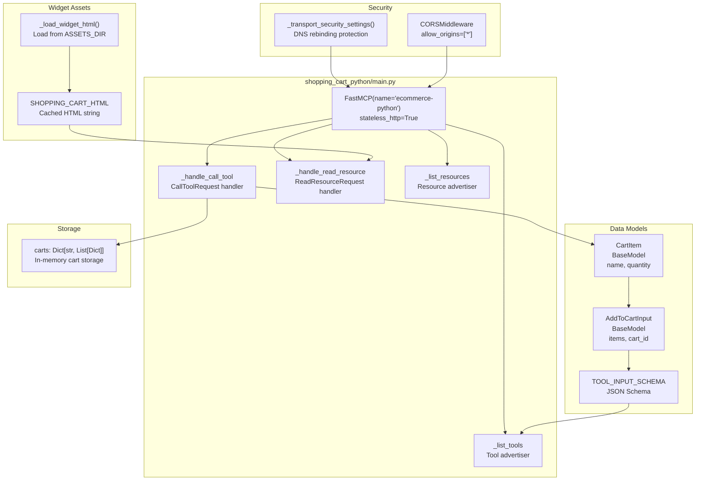
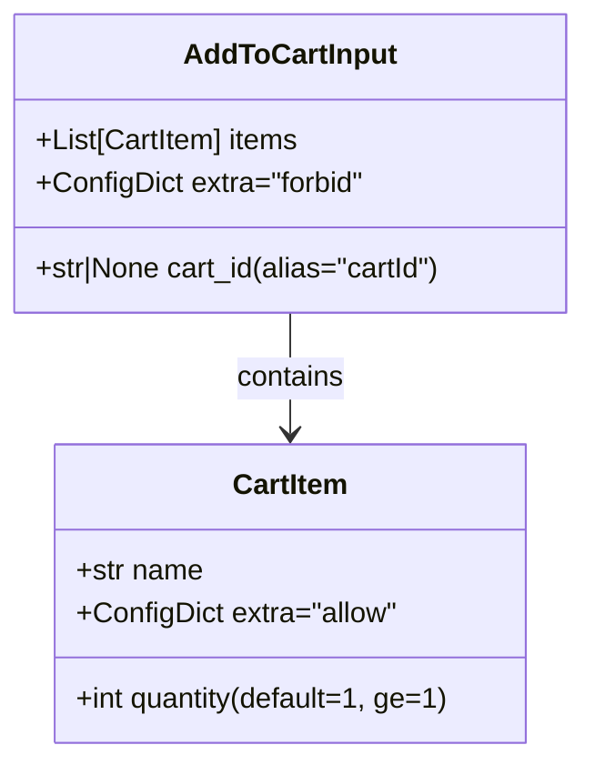
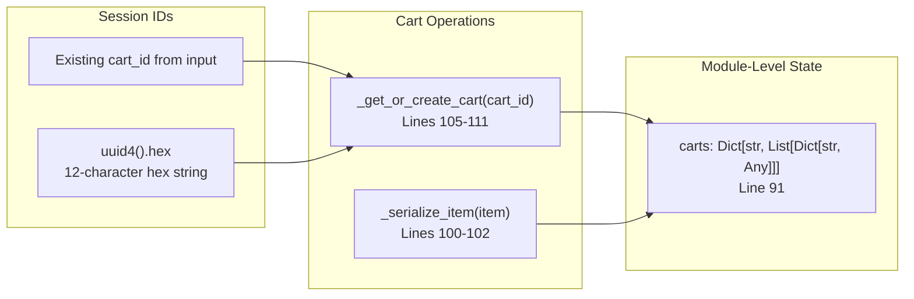
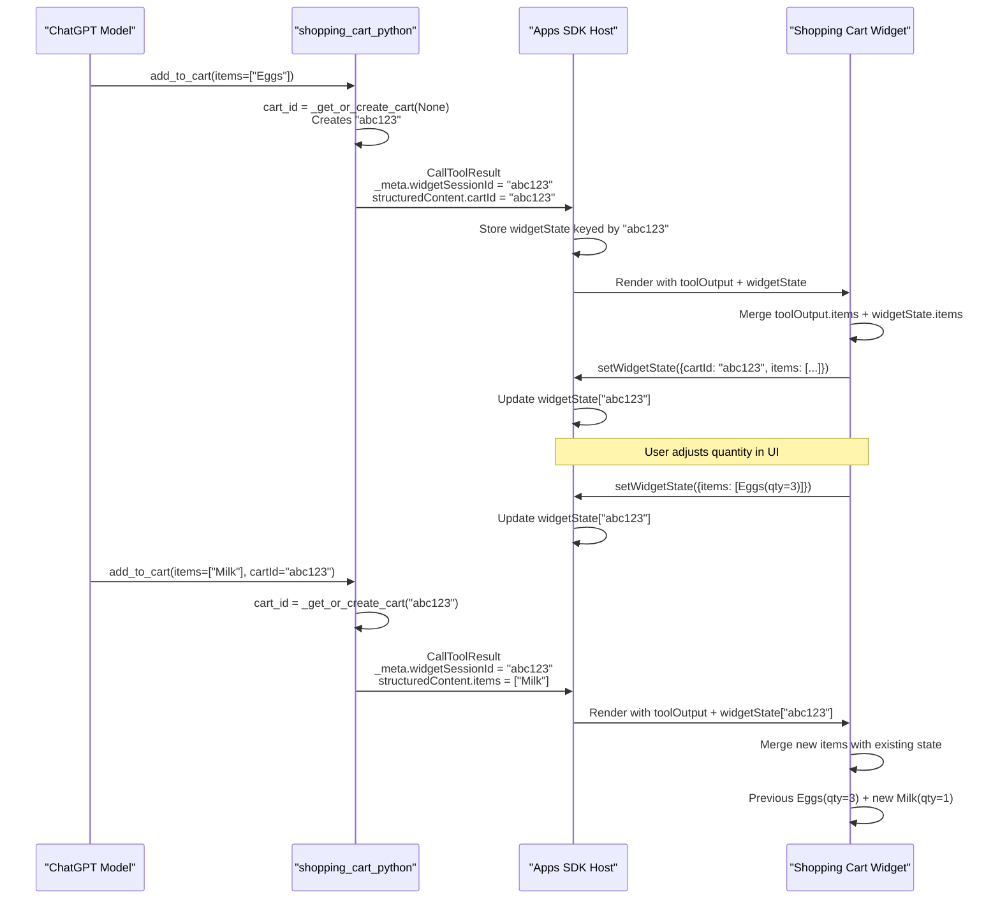
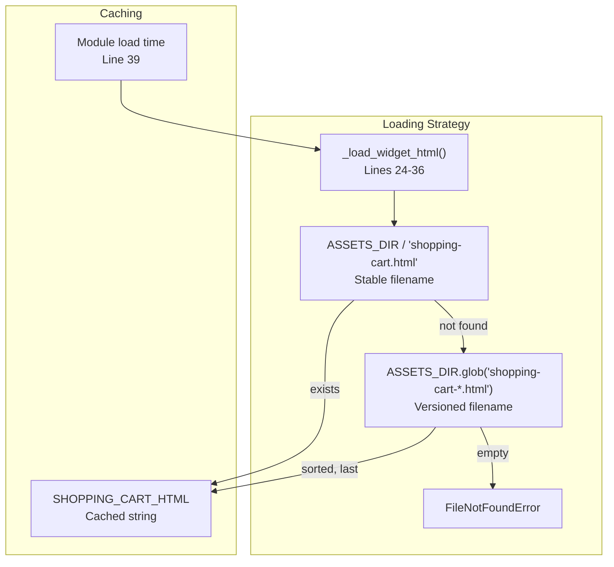

<!-- source: DeepWiki mcp.deepwiki.com · repo openai/openai-apps-sdk-examples · extra page Shopping Cart Python Server · fetched 2026-10-26 -->

# Shopping Cart Python Server

<details>
<summary>Relevant source files</summary>

The following files were used as context for generating this wiki page:

- [shopping_cart_python/README.md](shopping_cart_python/README.md)
- [shopping_cart_python/main.py](shopping_cart_python/main.py)
- [shopping_cart_python/requirements.txt](shopping_cart_python/requirements.txt)
- [src/shopping-cart/icons.tsx](src/shopping-cart/icons.tsx)
- [src/shopping-cart/index.tsx](src/shopping-cart/index.tsx)

</details>


## Purpose and Scope

This document describes the Shopping Cart Python MCP server implementation located in `shopping_cart_python/`. This server demonstrates how to maintain stateful widget interactions across conversational turns using the `widgetSessionId` pattern. The server exposes a single `add_to_cart` tool that manages shopping cart state and synchronizes it with the shopping cart widget.

For information about the client-side shopping cart widget implementation, see [Shopping Cart Widget](#4.7.2). For general Python MCP server patterns, see [Python MCP Servers with FastMCP](#5.1). For conceptual information about state management, see [State Management and widgetSessionId](#3.4).

**Sources:** [shopping_cart_python/README.md:1-3]()

---

## Server Architecture

The shopping cart server is built using FastMCP and follows a stateless HTTP transport model with in-memory session storage.

### System Components to Code Entities

This diagram bridges the conceptual server components to the specific identifiers used in the Python implementation.



**Key Components:**

| Component | Type | Purpose |
|-----------|------|---------|
| `FastMCP` | Framework | Provides MCP protocol implementation with stateless HTTP transport [shopping_cart_python/main.py:93-97]() |
| `add_to_cart` | Tool | Single tool exposed by server for cart manipulation [shopping_cart_python/main.py:15]() |
| `carts` | Dict[str, List[Dict]] | In-memory storage keyed by cart ID [shopping_cart_python/main.py:91]() |
| `CartItem` | Pydantic Model | Validates individual cart item structure [shopping_cart_python/main.py:60-71]() |
| `AddToCartInput` | Pydantic Model | Validates tool input payload [shopping_cart_python/main.py:73-87]() |
| `_load_widget_html()` | Function | Loads widget HTML from `assets/` directory [shopping_cart_python/main.py:24-36]() |

**Sources:** [shopping_cart_python/main.py:1-244]()

---

## Tool Definition and Input Schema

The server exposes a single tool named `add_to_cart` with a Pydantic-based input schema.

### Pydantic Models



**CartItem Model** [shopping_cart_python/main.py:60-71]()

The `CartItem` model represents a single item in the cart:
- `name`: String identifier for the item (required).
- `quantity`: Number of units to add (must be ≥1, defaults to 1).
- `extra="allow"`: Permits additional fields for extensibility.

**AddToCartInput Model** [shopping_cart_python/main.py:73-87]()

The `AddToCartInput` model defines the tool's input contract:
- `items`: List of `CartItem` objects to add (required).
- `cart_id`: Optional identifier to target an existing cart (aliased as `cartId` in JSON).
- `extra="forbid"`: Rejects unknown fields to enforce schema strictness.

### Tool Registration

The tool is registered with comprehensive metadata [shopping_cart_python/main.py:123-133]():

| Field | Value | Purpose |
|-------|-------|---------|
| `name` | `TOOL_NAME` ("add_to_cart") | Tool identifier [shopping_cart_python/main.py:15]() |
| `title` | `"Add items to cart"` | Human-readable name |
| `description` | `"Adds the provided items to the active cart and returns its state."` | Tool description for model |
| `inputSchema` | `TOOL_INPUT_SCHEMA` | JSON Schema with camelCase aliases [shopping_cart_python/main.py:89]() |
| `_meta.openai/outputTemplate` | `WIDGET_TEMPLATE_URI` | Widget resource URI [shopping_cart_python/main.py:16]() |

**Sources:** [shopping_cart_python/main.py:60-133]()

---

## Cart Storage and Session Management

The server maintains carts in a simple in-memory dictionary.

### Storage Structure



### Cart Lifecycle

**Cart Creation** [shopping_cart_python/main.py:105-111]()

The `_get_or_create_cart()` function handles cart lifecycle:
1. If `cart_id` is provided and exists in `carts`, return that ID.
2. Otherwise, generate a new UUID-based ID using `uuid4().hex`.
3. Initialize empty list in `carts` dictionary at that ID.
4. Return the cart ID.

**Item Serialization** [shopping_cart_python/main.py:100-102]()

The `_serialize_item()` function converts `CartItem` Pydantic models to plain dictionaries:
- Uses `model_dump(by_alias=True)` to convert to camelCase JSON-compatible format.
- Preserves extra fields due to `extra="allow"` configuration.
- Returns `Dict[str, Any]` suitable for JSON serialization.

### Current Implementation Limitation

**Note:** In this demonstration implementation, line 199 retrieves the existing cart but line 200 immediately initializes `cart_items` as an empty list [shopping_cart_python/main.py:199-202](). This illustrates the `widgetSessionId` pattern where the widget itself manages the merged snapshot, rather than relying on server-side persistence for this specific example.

**Sources:** [shopping_cart_python/main.py:91-111, 199-202]()

---

## Widget Session ID Pattern

The `widgetSessionId` mechanism enables stateful widgets across conversational turns by establishing a stable session identifier.

### Session Flow



### Implementation Details

**Setting widgetSessionId** [shopping_cart_python/main.py:208-209]()

The server includes `widgetSessionId` in the tool response metadata:
```python
meta = _widget_meta()
meta["openai/widgetSessionId"] = cart_id
```

**Response Structure** [shopping_cart_python/main.py:204-218]()

Each tool response includes:
- `content`: Text message describing the operation.
- `structuredContent`: JSON object with `cartId` and `items` array.
- `_meta`: Dictionary containing widget metadata and session ID.

**Widget State Restoration** [src/shopping-cart/index.tsx:192-194]()

When a new tool response arrives, the widget uses `widgetState` as the base:
```typescript
const baseState = widgetState ?? cartState ?? createDefaultCartState();
```

This ensures UI modifications (like quantity adjustments) persist across turns because the host restores `widgetState` keyed by the session ID.

**Sources:** [shopping_cart_python/main.py:204-218](), [shopping_cart_python/README.md:33-37](), [src/shopping-cart/index.tsx:160-224]()

---

## State Synchronization Flow

The widget implements a merge strategy to combine incoming tool responses with existing widget state.

### Merge Implementation

**Effect Hook** [src/shopping-cart/index.tsx:160-224]()

The widget uses a `useEffect` hook that triggers on `toolOutput` changes:

1. **Extract Incoming Items** [src/shopping-cart/index.tsx:184-189]()
   - Parse `toolOutput.items` array.
   - Extract `toolOutput.cartId` if present.

2. **Establish Base State** [src/shopping-cart/index.tsx:194]()
   - Use `widgetState` as primary source (restored by host).
   - Fall back to `cartState` then default empty state.

3. **Merge by Name** [src/shopping-cart/index.tsx:201-212]()
   - Create `Map<string, CartItem>` from base items.
   - Iterate incoming items, overwriting or updating by name.
   - Preserves UI modifications not in new `toolOutput`.

4. **Update Widget State** [src/shopping-cart/index.tsx:221-223]()
   - Call `setCartState()` with merged result.
   - Automatically syncs to `window.openai.widgetState`.

**Deduplication Logic** [src/shopping-cart/index.tsx:169-182]()

The widget tracks `lastToolOutputRef` to prevent redundant merges when `useEffect` fires due to UI-triggered state updates rather than actual tool responses.

**Sources:** [src/shopping-cart/index.tsx:160-224](), [shopping_cart_python/README.md:33-37]()

---

## Widget HTML Loading

The server loads widget HTML from the `assets/` directory with fallback logic for versioned filenames.

### Loading Strategy Implementation



**Load Function** [shopping_cart_python/main.py:24-36]()

The `_load_widget_html()` function implements a two-tier loading strategy:
1. **Primary**: Attempt to load `assets/shopping-cart.html`.
2. **Fallback**: Use glob pattern `shopping-cart-*.html`, sort lexicographically, and take the last match.
3. **Error**: Raise `FileNotFoundError` with instructions to run `pnpm run build`.

**Resource Handler** [shopping_cart_python/main.py:150-167]()

The `_handle_read_resource()` function serves the cached `SHOPPING_CART_HTML`:
- Checks that requested URI matches `WIDGET_TEMPLATE_URI`.
- Returns `TextResourceContents` with MIME type `text/html+skybridge`.

**Sources:** [shopping_cart_python/main.py:24-167]()

---

## Transport Security Configuration

The server implements DNS rebinding protection and CORS configuration for secure operation.

### Security Implementation

**Security Settings Function** [shopping_cart_python/main.py:42-57]()

The `_transport_security_settings()` function configures protection:
1. **Parse Environment Variables**: Splits `MCP_ALLOWED_HOSTS` and `MCP_ALLOWED_ORIGINS` by comma [shopping_cart_python/main.py:49-50]().
2. **Conditional Protection**: If both variables are unset, disables DNS rebinding protection for local development [shopping_cart_python/main.py:51-52]().
3. **TransportSecuritySettings**: Creates settings object passed to `FastMCP` [shopping_cart_python/main.py:53-57, 96]().

**CORS Middleware** [shopping_cart_python/main.py:227-237]()

CORS is configured permissively for development via `CORSMiddleware`, allowing all origins, methods, and headers.

**Sources:** [shopping_cart_python/main.py:42-97, 227-237]()

---

## Running the Server

### Installation

[shopping_cart_python/README.md:9-13]()

```bash
python -m venv .venv
source .venv/bin/activate
pip install -r shopping_cart_python/requirements.txt
```

### Execution

**Asset Server** [shopping_cart_python/README.md:19-21]()

Serve static assets from the repo root:
```bash
pnpm run serve
```

**MCP Server** [shopping_cart_python/README.md:23-31]()

Start the server using `uvicorn`:
```bash
python -m uvicorn shopping_cart_python.main:app --host 0.0.0.0 --port 8000
```

The server exposes SSE endpoints for initial connection and session-based message handling [shopping_cart_python/README.md:31]().

**Sources:** [shopping_cart_python/README.md:9-31](), [shopping_cart_python/requirements.txt:1-4]()

---

## Production Considerations

The current implementation uses in-memory storage for demonstration. Production deployments should implement persistent storage.

### Recommended Architecture Pattern

[shopping_cart_python/README.md:39-47]()

1. **Server-Side Persistence**: On each `add_to_cart` tool call, load the cart from a datastore using the session ID, apply changes, and persist the new snapshot [shopping_cart_python/README.md:41-43]().
2. **Source of Truth**: The widget should treat the datastore as the source of truth. UX interactions (like incrementing quantities) should invoke the backend—either via MCP tool calls or direct HTTP requests [shopping_cart_python/README.md:44]().
3. **Session Stability**: Continue using `_meta["widgetSessionId"]` to ensure the host and widget stay locked to the same cart across conversational turns [shopping_cart_python/README.md:45]().

**Sources:** [shopping_cart_python/README.md:39-47]()

---

## Example Usage Flow

[shopping_cart_python/README.md:49-62]()

The following sequence demonstrates state persistence across turns:

1. **Ask "Add 2 eggs to my cart"**: Tool is called, `widgetSessionId` is established.
2. **Say "Now add milk"**: Tool is called with the same `cartId`, milk is added to existing items.
3. **Add 2 avocados from UI**: Widget updates `window.openai.widgetState` directly.
4. **Say "Now add 3 tomatoes"**: Tool returns new items; widget merges them with the 2 avocados in `widgetState`.

**Sources:** [shopping_cart_python/README.md:49-62]()

---

