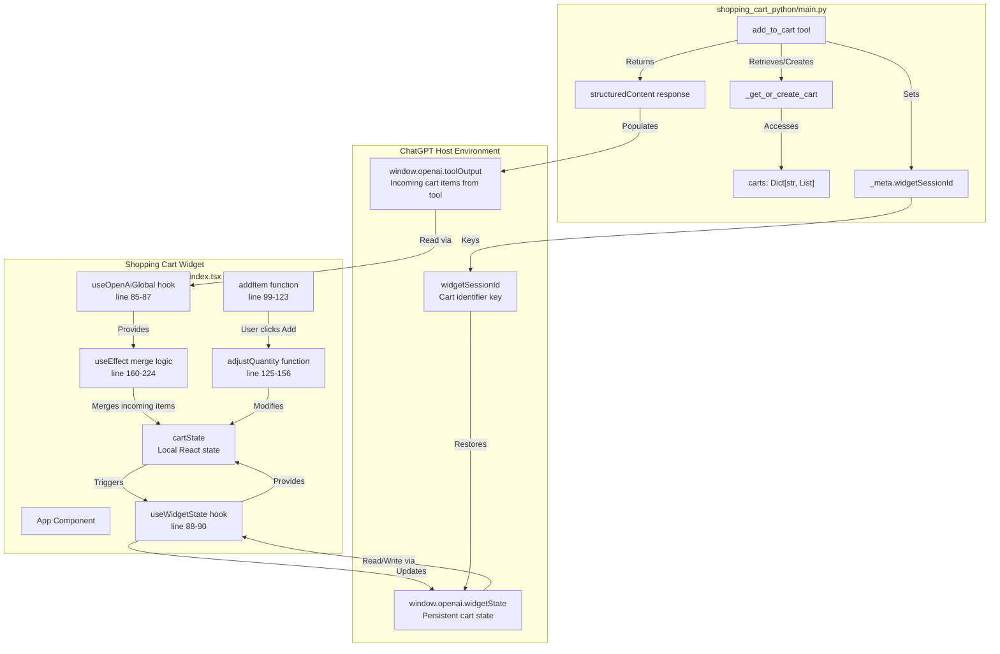
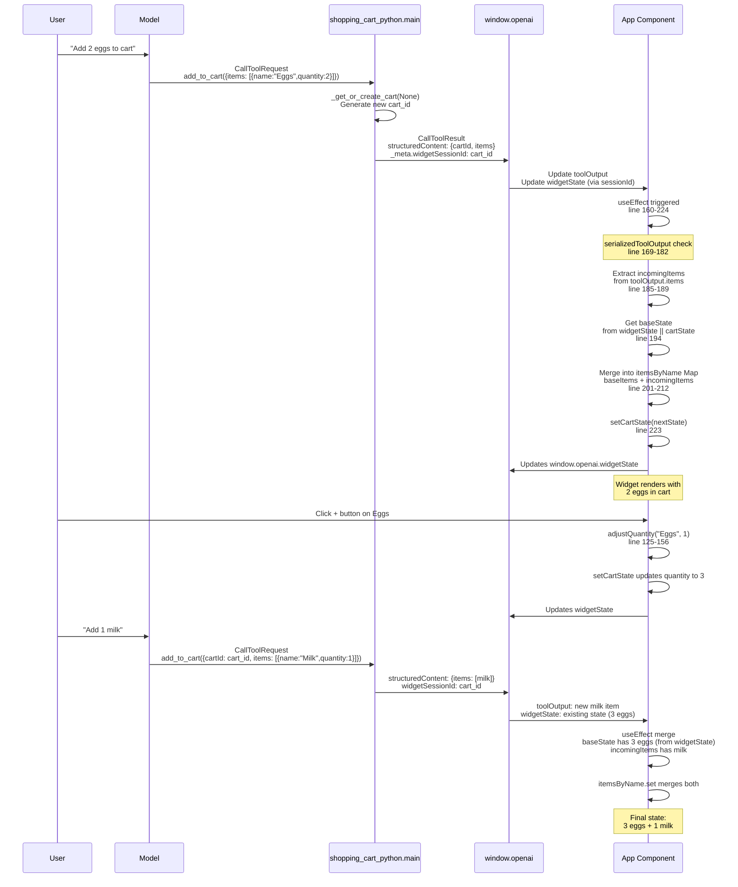
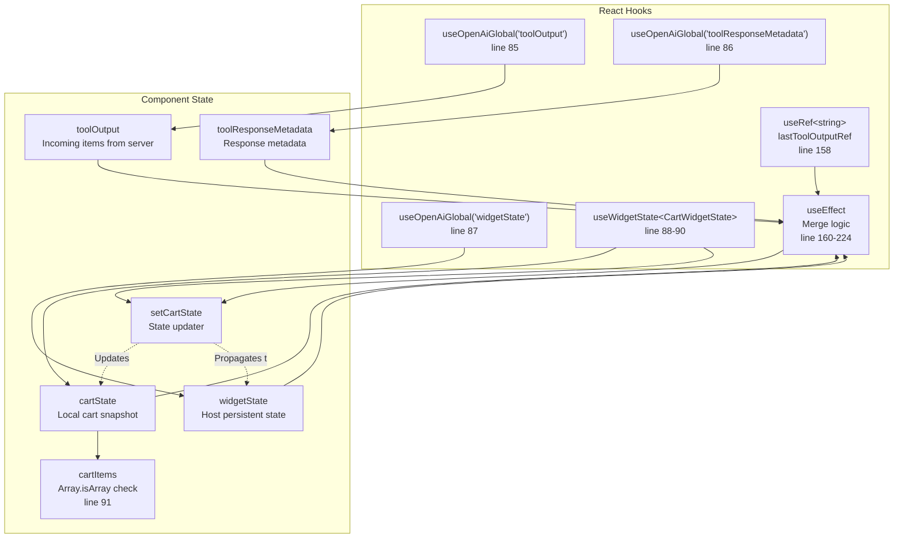
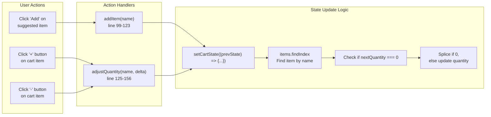

<!-- source: DeepWiki mcp.deepwiki.com · repo openai/openai-apps-sdk-examples · extra page Shopping Cart Widget · fetched 2026-10-26 -->

# Shopping Cart Widget

Relevant source files

The following files were used as context for generating this wiki page:

- [shopping_cart_python/README.md](shopping_cart_python/README.md)
- [shopping_cart_python/requirements.txt](shopping_cart_python/requirements.txt)
- [src/shopping-cart/icons.tsx](src/shopping-cart/icons.tsx)
- [src/shopping-cart/index.tsx](src/shopping-cart/index.tsx)

## Purpose and Scope

This document details the Shopping Cart widget implementation, which demonstrates session-based state persistence across conversational turns using `widgetSessionId`. The widget showcases how to synchronize state between the MCP server, the widget UI, and the host environment's `widgetState`, enabling users to modify cart contents both through natural language commands and direct UI interactions while maintaining consistency across all three layers.

For broader state management patterns applicable to all widgets, see [State Management Patterns](). For server-side patterns using FastMCP, see [Python Server Architecture Patterns]().

---

## Architecture Overview

The Shopping Cart widget implements a three-way state synchronization model between the MCP server, the widget component, and the host environment's persistent storage.

**Sources:**
- [src/shopping-cart/index.tsx:1-224]()
- [shopping_cart_python/README.md:33-48]()

---

## State Synchronization Flow

The widget implements a sophisticated state merge pattern that reconciles three sources of data: incoming tool responses, persistent widget state from previous turns, and user modifications made through the UI.

**Sources:**
- [src/shopping-cart/index.tsx:160-224]()
- [shopping_cart_python/README.md:33-37]()

---

## Widget Implementation

### Component Structure

The Shopping Cart widget is a single-page React application that renders a two-column layout with suggested items and the current cart contents.

| Component Element | Purpose | Code Reference |
|-------------------|---------|----------------|
| `App` | Root component managing all state | [src/shopping-cart/index.tsx:84]() |
| `JsonPanel` | Debug view for `widgetState` and `toolOutput` | [src/shopping-cart/index.tsx:37-52]() |
| `suggestedItems` | Static array of pre-defined items with icons | [src/shopping-cart/index.tsx:54-75]() |
| `iconMatchers` | Keyword-based icon selection logic | [src/shopping-cart/index.tsx:77-82]() |

### State Hooks and Data Flow

**Sources:**
- [src/shopping-cart/index.tsx:85-91]()
- [src/shopping-cart/index.tsx:158-224]()

### Merge Logic Implementation

The core state synchronization occurs in the `useEffect` hook, which runs whenever `toolOutput` or `toolResponseMetadata` changes.

**Key Steps:**

1. **Duplicate Detection** ([src/shopping-cart/index.tsx:169-182]()): Serializes `toolOutput` and `toolResponseMetadata` and compares against a ref to prevent redundant merges triggered by UI updates.

2. **Extract Incoming Items** ([src/shopping-cart/index.tsx:185-189]()): Safely extracts the `items` array from `toolOutput` with type guards.

3. **Determine Base State** ([src/shopping-cart/index.tsx:194]()): Uses `widgetState` as the authoritative source if available, falling back to `cartState`, then default state.

4. **Merge Using Map** ([src/shopping-cart/index.tsx:201-212]()): Creates a `Map<string, CartItem>` keyed by item name, populates it with base items, then overwrites/adds incoming items.

5. **Update Cart State** ([src/shopping-cart/index.tsx:223]()): Calls `setCartState` with the merged result, which automatically propagates to `window.openai.widgetState`.

**Sources:**
- [src/shopping-cart/index.tsx:160-224]()

### UI-Triggered Actions

The widget provides two user interaction patterns:

**Add Item** ([src/shopping-cart/index.tsx:99-123]()):
- Triggered by clicking "Add" buttons on suggested items.
- Finds existing item by name or creates new entry.
- Increments quantity if item already exists.
- Updates `cartState` via functional setter to ensure atomic updates.

**Adjust Quantity** ([src/shopping-cart/index.tsx:125-156]()):
- Triggered by +/- buttons on cart items.
- Supports both increment (+1) and decrement (-1).
- Removes item from array when quantity reaches 0.

**Sources:**
- [src/shopping-cart/index.tsx:99-156]()

---

## Server Implementation

### Tool Definition and Session Management

The server ships an `add_to_cart` tool. Every `call_tool` response sets `_meta["widgetSessionId"]` to the cart identifier and returns a `structuredContent` payload containing the new cart items ([shopping_cart_python/README.md:35]()).

### Resource Serving

The server implements MCP resource serving to provide the widget HTML. It uses a fallback pattern to load the static assets ([shopping_cart_python/README.md:17-21]()).

**Sources:**
- [shopping_cart_python/README.md:15-31]()

---

## Production Considerations

The README explicitly notes that this demo relies on `window.openai.widgetState` for simplicity, but production systems should implement server-side persistence ([shopping_cart_python/README.md:40-46]()):

1. **Persist to Datastore**: On each `add_to_cart` tool call, load the cart from your datastore using the session ID, apply changes, and persist.
2. **Authoritative Server State**: Treat the datastore as the source of truth. UX interactions (like incrementing quantities) should invoke the backend—either via MCP tool call or direct HTTP request.
3. **Session Locking**: Continue setting `_meta["widgetSessionId"]` so the host and widget stay locked to the same cart across turns.

**Sources:**
- [shopping_cart_python/README.md:40-48]()

---

## Testing the Widget

### Example Conversation Flow

The README provides a test script demonstrating multi-turn state persistence ([shopping_cart_python/README.md:49-61]()):

1. **Turn 1**: "Add 2 eggs to my cart" → Widget renders with 2 eggs.
2. **Turn 2**: "Now add milk" → Widget shows 2 eggs + 1 milk (merged).
3. **UI Interaction**: Add 2 avocados from the UI → `widgetState` updates.
4. **Turn 3**: "Now add 3 tomatoes" → Widget shows merged state of eggs, milk, avocados, and tomatoes.

**Sources:**
- [shopping_cart_python/README.md:49-61]()

---

