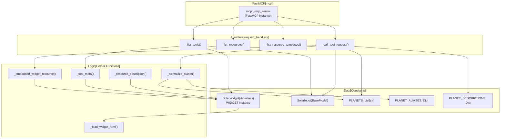
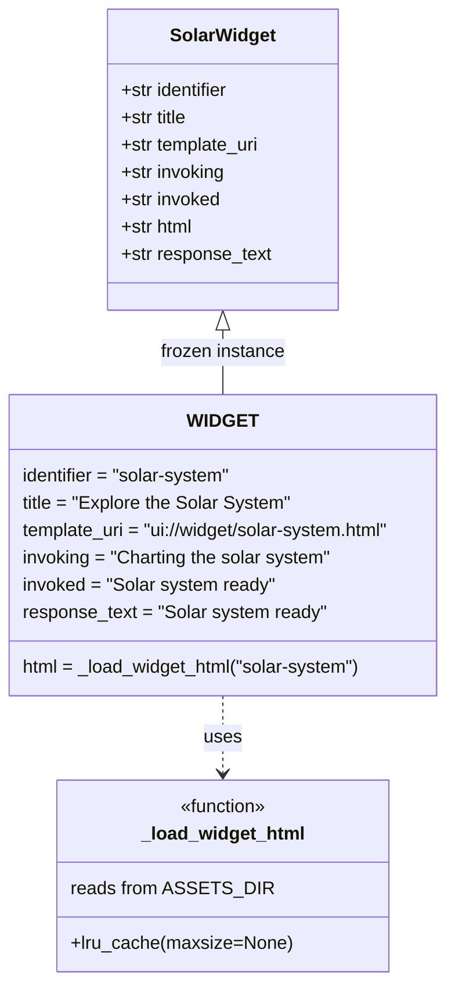
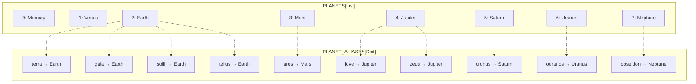
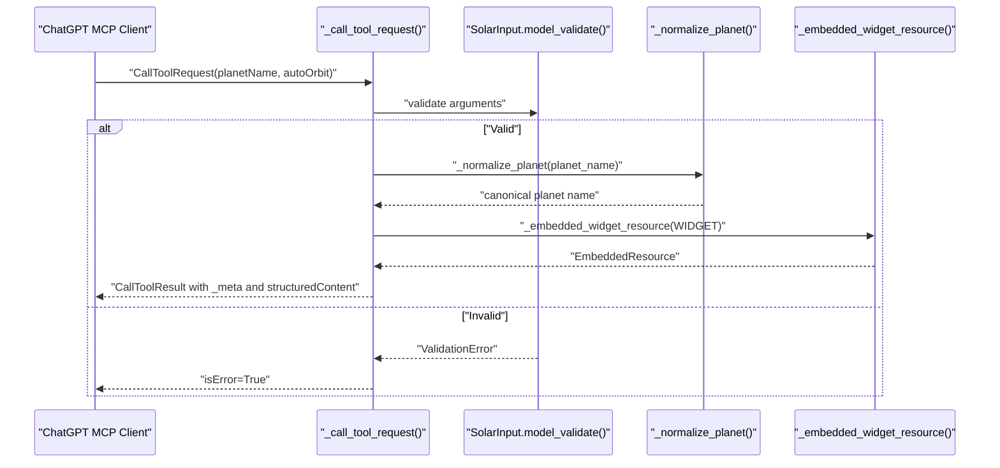

<!-- source: DeepWiki mcp.deepwiki.com · repo openai/openai-apps-sdk-examples · extra page Solar System Python Server · fetched 2026-10-26 -->

# Solar System Python Server

Relevant source files

The following files were used as context for generating this wiki page:

- [solar-system_server_python/README.md](solar-system_server_python/README.md)
- [solar-system_server_python/main.py](solar-system_server_python/main.py)

The Solar System Python server implements an MCP server using FastMCP that exposes a single tool (`focus-solar-planet`) for rendering a 3D solar system widget. The server provides HTTP/SSE endpoints for MCP protocol communication and demonstrates widget integration with planet normalization logic and structured metadata responses.

For other Python server implementations, see pages 5.1.1 (Pizzaz) and 5.1.5 (Kitchen Sink). For MCP protocol fundamentals, see page 3.2.

**Sources**: [solar-system_server_python/main.py:1-132]()

## Purpose and Capabilities

The server implements one MCP tool (`focus-solar-planet`) that accepts `planetName` and `autoOrbit` parameters, returning structured planet data with widget metadata. It maintains three constant dictionaries: `PLANETS` (8 canonical names) [solar-system_server_python/main.py:17-26](), `PLANET_ALIASES` (mappings for mythological names) [solar-system_server_python/main.py:27-38](), and `PLANET_DESCRIPTIONS` (scientific descriptions) [solar-system_server_python/main.py:39-48](). The `_normalize_planet()` function [solar-system_server_python/main.py:167-191]() handles fuzzy matching with exact match, alias lookup, and prefix matching fallback logic.

**Sources**: [solar-system_server_python/main.py:17-48](), [solar-system_server_python/main.py:167-191]()

## Server Architecture

**Server Component Architecture**

The server uses `FastMCP(name="solar-system-python", stateless_http=True)` [solar-system_server_python/main.py:128-132]() to generate ASGI endpoints. Request handlers are manually registered using `mcp._mcp_server` decorators or internal methods.

**Sources**: [solar-system_server_python/main.py:128-132](), [solar-system_server_python/main.py:194-222]()

## FastMCP Configuration

The server instantiates FastMCP with stateless HTTP mode enabled and transport security settings:

| Configuration Key | Value | Purpose |
|------------------|-------|---------|
| `name` | `"solar-system-python"` | MCP server identifier [solar-system_server_python/main.py:129]() |
| `stateless_http` | `True` | Enables per-request session isolation [solar-system_server_python/main.py:130]() |
| `transport_security` | `_transport_security_settings()` | DNS rebinding and host protection [solar-system_server_python/main.py:131]() |

The `_transport_security_settings()` function [solar-system_server_python/main.py:116-125]() configures `TransportSecuritySettings` based on `MCP_ALLOWED_HOSTS` and `MCP_ALLOWED_ORIGINS` environment variables.

**Sources**: [solar-system_server_python/main.py:116-132](), [solar-system_server_python/README.md:30-36]()

## Data Structures and Constants

### SolarWidget Dataclass

**SolarWidget Structure**

The `SolarWidget` dataclass [solar-system_server_python/main.py:52-60]() is defined with `@dataclass(frozen=True)` for immutability. The singleton `WIDGET` instance [solar-system_server_python/main.py:82-90]() loads HTML from the local `assets/` directory using `_load_widget_html("solar-system")` [solar-system_server_python/main.py:66-79](), which implements `@lru_cache(maxsize=None)` for caching.

**Sources**: [solar-system_server_python/main.py:52-60](), [solar-system_server_python/main.py:66-79](), [solar-system_server_python/main.py:82-90]()

### SolarInput Validation Schema

The `SolarInput` Pydantic model [solar-system_server_python/main.py:93-108]() defines the tool's input contract:

| Field | Type | Default | Alias | Description |
|-------|------|---------|-------|-------------|
| `planet_name` | `str` | `DEFAULT_PLANET` ("Earth") | `planetName` | Target planet (case insensitive) [solar-system_server_python/main.py:96-100]() |
| `auto_orbit` | `bool` | `True` | `autoOrbit` | Enable camera orbit if planet missing [solar-system_server_python/main.py:101-105]() |

The JSON schema is extracted at [solar-system_server_python/main.py:134]() via `TOOL_INPUT_SCHEMA = SolarInput.model_json_schema()` for MCP tool registration.

**Sources**: [solar-system_server_python/main.py:49](), [solar-system_server_python/main.py:93-108](), [solar-system_server_python/main.py:134]()

### Planet Catalog

**Planet Data Constants**

Three module-level constants [solar-system_server_python/main.py:17-48]() define planetary data:
- `PLANETS`: List of 8 canonical planet names.
- `PLANET_ALIASES`: Dict mapping mythological/alternate names (e.g., "ares" to "Mars").
- `PLANET_DESCRIPTIONS`: Dict providing scientific descriptions for each planet.

**Sources**: [solar-system_server_python/main.py:17-48](), [solar-system_server_python/main.py:167-191]()

## MCP Handler Functions

### Tool Listing

The `_list_tools()` async function [solar-system_server_python/main.py:194-204]() returns a `types.Tool` list:
- **name**: `"focus-solar-planet"`
- **inputSchema**: `TOOL_INPUT_SCHEMA`
- **_meta**: Generated by `_tool_meta(WIDGET)` [solar-system_server_python/main.py:141-152]().

The `_tool_meta()` function [solar-system_server_python/main.py:141-152]() specifies that the widget is accessible and provides a `readOnlyHint`.

**Sources**: [solar-system_server_python/main.py:141-152](), [solar-system_server_python/main.py:194-204]()

### Resource Management

The server manages resources through three handlers:

1. **_list_resources()** [solar-system_server_python/main.py:207-218]() - Returns the `WIDGET` title and URI ("ui://widget/solar-system.html").
2. **_list_resource_templates()** [solar-system_server_python/main.py:221-224]() - Provides templates for dynamic resource discovery.
3. **_embedded_widget_resource()** [solar-system_server_python/main.py:155-164]() - Wraps the `WIDGET.html` in a `types.EmbeddedResource` with the `text/html+skybridge` MIME type.

**Sources**: [solar-system_server_python/main.py:16](), [solar-system_server_python/main.py:155-164](), [solar-system_server_python/main.py:207-224]()

## Planet Normalization Algorithm

The `_normalize_planet()` function [solar-system_server_python/main.py:167-191]() implements fuzzy matching logic:

1. **Empty check** [solar-system_server_python/main.py:168-173](): Returns `DEFAULT_PLANET` if input is missing.
2. **Exact match** [solar-system_server_python/main.py:177-180](): Compares alphanumeric-only versions of the input and canonical names.
3. **Alias lookup** [solar-system_server_python/main.py:182-184](): Checks the `PLANET_ALIASES` dictionary.
4. **Prefix match** [solar-system_server_python/main.py:186-189](): Returns a planet if the input is a prefix of its name (e.g., "Jup" → "Jupiter").

**Sources**: [solar-system_server_python/main.py:167-191]()

## Tool Call Handling

The tool call process involves input validation, normalization, and response assembly.

**_call_tool_request() Execution Sequence**

The response includes `structuredContent` [solar-system_server_python/main.py:134]() containing the planet name and scientific description, along with `_meta` containing the embedded widget HTML [solar-system_server_python/main.py:141-152]().

**Sources**: [solar-system_server_python/main.py:134-164](), [solar-system_server_python/main.py:237-296]()

## Installation and Execution

### Setup and Execution

Standard Python installation steps:

1. **Virtual environment**: `python -m venv .venv` [solar-system_server_python/README.md:16]()
2. **Dependencies**: `pip install -r requirements.txt` [solar-system_server_python/README.md:18]()
3. **Execution**: `python main.py` [solar-system_server_python/README.md:28]()

The server runs on `http://127.0.0.1:8000` [solar-system_server_python/README.md:31](). It exposes:
- `GET /mcp`: SSE stream for protocol messages [solar-system_server_python/README.md:35]().
- `POST /mcp/messages`: Endpoint for client-to-server messages [solar-system_server_python/README.md:36]().

**Sources**: [solar-system_server_python/README.md:15-36]()

---

