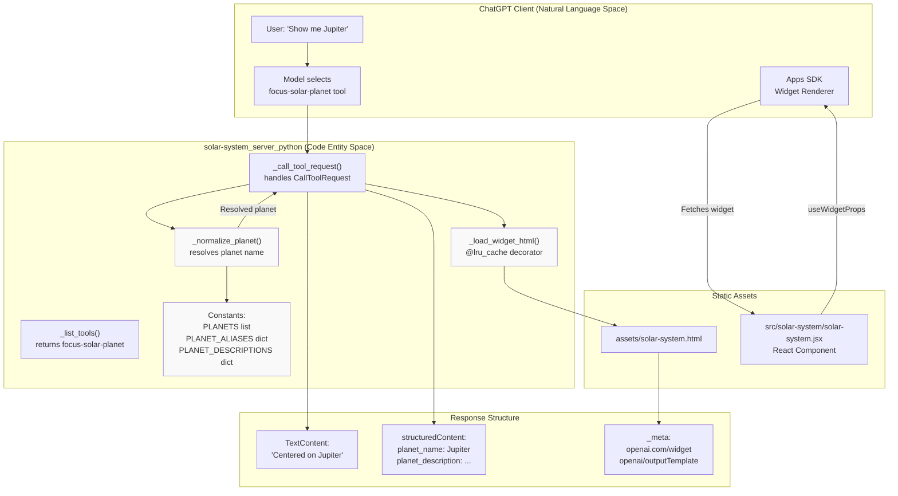
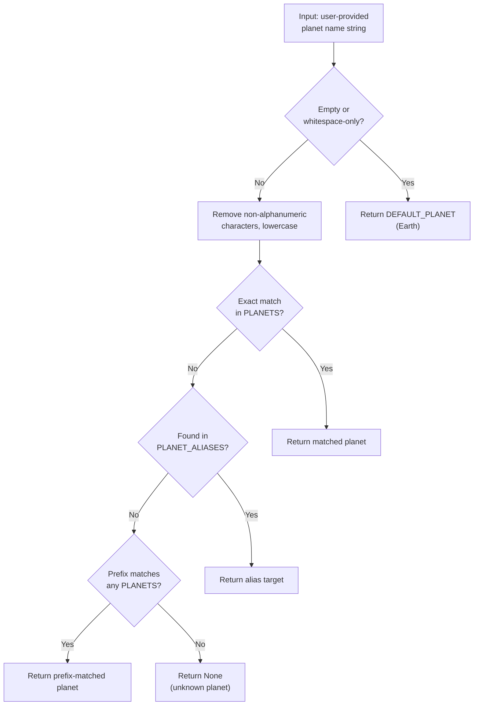
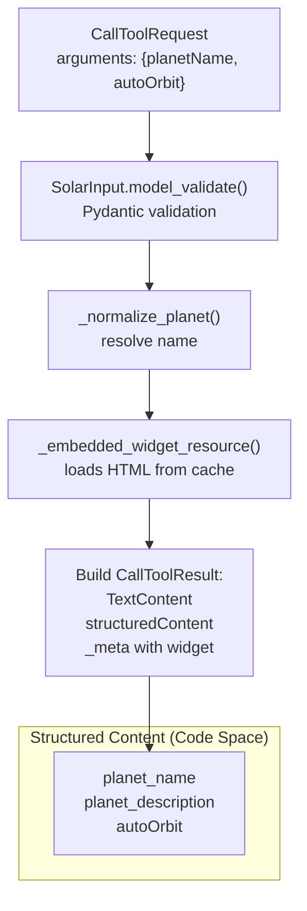

<!-- source: DeepWiki mcp.deepwiki.com · repo openai/openai-apps-sdk-examples · extra page Solar System Widget · fetched 2026-10-26 -->

# Solar System Widget

<details>
<summary>Relevant source files</summary>

The following files were used as context for generating this wiki page:

- [solar-system_server_python/main.py](solar-system_server_python/main.py)
- [src/solar-system/index.jsx](src/solar-system/index.jsx)
- [src/solar-system/solar-system.jsx](src/solar-system/solar-system.jsx)

</details>


## Purpose and Scope

The Solar System widget is a 3D visualization example that demonstrates how to build an interactive, data-driven widget with flexible input handling. This widget displays an animated 3D model of the solar system using React Three Fiber and allows the user to focus on specific planets through natural language requests. The implementation showcases planet name normalization, alias resolution, and prefix matching patterns that enable robust handling of user input variations.

This page covers the widget's architecture, planet name normalization logic, and integration with its MCP server. For other example widgets, see [Pizzaz Widgets](#4.7.1), [Shopping Cart Widget](#4.7.2), and [Kitchen Sink Widget](#4.7.4). For general widget development patterns, see [Widget Architecture](#4.1) and [State Management Patterns](#4.3).

**Sources:** [solar-system_server_python/main.py:1-48](), [src/solar-system/solar-system.jsx:1-12]()

---

## Widget Features

The Solar System widget provides the following capabilities:

| Feature | Description |
|---------|-------------|
| **3D Visualization** | Renders an animated model of the solar system using `@react-three/fiber` and `@react-three/drei`. |
| **Planet Focus** | Centers the camera on a specific planet when requested via `planet_name` prop. |
| **Auto-Orbit Mode** | Continuously orbits the camera when enabled or when target planet is missing. |
| **Flexible Input** | Accepts planet names with case variations, aliases (e.g., "Terra" → "Earth"), and prefix matching (e.g., "Jup" → "Jupiter"). |
| **Planet Descriptions** | Displays educational text about the focused planet with streaming animation. |

The widget is read-only and does not maintain persistent state across conversational turns. Each tool invocation creates a fresh view focused on the requested planet.

**Sources:** [solar-system_server_python/main.py:93-106](), [solar-system_server_python/main.py:39-48](), [src/solar-system/solar-system.jsx:202-212]()

---

## System Architecture

The Solar System widget follows the standard MCP + Apps SDK architecture with a Python server and a standalone HTML/JS bundle:

### Component Relationship Diagram



**Key components:**

- **`focus-solar-planet` tool**: Single MCP tool that accepts planet name and auto-orbit flag [solar-system_server_python/main.py:198-203]().
- **`_normalize_planet()` function**: Handles flexible input resolution [solar-system_server_python/main.py:167-192]().
- **`_load_widget_html()` function**: Loads and caches widget HTML with fallback to versioned filenames [solar-system_server_python/main.py:66-79]().
- **`SolarInput` Pydantic model**: Validates tool input with `planetName` (aliased) and `autoOrbit` fields [solar-system_server_python/main.py:93-107]().
- **`SolarSystem` React Component**: Main 3D rendering logic using `useWidgetProps` to receive data [src/solar-system/solar-system.jsx:202-212]().

**Sources:** [solar-system_server_python/main.py:1-343](), [src/solar-system/solar-system.jsx:202-212]()

---

## Planet Name Normalization

The widget implements sophisticated planet name resolution to handle diverse user input patterns.

### Normalization Flow



### Implementation Details

The `_normalize_planet()` function [solar-system_server_python/main.py:167-192]() implements the following strategies:

1. **Empty Input Handling**: Returns `"Earth"` (the `DEFAULT_PLANET` constant) for null or whitespace-only input [solar-system_server_python/main.py:168-173]().

2. **Exact Matching**: Compares the cleaned input against each planet in the `PLANETS` list [solar-system_server_python/main.py:177-180]().
   - Example: `"jupiter"`, `"Jupiter"`, `"JUPITER"` → `"Jupiter"`

3. **Alias Resolution**: Looks up the cleaned input in `PLANET_ALIASES` dictionary [solar-system_server_python/main.py:182-184]().
   - Supported aliases [solar-system_server_python/main.py:27-38]():
     - `"terra"`, `"gaia"`, `"soliii"`, `"tellus"` → `"Earth"`
     - `"ares"` → `"Mars"`
     - `"jove"`, `"zeus"` → `"Jupiter"`
     - `"cronus"` → `"Saturn"`
     - `"ouranos"` → `"Uranus"`
     - `"poseidon"` → `"Neptune"`

4. **Prefix Matching**: Checks if the cleaned input is a prefix of any planet name [solar-system_server_python/main.py:186-189]().
   - Example: `"jup"` → `"Jupiter"`, `"sat"` → `"Saturn"`

**Sources:** [solar-system_server_python/main.py:17-49](), [solar-system_server_python/main.py:167-192]()

---

## Tool Definition and Invocation

### Tool Schema

The `focus-solar-planet` tool is defined with the following JSON Schema input contract:

| Parameter | Type | Default | Description |
|-----------|------|---------|-------------|
| `planetName` | `string` | `"Earth"` | Planet to focus (case insensitive, supports aliases and prefixes) |
| `autoOrbit` | `boolean` | `true` | Whether to keep camera orbiting if target planet is missing |

The schema is generated from the `SolarInput` Pydantic model [solar-system_server_python/main.py:93-107]() with field aliases for camelCase JSON properties.

### Tool Metadata

The tool includes metadata annotations for the Apps SDK:

```python
{
    "openai/outputTemplate": "ui://widget/solar-system.html",
    "openai/toolInvocation/invoking": "Charting the solar system",
    "openai/toolInvocation/invoked": "Solar system ready",
    "openai/widgetAccessible": True,
    "annotations": {
        "destructiveHint": False,
        "openWorldHint": False,
        "readOnlyHint": True,
    }
}
```

The `readOnlyHint: True` annotation indicates that this tool does not modify any state or data [solar-system_server_python/main.py:141-152]().

**Sources:** [solar-system_server_python/main.py:134-152](), [solar-system_server_python/main.py:194-204]()

---

## Tool Call Handling

### Request Processing Flow



### Response Structure

A successful tool call returns a `CallToolResult` with three components:

1. **TextContent**: Human-readable message for the model.
2. **structuredContent**: Data for the widget to consume, including `planet_name`, `planet_description`, and `autoOrbit` [solar-system_server_python/main.py:301-305]().
3. **_meta**: Widget resource and metadata containing the HTML markup [solar-system_server_python/main.py:311-314]().

**Sources:** [solar-system_server_python/main.py:258-318]()

---

## Frontend Implementation

The widget is built using React and Three.js.

### Key Frontend Entities

| Entity | File | Role |
|--------|------|------|
| `SolarSystem` | [src/solar-system/solar-system.jsx:202]() | Main component; manages camera focus and planet selection. |
| `useWidgetProps` | [src/solar-system/solar-system.jsx:205]() | Hook used to extract `planet_name` and other data from the tool call. |
| `SceneBackground` | [src/solar-system/solar-system.jsx:75]() | Renders the starfield environment map. |
| `Effects` | [src/solar-system/solar-system.jsx:89]() | Manages Post-processing (Bloom, Depth of Field). |
| `StreamText` | [src/solar-system/solar-system.jsx:61]() | Animates the display of planet descriptions. |

### State Synchronization

The widget synchronizes its internal state (like whether it is currently orbiting or which planet is in focus) back to the host via `window.oai.widget.setState` [src/solar-system/solar-system.jsx:223-227]().

**Sources:** [src/solar-system/solar-system.jsx:1-230]()

---

## Usage Examples

### Starting the Server

```bash
# Install dependencies
pip install -r solar-system_server_python/requirements.txt

# Build widget assets
pnpm run build

# Start the MCP server
uvicorn solar-system_server_python.main:app --port 8000
```

### Example User Queries

- "Show me Jupiter" → Focuses on Jupiter with description.
- "What does mars look like?" → Focuses on Mars.
- "Display terra" → Resolves alias to Earth via `PLANET_ALIASES` [solar-system_server_python/main.py:28]().
- "Focus on nep" → Prefix matches to Neptune [solar-system_server_python/main.py:188]().

**Sources:** [solar-system_server_python/main.py:27-38](), [solar-system_server_python/main.py:167-192]()

---

