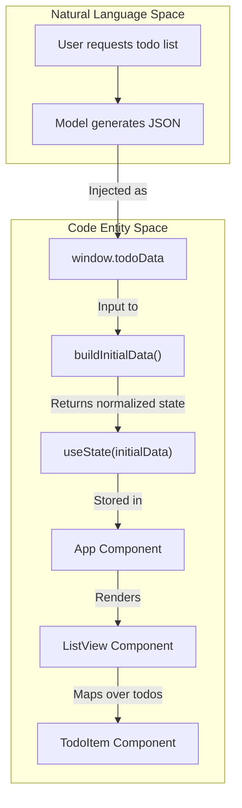
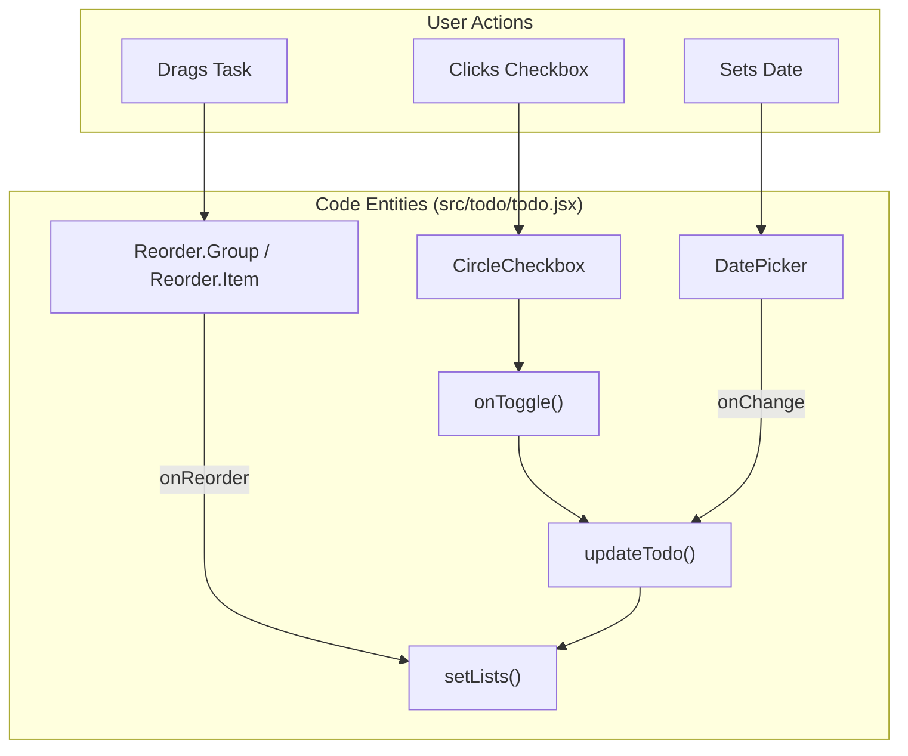

<!-- source: DeepWiki mcp.deepwiki.com · repo openai/openai-apps-sdk-examples · extra page Todo Widget · fetched 2026-10-26 -->

# Todo Widget

Relevant source files

The following files were used as context for generating this wiki page:

- [src/todo/index.jsx](src/todo/index.jsx)
- [src/todo/todo.css](src/todo/todo.css)
- [src/todo/todo.jsx](src/todo/todo.jsx)

The **Todo Widget** is a functional React-based todo list demonstration. It showcases standard widget patterns including complex state management for nested lists, interactive UI components using `framer-motion`, and integration with external libraries like `react-datepicker` within the Apps SDK environment.

## Overview and Purpose

The purpose of the Todo Widget is to provide a reference implementation for:
*   **Nested State Management**: Managing multiple lists, each containing an array of todo items with individual properties (completion status, notes, due dates).
*   **Interactive UI**: Implementing drag-and-drop reordering, animations for adding/removing items, and custom date picking.
*   **Data Normalization**: Ensuring that data passed from the model (via `window.todoData`) is sanitized and assigned stable identifiers for React rendering.

## Implementation Details

### Data Initialization and Normalization
The widget initializes its state by consuming `window.todoData`, which is injected by the host environment. The `buildInitialData` function [src/todo/todo.jsx:152-170]() ensures that every list and todo item has a stable `id` (generated via `uid()`) and that boolean flags or optional fields (like `dueDate`) are normalized to prevent runtime errors.

### State Structure
The widget's internal state is managed via a single `state` object containing an array of `lists`.

| Entity | Properties | Source |
| :--- | :--- | :--- |
| **List** | `id`, `title`, `isCurrentlyOpen`, `todos[]` | [src/todo/todo.jsx:162-167]() |
| **Todo** | `id`, `isComplete`, `note`, `title`, `dueDate` | [src/todo/todo.jsx:153-160]() |

### Key Components

*   **App**: The root component that manages the global state and renders either the list overview or a specific active list [src/todo/todo.jsx:780-877]().
*   **TodoItem**: Represents a single task. It handles local interactions like toggling completion, editing text, and opening the date picker [src/todo/todo.jsx:426-590]().
*   **CircleCheckbox**: A custom accessible checkbox component used for marking tasks as complete [src/todo/todo.jsx:194-222]().
*   **CustomHeader (DatePicker)**: A bespoke header for the `react-datepicker` to match the widget's aesthetic [src/todo/todo.jsx:382-424]().

## Data Flow and Interactions

The widget uses a "lifted state" pattern where the root `App` component holds the master data. Sub-components communicate changes back to the root via callback functions.

### Natural Language to Code Entity Mapping: Rendering Flow
The following diagram illustrates how the widget transitions from raw data to a rendered interactive UI.

"Widget Rendering Flow"

Sources: [src/todo/todo.jsx:13-13](), [src/todo/todo.jsx:152-170](), [src/todo/todo.jsx:783-783]()

### Natural Language to Code Entity Mapping: Interaction Flow
This diagram maps user actions (like completing a task) to the underlying code functions.

"Task Interaction Flow"

Sources: [src/todo/todo.jsx:194-222](), [src/todo/todo.jsx:435-442](), [src/todo/todo.jsx:530-540](), [src/todo/todo.jsx:660-675]()

## Styling and Animations

### CSS Injection
The widget uses a manual CSS injection pattern for the date picker to ensure styles are encapsulated and consistent with the ChatGPT UI theme. The `injectDatepickerStylesOnce` function [src/todo/todo.jsx:19-93]() creates a `<style>` block in the document head containing custom overrides for `.react-datepicker`.

### Motion Patterns
`framer-motion` is utilized for fluid UI transitions:
*   **Reordering**: The `Reorder` component allows users to drag tasks to change their priority [src/todo/todo.jsx:660-675]().
*   **Presence**: `AnimatePresence` handles the entrance and exit animations when tasks are added or deleted [src/todo/todo.jsx:658-677]().
*   **Layout**: `layout` props on motion components ensure that surrounding elements slide smoothly when a neighbor is removed [src/todo/todo.jsx:681-681]().

## Utility Functions

| Function | Description | File Location |
| :--- | :--- | :--- |
| `uid()` | Generates a stable unique identifier using `crypto.randomUUID` or a fallback. | [src/todo/todo.jsx:108-115]() |
| `formatDueDate()` | Formats a `YYYY-MM-DD` string into a human-readable format like "Aug 12". | [src/todo/todo.jsx:118-132]() |
| `toYMD()` | Converts a JavaScript `Date` object into a `YYYY-MM-DD` string. | [src/todo/todo.jsx:143-149]() |
| `useClickOutside()` | A custom hook to detect clicks outside a specific element (used for menus). | [src/todo/todo.jsx:173-181]() |

Sources: [src/todo/todo.jsx:1-900]()

---

