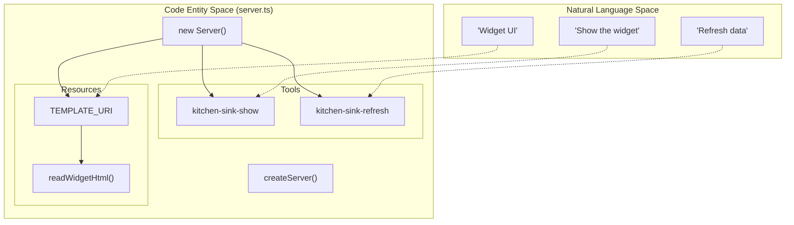
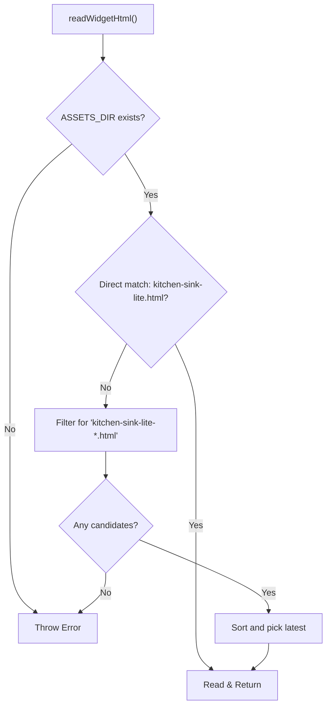
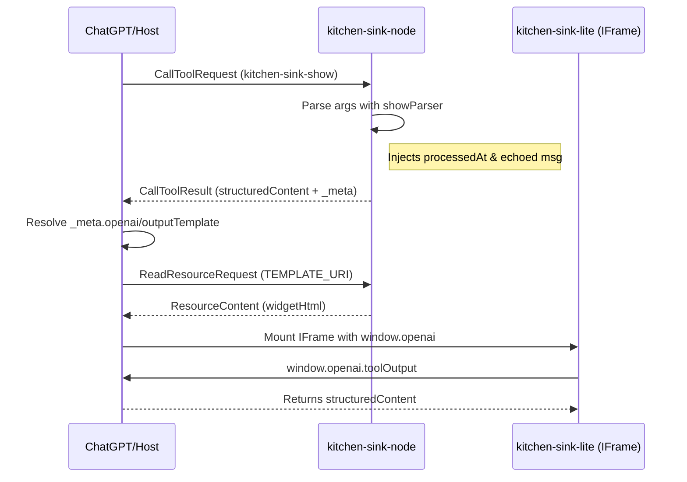

<!-- source: DeepWiki mcp.deepwiki.com · repo openai/openai-apps-sdk-examples · extra page Kitchen Sink Node Server · fetched 2026-10-26 -->

# Kitchen Sink Node Server

<details>
<summary>Relevant source files</summary>

The following files were used as context for generating this wiki page:

- [kitchen_sink_server_node/README.md](kitchen_sink_server_node/README.md)
- [kitchen_sink_server_node/package-lock.json](kitchen_sink_server_node/package-lock.json)
- [kitchen_sink_server_node/package.json](kitchen_sink_server_node/package.json)
- [kitchen_sink_server_node/src/server.ts](kitchen_sink_server_node/src/server.ts)
- [kitchen_sink_server_node/tsconfig.json](kitchen_sink_server_node/tsconfig.json)
- [kitchen_sink_server_python/README.md](kitchen_sink_server_python/README.md)
- [kitchen_sink_server_python/main.py](kitchen_sink_server_python/main.py)
- [kitchen_sink_server_python/requirements.txt](kitchen_sink_server_python/requirements.txt)

</details>


## Purpose and Scope

The Kitchen Sink Node.js MCP server is a comprehensive implementation demonstrating the full `window.openai` API surface. It pairs with the `kitchen-sink-lite` widget bundle to showcase host state reading, state modification, tool invocation, and host helper functions within the ChatGPT environment. 

The server exposes two primary tools:
- `kitchen-sink-show`: Renders the widget and echoes a provided message with optional styling.
- `kitchen-sink-refresh`: A lightweight echo tool designed to be called directly from the widget via `window.openai.callTool`.

**Sources:** [kitchen_sink_server_node/src/server.ts:1-10](), [kitchen_sink_server_node/README.md:1-10]()

---

## Server Architecture

The Kitchen Sink Node server utilizes the `@modelcontextprotocol/sdk` to implement the Model Context Protocol over an SSE (Server-Sent Events) transport. It serves both the widget's structured data (via tools) and the widget's UI markup (via resources).

### System Component Mapping

This diagram maps the high-level system requirements to specific code entities within the Node.js implementation.



**Sources:** [kitchen_sink_server_node/src/server.ts:20-36](), [kitchen_sink_server_node/src/server.ts:50-51](), [kitchen_sink_server_node/src/server.ts:145-170](), [kitchen_sink_server_node/src/server.ts:192-204]()

---

## Implementation Details

### Tool Definitions and Schemas
The server defines two tools using JSON Schema for input validation and Zod for runtime parsing.

| Tool Name | Input Schema | Purpose |
|-----------|--------------|---------|
| `kitchen-sink-show` | `message` (req), `accentColor`, `details` | Initial rendering of the widget with custom content. |
| `kitchen-sink-refresh` | `message` (req) | Lightweight endpoint for `window.openai.callTool` demonstrations. |

Both tools include `_meta` fields required by the Apps SDK to locate the widget template and provide user-facing status strings during invocation.

**Sources:** [kitchen_sink_server_node/src/server.ts:106-143](), [kitchen_sink_server_node/src/server.ts:145-170](), [kitchen_sink_server_node/src/server.ts:88-102]()

### Widget HTML Loading
The server dynamically locates the widget HTML in the `assets/` directory. It supports a fallback mechanism to handle versioned filenames generated by the build process.



**Sources:** [kitchen_sink_server_node/src/server.ts:53-86]()

---

## Data Flow: Widget Hydration

The following diagram illustrates how the server bridges the gap between a tool call and the rendered widget state.



**Sources:** [kitchen_sink_server_node/src/server.ts:214-225](), [kitchen_sink_server_node/src/server.ts:242-262](), [kitchen_sink_server_node/src/server.ts:50-51]()

---

## Configuration and Execution

### Prerequisites
- **Node.js**: Version 18 or higher is required.
- **Assets**: The widget assets must be built prior to starting the server. This is done via `pnpm run build` from the repository root, which populates the `assets/` directory.

**Sources:** [kitchen_sink_server_node/README.md:12-16]()

### Environment Variables
The server respects the following environment variables:
- `PORT`: The port on which the HTTP server listens (defaults to `8000`).

### Running the Server
The server can be started using `tsx` to run the TypeScript source directly.

```bash
# Install dependencies
pnpm install

# Start the server
pnpm start
```

The server exposes an SSE endpoint at `http://localhost:8000/mcp`.

**Sources:** [kitchen_sink_server_node/package.json:7-17](), [kitchen_sink_server_node/README.md:17-27]()

### Summary of Provided Tools

| Functionality | Code Reference |
|---------------|----------------|
| Tool List Handler | `server.setRequestHandler(ListToolsRequestSchema, ...)` [kitchen_sink_server_node/src/server.ts:234-239]() |
| Resource List Handler | `server.setRequestHandler(ListResourcesRequestSchema, ...)` [kitchen_sink_server_node/src/server.ts:206-211]() |
| Tool Execution Handler | `server.setRequestHandler(CallToolRequestSchema, ...)` [kitchen_sink_server_node/src/server.ts:241-262]() |
| SSE Transport Setup | `new SSEServerTransport("/mcp/messages", res)` [kitchen_sink_server_node/src/server.ts:21]() |

**Sources:** [kitchen_sink_server_node/src/server.ts:206-262]()

---

