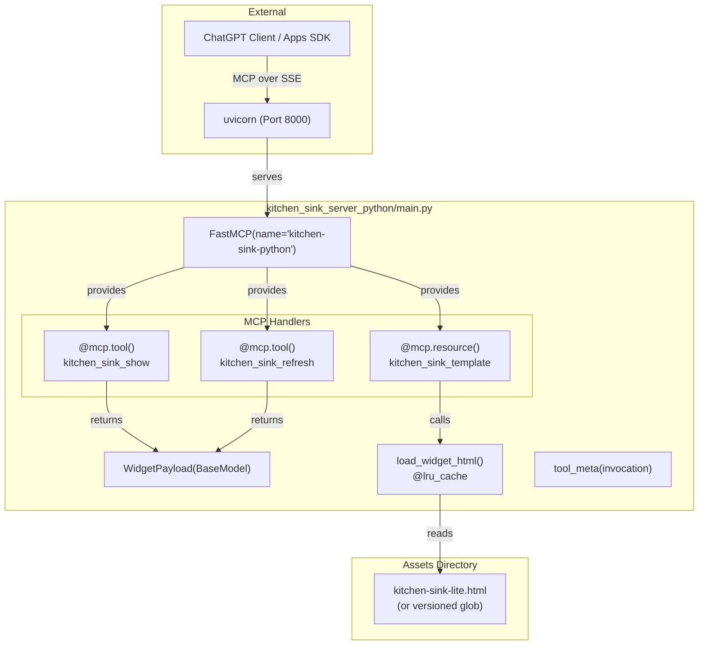
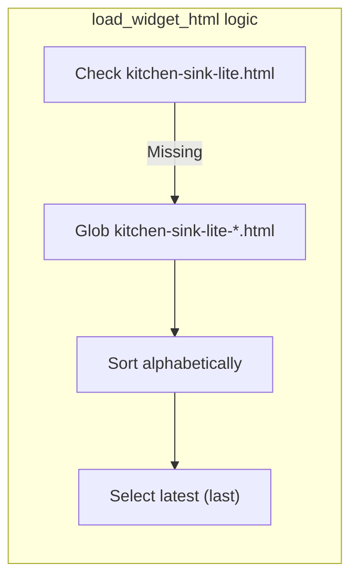

<!-- source: DeepWiki mcp.deepwiki.com · repo openai/openai-apps-sdk-examples · extra page Kitchen Sink Python Server · fetched 2026-10-26 -->

# Kitchen Sink Python Server

<details>
<summary>Relevant source files</summary>

The following files were used as context for generating this wiki page:

- [kitchen_sink_server_node/README.md](kitchen_sink_server_node/README.md)
- [kitchen_sink_server_node/package-lock.json](kitchen_sink_server_node/package-lock.json)
- [kitchen_sink_server_node/package.json](kitchen_sink_server_node/package.json)
- [kitchen_sink_server_node/src/server.ts](kitchen_sink_server_node/src/server.ts)
- [kitchen_sink_server_node/tsconfig.json](kitchen_sink_server_node/tsconfig.json)
- [kitchen_sink_server_python/README.md](kitchen_sink_server_python/README.md)
- [kitchen_sink_server_python/main.py](kitchen_sink_server_python/main.py)
- [kitchen_sink_server_python/requirements.txt](kitchen_sink_server_python/requirements.txt)

</details>


## Purpose and Scope

The Kitchen Sink Python Server ([kitchen_sink_server_python/main.py]()) is a comprehensive demonstration MCP server implemented with `FastMCP`. It showcases the complete `window.openai` API surface by pairing with the `src/kitchen-sink-lite` widget bundle. The server exposes two primary tools: `kitchen-sink-show` for initial rendering and `kitchen-sink-refresh` for demonstrating client-side tool calls via `window.openai.callTool`.

Unlike specialized examples, this server exercises all host environment capabilities, including structured content hydration, tool metadata configuration, and resource serving for widget templates.

**Sources:** [kitchen_sink_server_python/main.py:1-11](), [kitchen_sink_server_python/README.md:3-9]()

---

## Server Architecture

The server utilizes the `FastMCP` framework with `stateless_http=True` to support SSE-compatible streaming over FastAPI. It manages widget assets and implements DNS rebinding protection via transport security settings.

### System Components and Data Flow



**Sources:** [kitchen_sink_server_python/main.py:26-93](), [kitchen_sink_server_python/main.py:152-157]()

---

## Core Implementation Details

### Data Models and Metadata
The server defines a `WidgetPayload` Pydantic model to ensure structured content sent to the widget is consistent across different tool calls.

| Field | Type | Description |
|-------|------|-------------|
| `message` | `str` | Primary message rendered in the widget. |
| `accentColor` | `str` | Hex code for header styling (default: `#2d6cdf`). |
| `details` | `str` | Optional supporting text. |
| `fromTool` | `str` | Identifies which tool generated the payload. |

**Sources:** [kitchen_sink_server_python/main.py:31-42]()

The `tool_meta` function provides the necessary MCP metadata to trigger widget rendering in the ChatGPT UI, specifically using the `openai/outputTemplate` key.

**Sources:** [kitchen_sink_server_python/main.py:61-69]()

### Widget Loading Mechanism
The server dynamically locates the widget HTML in the `assets/` directory. It supports both exact filename matches and versioned files (e.g., `kitchen-sink-lite-HASH.html`) generated by the build system.



**Sources:** [kitchen_sink_server_python/main.py:45-59]()

---

## Tool Definitions

The server implements two distinct tools to demonstrate different interaction patterns.

### 1. kitchen-sink-show
Used for the initial rendering of the widget. It accepts parameters for customization and returns `CallToolResult` containing `structuredContent` and `_meta`.

*   **Arguments:** `message` (required), `accent_color` (aliased to `accentColor`), `details`.
*   **Behavior:** Hydrates the widget with provided text and colors.

**Sources:** [kitchen_sink_server_python/main.py:101-130]()

### 2. kitchen-sink-refresh
A lightweight echo tool designed to be called directly from the widget's JavaScript environment using `window.openai.callTool`.

*   **Arguments:** `message` (required).
*   **Behavior:** Returns a payload identifying itself as `fromTool: kitchen-sink-refresh`, allowing the widget to demonstrate dynamic updates without a full conversational turn.

**Sources:** [kitchen_sink_server_python/main.py:133-149]()

---

## Security and Transport

The server includes built-in DNS rebinding protection, configured via environment variables.

| Environment Variable | Function |
|----------------------|----------|
| `MCP_ALLOWED_HOSTS` | Comma-separated list of valid `Host` headers. |
| `MCP_ALLOWED_ORIGINS` | Comma-separated list of valid `Origin` headers. |

If neither is provided, DNS rebinding protection is disabled for easier local development.

**Sources:** [kitchen_sink_server_python/main.py:71-86]()

---

## Setup and Execution

### Prerequisites
*   Python 3.10+
*   Built static assets (run `pnpm run build` from the repository root).

**Sources:** [kitchen_sink_server_python/README.md:10-13]()

### Installation and Running
1.  **Install dependencies:**
    ```bash
    pip install -r kitchen_sink_server_python/requirements.txt
    ```
2.  **Start the server:**
    ```bash
    uvicorn kitchen_sink_server_python.main:app --port 8000
    ```
    The server will be available at `http://localhost:8000/mcp`.

**Sources:** [kitchen_sink_server_python/README.md:15-25](), [kitchen_sink_server_python/main.py:154-157]()

---

