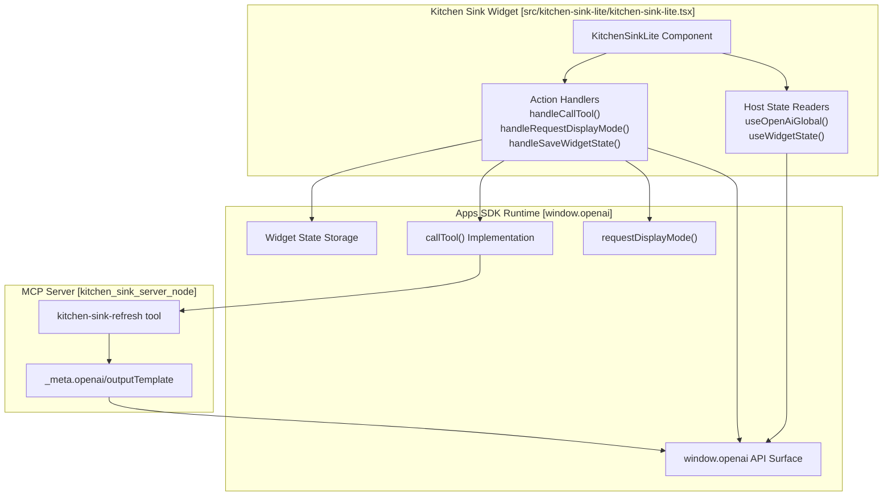
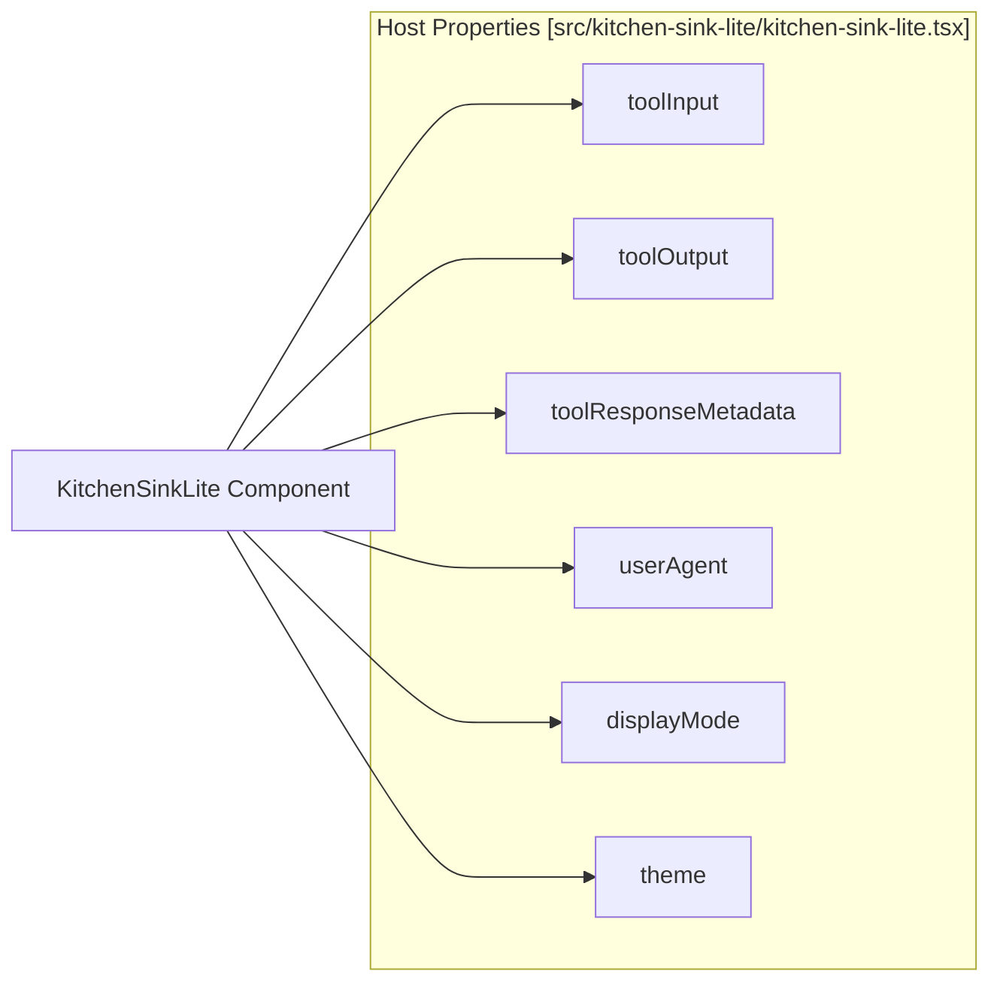
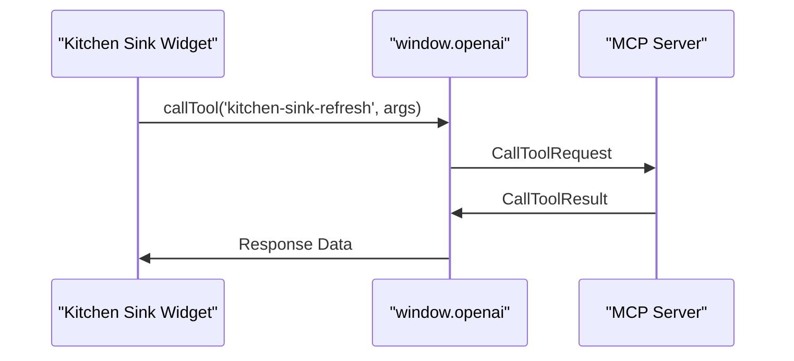
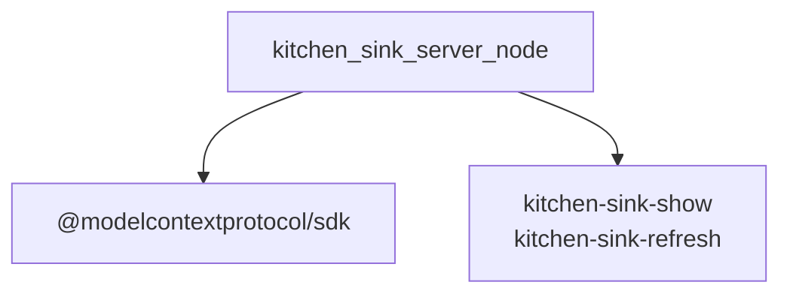

<!-- source: DeepWiki mcp.deepwiki.com · repo openai/openai-apps-sdk-examples · extra page Kitchen Sink Widget · fetched 2026-10-26 -->

# Kitchen Sink Widget

Relevant source files

The following files were used as context for generating this wiki page:

- [.gitignore](.gitignore)
- [package.json](package.json)
- [pnpm-lock.yaml](pnpm-lock.yaml)
- [pnpm-workspace.yaml](pnpm-workspace.yaml)
- [src/kitchen-sink-lite/index.tsx](src/kitchen-sink-lite/index.tsx)
- [src/kitchen-sink-lite/kitchen-sink-lite.css](src/kitchen-sink-lite/kitchen-sink-lite.css)
- [src/kitchen-sink-lite/kitchen-sink-lite.tsx](src/kitchen-sink-lite/kitchen-sink-lite.tsx)

## Purpose and Scope

The Kitchen Sink Widget is a comprehensive demonstration widget that showcases the complete `window.openai` API surface provided by the Apps SDK. It serves as a reference implementation for developers building custom widgets, illustrating how to integrate all available host environment APIs, state management patterns, and MCP tool interactions in a single example [src/kitchen-sink-lite/kitchen-sink-lite.tsx:1-12]().

This page documents the widget implementation, its demonstrated capabilities, and the corresponding MCP server implementations. For general widget architecture concepts, see [Widget Architecture](#4.1). For detailed API reference documentation, see [window.openai API Reference](#4.2). For state management patterns used in production widgets, see [State Management Patterns](#4.3).

**Sources:** [src/kitchen-sink-lite/kitchen-sink-lite.tsx:1-12]()

## Overview

The `kitchen-sink-lite` widget demonstrates several core capabilities of the Apps SDK:

| Capability | API Method / Property | Purpose |
|------------|------------|---------|
| Read host state | `toolInput`, `toolOutput`, `userAgent` | Access conversation context and tool invocation data [src/kitchen-sink-lite/kitchen-sink-lite.tsx:98-107]() |
| Write widget state | `setWidgetState()` | Persist widget state across conversational turns [src/kitchen-sink-lite/kitchen-sink-lite.tsx:162-170]() |
| Call MCP tools | `callTool()` | Invoke other tools from within the widget [src/kitchen-sink-lite/kitchen-sink-lite.tsx:184-210]() |
| Request display mode | `requestDisplayMode()` | Toggle between inline and fullscreen views [src/kitchen-sink-lite/kitchen-sink-lite.tsx:172-182]() |
| Open external URLs | `openExternal()` | Navigate user to external resources [src/kitchen-sink-lite/kitchen-sink-lite.tsx:212-220]() |
| Send follow-up messages | `sendFollowUpMessage()` | Programmatically continue the conversation [src/kitchen-sink-lite/kitchen-sink-lite.tsx:222-230]() |
| Request Modal | `requestModal()` | Trigger a host-rendered modal dialog [src/kitchen-sink-lite/kitchen-sink-lite.tsx:232-243]() |

The widget is implemented as a React component [src/kitchen-sink-lite/kitchen-sink-lite.tsx:97]() and is supported by both Python and Node.js MCP server implementations.

**Sources:** [src/kitchen-sink-lite/kitchen-sink-lite.tsx:1-12](), [src/kitchen-sink-lite/kitchen-sink-lite.tsx:97-243]()

## Widget Architecture

**Diagram: Kitchen Sink Widget Architecture showing API interactions**

The widget acts as a comprehensive test harness for the Apps SDK runtime. The component reads from `window.openai` global properties via the `useOpenAiGlobal` hook [src/kitchen-sink-lite/kitchen-sink-lite.tsx:98-107](), invokes action methods, and observes state changes.

**Sources:** [src/kitchen-sink-lite/kitchen-sink-lite.tsx:97-243](), [src/kitchen-sink-lite/index.tsx:1-11]()

## Demonstrated API Surface

### Host State Reading

The widget demonstrates reading all available host state properties using the `useOpenAiGlobal` helper:

**Diagram: Host state properties accessed by Kitchen Sink Widget**

Each property is displayed in the widget UI, often using the `CodeBlock` component for inspection [src/kitchen-sink-lite/kitchen-sink-lite.tsx:16]().

**Sources:** [src/kitchen-sink-lite/kitchen-sink-lite.tsx:98-107]()

### State Persistence

The widget demonstrates `setWidgetState()` for persisting data across conversational turns via the `useWidgetState` hook [src/kitchen-sink-lite/kitchen-sink-lite.tsx:109-113]():

| Method | Implementation | Purpose |
|--------|-----------|---------|
| `setWidgetState` | `handleSaveWidgetState` | Persists `note` and `highlight` values to the host [src/kitchen-sink-lite/kitchen-sink-lite.tsx:162-170]() |

The widget includes `Input` and `Checkbox` components to modify these state values before saving [src/kitchen-sink-lite/kitchen-sink-lite.tsx:17-18]().

**Sources:** [src/kitchen-sink-lite/kitchen-sink-lite.tsx:109-118](), [src/kitchen-sink-lite/kitchen-sink-lite.tsx:162-170]()

### Tool Invocation from Widget

The widget demonstrates calling MCP tools directly using `window.openai.callTool()` [src/kitchen-sink-lite/kitchen-sink-lite.tsx:184-210]():

**Diagram: Tool invocation flow from widget context**

This capability enables widgets to fetch additional data or trigger server-side actions. The widget provides a text input to customize the message sent to the `kitchen-sink-refresh` tool [src/kitchen-sink-lite/kitchen-sink-lite.tsx:120-122]().

**Sources:** [src/kitchen-sink-lite/kitchen-sink-lite.tsx:184-210]()

## MCP Server Implementations

The kitchen sink widget is supported by server implementations in both Python and Node.js.

### Node.js Server

The Node.js implementation is located in `kitchen_sink_server_node/` [pnpm-workspace.yaml:3]().

**Diagram: Node.js MCP server structure for Kitchen Sink Widget**

The Node.js server defines tools that return the necessary `_meta.openai/outputTemplate` to render the widget [pnpm-lock.yaml:173-180]().

**Sources:** [pnpm-workspace.yaml:3](), [pnpm-lock.yaml:173-180]()

## Widget Code Structure

The widget source code is located in `src/kitchen-sink-lite/`:

| File | Purpose |
|--------------|----------|
| `index.tsx` | Entry point that mounts the React component to the DOM [src/kitchen-sink-lite/index.tsx:1-12]() |
| `kitchen-sink-lite.tsx` | Core logic and UI implementation [src/kitchen-sink-lite/kitchen-sink-lite.tsx:1-12]() |
| `kitchen-sink-lite.css` | Minimal custom CSS for code block styling [src/kitchen-sink-lite/kitchen-sink-lite.css:1-5]() |

The component uses several components from the `@openai/apps-sdk-ui` library, including `Badge`, `Button`, `CodeBlock`, `Checkbox`, `Input`, and `Textarea` [src/kitchen-sink-lite/kitchen-sink-lite.tsx:14-19]().

**Sources:** [src/kitchen-sink-lite/index.tsx:1-12](), [src/kitchen-sink-lite/kitchen-sink-lite.tsx:14-21]()

## Build and Serving

The kitchen sink widget is built using the monorepo's build system:

1. **Bundling**: Vite bundles the source code into the `assets/` directory [package.json:9]().
2. **Serving**: The `pnpm run serve` command serves these assets on port 4444 [package.json:8]().

**Sources:** [package.json:8-9](), [pnpm-workspace.yaml:1-11]()

---

