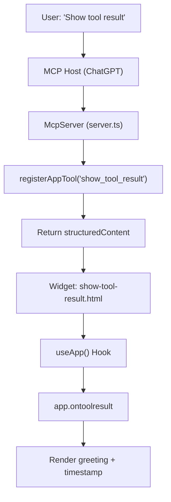
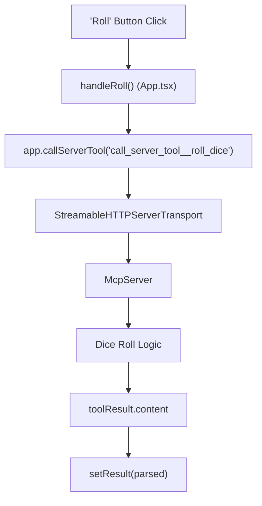

<!-- source: DeepWiki mcp.deepwiki.com · repo openai/openai-apps-sdk-examples · extra page MCP App Basics Node Server · fetched 2026-10-26 -->

# MCP App Basics Node Server

Relevant source files

The following files were used as context for generating this wiki page:

- [mcp_app_basics_node/README.md](mcp_app_basics_node/README.md)
- [mcp_app_basics_node/package.json](mcp_app_basics_node/package.json)
- [mcp_app_basics_node/src/server.ts](mcp_app_basics_node/src/server.ts)
- [mcp_app_basics_node/tsconfig.json](mcp_app_basics_node/tsconfig.json)
- [src/call-server-tool/App.tsx](src/call-server-tool/App.tsx)
- [src/call-server-tool/index.css](src/call-server-tool/index.css)

The **MCP App Basics Node Server** is an educational demonstration server designed to showcase the full breadth of the Model Context Protocol (MCP) Apps SDK APIs. It implements eleven distinct tools, each paired with a specific widget to illustrate core concepts like data flow, host interaction, and tool lifecycle [mcp_app_basics_node/src/server.ts:1-16]().

## Implementation Overview

The server is built using `@modelcontextprotocol/sdk` and the `@modelcontextprotocol/ext-apps` extension library [mcp_app_basics_node/package.json:11-12](). It utilizes a stateless `StreamableHTTPServerTransport` to communicate with the MCP host [mcp_app_basics_node/src/server.ts:28]().

### Key Architectural Patterns
*   **`registerAppTool`**: Simplifies tool definition by automatically handling the mapping between the tool and its corresponding UI resource [mcp_app_basics_node/src/server.ts:109-131]().
*   **`registerAppResource`**: Used to serve the HTML/JS assets for the widgets [mcp_app_basics_node/src/server.ts:23]().
*   **`structuredContent`**: A primary mechanism for passing rich, typed data from the server's tool handler directly into the widget's `ontoolresult` callback [mcp_app_basics_node/src/server.ts:147-185]().

### Data Flow: Server to Widget
The following diagram illustrates how a tool call results in a rendered widget with data populated via `structuredContent`.

**Natural Language to Code: Tool Result Flow**

Sources: [mcp_app_basics_node/src/server.ts:109-185](), [src/call-server-tool/App.tsx:34-43]()

## Tool Categories and APIs

The server organizes its eleven tools into functional categories to demonstrate different SDK capabilities.

| Category | Tool Name | Primary API Demonstrated |
| :--- | :--- | :--- |
| **Data Flow** | `show_tool_result` | `ontoolresult` + `structuredContent` [mcp_app_basics_node/src/server.ts:111]() |
| | `send_message` | `app.sendMessage()` [mcp_app_basics_node/src/server.ts:4-6]() |
| | `update_model_context` | `app.updateModelContext()` [mcp_app_basics_node/src/server.ts:7]() |
| **Widget ↔ Server** | `call_server_tool` | `app.callServerTool()` [mcp_app_basics_node/src/server.ts:8]() |
| **Host Interaction** | `open_link` | `app.openLink()` [mcp_app_basics_node/src/server.ts:10]() |
| | `request_display_mode`| `app.requestDisplayMode()` [mcp_app_basics_node/src/server.ts:11]() |
| | `host_theming` | `useHostStyles` + `useDocumentTheme` [mcp_app_basics_node/src/server.ts:9]() |
| | `get_host_capabilities`| `app.getHostCapabilities()` [mcp_app_basics_node/src/server.ts:13]() |
| | `get_host_context` | `app.getHostContext()` [mcp_app_basics_node/src/server.ts:14]() |
| | `get_host_version` | `app.getHostVersion()` [mcp_app_basics_node/src/server.ts:15]() |
| **Tool Lifecycle** | `streaming_tool_input`| `app.ontoolinputpartial` [mcp_app_basics_node/src/server.ts:12]() |

Sources: [mcp_app_basics_node/src/server.ts:4-15](), [mcp_app_basics_node/README.md:22-52]()

## Detailed Implementation: `call_server_tool`

The `call_server_tool` example demonstrates how a widget can trigger server-side logic without involving the LLM in the loop. This is useful for high-frequency interactions or private data processing.

### Server-Side Registration
The server registers a main tool to show the UI and a secondary "hidden" tool for the actual logic.
*   **Main Tool**: `call_server_tool` returns the widget URI [mcp_app_basics_node/src/server.ts:46-47]().
*   **Logic Tool**: `call_server_tool__roll_dice` performs a calculation and returns a result [src/call-server-tool/App.tsx:75]().

### Client-Side Execution
In the widget, the `app.callServerTool` method is invoked inside a standard React event handler.

**Natural Language to Code: Widget Tool Call**

Sources: [src/call-server-tool/App.tsx:69-99](), [mcp_app_basics_node/src/server.ts:28]()

## Asset Management

The server dynamically serves widget HTML files from an `assets` directory [mcp_app_basics_node/src/server.ts:40]().

### `readWidgetHtml` Function
This helper function manages the retrieval of built widget assets. It supports:
1.  **Direct Lookup**: Checks for `${widgetName}.html` [mcp_app_basics_node/src/server.ts:67-71]().
2.  **Hashed Fallback**: If a direct match is not found (common in production builds), it searches for patterns like `${widgetName}-{hash}.html` and returns the most recent version [mcp_app_basics_node/src/server.ts:74-84]().

Sources: [mcp_app_basics_node/src/server.ts:60-89]()

## Server Configuration

The server runs as an Express application using the `StreamableHTTPServerTransport` for MCP communication [mcp_app_basics_node/src/server.ts:28-30]().

*   **Entry Point**: `src/server.ts` [mcp_app_basics_node/package.json:8]().
*   **Port**: Defaults to `8000`, configurable via `PORT` environment variable [mcp_app_basics_node/README.md:15-18]().
*   **Dependencies**: Uses `zod` for input schema validation and `cors` for cross-origin resource sharing [mcp_app_basics_node/package.json:13-15]().

Sources: [mcp_app_basics_node/src/server.ts:22-34](), [mcp_app_basics_node/package.json:7-16]()

---

