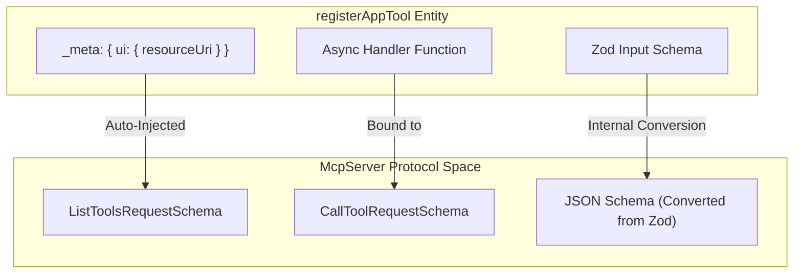
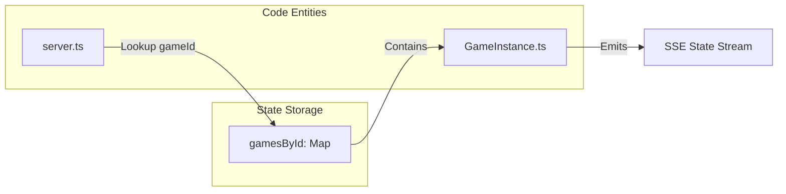

<!-- source: DeepWiki mcp.deepwiki.com · repo openai/openai-apps-sdk-examples · extra page Node.js Server Architecture Patterns · fetched 2026-10-26 -->

# Node.js Server Architecture Patterns

Relevant source files

The following files were used as context for generating this wiki page:

- [cards_against_ai_server_node/src/server.ts](cards_against_ai_server_node/src/server.ts)
- [mcp_app_basics_node/README.md](mcp_app_basics_node/README.md)
- [mcp_app_basics_node/package.json](mcp_app_basics_node/package.json)
- [mcp_app_basics_node/src/server.ts](mcp_app_basics_node/src/server.ts)
- [mcp_app_basics_node/tsconfig.json](mcp_app_basics_node/tsconfig.json)
- [pizzaz_server_node/src/server.ts](pizzaz_server_node/src/server.ts)
- [src/call-server-tool/App.tsx](src/call-server-tool/App.tsx)
- [src/call-server-tool/index.css](src/call-server-tool/index.css)

## Purpose and Scope

This page documents the architectural patterns used in Node.js MCP server implementations. It covers the evolution from manual `McpServer` setups with `SSEServerTransport` to the higher-level `registerAppTool` abstractions provided by `@modelcontextprotocol/ext-apps`. These patterns are demonstrated across `pizzaz_server_node`, `mcp_app_basics_node`, and `cards_against_ai_server_node`.

**Sources:** [pizzaz_server_node/src/server.ts:1-26]() [mcp_app_basics_node/src/server.ts:1-34]() [cards_against_ai_server_node/src/server.ts:1-25]()

---

## MCP Registration Patterns

Node.js servers in this repository use two primary methods for registering tools and resources: the standard MCP SDK and the Apps-specific extension SDK.

### registerAppTool vs manual McpServer

While the base `@modelcontextprotocol/sdk` requires manual handling of request schemas, the `@modelcontextprotocol/ext-apps` package provides `registerAppTool` and `registerAppResource` helpers. These helpers automatically inject the necessary `_meta` fields required for ChatGPT widget rendering.

| Feature | Manual `McpServer` | `registerAppTool` |
|---------|-------------------|-------------------|
| **Input Validation** | Manual `Zod` parsing in handler | Automatic via Zod schema in definition |
| **Metadata** | Manually added to `_meta` | Automatically handled via options |
| **MIME Types** | Explicitly set for resources | Uses `RESOURCE_MIME_TYPE` constant |
| **Implementation** | `server.setRequestHandler(...)` | `registerAppTool(server, name, options, handler)` |

**Sources:** [pizzaz_server_node/src/server.ts:209-279]() [mcp_app_basics_node/src/server.ts:109-131]() [cards_against_ai_server_node/src/server.ts:18-21]()

### Metadata Abstraction Diagram

This diagram shows how `registerAppTool` bridges the gap between high-level tool definitions and the low-level MCP protocol structure.

**Sources:** [mcp_app_basics_node/src/server.ts:109-131]() [cards_against_ai_server_node/src/server.ts:181-223]()

---

## Session and State Management

Node.js servers implement two distinct state patterns: **Session-Based Isolation** (standard for SSE) and **External State Mapping** (for shared or persistent state).

### Session Map Pattern

In servers like `pizzaz_server_node`, each SSE connection is isolated. A `Map` stores the `Server` instance and its `transport`, keyed by a unique `sessionId`.

[pizzaz_server_node/src/server.ts:281-286]()

### External Game State Pattern

In `cards_against_ai_server_node`, game state is decoupled from the connection. This allows the server to remain stateless regarding the transport while managing multiple active games.

**Sources:** [cards_against_ai_server_node/src/server.ts:77-77]() [cards_against_ai_server_node/src/GameInstance.ts:1-50]()

---

## Widget HTML and Asset Fallback Logic

Node.js servers often bundle widgets by inlining JS and CSS into a single HTML file to bypass CSP issues in the ChatGPT iframe.

### Asset Loading Flow

The `readWidgetHtml` function implements a robust lookup for built assets, supporting both static names and hashed filenames generated by Vite.

1.  **Direct Path**: Checks for `[name].html` [pizzaz_server_node/src/server.ts:50-55]()
2.  **Hashed Fallback**: Scans `ASSETS_DIR` for `[name]-[hash].html` [pizzaz_server_node/src/server.ts:56-65]()
3.  **Inlining (Advanced)**: The `cards_against_ai` server reads `.js` and `.css` files separately and injects them into a template string to create a self-contained page [cards_against_ai_server_node/src/server.ts:124-154]().

**Sources:** [pizzaz_server_node/src/server.ts:43-75]() [cards_against_ai_server_node/src/server.ts:100-154]()

---

## Transport Architectures

### SSEServerTransport (Standard)

Used in `pizzaz_server_node`, this pattern uses a dedicated SSE endpoint for server-to-client events and a POST endpoint for client-to-server messages.

[pizzaz_server_node/src/server.ts:288-348]()

### StreamableHTTPServerTransport (Stateless)

Used in `mcp_app_basics_node` and `cards_against_ai_server_node`. This transport is designed for environments where long-lived SSE connections might be proxied or where a more "web-native" HTTP approach is preferred.

[mcp_app_basics_node/src/server.ts:28]() [cards_against_ai_server_node/src/server.ts:14]()

---

## Input Validation with Zod Schemas

Unlike the Python SDK which uses Pydantic, Node.js servers rely on **Zod** for schema definition and runtime validation.

### Complex Schema Example

The `cards_against_ai` server demonstrates deeply nested Zod objects to validate complex game inputs like player personas and card arrays.

[cards_against_ai_server_node/src/server.ts:184-218]()

These schemas serve a dual purpose:
1.  **Type Safety**: Providing TypeScript types via `z.infer`.
2.  **Tool Discovery**: Being converted to JSON Schema for the `ListTools` MCP response [cards_against_ai_server_node/src/server.ts:181-182]().

**Sources:** [cards_against_ai_server_node/src/server.ts:181-235]() [pizzaz_server_node/src/server.ts:161-163]()

---

## Comparison of Server Architectures

| Server | Transport | Tool Registration | State Pattern |
|--------|-----------|-------------------|---------------|
| `pizzaz_server_node` | `SSEServerTransport` | Manual `setRequestHandler` | Connection-isolated |
| `mcp_app_basics_node` | `StreamableHTTP` | `registerAppTool` | Stateless |
| `cards_against_ai` | `StreamableHTTP` | `registerAppTool` | Shared `Map` (Game Engine) |

**Sources:** [pizzaz_server_node/src/server.ts:195-207]() [mcp_app_basics_node/src/server.ts:102-107]() [cards_against_ai_server_node/src/server.ts:77-78]()

---

