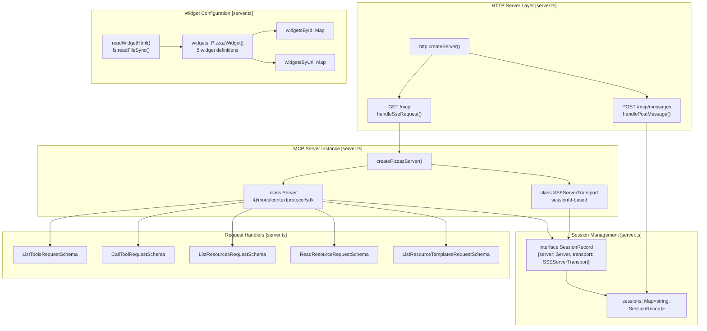
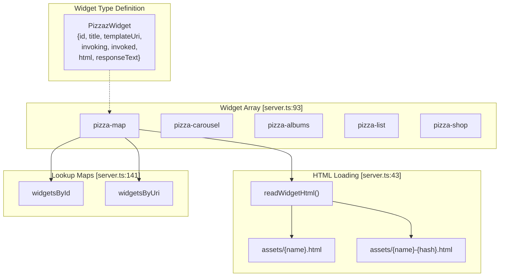
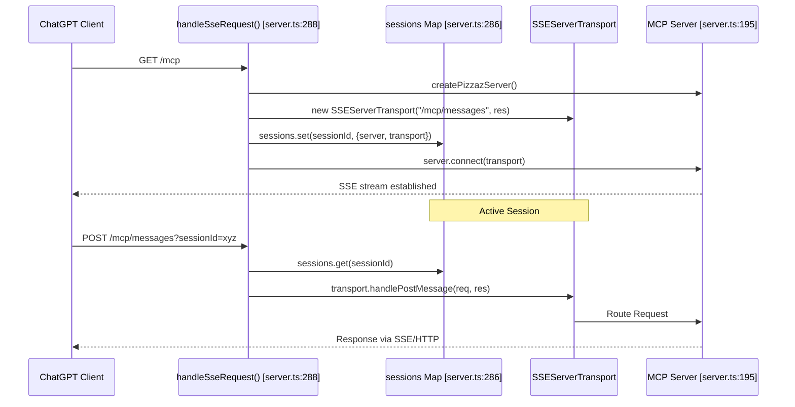
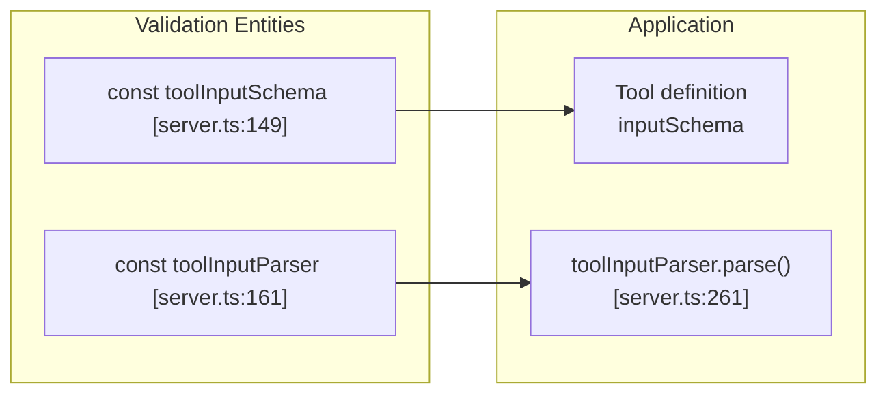

<!-- source: DeepWiki mcp.deepwiki.com · repo openai/openai-apps-sdk-examples · extra page Pizzaz Node Server · fetched 2026-10-26 -->

# Pizzaz Node Server

Relevant source files

The following files were used as context for generating this wiki page:

- [LICENSE](LICENSE)
- [pizzaz_server_node/README.md](pizzaz_server_node/README.md)
- [pizzaz_server_node/package.json](pizzaz_server_node/package.json)
- [pizzaz_server_node/src/server.ts](pizzaz_server_node/src/server.ts)
- [pizzaz_server_node/tsconfig.json](pizzaz_server_node/tsconfig.json)
- [pizzaz_server_python/README.md](pizzaz_server_python/README.md)

The Pizzaz Node Server is a reference implementation of an MCP server using the official `@modelcontextprotocol/sdk` package in Node.js. It exposes five pizza-themed widget tools (map, carousel, albums, list, shop) through the Model Context Protocol, demonstrating session management with SSE transport, widget HTML serving via MCP resources, and tool execution patterns. [pizzaz_server_node/src/server.ts:1-26](), [pizzaz_server_node/README.md:1-4]()

For the Python implementation of the same functionality, see [Pizzaz Python Server](#5.1.1). For general Node.js server patterns, see [Node.js Server Architecture Patterns](#5.2.4).

## Server Architecture

The Pizzaz Node server implements a stateful, multi-session architecture where each ChatGPT connection establishes its own MCP server instance with dedicated SSE transport. The server exposes two HTTP endpoints: one for SSE stream initialization and one for receiving client messages. [pizzaz_server_node/src/server.ts:281-348]()

### System to Code Mapping
The following diagram maps high-level system components to specific code entities and files.

**Sources:** [pizzaz_server_node/src/server.ts:1-401]()

## Server Initialization

The server creates a Node.js HTTP server listening on port 8000 (configurable via `PORT` environment variable). [pizzaz_server_node/src/server.ts:350-400]() The `createPizzazServer()` function instantiates a new `Server` instance from the MCP SDK with server metadata and capability declarations. [pizzaz_server_node/src/server.ts:195-207]()

The server initialization happens on-demand for each SSE connection request, creating isolated server instances per session. Each server instance registers five request handlers for the MCP protocol operations. [pizzaz_server_node/src/server.ts:209-278]()

**Key Components:**
| Component | Type | Purpose |
|-----------|------|---------|
| `createPizzazServer()` | Function | Factory creating isolated MCP server instances [pizzaz_server_node/src/server.ts:195]() |
| `Server` | Class | MCP SDK server with request routing [pizzaz_server_node/src/server.ts:10]() |
| `port` | number | HTTP listening port from env or default 8000 [pizzaz_server_node/src/server.ts:350]() |
| `httpServer` | http.Server | Node.js HTTP server handling all requests [pizzaz_server_node/src/server.ts:352]() |

**Sources:** [pizzaz_server_node/src/server.ts:195-207](), [pizzaz_server_node/src/server.ts:350-400]()

## Widget Configuration

The server defines five `PizzazWidget` objects, each containing metadata for tool presentation, widget HTML content, and response text. [pizzaz_server_node/src/server.ts:29-37](), [pizzaz_server_node/src/server.ts:93-139]() Widget HTML is loaded once at module initialization via `readWidgetHtml()`, which searches the `assets/` directory for versioned or direct HTML files. [pizzaz_server_node/src/server.ts:43-75]()

The `readWidgetHtml()` function implements a fallback strategy: it first checks for a direct match (e.g., `pizzaz.html`), then searches for versioned files (e.g., `pizzaz-a1b2c3.html`) and selects the lexicographically last one. [pizzaz_server_node/src/server.ts:50-66]()

**Sources:** [pizzaz_server_node/src/server.ts:29-75](), [pizzaz_server_node/src/server.ts:93-147]()

## MCP Tool Implementation

The server exposes five tools corresponding to the five widgets. Each tool uses the same input schema (`pizzaTopping: string`) and returns structured content with widget metadata. [pizzaz_server_node/src/server.ts:149-177]()

**Tool Execution Flow:**
1. Request arrives via `CallToolRequestSchema`. [pizzaz_server_node/src/server.ts:253]()
2. Look up widget by `request.params.name` in `widgetsById`. [pizzaz_server_node/src/server.ts:255]()
3. Parse arguments with `toolInputParser` (Zod schema). [pizzaz_server_node/src/server.ts:261]()
4. Return response with `content` (text), `structuredContent` (data), and `_meta` (widget metadata). [pizzaz_server_node/src/server.ts:263-274]()

**Tool Annotations:**
All tools are marked with `readOnlyHint: true`, `destructiveHint: false`, and `openWorldHint: false` to prevent approval prompts in ChatGPT. [pizzaz_server_node/src/server.ts:172-176]()

**Sources:** [pizzaz_server_node/src/server.ts:149-177](), [pizzaz_server_node/src/server.ts:252-276]()

## MCP Resource Implementation

Resources expose the widget HTML as downloadable content through the MCP protocol. [pizzaz_server_node/src/server.ts:179-193]()

| Handler | Schema | Purpose | Response |
|---------|--------|---------|----------|
| List Resources | `ListResourcesRequestSchema` | Return all available resources | `{ resources: Resource[] }` [pizzaz_server_node/src/server.ts:209-214]() |
| Read Resource | `ReadResourceRequestSchema` | Return HTML content for URI | `{ contents: [{ text: html }] }` [pizzaz_server_node/src/server.ts:217-236]() |
| List Templates | `ListResourceTemplatesRequestSchema` | Return resource templates | `{ resourceTemplates: ResourceTemplate[] }` [pizzaz_server_node/src/server.ts:238-243]() |

**Sources:** [pizzaz_server_node/src/server.ts:179-243]()

## Session Management and SSE Transport

The server maintains a `sessions` map keyed by session ID, where each session contains an MCP `Server` instance and its corresponding `SSEServerTransport`. [pizzaz_server_node/src/server.ts:281-286]()

**Sources:** [pizzaz_server_node/src/server.ts:281-348]()

## Metadata Generation

The server uses two metadata helper functions to generate OpenAI-specific metadata: `widgetDescriptorMeta()` for tool/resource definitions, and `widgetInvocationMeta()` for tool execution responses. [pizzaz_server_node/src/server.ts:77-91]()

| Field | Purpose |
|-------|---------|
| `openai/outputTemplate` | URI to widget HTML for rendering. [pizzaz_server_node/src/server.ts:79]() |
| `openai/toolInvocation/invoking` | Present tense action text ("Hand-tossing a map"). [pizzaz_server_node/src/server.ts:80]() |
| `openai/toolInvocation/invoked` | Past tense completion text ("Served a fresh map"). [pizzaz_server_node/src/server.ts:81]() |
| `openai/widgetAccessible` | Marks widget as accessible to Apps SDK. [pizzaz_server_node/src/server.ts:82]() |

**Sources:** [pizzaz_server_node/src/server.ts:77-91]()

## Input Validation

Tool arguments are validated using Zod schemas. The server defines both a JSON Schema for MCP tool description and a corresponding Zod schema for runtime validation. [pizzaz_server_node/src/server.ts:149-163]()

**Sources:** [pizzaz_server_node/src/server.ts:149-163](), [pizzaz_server_node/src/server.ts:261-261]()

---

