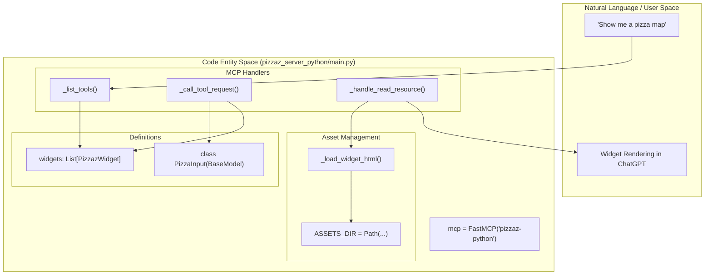
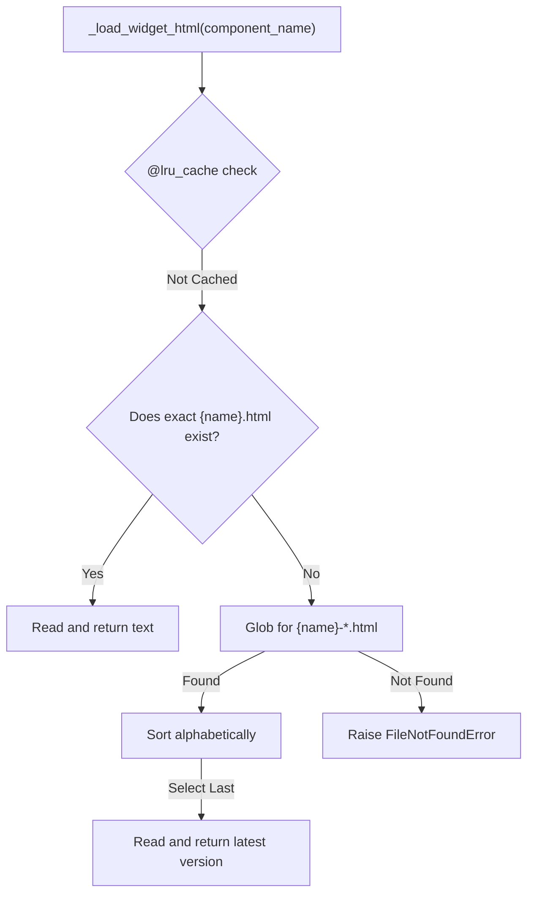

<!-- source: DeepWiki mcp.deepwiki.com · repo openai/openai-apps-sdk-examples · extra page Pizzaz Python Server · fetched 2026-10-26 -->

# Pizzaz Python Server

Relevant source files

The following files were used as context for generating this wiki page:

- [pizzaz_server_python/main.py](pizzaz_server_python/main.py)
- [pizzaz_server_python/requirements.txt](pizzaz_server_python/requirements.txt)
- [solar-system_server_python/requirements.txt](solar-system_server_python/requirements.txt)
- [src/pizzaz-albums/albums.json](src/pizzaz-albums/albums.json)
- [tsconfig.app.json](tsconfig.app.json)
- [tsconfig.node.json](tsconfig.node.json)

## Purpose and Scope

This document describes the Python implementation of the Pizzaz MCP server, located in `pizzaz_server_python/main.py` [pizzaz_server_python/main.py:1-8](). This server serves as a reference implementation demonstrating how to expose widget-backed tools using the `FastMCP` library [pizzaz_server_python/main.py:145-149](). It showcases five widget variants—map, carousel, albums, list, and shop—and implements the complete Model Context Protocol (MCP) for tools, resources, and widget rendering [pizzaz_server_python/main.py:55-101]().

The server handles loading widget HTML from disk, defining tool schemas, and generating the necessary metadata for ChatGPT to render the Apps SDK widgets [pizzaz_server_python/main.py:169-175]().

**Sources:** [pizzaz_server_python/main.py:1-101](), [pizzaz_server_python/main.py:145-149](), [pizzaz_server_python/main.py:169-175]()

---

## Server Architecture

The Pizzaz Python server implements a stateless MCP server with HTTP/SSE transport. It uses the `FastMCP` library to coordinate tool definitions and resource serving.

### Code-to-System Mapping
The following diagram maps internal code entities to their roles in the MCP ecosystem.

**Sources:** [pizzaz_server_python/main.py:25-36](), [pizzaz_server_python/main.py:39-40](), [pizzaz_server_python/main.py:115](), [pizzaz_server_python/main.py:145](), [pizzaz_server_python/main.py:185](), [pizzaz_server_python/main.py:234](), [pizzaz_server_python/main.py:257]()

---

## Widget and Tool Definitions

The server defines five widget variants using the `PizzazWidget` dataclass [pizzaz_server_python/main.py:25-34](). These definitions populate both the tools and resources advertised to the client.

### PizzazWidget Dataclass
| Field | Type | Purpose |
|-------|------|---------|
| `identifier` | `str` | The tool name (e.g., `pizza-map`) [pizzaz_server_python/main.py:57]() |
| `title` | `str` | Human-readable title for the tool/resource [pizzaz_server_python/main.py:58]() |
| `template_uri` | `str` | URI for resource lookup (e.g., `ui://widget/pizza-map.html`) [pizzaz_server_python/main.py:59]() |
| `html` | `str` | The actual HTML content loaded from assets [pizzaz_server_python/main.py:62]() |
| `response_text` | `str` | Text description returned in the tool response [pizzaz_server_python/main.py:63]() |

### Tool Metadata and Output Templates
A critical part of the widget integration is the `_meta` field returned during tool listing and tool calls. The `_tool_meta` function generates these required keys [pizzaz_server_python/main.py:169-175]():

- `openai/outputTemplate`: Points to the `template_uri` [pizzaz_server_python/main.py:171]().
- `openai/widgetAccessible`: Set to `True` to signal widget support [pizzaz_server_python/main.py:174]().
- `openai/toolInvocation/invoking`: Custom text shown during tool execution [pizzaz_server_python/main.py:172]().

**Sources:** [pizzaz_server_python/main.py:25-34](), [pizzaz_server_python/main.py:57-63](), [pizzaz_server_python/main.py:169-175]()

---

## HTML Loading and Asset Resolution

The server must serve the compiled HTML files generated by the frontend build process. These files are located in the `assets/` directory [pizzaz_server_python/main.py:36]().

### The `_load_widget_html` Logic
The function `_load_widget_html` handles resolving filenames, supporting both static names and versioned hashes [pizzaz_server_python/main.py:39-52]().

The use of `@lru_cache(maxsize=None)` ensures that disk I/O only occurs once per widget during the server's lifecycle [pizzaz_server_python/main.py:39]().

**Sources:** [pizzaz_server_python/main.py:36-52]()

---

## Request Handling

The server implements two primary MCP handlers: `CallToolRequest` and `ReadResourceRequest`.

### Call Tool Implementation
When a tool like `pizza-map` is called, `_call_tool_request` processes the input [pizzaz_server_python/main.py:257-302]().

1.  **Validation**: It validates the input using the `PizzaInput` Pydantic model [pizzaz_server_python/main.py:270-271]().
2.  **Lookup**: It retrieves the corresponding `PizzazWidget` from `WIDGETS_BY_ID` [pizzaz_server_python/main.py:263-264]().
3.  **Response**: It returns a `CallToolResult` containing:
    - `content`: A text description [pizzaz_server_python/main.py:284-286]().
    - `structuredContent`: The raw data (e.g., `pizzaTopping`) used by the widget for hydration [pizzaz_server_python/main.py:287-289]().
    - `_meta`: Tool invocation status and template URI [pizzaz_server_python/main.py:290-293]().

### Read Resource Implementation
When the client needs to render the widget, it requests the URI defined in the tool's `outputTemplate`. The `_handle_read_resource` function resolves this [pizzaz_server_python/main.py:234-254]().

- It looks up the widget by URI in `WIDGETS_BY_URI` [pizzaz_server_python/main.py:239]().
- It returns a `TextResourceContents` object with the `mimeType` set to `text/html+skybridge` and the loaded `widget.html` [pizzaz_server_python/main.py:245-250]().

**Sources:** [pizzaz_server_python/main.py:234-254](), [pizzaz_server_python/main.py:257-302]()

---

## Transport and Security

The server is configured to run as a streamable HTTP application, typically hosted via `uvicorn` [pizzaz_server_python/main.py:310]().

### Security Settings
The `_transport_security_settings` function configures protection against DNS rebinding and restricts origins based on environment variables [pizzaz_server_python/main.py:133-142]().

- **Allowed Hosts**: Parsed from `MCP_ALLOWED_HOSTS` [pizzaz_server_python/main.py:134]().
- **Allowed Origins**: Parsed from `MCP_ALLOWED_ORIGINS` [pizzaz_server_python/main.py:135]().

### Middleware
The server applies `CORSMiddleware` to allow cross-origin requests from the ChatGPT client [pizzaz_server_python/main.py:312-322]().

| Middleware | Configuration | Purpose |
|------------|---------------|---------|
| `CORSMiddleware` | `allow_origins=["*"]` | Allows the Apps SDK host to communicate with the MCP server [pizzaz_server_python/main.py:315](). |
| `FastMCP` | `stateless_http=True` | Configures the server for standard HTTP/SSE transport rather than persistent stdio [pizzaz_server_python/main.py:147](). |

**Sources:** [pizzaz_server_python/main.py:133-142](), [pizzaz_server_python/main.py:147](), [pizzaz_server_python/main.py:310-322]()

---

