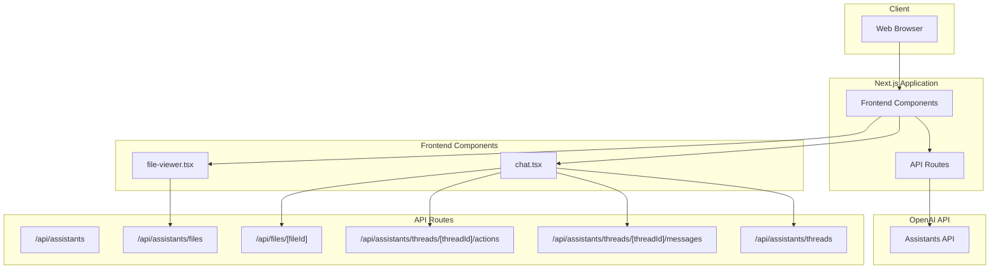
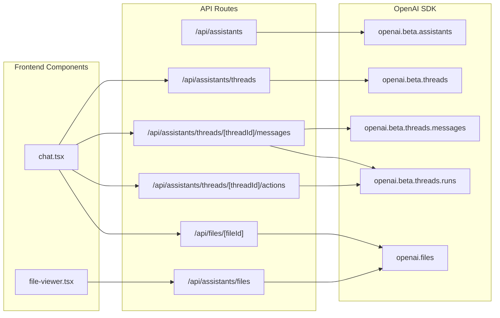
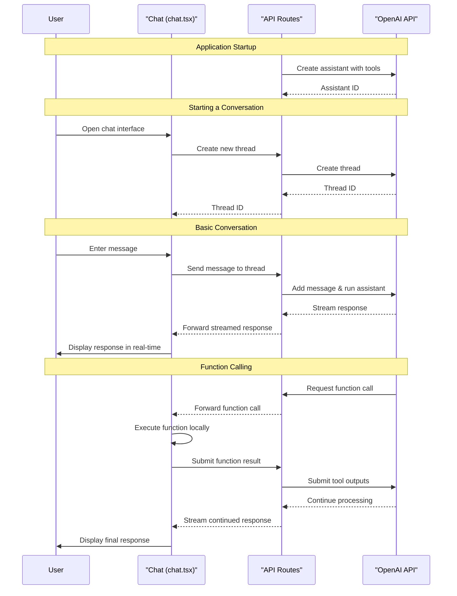

<!-- source: DeepWiki mcp.deepwiki.com · repo openai/openai-assistants-quickstart · page 1 Overview · fetched 2026-10-26 -->

# Overview

Relevant source files

The following files were used as context for generating this wiki page:

- [README.md](README.md)
- [package.json](package.json)

This document provides an introduction to the OpenAI Assistants Quickstart repository, which serves as a template for integrating the OpenAI Assistants API with Next.js applications.

## Purpose and Scope

The OpenAI Assistants Quickstart demonstrates how to implement a complete chat interface with advanced assistant capabilities including:

- Real-time streaming of assistant responses
- Tool usage (code interpreter and file search)
- Function calling capabilities
- File management for assistant interactions

This template provides both standalone examples of each feature and a comprehensive implementation combining all capabilities. The system uses the same underlying assistant configuration across all examples.

For detailed information about the system architecture, see [System Architecture](#2).

Sources: [README.md:45-49]()

## High-Level System Architecture

The following diagram illustrates the main components of the system and how they interact:

Sources: [README.md:45-49]()

## Core Components

### Frontend Components

1. **Chat Component** (`app/components/chat.tsx`): 
   - Renders the chat interface
   - Manages message state
   - Handles streaming of assistant responses
   - Processes function calls from the assistant
   - Renders different message types (text, code, images)

2. **File Viewer Component** (`app/components/file-viewer.tsx`): 
   - Handles file uploading for assistant usage
   - Lists available files
   - Manages file deletion
   - Integrates with file search capabilities

Sources: [README.md:59-62]()

### API Endpoints

The application provides several API endpoints that connect the frontend with the OpenAI Assistants API:

| Endpoint | Method | Purpose |
|----------|--------|---------|
| `/api/assistants` | POST | Create assistant with tools |
| `/api/assistants/threads` | POST | Create new conversation thread |
| `/api/assistants/threads/[threadId]/messages` | POST | Send message to assistant and receive streaming response |
| `/api/assistants/threads/[threadId]/actions` | POST | Submit function call results back to assistant |
| `/api/assistants/files` | GET/POST/DELETE | Manage files for file search |
| `/api/files/[fileId]` | GET | Download file content |

Sources: [README.md:63-70]()

## Data Flow

This sequence diagram illustrates the typical flow of a conversation with the assistant:

Sources: [README.md:45-49]()

## Feature Examples

The repository includes several example pages demonstrating different capabilities:

| Example | URL | Features |
|---------|-----|----------|
| Basic Chat | `/examples/basic-chat` | Simple text-based conversation |
| Function Calling | `/examples/function-calling` | Assistant calling client-side functions |
| File Search | `/examples/file-search` | File uploading and searching |
| Full-featured | `/examples/all` | All capabilities combined |

Sources: [README.md:51-56]()

## Technical Stack

| Component | Technology |
|-----------|------------|
| Frontend Framework | Next.js 14.1.4 |
| API Integration | OpenAI Node.js SDK v4.46.0 |
| UI Rendering | React 18 |
| Content Rendering | React Markdown 9.0.1 |

Sources: [package.json:11-16]()

## Main Logic Location

The core logic for the chat functionality is implemented in:
- `app/components/chat.tsx` - the frontend Chat component
- API handlers in the `api/assistants/threads/...` directory

These components handle the conversation flow, message rendering, streaming, function calls, and integration with the OpenAI Assistants API.

Sources: [README.md:47-49]()

## Getting Started

For detailed setup and development instructions, see [Development Guide](#6) and [Getting Started](#6.1).

To run the application locally:
1. Clone the repository
2. Set your OpenAI API key
3. Install dependencies with `npm install`
4. Start the development server with `npm run dev`
5. Navigate to http://localhost:3000

Sources: [README.md:8-37]()

---

