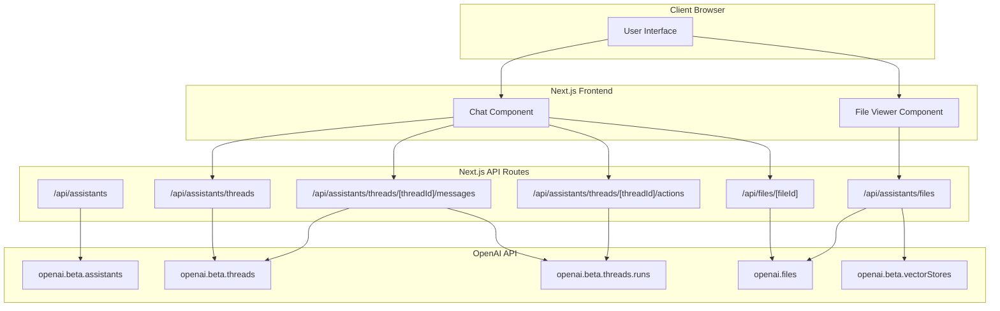
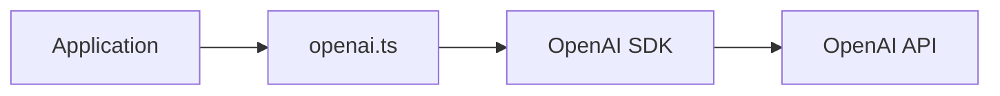
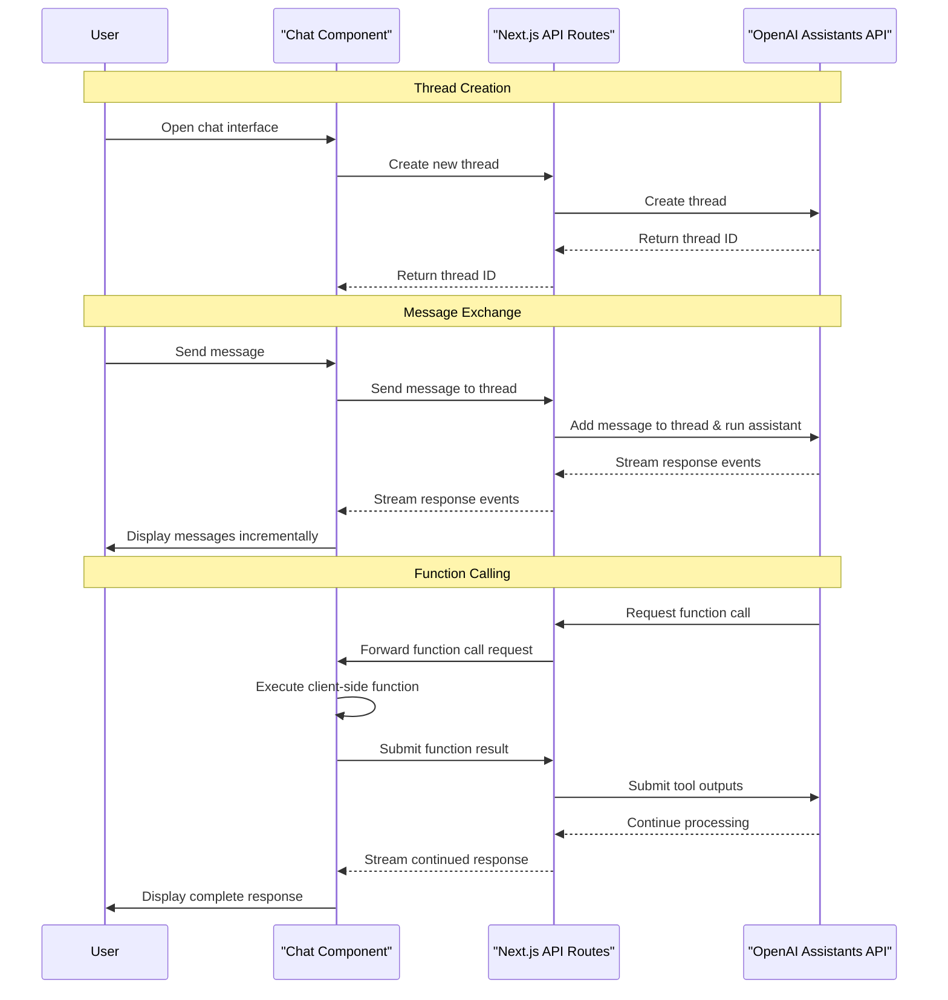
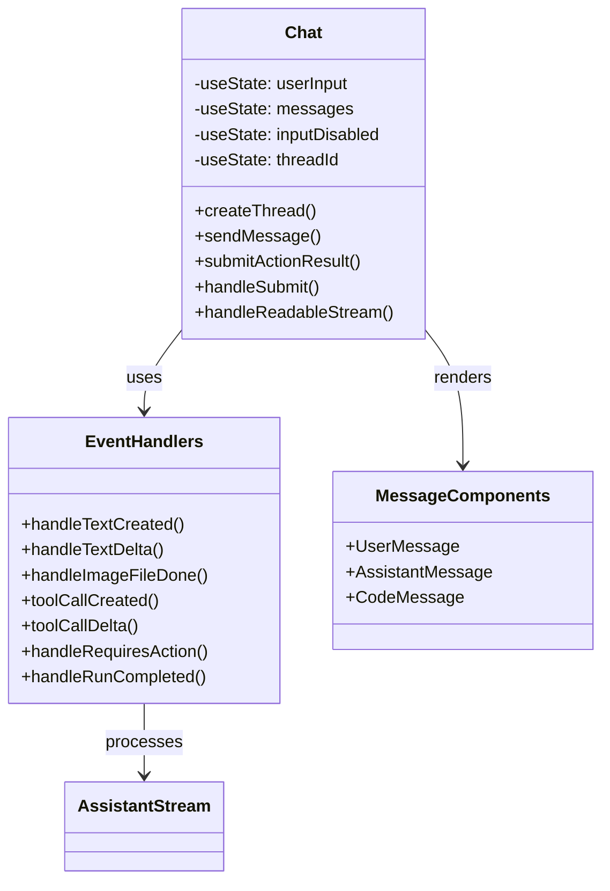
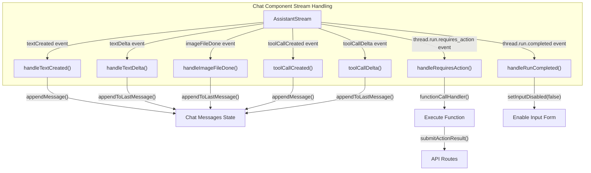
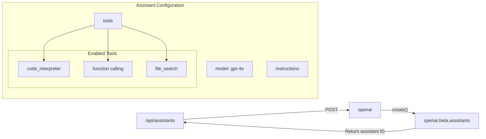

<!-- source: DeepWiki mcp.deepwiki.com · repo openai/openai-assistants-quickstart · page 2 System Architecture · fetched 2026-10-26 -->

# System Architecture

Relevant source files

The following files were used as context for generating this wiki page:

- [README.md](README.md)
- [app/api/assistants/route.ts](app/api/assistants/route.ts)
- [app/components/chat.tsx](app/components/chat.tsx)
- [app/openai.ts](app/openai.ts)

This document provides a comprehensive overview of the system architecture for the OpenAI Assistants Quickstart. It explains how the frontend components interact with Next.js API routes and how these routes communicate with the OpenAI Assistants API. For information about specific frontend components, see [Frontend Components](#3), and for detailed API endpoint documentation, see [API Endpoints](#4).

## Overview

The OpenAI Assistants Quickstart is a Next.js application that implements a chat interface using the OpenAI Assistants API. The architecture follows a client-server model with:

1. **Frontend Layer**: React components that provide the user interface
2. **API Layer**: Next.js API routes that serve as middleware between the frontend and OpenAI
3. **External Services**: The OpenAI Assistants API that powers the AI functionality

### System Components Diagram

Sources: [README.md:58-70](), [app/components/chat.tsx:77-87](), [app/components/chat.tsx:89-101](), [app/api/assistants/route.ts:5-38]()

## Core Components

### Frontend Components

The application has two main frontend components:

1. **Chat Component**: Manages the chat interface, including sending messages, receiving streaming responses, and handling function calls.
2. **File Viewer Component**: Handles file upload, listing, and deletion for the assistant.

### API Routes

The application uses several Next.js API routes to interface with OpenAI:

| API Route | Purpose |
|-----------|---------|
| `/api/assistants` | Creates the assistant with specified tools |
| `/api/assistants/threads` | Creates new conversation threads |
| `/api/assistants/threads/[threadId]/messages` | Sends messages and receives streaming responses |
| `/api/assistants/threads/[threadId]/actions` | Submits function call results back to the assistant |
| `/api/assistants/files` | Manages files for file search capability |
| `/api/files/[fileId]` | Downloads file content |

Sources: [README.md:63-70]()

### OpenAI Integration

The application initializes the OpenAI client simply:

Sources: [app/openai.ts:1-3]()

## Data Flow

The following diagram shows how data flows through the system during a typical user interaction:

Sources: [app/components/chat.tsx:77-87](), [app/components/chat.tsx:89-101](), [app/components/chat.tsx:103-119](), [app/components/chat.tsx:170-184]()

## Chat Component Architecture

The Chat component is the central piece of the frontend and handles all chat-related functionality:

Sources: [app/components/chat.tsx:11-52](), [app/components/chat.tsx:60-132](), [app/components/chat.tsx:134-208]()

### Message Flow in Chat Component

The Chat component processes messages and streaming responses through a series of steps:

1. **Thread Creation**: When a user first opens the chat, a new conversation thread is created via the `/api/assistants/threads` endpoint.
2. **Message Sending**: When a user sends a message, it's added to the thread via the `/api/assistants/threads/[threadId]/messages` endpoint.
3. **Stream Processing**: The response is streamed back from the OpenAI API and processed through various event handlers:
   - `textCreated`: Creates a new assistant message
   - `textDelta`: Appends text to the last message incrementally
   - `imageFileDone`: Shows generated images in the chat
   - `toolCallCreated`/`toolCallDelta`: Handles code interpreter input/output
   - `thread.run.requires_action`: Processes function calls
   - `thread.run.completed`: Re-enables the input form

Sources: [app/components/chat.tsx:134-208](), [app/components/chat.tsx:217-249]()

## Assistant Creation and Configuration

The assistant is created with specific tools enabled through the `/api/assistants` endpoint:

Sources: [app/api/assistants/route.ts:6-38]()

## Summary

The OpenAI Assistants Quickstart application follows a clean, modular architecture that separates concerns between frontend components and API routes. The frontend components provide the user interface for interacting with the assistant, while the API routes handle the communication with the OpenAI API.

Key architectural features include:

1. **Real-time streaming**: The Chat component processes streaming responses from the OpenAI API in real-time, providing an interactive chat experience.

2. **Function calling**: The application implements the ability for the assistant to call client-side functions and receive the results.

3. **File management**: The application supports uploading and managing files for use with the assistant's file search capability.

4. **Code interpretation**: The Chat component can display and process code outputs from the assistant's code interpreter.

This architecture provides a solid foundation for building AI assistant applications with Next.js and the OpenAI Assistants API.

Sources: [README.md:45-71](), [app/components/chat.tsx:1-282](), [app/api/assistants/route.ts:1-38](), [app/openai.ts:1-3]()

---

