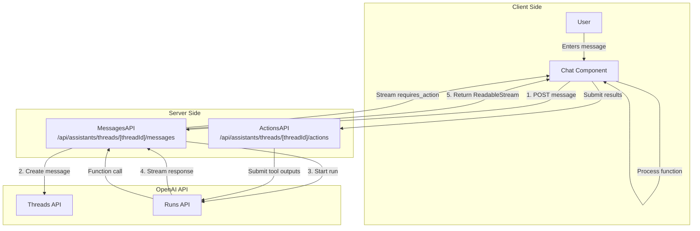
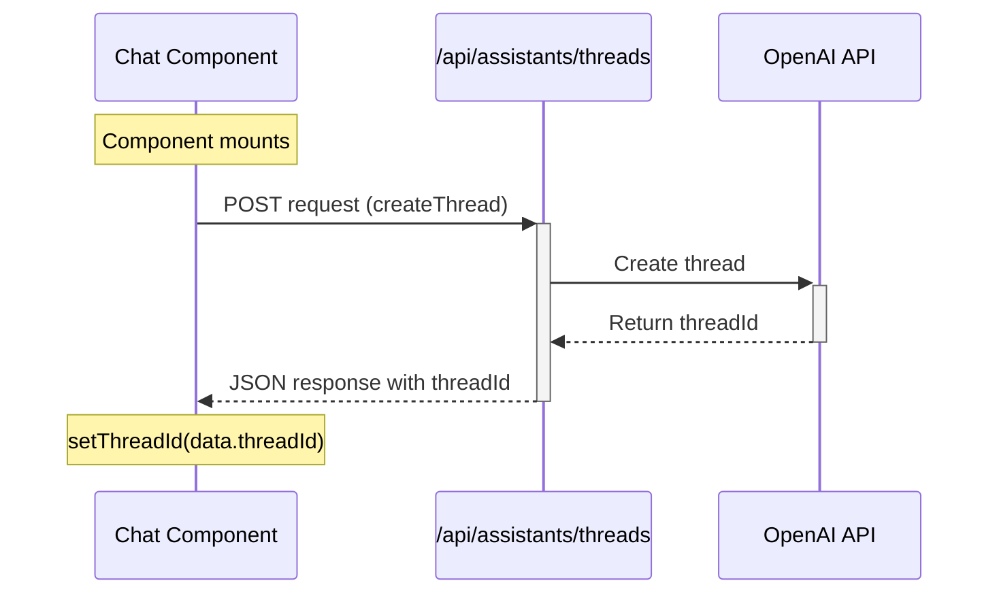
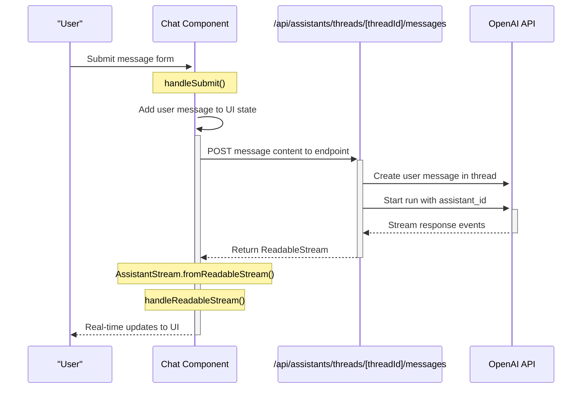
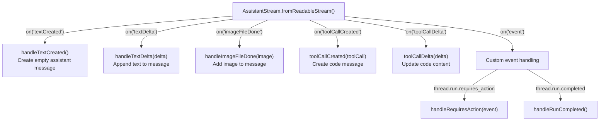
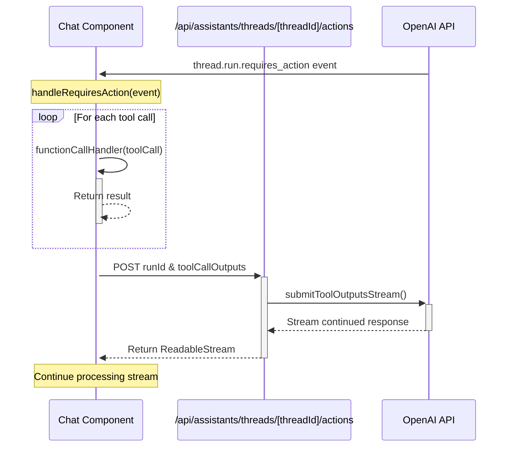
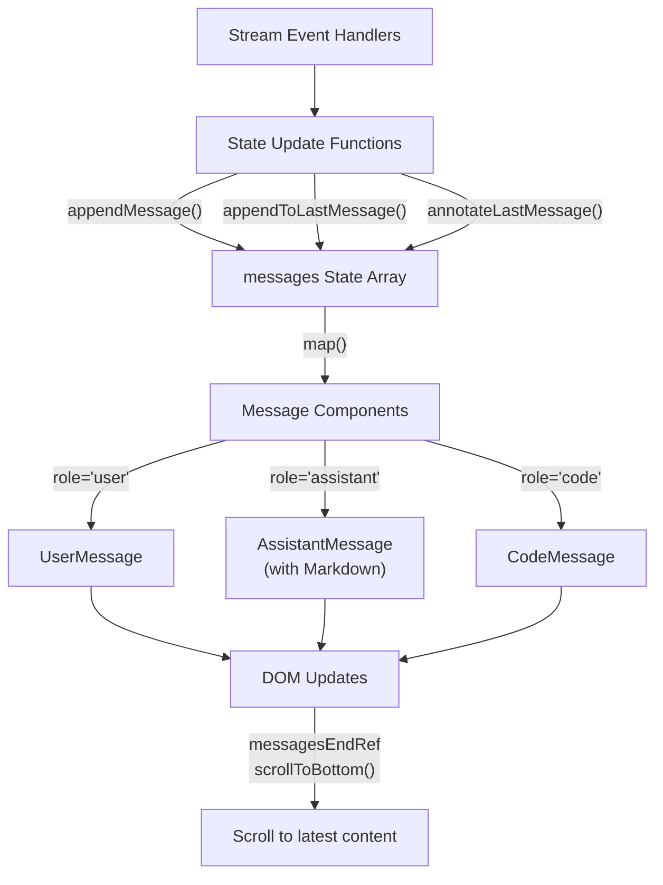
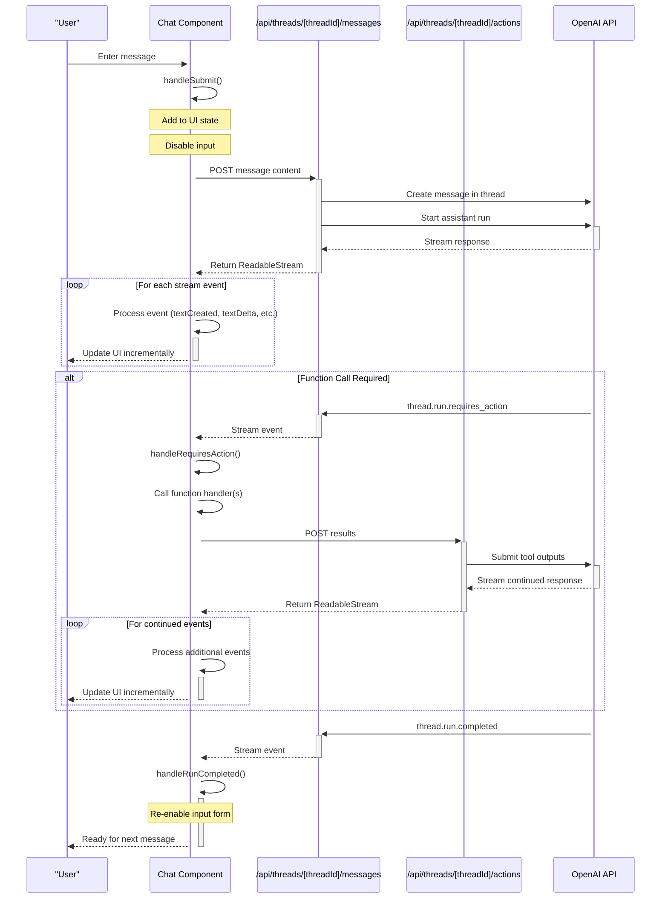

<!-- source: DeepWiki mcp.deepwiki.com · repo openai/openai-assistants-quickstart · page 2.1 Data Flow · fetched 2026-10-26 -->

# Data Flow

Relevant source files

The following files were used as context for generating this wiki page:

- [app/api/assistants/threads/[threadId]/actions/route.ts](app/api/assistants/threads/[threadId]/actions/route.ts)
- [app/api/assistants/threads/[threadId]/messages/route.ts](app/api/assistants/threads/[threadId]/messages/route.ts)
- [app/components/chat.tsx](app/components/chat.tsx)

This document details how data flows through the OpenAI Assistants Quickstart application, focusing on communication between frontend components, API routes, and the OpenAI Assistants API. Special attention is given to the streaming functionality that enables real-time assistant responses, and how function calling is handled through the system.

## Overview of Data Flow Architecture

This diagram illustrates the primary data flows in the application:

Sources: [app/components/chat.tsx:89-101](), [app/api/assistants/threads/[threadId]/messages/route.ts:7-20](), [app/api/assistants/threads/[threadId]/actions/route.ts:4-15]()

## Thread Initialization

When a user first opens the chat interface, a new conversation thread is created:

Sources: [app/components/chat.tsx:78-87]()

## Message Sending Flow

When a user sends a message, the following data flow occurs:

Sources: [app/components/chat.tsx:89-101](), [app/components/chat.tsx:121-132](), [app/api/assistants/threads/[threadId]/messages/route.ts:7-20]()

## Streaming Response Handling

A key feature of the application is its real-time streaming response handling:

Sources: [app/components/chat.tsx:191-209](), [app/components/chat.tsx:135-190]()

The stream event handlers implement a sophisticated system for processing different types of events from the assistant:

| Event | Handler | Purpose |
|-------|---------|---------|
| `textCreated` | `handleTextCreated()` | Initializes an empty assistant message in the UI |
| `textDelta` | `handleTextDelta(delta)` | Appends incoming text chunks to the last message |
| `imageFileDone` | `handleImageFileDone(image)` | Adds an image reference to the message |
| `toolCallCreated` | `toolCallCreated(toolCall)` | Creates a new code message container |
| `toolCallDelta` | `toolCallDelta(delta, snapshot)` | Updates code content incrementally |
| `thread.run.requires_action` | `handleRequiresAction(event)` | Handles function calls |
| `thread.run.completed` | `handleRunCompleted()` | Re-enables the input form |

Sources: [app/components/chat.tsx:135-190]()

## Function Calling Flow

When the assistant needs to call a function, a specialized data flow is triggered:

Sources: [app/components/chat.tsx:170-184](), [app/api/assistants/threads/[threadId]/actions/route.ts:4-15]()

## UI Update Flow

As stream events are processed, the UI is updated through a state management system:

Sources: [app/components/chat.tsx:11-52](), [app/components/chat.tsx:217-249](), [app/components/chat.tsx:251-258](), [app/components/chat.tsx:69-75]()

## Complete Message-to-Response Cycle

This comprehensive diagram illustrates the entire data flow from user input to completed assistant response:

Sources: [app/components/chat.tsx:60-279](), [app/api/assistants/threads/[threadId]/messages/route.ts:7-20](), [app/api/assistants/threads/[threadId]/actions/route.ts:4-15]()

## Data Types and Transformations

The application transforms data between different formats as it flows through the system:

| Location | Input Data | Transformation | Output Data |
|----------|------------|----------------|------------|
| Frontend | User text input | `handleSubmit()` | UI state update + API request |
| API Route | Message content JSON | OpenAI API calls | ReadableStream |
| Frontend | ReadableStream | `AssistantStream.fromReadableStream()` | Event stream |
| Frontend | Event stream | Event handlers | UI state updates |
| Frontend | Tool call events | `functionCallHandler()` | Function results |
| API Route | Tool outputs JSON | `submitToolOutputsStream()` | ReadableStream |
| Frontend | Message state array | React rendering | DOM elements |

Sources: [app/components/chat.tsx:89-119](), [app/api/assistants/threads/[threadId]/messages/route.ts:7-20](), [app/api/assistants/threads/[threadId]/actions/route.ts:4-15]()

---

