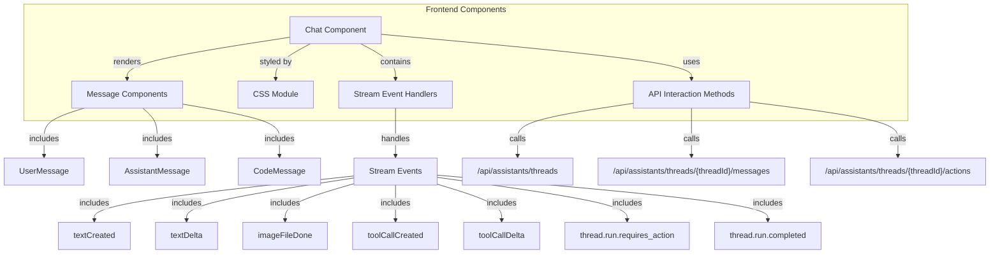
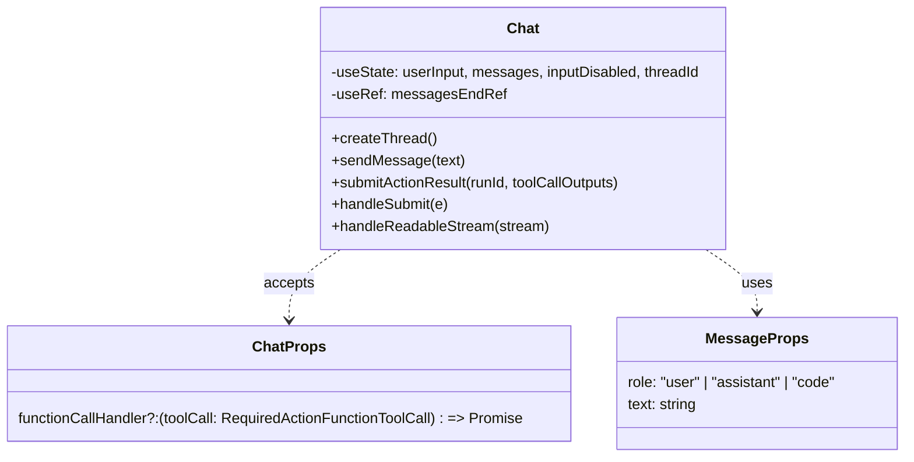
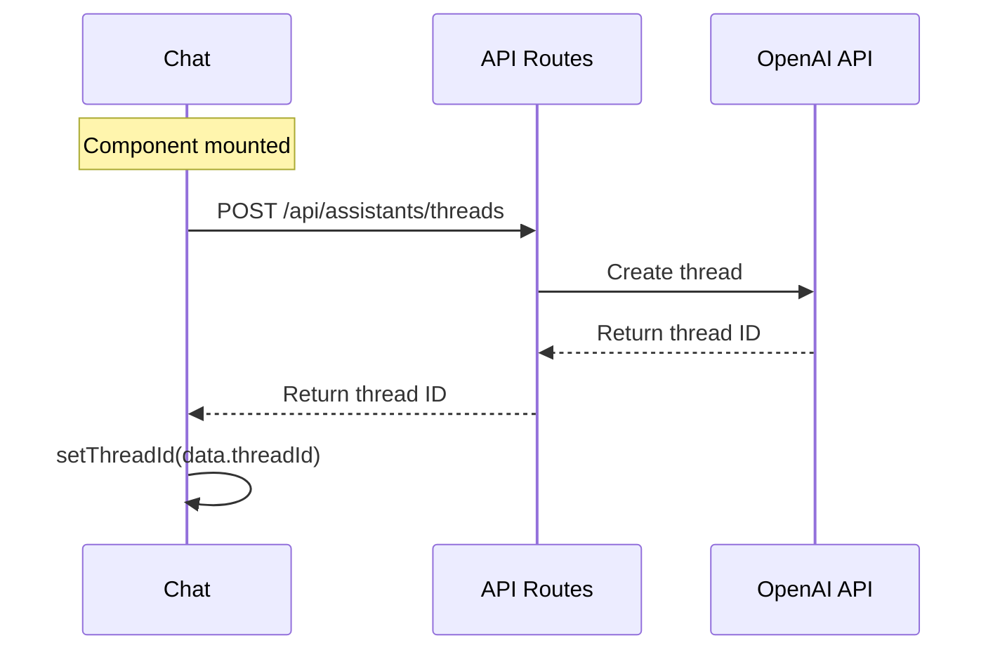
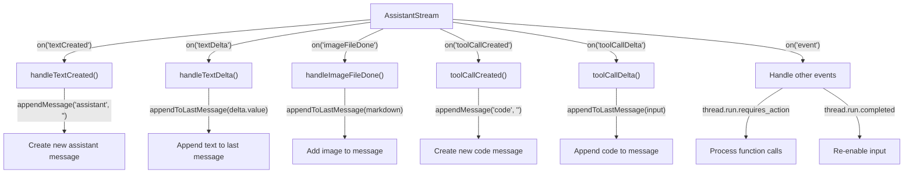
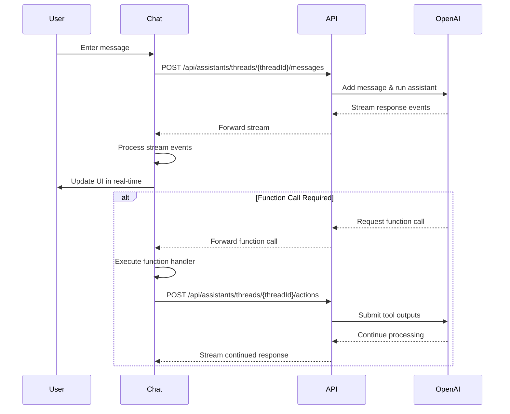
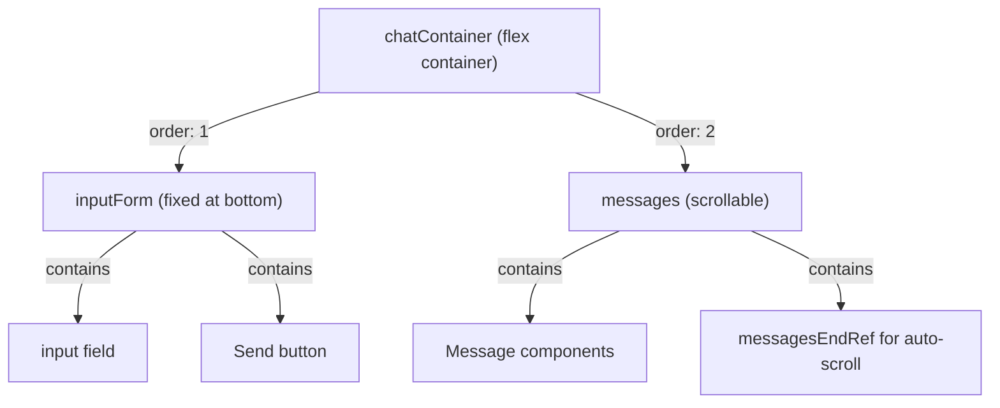
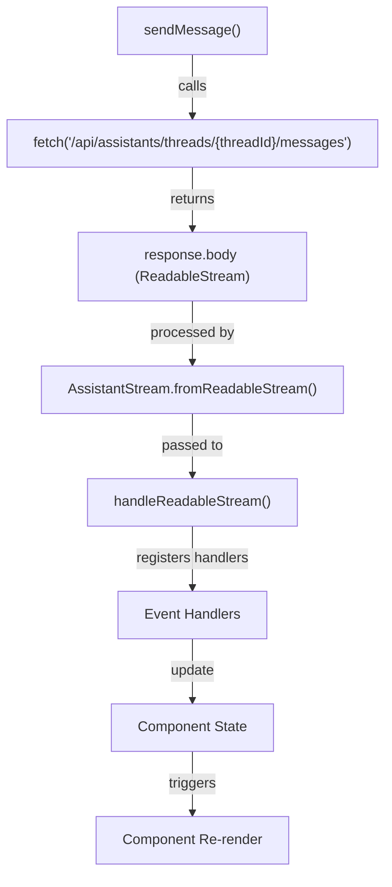

<!-- source: DeepWiki mcp.deepwiki.com · repo openai/openai-assistants-quickstart · page 3 Frontend Components · fetched 2026-10-26 -->

# Frontend Components

<details>
<summary>Relevant source files</summary>

The following files were used as context for generating this wiki page:

- [app/components/chat.module.css](app/components/chat.module.css)
- [app/components/chat.tsx](app/components/chat.tsx)

</details>


This document provides an overview of the frontend components in the OpenAI Assistants Quickstart application. It focuses on the structure, functionality, and relationships between the UI components that enable users to interact with the OpenAI Assistants API. For information about API endpoints that these components interact with, see [API Endpoints](#4).

## Component Architecture Overview

The frontend of the application consists primarily of a Chat component that manages user interactions, message rendering, and communication with the backend API routes. The following diagram illustrates the core frontend components and their relationships:



Sources: [app/components/chat.tsx:1-282]()

## Chat Component

The Chat component is the central UI element of the application, responsible for:
- Managing user input and message history
- Rendering messages of different types (user, assistant, code)
- Creating conversation threads
- Sending user messages to the assistant
- Processing streaming responses
- Handling function calls

### Structure and Props

The Chat component accepts a `functionCallHandler` prop that allows it to process function calls requested by the assistant.



Sources: [app/components/chat.tsx:54-62](), [app/components/chat.tsx:11-14]()

### State Management

The Chat component manages several pieces of state:

| State Variable | Type | Purpose |
|----------------|------|---------|
| `userInput` | string | Stores the current text in the input field |
| `messages` | array | Stores the conversation history |
| `inputDisabled` | boolean | Controls whether the input field is enabled |
| `threadId` | string | Stores the ID of the current conversation thread |

Sources: [app/components/chat.tsx:63-66]()

### Lifecycle and Initialization

On component mount, the Chat component creates a new thread via the API:



Sources: [app/components/chat.tsx:77-87]()

### Message Rendering

The Chat component renders three types of messages:

1. **UserMessage**: Displays user inputs in a distinctive style
2. **AssistantMessage**: Renders assistant responses with Markdown support
3. **CodeMessage**: Formats code with line numbers

```mermaid
graph TD
    Message["Message Component"]
    Message -->|role="user"| UserMessage
    Message -->|role="assistant"| AssistantMessage
    Message -->|role="code"| CodeMessage
    
    UserMessage -->|renders| UserText["Simple text display"]
    AssistantMessage -->|renders| MarkdownText["Markdown with image support"]
    CodeMessage -->|renders| CodeWithLineNumbers["Code with line numbers"]
```

Sources: [app/components/chat.tsx:16-52]()

Each message type has distinct styling defined in the CSS module:

| Message Type | CSS Class | Visual Characteristics |
|--------------|-----------|------------------------|
| UserMessage | `.userMessage` | Right-aligned, dark background, white text |
| AssistantMessage | `.assistantMessage` | Left-aligned, light gray background, supports images |
| CodeMessage | `.codeMessage` | Monospace font, line numbers, light background |

Sources: [app/components/chat.module.css:55-96]()

### Stream Event Handling

A key feature of the Chat component is its ability to process streaming events from the OpenAI API, providing real-time updates to the UI:



Sources: [app/components/chat.tsx:135-208]()

### API Interactions

The Chat component interacts with the backend API routes in three main ways:

1. **Thread Creation**: Creates a new conversation thread when the component is mounted
2. **Message Sending**: Sends user messages to the thread and initiates assistant responses
3. **Action Submission**: Submits the results of function calls back to the assistant



Sources: [app/components/chat.tsx:89-119]()

## User Interface Elements

The Chat component includes a simple but effective user interface with:

1. A scrollable message container
2. A fixed input form with text input and send button
3. Auto-scrolling functionality to keep the latest messages visible

The UI layout is structured as a flex container with reverse column direction, placing the input at the bottom and messages above:



Sources: [app/components/chat.module.css:1-53](), [app/components/chat.tsx:251-279]()

## Utility Functions

The Chat component includes several utility functions for managing the message display:

| Function | Purpose |
|----------|---------|
| `appendToLastMessage(text)` | Adds text to the most recent message |
| `appendMessage(role, text)` | Creates a new message with the specified role and text |
| `annotateLastMessage(annotations)` | Processes file references in messages |
| `scrollToBottom()` | Scrolls the view to show the latest messages |

Sources: [app/components/chat.tsx:211-249](), [app/components/chat.tsx:69-75]()

## Integration with OpenAI Stream API

The Chat component integrates with the OpenAI Assistant Stream API using the `AssistantStream` class to process streaming events:



Sources: [app/components/chat.tsx:89-101](), [app/components/chat.tsx:191-208]()

Through this architecture and integration, the Frontend Components efficiently handle the presentation and user interaction aspects of the OpenAI Assistants API, providing a responsive and interactive chat experience.

---

