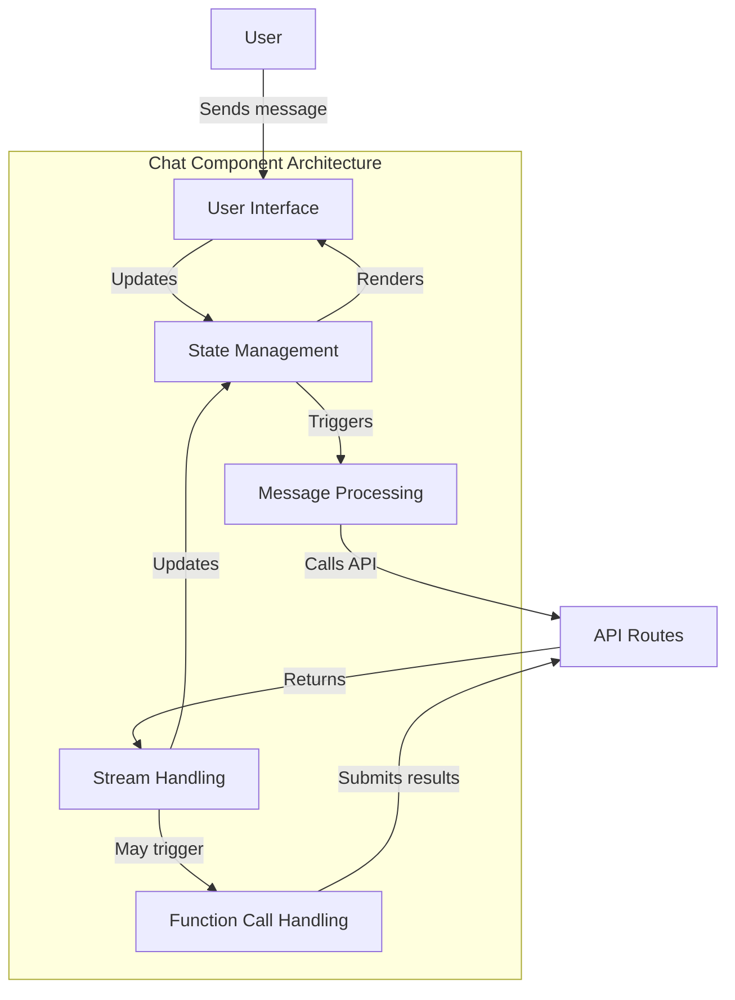
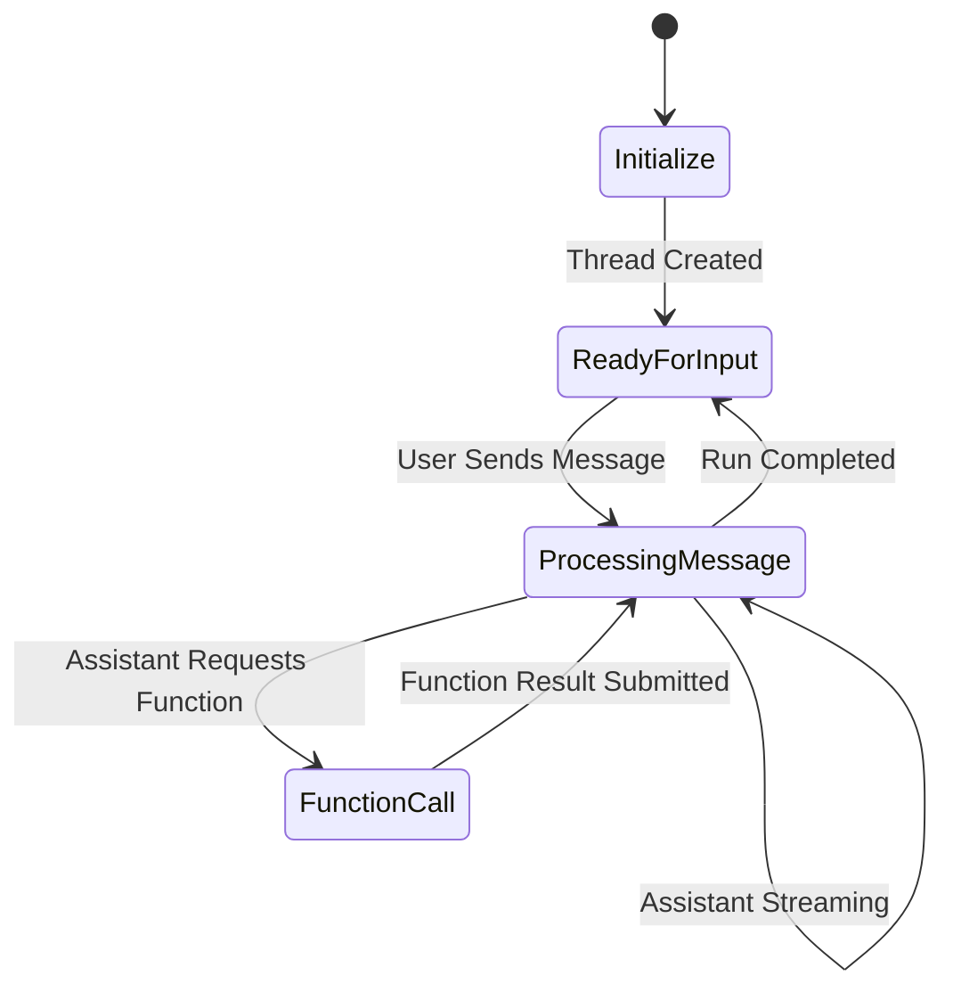
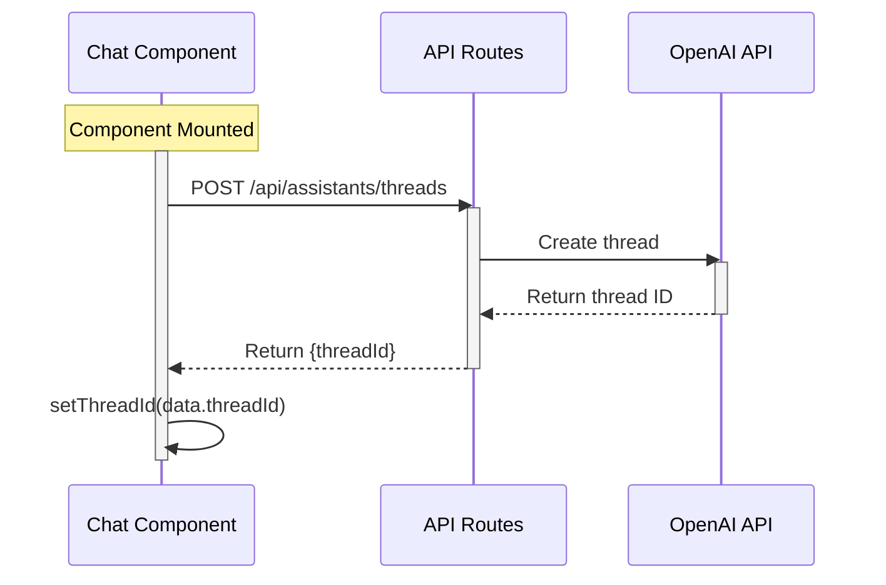
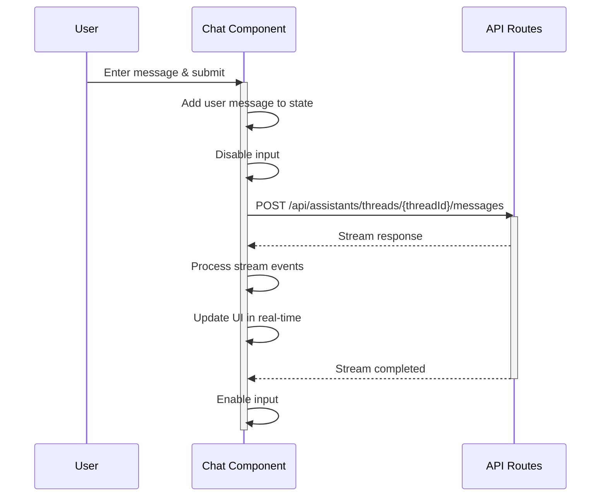
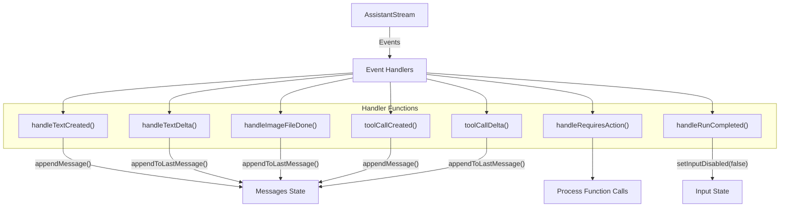
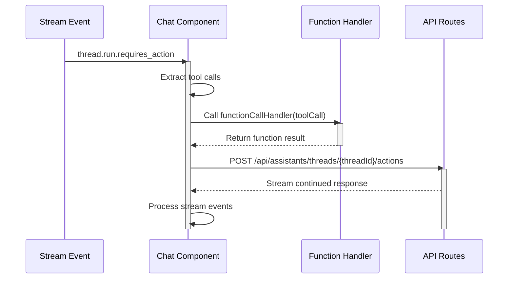
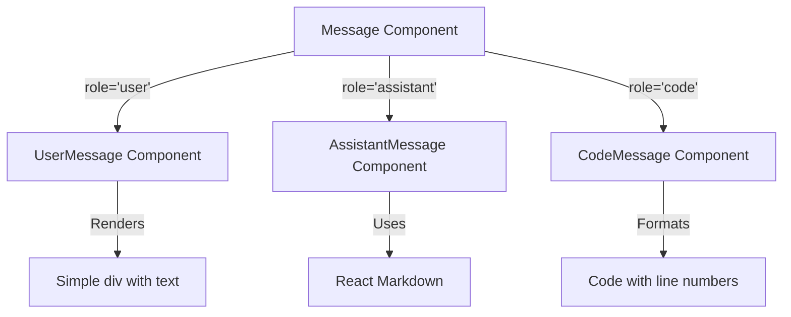
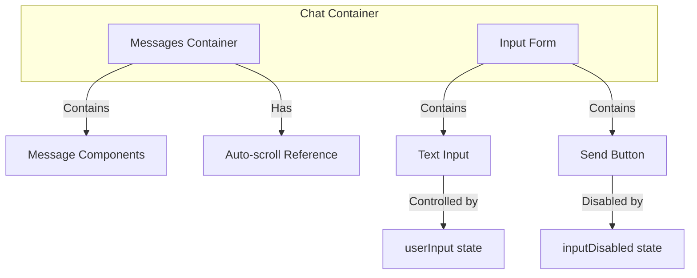

<!-- source: DeepWiki mcp.deepwiki.com · repo openai/openai-assistants-quickstart · page 3.1 Chat Component · fetched 2026-10-26 -->

# Chat Component

<details>
<summary>Relevant source files</summary>

The following files were used as context for generating this wiki page:

- [app/components/chat.tsx](app/components/chat.tsx)

</details>


The Chat Component is the primary user interface element in the OpenAI Assistants Quickstart application, responsible for managing the conversation between the user and an AI assistant. It handles message rendering, user input, streaming responses, and function calling capabilities.

For information about message styling and rendering details, see [Message Rendering](#3.2).

## Overview and Purpose

The Chat Component provides a complete chat interface that:

- Creates and manages conversation threads with the OpenAI Assistants API
- Renders messages from both the user and assistant
- Processes streaming responses for real-time interaction
- Handles rich content including markdown, code blocks, and images
- Supports function calling (tool use) with custom handlers



Sources: [app/components/chat.tsx:60-280]()

## Component Interface

The Chat Component accepts a single optional prop:

```typescript
type ChatProps = {
  functionCallHandler?: (toolCall: RequiredActionFunctionToolCall) => Promise<string>;
};
```

This allows parent components to provide a custom handler for function calls made by the assistant.

Sources: [app/components/chat.tsx:54-58]()

## State Management

The component manages several pieces of state:

| State Variable | Type | Purpose |
|----------------|------|---------|
| `userInput` | string | Stores the current text in the input field |
| `messages` | array | Stores all messages in the conversation |
| `inputDisabled` | boolean | Controls whether the input form is enabled |
| `threadId` | string | Stores the ID of the current conversation thread |



Sources: [app/components/chat.tsx:63-66](), [app/components/chat.tsx:188-189]()

## Thread Initialization

When the component mounts, it automatically creates a new conversation thread:



Sources: [app/components/chat.tsx:78-87]()

## Message Handling Flow

When a user submits a message, the component:

1. Adds the message to local state
2. Sends the message to the API
3. Sets the input field as disabled
4. Processes the streaming response



Sources: [app/components/chat.tsx:89-101](), [app/components/chat.tsx:121-132]()

## Stream Event Processing

The component processes streaming responses from the OpenAI API using various event handlers:

| Event | Handler | Purpose |
|-------|---------|---------|
| `textCreated` | `handleTextCreated` | Creates a new empty assistant message |
| `textDelta` | `handleTextDelta` | Appends incoming text to the last assistant message |
| `imageFileDone` | `handleImageFileDone` | Adds an image reference to the message |
| `toolCallCreated` | `toolCallCreated` | Creates a new code message for code interpreter output |
| `toolCallDelta` | `toolCallDelta` | Appends code to the last code message |
| `thread.run.requires_action` | `handleRequiresAction` | Processes function calls from the assistant |
| `thread.run.completed` | `handleRunCompleted` | Re-enables the input form |



Sources: [app/components/chat.tsx:136-209]()

## Function Call Handling

When the assistant requires a function call to be executed, the component:

1. Extracts the tool calls from the event
2. Calls the provided `functionCallHandler` for each tool call
3. Submits the results back to the API
4. Processes the continued response



Sources: [app/components/chat.tsx:170-184](), [app/components/chat.tsx:103-119]()

## Message Rendering

The Chat Component supports three types of messages:

1. **User Messages** - Plain text messages from the user
2. **Assistant Messages** - Markdown-formatted messages from the assistant
3. **Code Messages** - Code blocks with line numbers

Each message type has a dedicated rendering component:



Sources: [app/components/chat.tsx:11-52]()

## API Interaction

The Chat Component interacts with several API endpoints:

| Endpoint | Method | Purpose |
|----------|--------|---------|
| `/api/assistants/threads` | POST | Creates a new conversation thread |
| `/api/assistants/threads/${threadId}/messages` | POST | Sends user messages and receives responses |
| `/api/assistants/threads/${threadId}/actions` | POST | Submits function call results |
| `/api/files/${fileId}` | GET | Referenced in markdown to display files/images |

Sources: [app/components/chat.tsx:80-81](), [app/components/chat.tsx:90-98](), [app/components/chat.tsx:104-116](), [app/components/chat.tsx:153]()

## Utility Methods

The component includes several utility methods for managing messages:

| Method | Purpose |
|--------|---------|
| `appendMessage` | Adds a new message to the messages array |
| `appendToLastMessage` | Appends text to the most recent message |
| `annotateLastMessage` | Processes annotations in messages (such as file paths) |
| `scrollToBottom` | Automatically scrolls the chat window to show newest messages |

Sources: [app/components/chat.tsx:217-249](), [app/components/chat.tsx:70-75]()

## User Interface Structure

The UI consists of two main sections:

1. **Message List** - Area displaying all messages in the conversation
2. **Input Form** - Form with text input and submit button



Sources: [app/components/chat.tsx:251-279]()

---

