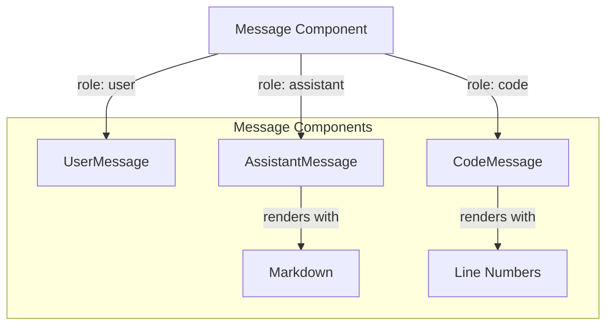
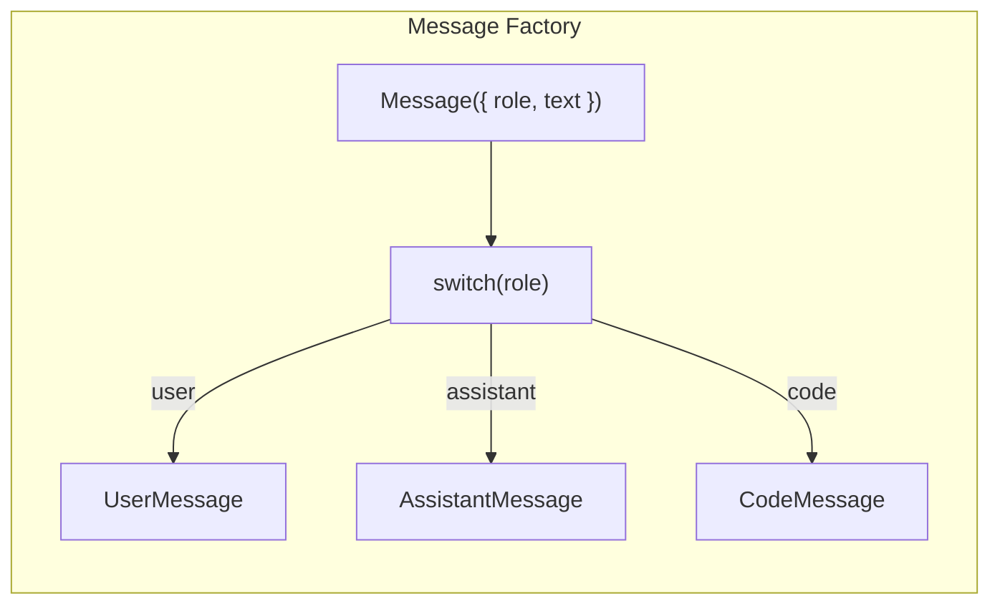
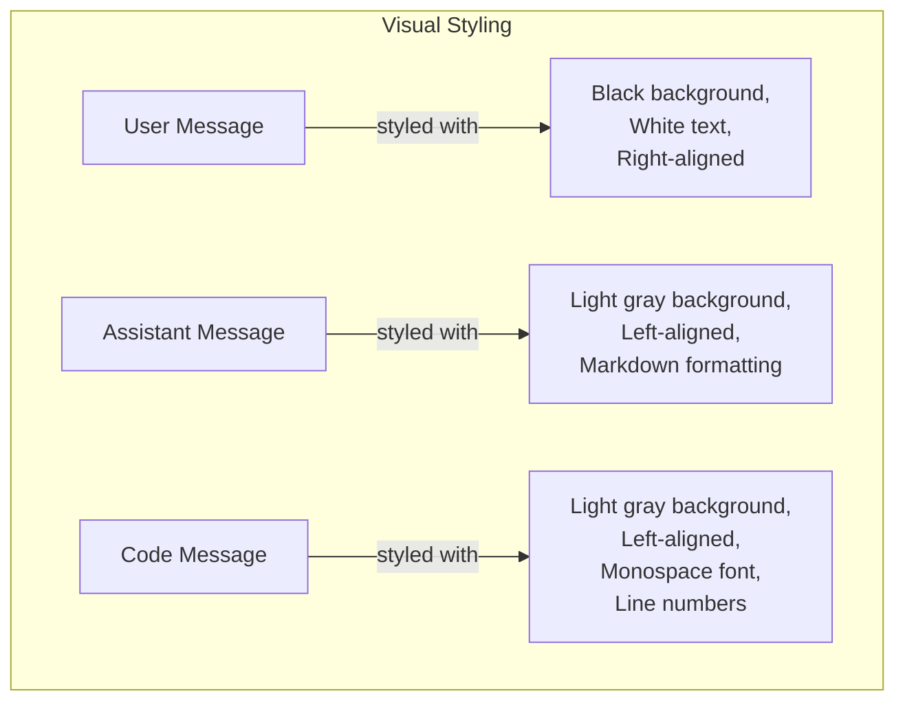
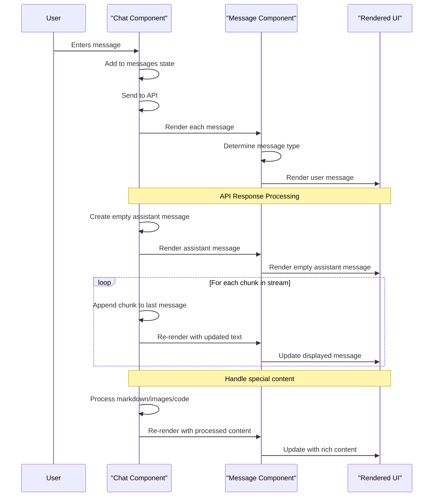
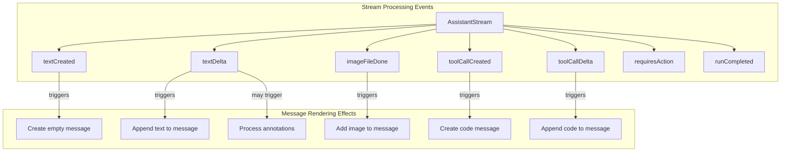

<!-- source: DeepWiki mcp.deepwiki.com · repo openai/openai-assistants-quickstart · page 3.2 Message Rendering · fetched 2026-10-26 -->

# Message Rendering

<details>
<summary>Relevant source files</summary>

The following files were used as context for generating this wiki page:

- [app/components/chat.module.css](app/components/chat.module.css)
- [app/components/chat.tsx](app/components/chat.tsx)

</details>


This document details how different message types are rendered in the OpenAI Assistants Quickstart application. It focuses on the components, styling, and processes involved in displaying messages in the chat interface. For information about the overall Chat component structure and state management, see [Chat Component](#3.1).

## Message Type Overview

The application supports three distinct message types, each with specialized rendering:



Sources: [app/components/chat.tsx:11-52]()

## Message Components

### Message Types Structure

The application defines a `MessageProps` interface that specifies the properties required for rendering messages:

```typescript
type MessageProps = {
  role: "user" | "assistant" | "code";
  text: string;
};
```

A factory component `Message` determines which specific message component to render based on the role property:



Sources: [app/components/chat.tsx:11-52]()

### Component Implementation

#### User Message

User messages are rendered as simple text in a styled container.

```typescript
const UserMessage = ({ text }: { text: string }) => {
  return <div className={styles.userMessage}>{text}</div>;
};
```

#### Assistant Message

Assistant messages support Markdown for rich text formatting, allowing for formatted text, links, lists, and other Markdown features.

```typescript
const AssistantMessage = ({ text }: { text: string }) => {
  return (
    <div className={styles.assistantMessage}>
      <Markdown>{text}</Markdown>
    </div>
  );
};
```

#### Code Message

Code messages provide line-numbered display for code blocks:

```typescript
const CodeMessage = ({ text }: { text: string }) => {
  return (
    <div className={styles.codeMessage}>
      {text.split("\n").map((line, index) => (
        <div key={index}>
          <span>{`${index + 1}. `}</span>
          {line}
        </div>
      ))}
    </div>
  );
};
```

Sources: [app/components/chat.tsx:16-39]()

## Visual Styling

Messages are styled with CSS to provide visual distinction between different message types.

### Common Styling

All message types share some base styling properties:

```css
.userMessage, .assistantMessage, .codeMessage {
  margin: 8px 0;
  padding: 8px 16px;
  align-self: flex-start;
  border-radius: 15px;
  max-width: 80%;
  overflow-wrap: break-word;
}
```

### Type-Specific Styling

Each message type has unique styling to differentiate its appearance:

| Message Type | Alignment | Background Color | Text Color | Special Features |
|--------------|-----------|------------------|------------|------------------|
| User | Right-aligned (`align-self: flex-end`) | Black | White | None |
| Assistant | Left-aligned | Light gray (#efefef) | Default | Markdown support |
| Code | Left-aligned | Light gray (#e9e9e9) | Default | Monospace font, Line numbers |



Sources: [app/components/chat.module.css:55-96]()

### Image Rendering

Images within assistant messages have special styling:

```css
.assistantMessage img {
  max-width: 100%;
  margin: 8px 0px 8px 0px;
  border-radius: 8px;
}
```

Sources: [app/components/chat.module.css:66-70]()

## Special Content Handling

### Image Rendering

Images are injected into assistant messages using Markdown image syntax:

```typescript
const handleImageFileDone = (image) => {
  appendToLastMessage(`\n\n`);
}
```

When an image is created by the assistant, it's added to the message as a Markdown image link that points to the API endpoint for retrieving the file.

Sources: [app/components/chat.tsx:152-154]()

### File Path Annotations

The application handles file path annotations by replacing references with API URLs:

```typescript
const annotateLastMessage = (annotations) => {
  // ...
  annotations.forEach((annotation) => {
    if (annotation.type === 'file_path') {
      updatedLastMessage.text = updatedLastMessage.text.replaceAll(
        annotation.text,
        `/api/files/${annotation.file_path.file_id}`
      );
    }
  })
  // ...
}
```

This process transforms file path references into clickable links that can be used to access the referenced files.

Sources: [app/components/chat.tsx:232-249]()

## Message Rendering Process



Sources: [app/components/chat.tsx:89-101](), [app/components/chat.tsx:121-132](), [app/components/chat.tsx:252-258]()

## Stream Processing

The application handles streaming responses to provide a real-time typing effect:



### Event Handlers

The application uses several event handlers to process streaming content:

1. **Text Created**: Creates a new empty assistant message
   ```typescript
   const handleTextCreated = () => {
     appendMessage("assistant", "");
   };
   ```

2. **Text Delta**: Appends text fragments to the current message
   ```typescript
   const handleTextDelta = (delta) => {
     if (delta.value != null) {
       appendToLastMessage(delta.value);
     };
     if (delta.annotations != null) {
       annotateLastMessage(delta.annotations);
     }
   };
   ```

3. **Image File Done**: Adds images to the message
   ```typescript
   const handleImageFileDone = (image) => {
     appendToLastMessage(`\n\n`);
   }
   ```

4. **Tool Call Events**: Handle code interpreter output
   ```typescript
   const toolCallCreated = (toolCall) => {
     if (toolCall.type != "code_interpreter") return;
     appendMessage("code", "");
   };
   
   const toolCallDelta = (delta, snapshot) => {
     if (delta.type != "code_interpreter") return;
     if (!delta.code_interpreter.input) return;
     appendToLastMessage(delta.code_interpreter.input);
   };
   ```

Sources: [app/components/chat.tsx:137-167]()

### Message Manipulation Utilities

The application uses utility functions to manage the message state:

1. **appendToLastMessage**: Adds text to the most recent message
   ```typescript
   const appendToLastMessage = (text) => {
     setMessages((prevMessages) => {
       const lastMessage = prevMessages[prevMessages.length - 1];
       const updatedLastMessage = {
         ...lastMessage,
         text: lastMessage.text + text,
       };
       return [...prevMessages.slice(0, -1), updatedLastMessage];
     });
   };
   ```

2. **appendMessage**: Adds a new message to the chat
   ```typescript
   const appendMessage = (role, text) => {
     setMessages((prevMessages) => [...prevMessages, { role, text }]);
   };
   ```

These utilities work together to create a smooth, real-time message rendering experience.

Sources: [app/components/chat.tsx:217-230]()

## Integration with Chat Component

Messages are rendered in the Chat component using the map function:

```typescript
<div className={styles.messages}>
  {messages.map((msg, index) => (
    <Message key={index} role={msg.role} text={msg.text} />
  ))}
  <div ref={messagesEndRef} />
</div>
```

A ref (`messagesEndRef`) is used to automatically scroll to the newest message when content updates.

Sources: [app/components/chat.tsx:252-258]()

---

