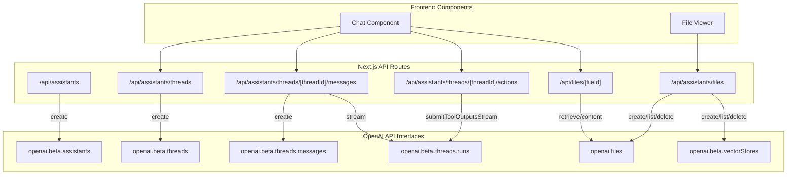
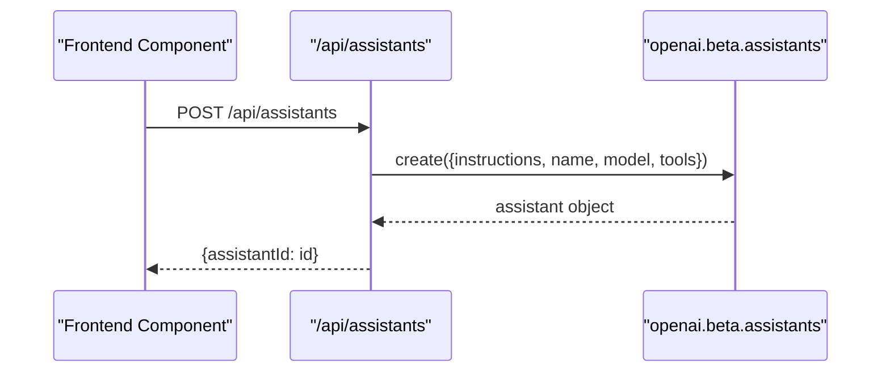
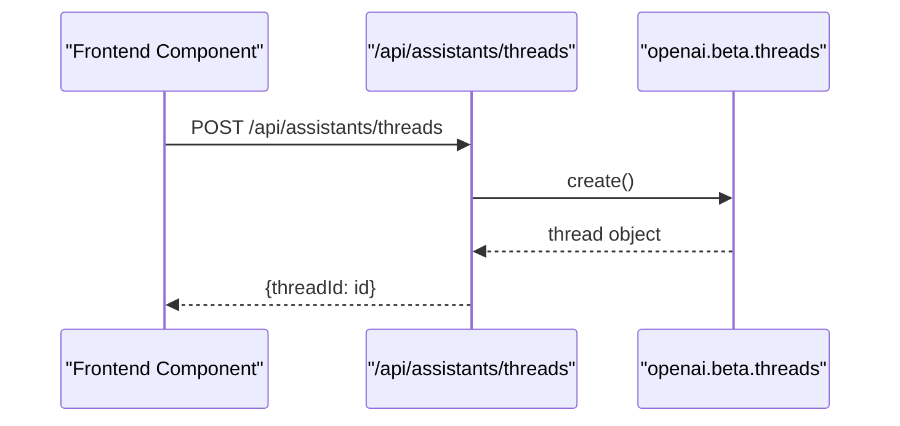
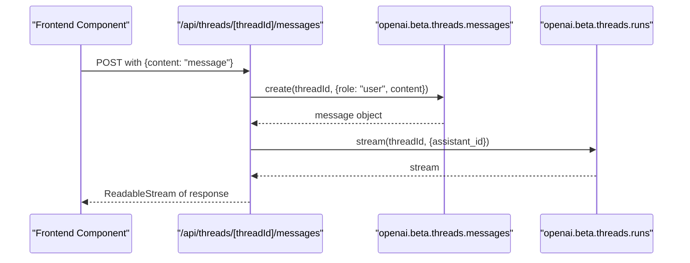
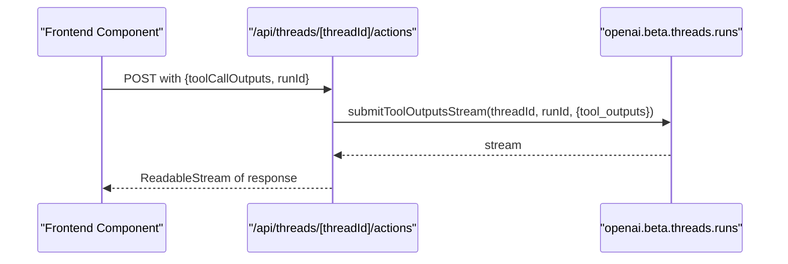
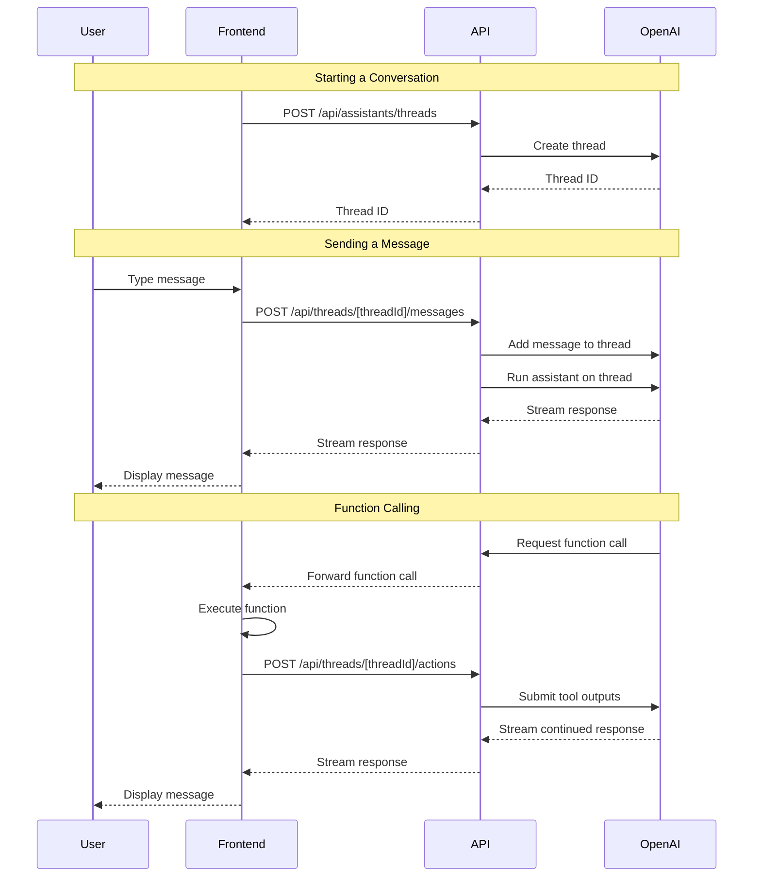

<!-- source: DeepWiki mcp.deepwiki.com · repo openai/openai-assistants-quickstart · page 4 API Endpoints · fetched 2026-10-26 -->

# API Endpoints

<details>
<summary>Relevant source files</summary>

The following files were used as context for generating this wiki page:

- [app/api/assistants/route.ts](app/api/assistants/route.ts)
- [app/api/assistants/threads/[threadId]/actions/route.ts](app/api/assistants/threads/[threadId]/actions/route.ts)
- [app/api/assistants/threads/[threadId]/messages/route.ts](app/api/assistants/threads/[threadId]/messages/route.ts)
- [app/api/assistants/threads/route.ts](app/api/assistants/threads/route.ts)

</details>


This page documents the API endpoints implemented in the OpenAI Assistants Quickstart application. These endpoints serve as a bridge between the frontend components and the OpenAI Assistants API, enabling operations like creating assistants, managing conversation threads, sending messages, and processing function calls. For information about the frontend components that consume these endpoints, see [Frontend Components](#3).

## API Routes Overview

The application implements several Next.js API routes that map to corresponding OpenAI API operations:



Sources: System architecture diagrams provided in the context

The table below summarizes the API endpoints implemented in the codebase:

| Endpoint | HTTP Method | Purpose |
|----------|-------------|---------|
| `/api/assistants` | POST | Create a new assistant with tools |
| `/api/assistants/threads` | POST | Create a new conversation thread |
| `/api/assistants/threads/[threadId]/messages` | POST | Send a message and stream response |
| `/api/assistants/threads/[threadId]/actions` | POST | Submit tool outputs for function calls |
| `/api/assistants/files` | Various | File management (not in provided snippets) |
| `/api/files/[fileId]` | GET | File download (not in provided snippets) |

Sources: [app/api/assistants/route.ts](), [app/api/assistants/threads/route.ts](), [app/api/assistants/threads/[threadId]/messages/route.ts](), [app/api/assistants/threads/[threadId]/actions/route.ts]()

## Assistant Creation Endpoint

The `/api/assistants` endpoint creates a new OpenAI Assistant with specific configuration settings.



### Implementation Details

The endpoint is implemented as a POST handler that:
- Creates a new assistant using `openai.beta.assistants.create()`
- Configures the assistant with specific settings
- Returns the assistant ID to the client

```javascript
// Configuration used in assistant creation
{
  instructions: "You are a helpful assistant.",
  name: "Quickstart Assistant",
  model: "gpt-4o",
  tools: [
    { type: "code_interpreter" },
    {
      type: "function",
      function: {
        name: "get_weather",
        description: "Determine weather in my location",
        parameters: {
          type: "object",
          properties: {
            location: {
              type: "string",
              description: "The city and state e.g. San Francisco, CA",
            },
            unit: {
              type: "string",
              enum: ["c", "f"],
            },
          },
          required: ["location"],
        },
      },
    },
    { type: "file_search" },
  ],
}
```

Sources: [app/api/assistants/route.ts:6-38]()

## Thread Creation Endpoint

The `/api/assistants/threads` endpoint creates a new conversation thread for interactions between the user and the assistant.



### Implementation Details

The endpoint is implemented as a simple POST handler that:
- Creates an empty thread using `openai.beta.threads.create()`
- Returns the thread ID to the client

This implementation is straightforward and serves as a container for the conversation history between the user and the assistant.

Sources: [app/api/assistants/threads/route.ts:6-9]()

## Message Management Endpoint

The `/api/assistants/threads/[threadId]/messages` endpoint handles sending a message to a thread and receiving the assistant's response.



### Implementation Details

The endpoint performs three key operations:
1. Takes a user message from the request body
2. Adds the message to the specified thread with role "user"
3. Starts a streaming run with the configured assistant ID
4. Returns a ReadableStream of the assistant's response

The assistant ID is imported from `app/assistant-config.ts` rather than being passed as a parameter, which means the endpoint always uses the same assistant for all conversations.

Sources: [app/api/assistants/threads/[threadId]/messages/route.ts:7-20]()

## Function Calling / Tool Outputs Endpoint

The `/api/assistants/threads/[threadId]/actions` endpoint handles submitting tool outputs for function calls requested by the assistant.



### Implementation Details

When the assistant makes a function call (such as the `get_weather` function defined in the assistant), the client executes the function locally and submits the result through this endpoint. The endpoint:

1. Accepts a POST request with:
   - `toolCallOutputs`: An array of outputs from tool calls
   - `runId`: The ID of the current run
2. Forwards these outputs to the OpenAI API using `submitToolOutputsStream`
3. Returns a ReadableStream of the assistant's continued response

Sources: [app/api/assistants/threads/[threadId]/actions/route.ts:4-15]()

## Conversation Data Flow

The following sequence diagram illustrates how these API endpoints work together during a typical conversation:



Sources: System architecture diagrams provided in the context, [app/api/assistants/threads/route.ts](), [app/api/assistants/threads/[threadId]/messages/route.ts](), [app/api/assistants/threads/[threadId]/actions/route.ts]()

## API Runtime Configuration

Each of these API routes specifies the Node.js runtime (rather than Edge runtime) using the following configuration:

```javascript
export const runtime = "nodejs";
```

This ensures that the API routes have access to the full Node.js environment, which is necessary for interacting with the OpenAI SDK.

Sources: [app/api/assistants/route.ts:3](), [app/api/assistants/threads/route.ts:3](), [app/api/assistants/threads/[threadId]/messages/route.ts:4]()

This architecture enables a seamless conversation experience with real-time streaming of the assistant's responses and support for function calling to perform actions requested by the assistant.

---

